# SH-3 Architecture Specification

> Version 2.1
>
> Status: Draft
>
> Target: SH-3 Complete Edition
>
> Document Type: Architecture Specification

---

# Table of Contents

1. Project Overview
2. Vision
3. Design Philosophy
4. Core Design Principles
5. Non-Goals
6. Terminology
7. Layered Architecture
8. Module Dependency Rules
9. System Lifecycle
10. Event-Driven Architecture
11. Foundation Layer
12. Infrastructure Layer
13. Runtime Layer
14. Services Layer
15. Kernel Layer
16. Deployment Layer
17. Extension System
18. Security Model
19. Testing Strategy
20. Future Roadmap

---

# 1. Project Overview

## 1.1 Purpose

SH-3 (System Hypervisor Generation 3) is an event-driven, modular AI Operating System framework designed for building autonomous, extensible, and production-ready intelligent systems.

Unlike conventional AI libraries, SH-3 does not focus on a single model or algorithm. Instead, it provides a complete execution architecture capable of coordinating cognition, memory, planning, learning, optimization, persistence, and deployment as independent subsystems.

The framework emphasizes deterministic behavior, modular composition, strict typing, and long-term maintainability.

---

## 1.2 Objectives

The primary objectives of SH-3 are:

- Build an AI Operating System rather than a standalone AI model.
- Separate every subsystem into independent, replaceable modules.
- Standardize communication through events.
- Eliminate circular dependencies.
- Maximize maintainability.
- Enable future distributed execution.
- Provide production-grade architecture.
- Ensure deterministic execution whenever possible.

---

## 1.3 Scope

SH-3 provides architecture for:

- Configuration
- Runtime
- Event Management
- Memory Systems
- Planning
- Policy Decision
- Learning
- Optimization
- Self-Healing
- Persistence
- Deployment
- Plugin Integration
- Diagnostics
- Metrics
- Logging

SH-3 intentionally does not prescribe any specific machine learning framework or large language model implementation.

Instead, AI models are treated as interchangeable services.

---

## 1.4 Design Priorities

Design decisions shall always follow the priority order below.

1. Correctness
2. Maintainability
3. Predictability
4. Replaceability
5. Performance
6. Developer Experience

Performance optimizations must never reduce architectural clarity.

---

## 1.5 Target Environment

SH-3 targets:

- Python 3.12+
- Linux
- Windows
- macOS
- Docker
- Kubernetes
- Cloud Deployment
- Local Execution

Distributed execution is considered a future extension and is not required by the initial implementation.

---

# 2. Vision

## 2.1 Long-Term Vision

The long-term goal of SH-3 is to become a reusable operating framework for intelligent software systems.

Every capability shall exist as an independent service connected only through well-defined interfaces and events.

No subsystem shall rely on implementation details of another subsystem.

---

## 2.2 Architectural Vision

The framework shall support:

- Single-process execution
- Multi-thread execution
- Multi-process execution
- Distributed execution
- Plugin-based extension
- Runtime service replacement
- Incremental capability expansion

No architectural redesign should be required when scaling between these environments.

---

## 2.3 Engineering Philosophy

The architecture prioritizes engineering discipline over implementation convenience.

Short-term implementation simplicity must never compromise long-term maintainability.

Every module should remain understandable in isolation.

Every public API should remain stable whenever practical.

---

# 3. Design Philosophy

The following principles define every component inside SH-3.

## 3.1 Everything is Event Driven

Communication between major subsystems occurs through events.

Direct dependencies should be minimized.

Subsystems publish information.

Interested subsystems subscribe.

The publisher does not know who consumes the event.

---

## 3.2 Everything is Replaceable

Every subsystem must be replaceable without modifying unrelated modules.

Examples include:

- Storage backend replacement
- Planner replacement
- Memory implementation replacement
- Policy replacement
- Learning strategy replacement
- Runtime replacement

Replacement should require configuration rather than code modification.

---

## 3.3 Everything is Typed

Public APIs shall expose explicit types.

Use of `Any` should be minimized.

Domain-specific aliases and protocols shall be preferred over generic dictionaries whenever practical.

---

## 3.4 Everything is Testable

Every component must support isolated testing.

Dependencies shall be injected.

Hidden global state should be avoided.

Components should be executable without requiring unrelated infrastructure.

---

## 3.5 Composition Over Inheritance

Composition is the preferred mechanism for building functionality.

Inheritance shall only be used where polymorphism clearly improves maintainability.

---

## 3.6 Explicit Dependencies

Dependencies must always be visible.

Constructor injection is preferred.

Hidden service locators should be avoided except where explicitly documented.

---

## 3.7 Deterministic Execution

Given identical inputs, configuration, and state, deterministic components shall produce identical outputs.

Sources of randomness must be isolated and configurable.

---

## 3.8 Modular Independence

Each package should be understandable without reading the entire project.

Internal implementation details must not leak across package boundaries.

Public interfaces define contracts.

Private implementations remain replaceable.

---

## 3.9 Production First

Prototype-oriented design is explicitly rejected.

Every subsystem shall be designed as if it will operate continuously in production environments.

Reliability takes precedence over experimental convenience.

---

## 3.10 Evolution Without Rewrite

SH-3 is expected to evolve over many years.

Future expansion shall occur by adding modules rather than rewriting existing architecture.

Stable interfaces are considered long-term assets.

# 4. Core Design Principles

The following architectural principles are mandatory throughout the SH-3 ecosystem.

Every implementation, regardless of subsystem, shall comply with these rules unless explicitly documented otherwise.

---

## 4.1 Single Responsibility

Every module shall have one clearly defined responsibility.

Responsibilities must never overlap.

Incorrect:

- Storage performing planning
- Planner performing persistence
- Runtime managing configuration
- Kernel executing business logic

Correct:

- Runtime manages execution.
- Planner produces plans.
- Memory stores knowledge.
- EventBus distributes events.
- Storage persists data.

---

## 4.2 Separation of Concerns

Each layer solves a different problem.

The architecture intentionally separates:

- Data
- Behavior
- Coordination
- Communication
- Persistence
- Execution

Mixing responsibilities across these domains is prohibited.

---

## 4.3 Dependency Direction

Dependencies always point downward.

```text
Application
    │
Deployment
    │
Kernel
    │
Services
    │
Runtime
    │
Infrastructure
    │
Foundation
```

Lower layers never depend on higher layers.

No exceptions.

---

## 4.4 Stable Public Interfaces

Public APIs represent contracts.

Implementation details may change.

Public behavior should remain stable whenever practical.

Breaking changes require version updates.

---

## 4.5 Interface Before Implementation

Subsystems communicate through contracts rather than concrete implementations.

Preferred examples include:

- Protocol
- ABC
- Generic
- Callable
- Typed aliases

Concrete classes should remain internal whenever possible.

---

## 4.6 Explicit State

Application state should always be explicit.

Avoid:

- Hidden globals
- Module-level mutable state
- Implicit caches

Prefer:

- Context objects
- Immutable snapshots
- Dependency injection

---

## 4.7 Immutable Data

Immutable objects are preferred whenever mutation is unnecessary.

Typical immutable objects include:

- Events
- Configuration
- Snapshots
- Metadata
- Identifiers

Mutable objects should clearly document ownership and lifecycle.

---

## 4.8 Thread Safety

Thread safety is a fundamental design goal.

Components should either:

- be immutable,

or

- synchronize internal mutation.

Thread safety must never rely on undocumented assumptions.

---

## 4.9 Predictable Failure

Failures should be explicit.

Avoid silent recovery.

Every recoverable failure should produce:

- diagnostic information
- metrics
- trace records
- structured exceptions

Unexpected failures should never be ignored.

---

## 4.10 Observability

Every important subsystem should expose operational visibility.

Examples include:

- Metrics
- Logging
- Tracing
- Health checks
- Runtime statistics

Production systems cannot be maintained without observability.

---

# 5. Non-Goals

Understanding what SH-3 intentionally does not provide is equally important.

---

## 5.1 SH-3 is not an LLM

Language models are external components.

SH-3 coordinates them.

SH-3 does not implement transformer architectures.

---

## 5.2 SH-3 is not a Machine Learning Framework

Training algorithms belong to replaceable services.

PyTorch

TensorFlow

JAX

ONNX Runtime

may all be integrated.

None are mandatory.

---

## 5.3 SH-3 is not tied to one vendor

No dependency should assume:

- OpenAI
- Anthropic
- Google
- Microsoft
- AWS
- Azure

Vendor neutrality is a design objective.

---

## 5.4 SH-3 is not a Web Framework

Web APIs belong to adapters.

The kernel has no knowledge of HTTP.

---

## 5.5 SH-3 is not an ORM

Database interaction belongs inside Storage.

Higher layers should not know persistence details.

---

## 5.6 SH-3 is not a Workflow Engine

Execution pipelines exist.

Business workflows do not.

Those belong to application-specific code.

---

# 6. Terminology

The following terms are used consistently throughout the project.

---

## 6.1 Layer

A layer is a logical architectural boundary.

Layers communicate only through defined interfaces.

---

## 6.2 Module

A module is a cohesive implementation unit.

Examples:

- EventBus
- Planner
- Memory
- Storage

---

## 6.3 Service

A service performs business capabilities.

Examples:

- Learning
- Planning
- Optimization
- Policy
- Healing

Services contain intelligence.

---

## 6.4 Component

A reusable implementation unit.

Components may exist inside modules.

They are generally not public APIs.

---

## 6.5 Event

An immutable message representing something that has already happened.

Events communicate information.

Events never request behavior.

Examples:

- GoalCreated
- PlanGenerated
- MemoryStored
- RuntimeStarted
- SnapshotSaved

---

## 6.6 Command

A request asking another subsystem to perform work.

Commands differ from Events.

Commands express intent.

Events express history.

---

## 6.7 Context

Context contains execution state shared within one execution scope.

Context is temporary.

Persistent information belongs elsewhere.

---

## 6.8 Snapshot

A Snapshot represents an immutable capture of system state.

Snapshots support:

- recovery
- rollback
- persistence
- diagnostics

---

## 6.9 Registry

A Registry stores discoverable runtime objects.

Examples:

- Services
- Plugins
- Pipelines
- Policies

Registries do not own object lifecycles.

---

## 6.10 Plugin

A Plugin extends SH-3 without modifying existing modules.

Plugins communicate only through public interfaces.

Internal implementation access is prohibited.

---

# 7. Layered Architecture

SH-3 adopts a strict layered architecture.

Every layer has one responsibility.

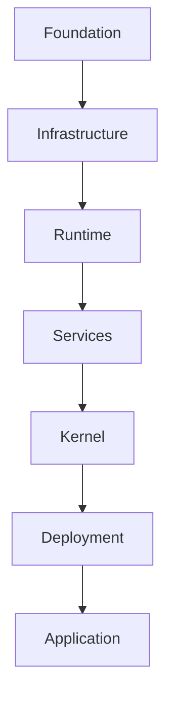

The arrows represent dependency direction.

Execution order is independent of dependency order.

---

## 7.1 Foundation

Foundation provides universal building blocks.

Responsibilities include:

- Types
- Utilities
- Enumerations
- Exceptions
- Logging primitives
- Configuration primitives

Foundation depends on nothing inside SH-3.

It is the lowest architectural layer.

---

## 7.2 Infrastructure

Infrastructure provides reusable runtime facilities.

Typical modules include:

- EventBus
- Storage
- Metrics
- Tracing
- Plugin Manager

Infrastructure may depend only on Foundation.

Infrastructure never depends on Runtime or Services.

---

## 7.3 Runtime

Runtime controls execution.

Responsibilities include:

- lifecycle management
- execution context
- scheduling
- startup
- shutdown
- resource coordination

Runtime depends only on Infrastructure and Foundation.

Business intelligence does not belong here.

---

## 7.4 Services

Services implement intelligence.

Examples include:

- Planner
- Memory
- Policy
- Learning
- Optimizer
- Self-Healing

Services are unaware of Deployment.

They communicate using Runtime and Infrastructure facilities.

---

## 7.5 Kernel

Kernel coordinates services.

Kernel does not implement intelligence.

Kernel decides:

- when
- where
- how

services cooperate.

Kernel is intentionally lightweight.

---

## 7.6 Deployment

Deployment packages SH-3 for execution.

Examples:

- Local execution
- Docker
- Kubernetes
- Cloud
- Embedded runtime

Deployment contains no business logic.

Its responsibility is composition.

---

# 8. Module Dependency Rules

Module dependencies define how software components interact across the SH-3 ecosystem.

These rules are mandatory.

Violations introduce architectural debt and shall be corrected before release.

---

## 8.1 Dependency Hierarchy

Every module belongs to exactly one architectural layer.

Dependencies always point toward lower layers.

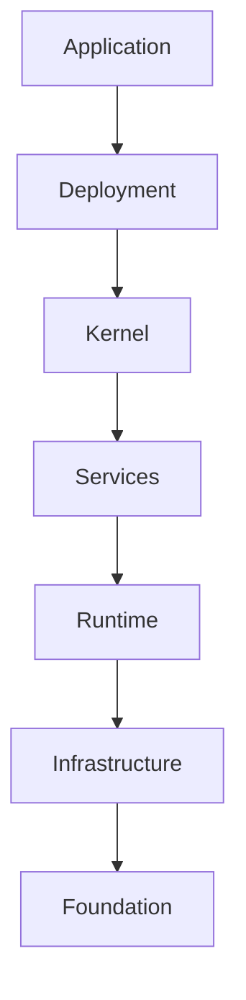

A module may depend on:

- modules within the same layer (only when explicitly allowed)
- modules in lower layers

A module must never depend on higher layers.

---

## 8.2 Circular Dependencies

Circular dependencies are prohibited.

Incorrect:

```text
Planner
    ↓
Memory
    ↓
Planner
```

Correct:

```text
Planner
    ↓
EventBus
    ↓
Memory
```

Communication should occur through events or public contracts.

---

## 8.3 Internal Visibility

Every package contains two categories of APIs.

Public APIs

- Stable
- Documented
- Versioned

Internal APIs

- Private
- Replaceable
- No compatibility guarantees

Only public APIs may be used by other packages.

---

## 8.4 Package Independence

Packages should remain independently understandable.

A developer should be capable of understanding:

- foundation
- infrastructure
- runtime

without reading the entire project.

Large packages should be decomposed into cohesive modules.

---

## 8.5 Shared Utilities

Reusable functionality belongs inside Foundation.

Examples:

- hashing
- validation
- serialization
- path handling
- time utilities
- immutable collections

Utility duplication is prohibited.

---

## 8.6 Cross-Service Communication

Services communicate using:

- Events
- Runtime Context
- Public Interfaces

Direct manipulation of another service's internal state is prohibited.

---

## 8.7 Dependency Injection

All replaceable dependencies should be injected.

Examples:

- Storage
- Planner
- Policy
- EventBus
- Logger

Avoid constructing concrete implementations inside business logic.

Preferred:

```text
Planner
    ↓
Storage Protocol
```

Avoid:

```text
Planner
    ↓
SQLiteStorage()
```

---

## 8.8 Service Registry

Runtime-discoverable services are registered through the Service Registry.

The registry provides discovery.

It does not own lifecycle management.

Registration should occur during initialization.

Removal should occur during shutdown.

---

## 8.9 Plugin Isolation

Plugins may depend on public SH-3 APIs.

Core modules must never depend on plugins.

Dependency direction:

```text
Plugin
    ↓
Public API
```

Never:

```text
Kernel
    ↓
Specific Plugin
```

---

## 8.10 External Libraries

External dependencies should be isolated.

Examples:

- PyTorch
- Redis
- SQLite
- FAISS
- NumPy

These libraries should be wrapped behind adapters.

Business logic must not directly depend on vendor-specific APIs.

---

# 9. System Lifecycle

The lifecycle defines how SH-3 starts, operates, and terminates.

Every execution follows the same sequence.

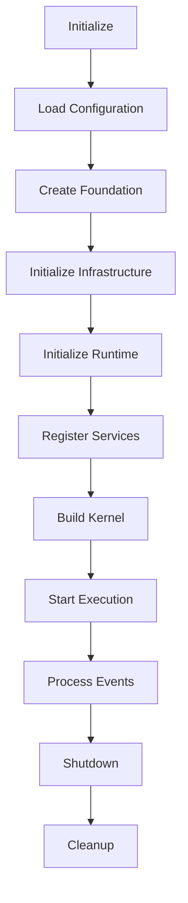

---

## 9.1 Initialization Phase

Initialization prepares the runtime.

Responsibilities include:

- configuration loading
- identifier generation
- logger initialization
- metrics initialization
- storage initialization
- event bus creation

No business logic executes during initialization.

---

## 9.2 Bootstrap Phase

Bootstrap assembles the dependency graph.

Typical actions include:

- service creation
- dependency injection
- protocol binding
- plugin discovery
- registry population

Bootstrap should fail fast.

Partial initialization is discouraged.

---

## 9.3 Runtime Start

Once initialization completes:

- Runtime starts.
- EventBus becomes active.
- Services subscribe to events.
- Scheduler begins execution.

The system is now operational.

---

## 9.4 Operational Phase

Normal execution consists entirely of event processing.

Typical sequence:

1. Event published
2. Event routed
3. Subscribers execute
4. New events generated
5. Metrics updated
6. Trace recorded

The architecture favors asynchronous coordination while allowing deterministic synchronous execution where required.

---

## 9.5 Shutdown Phase

Shutdown occurs in reverse dependency order.

Sequence:

1. Stop accepting work.
2. Flush event queues.
3. Persist pending state.
4. Close services.
5. Release runtime resources.
6. Shutdown infrastructure.

Shutdown should be graceful whenever possible.

---

## 9.6 Recovery

Recovery restores execution after failure.

Recovery may involve:

- snapshot restoration
- storage replay
- event replay
- plugin reload
- service restart

Recovery strategies are implementation-dependent.

The architecture only defines extension points.

---

## 9.7 Health Monitoring

Every long-running subsystem should expose health information.

Health states:

- Healthy
- Degraded
- Recovering
- Failed
- Offline

Health changes should generate events.

---

## 9.8 Lifecycle Events

Major lifecycle transitions generate immutable events.

Examples:

- RuntimeInitializing
- RuntimeInitialized
- RuntimeStarted
- RuntimeStopping
- RuntimeStopped

Subsystems may subscribe without introducing direct dependencies.

---

# 10. Event-Driven Architecture

The Event System is the communication backbone of SH-3.

Subsystems exchange information through immutable events.

This minimizes coupling while maximizing extensibility.

---

## 10.1 Design Goals

The Event System shall provide:

- loose coupling
- deterministic dispatch
- thread safety
- observability
- extensibility
- replay capability

Events represent facts.

They never represent requests.

---

## 10.2 Event Principles

Every event shall be:

- immutable
- timestamped
- uniquely identified
- serializable
- traceable

Events should not contain executable behavior.

They contain only data.

---

## 10.3 Event Metadata

Every event includes metadata.

Typical fields include:

- Event ID
- Event Name
- Timestamp
- Trace ID
- Source
- Version
- Priority
- Payload

Metadata should remain stable across implementations.

---

## 10.4 EventBus Responsibilities

The EventBus is responsible for:

- publish
- subscribe
- unsubscribe
- dispatch
- filtering
- prioritization
- tracing
- metrics
- history

The EventBus is not responsible for business logic.

---

## 10.5 Publisher Responsibilities

Publishers should:

- create immutable events
- publish once
- avoid subscriber knowledge
- avoid execution assumptions

Publishers never invoke subscribers directly.

---

## 10.6 Subscriber Responsibilities

Subscribers should:

- process events
- avoid blocking
- publish follow-up events when appropriate
- remain idempotent whenever practical

Subscribers should never mutate incoming events.

---

## 10.7 Event Ordering

Ordering guarantees are implementation-defined.

However, for a single synchronous dispatcher:

- FIFO ordering is recommended.
- Priority ordering may override FIFO.
- Ordering rules must be deterministic.

Behavior must be documented.

---

## 10.8 Event Filtering

Subscribers may register filters.

Filtering should occur before handler execution.

Typical filters include:

- event type
- source
- priority
- tags
- correlation identifiers

Filtering should be inexpensive.

---

## 10.9 Event Replay

Infrastructure may support replay.

Replay enables:

- debugging
- testing
- recovery
- simulation

Replay must preserve original metadata.

Synthetic events should be clearly identified.

---

## 10.10 Event Versioning

Events evolve over time.

Backward compatibility should be preserved whenever practical.

Breaking schema changes require version increments.

Consumers should validate event versions before processing.

---

# 11. Foundation Layer

The Foundation Layer is the lowest architectural layer of SH-3.

It contains the fundamental building blocks required by every higher layer.

Foundation must remain lightweight, deterministic, and independent.

No Foundation module may depend on Runtime, Services, Kernel, Deployment, or Application code.

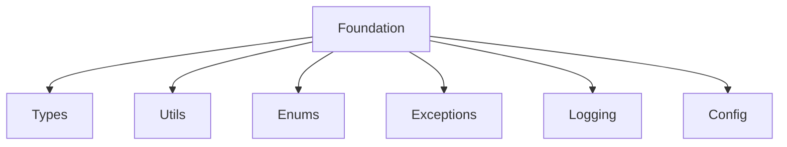

---

## 11.1 Responsibilities

Foundation is responsible for:

- primitive data structures
- shared type definitions
- reusable utilities
- configuration primitives
- exception hierarchy
- logging abstractions
- identifier generation
- serialization primitives
- validation primitives

Foundation is intentionally free of business logic.

---

## 11.2 Design Objectives

Foundation shall satisfy the following requirements.

- Zero circular dependencies.
- Minimal external dependencies.
- High test coverage.
- Platform independence.
- Deterministic behavior.
- Thread-safe implementations whenever practical.

Every module should remain reusable outside SH-3.

---

## 11.3 Package Structure

```text
foundation/
│
├── config/
├── enums/
├── exceptions/
├── logging/
├── types/
└── utils/
```

Each package owns one architectural responsibility.

---

## 11.4 Configuration

Configuration defines immutable system parameters.

Configuration objects should:

- validate themselves
- support serialization
- remain immutable after creation
- expose explicit defaults

Environment-specific configuration belongs to Deployment.

---

## 11.5 Types

The Types package defines domain-level type contracts.

Responsibilities include:

- aliases
- identifiers
- protocols
- primitives
- collections

No implementation logic should exist inside the Types package.

---

## 11.6 Utilities

Utilities provide reusable deterministic functionality.

Typical modules include:

```text
common.py
string.py
dict.py
list.py
json.py
path.py
time.py
hash.py
object.py
typing.py
validate.py
```

Utility modules must remain independent.

Shared implementations belong exclusively in `common.py`.

Duplicate utility implementations are prohibited.

---

## 11.7 Enumerations

Enumerations define stable symbolic constants.

Examples include:

- RuntimeState
- EventPriority
- HealthStatus
- LogLevel
- PluginState

Magic strings should be avoided.

---

## 11.8 Exceptions

Exceptions define the error taxonomy of SH-3.

Exception classes should describe architectural meaning rather than implementation details.

Example hierarchy:

```text
SH3Error
 ├── ConfigurationError
 ├── ValidationError
 ├── RuntimeError
 ├── StorageError
 ├── EventError
 ├── PluginError
 └── KernelError
```

Exceptions should carry structured diagnostic information.

---

## 11.9 Logging

Logging provides observability primitives.

The logging package defines:

- logger abstraction
- formatter
- context propagation
- structured records

Concrete logging providers remain replaceable.

---

## 11.10 Dependency Policy

Foundation may depend only on:

- Python Standard Library
- approved third-party libraries
- internal Foundation packages

Foundation must never depend on higher architectural layers.

---

# 12. Infrastructure Layer

Infrastructure provides reusable runtime capabilities shared by all higher layers.

Infrastructure contains mechanisms rather than intelligence.

It enables communication, persistence, monitoring, scheduling, and extension.

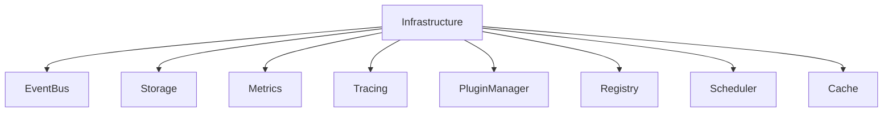

---

## 12.1 Responsibilities

Infrastructure provides:

- event routing
- persistence
- plugin discovery
- scheduling
- metrics
- tracing
- health monitoring
- caching
- synchronization

Infrastructure does not perform planning, learning, reasoning, or policy decisions.

---

## 12.2 Design Principles

Infrastructure components should:

- remain reusable
- avoid business knowledge
- expose stable interfaces
- support dependency injection
- provide deterministic APIs

Business behavior belongs to Services.

---

## 12.3 EventBus

EventBus is the central communication mechanism.

Responsibilities include:

- publish
- subscribe
- unsubscribe
- dispatch
- filtering
- priorities
- replay
- tracing
- metrics

The EventBus owns communication.

It does not own business execution.

---

## 12.4 Storage

Storage provides persistence abstractions.

Supported backends may include:

- memory
- SQLite
- PostgreSQL
- Redis
- object storage
- custom adapters

Consumers communicate through storage interfaces rather than backend-specific APIs.

---

## 12.5 Registry

The Registry stores discoverable runtime objects.

Typical registry contents include:

- services
- plugins
- schedulers
- pipelines
- policies

Registries provide lookup.

They do not manage object lifetimes.

---

## 12.6 Scheduler

Scheduler coordinates execution timing.

Responsibilities include:

- delayed execution
- recurring execution
- priority scheduling
- task cancellation
- lifecycle integration

Scheduling policies remain replaceable.

---

## 12.7 Metrics

Metrics expose operational measurements.

Typical metrics include:

- events published
- events processed
- handler latency
- queue depth
- memory usage
- storage latency
- scheduler utilization

Metrics should impose minimal runtime overhead.

---

## 12.8 Tracing

Tracing records execution flow.

Trace information should include:

- Trace ID
- Parent Trace ID
- Event ID
- Component
- Duration
- Status

Tracing must remain implementation-independent.

---

## 12.9 Plugin Manager

Plugin Manager discovers and loads extensions.

Responsibilities include:

- discovery
- validation
- registration
- activation
- deactivation
- unloading

Plugins execute only through public contracts.

---

## 12.10 Cache

Caching improves performance while preserving correctness.

Cache implementations should support:

- expiration
- invalidation
- statistics
- capacity limits

Caching must never alter observable behavior.

---

## 12.11 Health Monitoring

Infrastructure continuously evaluates component health.

Each component reports one of:

- Healthy
- Degraded
- Recovering
- Failed
- Offline

Health changes generate events.

---

## 12.12 Infrastructure Dependency Rules

Infrastructure may depend on:

- Foundation

Infrastructure must never depend on:

- Runtime
- Services
- Kernel
- Deployment
- Application

Infrastructure remains the stable platform upon which the remainder of SH-3 is constructed.

---

# 13. Runtime Layer

The Runtime Layer is responsible for executing, coordinating, and supervising the operational lifecycle of SH-3.

Unlike the Infrastructure Layer, which provides reusable mechanisms, the Runtime Layer governs how those mechanisms are assembled into a running system.

Runtime contains no domain intelligence.

Planning, learning, reasoning, and optimization belong exclusively to the Services Layer.

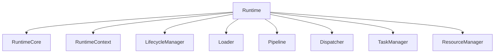

---

## 13.1 Responsibilities

The Runtime Layer is responsible for:

- system initialization
- execution context management
- lifecycle orchestration
- task execution
- pipeline execution
- resource coordination
- runtime supervision
- graceful shutdown

Runtime is execution-oriented.

It is not decision-oriented.

---

## 13.2 Runtime Core

Runtime Core represents the operational heart of the execution environment.

Responsibilities include:

- runtime state management
- service activation
- scheduler coordination
- event loop supervision
- execution monitoring

Runtime Core owns execution state.

It does not own business state.

---

## 13.3 Runtime Context

Runtime Context represents execution-local information.

Typical contents include:

- execution identifier
- trace identifier
- current configuration
- active services
- runtime metadata
- execution timestamp

Runtime Context is transient.

Persistent information belongs to Storage.

---

## 13.4 Lifecycle Manager

Lifecycle Manager coordinates major runtime transitions.

Supported lifecycle phases include:

1. Created
2. Initializing
3. Starting
4. Running
5. Pausing
6. Stopping
7. Stopped
8. Failed

Every transition should emit lifecycle events.

---

## 13.5 Loader

Loader constructs the runtime environment.

Responsibilities include:

- configuration loading
- dependency graph construction
- plugin discovery
- service instantiation
- registry population

The Loader performs composition.

It does not execute application logic.

---

## 13.6 Pipeline

Pipeline defines ordered execution stages.

Pipelines should support:

- sequential execution
- conditional execution
- branching
- composition
- cancellation

Each pipeline stage should expose explicit input and output contracts.

---

## 13.7 Dispatcher

Dispatcher executes work units.

Responsibilities include:

- dispatching events
- dispatching commands
- scheduling handlers
- collecting execution results

Dispatch policies should remain replaceable.

---

## 13.8 Task Manager

Task Manager supervises executable work.

Typical capabilities include:

- task creation
- cancellation
- timeout management
- prioritization
- retry policy

Tasks should remain independent whenever possible.

---

## 13.9 Resource Manager

Resource Manager coordinates runtime resources.

Managed resources may include:

- threads
- processes
- file handles
- network connections
- storage sessions
- caches

Resource ownership must always be explicit.

---

## 13.10 Runtime State

Runtime exposes a finite state model.

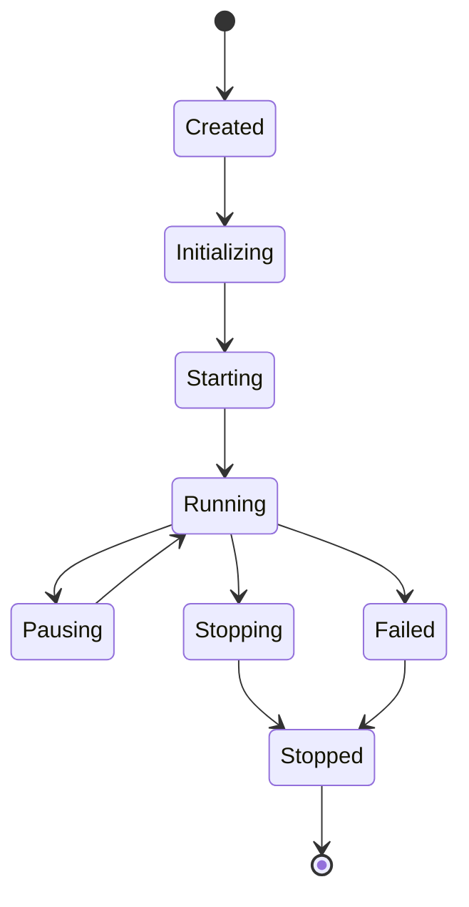

State transitions must be deterministic.

Unexpected transitions should raise runtime exceptions.

---

## 13.11 Runtime Events

Representative runtime events include:

- RuntimeCreated
- RuntimeInitializing
- RuntimeInitialized
- RuntimeStarted
- RuntimePaused
- RuntimeResumed
- RuntimeStopping
- RuntimeStopped
- RuntimeFailed

Runtime components should communicate through these events whenever practical.

---

## 13.12 Dependency Rules

Runtime may depend on:

- Foundation
- Infrastructure

Runtime must never depend directly on:

- Services
- Kernel
- Deployment
- Application

Business behavior enters Runtime only through injected services.

---

# 14. Services Layer

The Services Layer implements the intelligence of SH-3.

Every autonomous capability resides within this layer.

Services consume runtime facilities while remaining independent of deployment details.

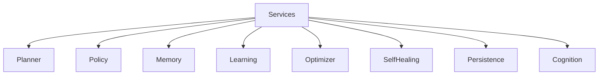

---

## 14.1 Responsibilities

Services are responsible for:

- planning
- memory management
- policy evaluation
- learning
- optimization
- reasoning
- self-healing
- persistence orchestration

Services transform information into intelligent behavior.

---

## 14.2 Planner

Planner produces executable plans.

Responsibilities include:

- goal decomposition
- action sequencing
- dependency analysis
- plan validation
- replanning

Planner does not execute plans.

Execution belongs to Runtime.

---

## 14.3 Policy

Policy determines which action should be selected.

Policy evaluation may consider:

- goals
- priorities
- constraints
- risk
- available resources
- runtime state

Policies should remain deterministic unless explicitly configured otherwise.

---

## 14.4 Memory

Memory manages knowledge across different time horizons.

Typical memory domains include:

- working memory
- episodic memory
- semantic memory
- procedural memory

Memory exposes retrieval and persistence through public interfaces.

Storage implementation details remain hidden.

---

## 14.5 Learning

Learning improves future system behavior.

Responsibilities include:

- feedback processing
- reward evaluation
- adaptation
- parameter updates
- experience management

Learning should never modify unrelated services directly.

Improvements are communicated through events or approved interfaces.

---

## 14.6 Optimizer

Optimizer improves operational efficiency.

Optimization targets may include:

- latency
- throughput
- resource usage
- cache efficiency
- scheduling decisions

Optimization must preserve observable correctness.

---

## 14.7 Self-Healing

Self-Healing detects and mitigates operational failures.

Typical capabilities include:

- anomaly detection
- automatic recovery
- restart coordination
- degraded-mode execution
- health restoration

Recovery actions should remain observable through events and logs.

---

## 14.8 Persistence

Persistence coordinates long-term state management.

Responsibilities include:

- snapshot creation
- checkpoint management
- state restoration
- migration coordination

Persistence orchestrates storage.

It does not implement storage engines.

---

## 14.9 Cognition

Cognition represents high-level reasoning coordination.

Responsibilities may include:

- objective analysis
- reasoning integration
- decision synthesis
- context fusion
- strategic evaluation

Cognition composes outputs from other services rather than replacing them.

---

## 14.10 Service Independence

Each service should remain independently replaceable.

Replacing one implementation should not require modifications to unrelated services.

Communication should occur through:

- Events
- Public Protocols
- Runtime Context

Internal implementation details must remain private.

---

## 14.11 Service Lifecycle

Every service follows a common lifecycle:

1. Constructed
2. Initialized
3. Registered
4. Started
5. Running
6. Stopping
7. Disposed

Lifecycle transitions should integrate with the Runtime Lifecycle Manager.

---

## 14.12 Dependency Rules

Services may depend on:

- Foundation
- Infrastructure
- Runtime

Services must never depend directly on:

- Kernel
- Deployment
- Application

Higher-level coordination belongs exclusively to the Kernel Layer.

---

# 15. Kernel Layer

The Kernel Layer is the orchestration center of SH-3.

Unlike the Services Layer, which implements intelligence, the Kernel coordinates how intelligent components cooperate to achieve system objectives.

The Kernel contains orchestration logic only.

It does not implement planning, learning, storage, reasoning, or optimization algorithms.

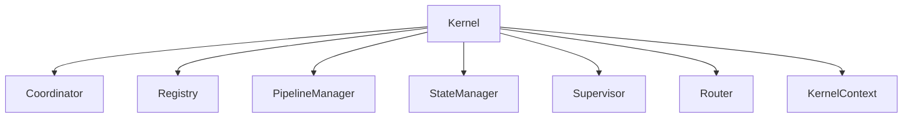

---

## 15.1 Responsibilities

The Kernel is responsible for:

- coordinating services
- managing execution flow
- maintaining global execution state
- routing requests
- supervising pipelines
- coordinating autonomous behavior
- exposing system-level APIs

The Kernel is intentionally lightweight.

---

## 15.2 Coordinator

The Coordinator is the central orchestration component.

Responsibilities include:

- receiving execution requests
- selecting execution pipelines
- coordinating services
- publishing orchestration events
- supervising execution progress

The Coordinator owns orchestration.

It never performs business computations itself.

---

## 15.3 Registry

The Kernel Registry provides discovery of runtime capabilities.

Typical registrations include:

- services
- pipelines
- plugins
- schedulers
- policies
- storage providers

The Registry is read-mostly during runtime.

Mutations should occur during initialization whenever possible.

---

## 15.4 Pipeline Manager

Pipeline Manager coordinates executable workflows.

Responsibilities include:

- pipeline construction
- execution ordering
- dependency validation
- cancellation
- recovery

Pipeline definitions should remain declarative.

---

## 15.5 State Manager

State Manager represents the current operational state of the Kernel.

Typical state includes:

- active execution
- active pipelines
- registered services
- runtime mode
- health summary

Business data does not belong here.

---

## 15.6 Supervisor

Supervisor monitors long-running execution.

Responsibilities include:

- timeout supervision
- health supervision
- recovery requests
- anomaly notification
- execution statistics

Supervisor coordinates with Self-Healing through events.

---

## 15.7 Router

Router selects execution targets.

Routing decisions may consider:

- service capability
- priority
- availability
- runtime load
- execution policy

Routing policies remain replaceable.

---

## 15.8 Kernel Context

Kernel Context contains system-wide execution metadata.

Typical contents include:

- system identifier
- execution identifier
- runtime mode
- trace identifier
- configuration snapshot

Kernel Context should remain immutable during one execution cycle whenever practical.

---

## 15.9 Kernel Events

Representative events include:

- PipelineStarted
- PipelineCompleted
- CoordinatorActivated
- CoordinatorStopped
- ServiceRegistered
- ServiceRemoved
- ExecutionCancelled

Kernel events describe orchestration state.

They do not represent business events.

---

## 15.10 Kernel Dependency Rules

Kernel may depend on:

- Foundation
- Infrastructure
- Runtime
- Services

Kernel must never depend on:

- Deployment
- Application

The Kernel remains deployment-independent.

---

# 16. Deployment Layer

Deployment assembles SH-3 into executable environments.

Deployment is responsible for composition rather than execution.

Deployment knows **what** to assemble.

Runtime knows **how** to execute.

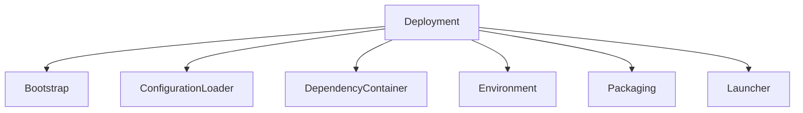

---

## 16.1 Responsibilities

Deployment is responsible for:

- environment configuration
- dependency composition
- runtime startup
- packaging
- distribution
- environment-specific adaptation

Deployment contains no business intelligence.

---

## 16.2 Bootstrap

Bootstrap constructs a complete SH-3 instance.

Responsibilities include:

- loading configuration
- creating infrastructure
- creating runtime
- registering services
- constructing kernel
- validating dependencies

Bootstrap should fail immediately upon configuration errors.

---

## 16.3 Configuration Loader

Configuration Loader reads configuration sources.

Supported sources may include:

- local files
- environment variables
- remote configuration providers
- encrypted secrets
- command-line parameters

Configuration merging should be deterministic.

---

## 16.4 Dependency Container

The Dependency Container performs dependency composition.

Responsibilities include:

- object creation
- dependency injection
- singleton management
- scoped lifetimes
- factory registration

The container should remain optional.

Manual composition must always be possible.

---

## 16.5 Environment

Deployment environments may include:

- Development
- Testing
- Staging
- Production
- Embedded

Behavior differences should be configuration-driven rather than implementation-driven.

---

## 16.6 Packaging

Packaging defines distributable artifacts.

Supported targets may include:

- Python package
- Docker image
- OCI image
- executable bundle
- embedded deployment

Packaging must not alter application behavior.

---

## 16.7 Launcher

Launcher represents the application entry point.

Responsibilities include:

- parsing startup arguments
- initializing bootstrap
- starting runtime
- handling termination signals

Launchers should remain minimal.

---

## 16.8 Deployment Profiles

Deployment profiles define reusable execution presets.

Example profiles:

- local
- docker
- kubernetes
- development
- production

Profiles should remain declarative.

---

## 16.9 Dependency Rules

Deployment may depend on every lower architectural layer.

Lower layers must never depend on Deployment.

Dependency direction remains strictly downward.

---

# 17. Extension System

SH-3 is designed to evolve without requiring modifications to the core architecture.

Extensions are implemented through the Plugin System.

The core framework must remain closed for modification while remaining open for extension.

---

## 17.1 Design Objectives

The Extension System provides:

- capability expansion
- runtime discovery
- implementation replacement
- optional functionality
- ecosystem growth

Extensions should require no modification of existing core modules.

---

## 17.2 Plugin Architecture

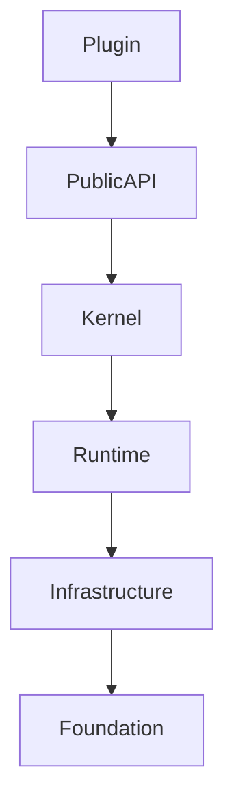

Plugins interact exclusively through public APIs.

Direct access to private implementation details is prohibited.

---

## 17.3 Plugin Lifecycle

Every plugin follows a standard lifecycle.

1. Discovered
2. Loaded
3. Validated
4. Registered
5. Initialized
6. Activated
7. Running
8. Deactivated
9. Unloaded

Each transition should generate lifecycle events.

---

## 17.4 Plugin Manifest

Every plugin should expose descriptive metadata.

Typical fields include:

- identifier
- version
- author
- capabilities
- dependencies
- compatibility
- license

Metadata should remain serializable.

---

## 17.5 Capability Registration

Plugins register capabilities rather than implementations.

Examples:

- planner
- storage
- embedding provider
- inference provider
- scheduler
- optimizer

Capability discovery remains implementation-independent.

---

## 17.6 Compatibility

Plugins should declare supported SH-3 versions.

Incompatible plugins should fail validation before activation.

Partial activation is discouraged.

---

## 17.7 Isolation

Plugins execute in logical isolation.

A plugin failure should not terminate unrelated plugins.

Isolation mechanisms remain implementation-dependent.

---

## 17.8 Extension Points

Stable extension points include:

- EventBus
- Registry
- Storage
- Planner
- Policy
- Memory
- Learning
- Optimizer
- Self-Healing

New extension points should preserve backward compatibility whenever practical.

---

# 18. Security Model

Security is a cross-cutting architectural concern.

Every subsystem must be designed assuming that untrusted input, unexpected failures, and hostile environments are possible.

Security shall be considered during architecture, implementation, testing, and deployment.

---

## 18.1 Security Principles

The SH-3 security model is based on the following principles.

- Least Privilege
- Defense in Depth
- Fail Secure
- Explicit Trust Boundaries
- Immutable Audit Records
- Secure by Default

Security features should be enabled by default whenever practical.

---

## 18.2 Trust Boundaries

The architecture distinguishes trusted and untrusted components.

Typical trusted components include:

- Foundation
- Infrastructure
- Runtime
- Kernel
- Core Services

Potentially untrusted components include:

- Plugins
- External APIs
- User input
- Network resources
- Third-party models

Crossing a trust boundary requires validation.

---

## 18.3 Input Validation

Every external input shall be validated before processing.

Validation includes:

- type validation
- schema validation
- size validation
- range validation
- encoding validation
- permission validation

Validation failures must produce structured exceptions.

---

## 18.4 Authentication

Authentication mechanisms are deployment-specific.

SH-3 provides extension points rather than concrete authentication providers.

Possible implementations include:

- API keys
- OAuth
- OpenID Connect
- Mutual TLS
- Token-based authentication

Core architecture remains authentication-provider independent.

---

## 18.5 Authorization

Authorization determines whether an authenticated entity may perform an operation.

Authorization decisions should remain centralized.

Business services should consume authorization results rather than implementing authorization logic internally.

---

## 18.6 Secret Management

Sensitive information must never be hardcoded.

Examples include:

- passwords
- API tokens
- encryption keys
- certificates

Secrets should be retrieved from secure providers supplied by the deployment environment.

---

## 18.7 Encryption

Sensitive data should support encryption:

- at rest
- in transit
- during backup

Algorithm selection is implementation-specific.

Interfaces should remain algorithm-independent.

---

## 18.8 Audit Logging

Security-relevant operations should produce immutable audit records.

Typical events include:

- authentication
- authorization
- plugin loading
- configuration changes
- privilege escalation
- shutdown requests

Audit records should remain tamper-evident whenever practical.

---

## 18.9 Secure Failure

Unexpected failures should default to the safest behavior.

Examples include:

- deny access
- reject malformed requests
- stop unsafe execution
- preserve existing state

Silent recovery from security failures is prohibited.

---

## 18.10 Security Events

Representative events include:

- AuthenticationSucceeded
- AuthenticationFailed
- AuthorizationDenied
- SecretLoaded
- PluginRejected
- SecurityViolationDetected

Security events integrate with the EventBus and Tracing systems.

---

# 19. Testing Strategy

Testing is a first-class architectural requirement.

Every module shall be testable in isolation.

Automated testing is mandatory for production-quality implementations.

---

## 19.1 Testing Objectives

Testing should verify:

- correctness
- determinism
- stability
- compatibility
- regression safety
- performance assumptions

Testing exists to validate behavior rather than implementation details.

---

## 19.2 Test Pyramid

SH-3 adopts the following testing hierarchy.

```text
End-to-End Tests
        ▲
Integration Tests
        ▲
Component Tests
        ▲
Unit Tests
```

Lower layers should contain the largest number of tests.

---

## 19.3 Unit Testing

Every public component should provide isolated unit tests.

Unit tests should avoid:

- network access
- filesystem dependencies
- external services
- global state

Mocking should be limited to true external dependencies.

---

## 19.4 Component Testing

Component tests verify interactions within a single module.

Examples include:

- EventBus dispatch
- Runtime lifecycle
- Storage adapters
- Plugin loading

Component tests should execute quickly.

---

## 19.5 Integration Testing

Integration tests verify collaboration across modules.

Typical scenarios include:

- Runtime + EventBus
- Planner + Memory
- Kernel + Runtime
- Storage + Persistence

Integration tests should remain deterministic.

---

## 19.6 End-to-End Testing

End-to-end tests validate complete execution flows.

Example sequence:

Application

↓

Bootstrap

↓

Runtime

↓

Kernel

↓

Planner

↓

Memory

↓

Learning

↓

Shutdown

These tests verify system-level behavior.

---

## 19.7 Performance Testing

Performance testing should measure:

- startup latency
- event throughput
- dispatch latency
- storage latency
- memory usage
- scheduler utilization

Performance benchmarks should be repeatable.

---

## 19.8 Concurrency Testing

Concurrent execution should verify:

- thread safety
- lock correctness
- race conditions
- deadlock prevention
- resource ownership

Stress testing is recommended for Runtime and Infrastructure components.

---

## 19.9 Fault Injection

The architecture should support controlled fault injection.

Examples include:

- storage failures
- network failures
- plugin crashes
- event handler exceptions
- resource exhaustion

Fault injection validates recovery behavior.

---

## 19.10 Continuous Integration

Every commit should execute automated verification.

Recommended pipeline:

1. Ruff
2. mypy
3. Unit Tests
4. Component Tests
5. Integration Tests
6. Coverage
7. Package Validation

Release builds should require successful completion of every stage.

---

# 20. Future Roadmap

SH-3 is designed for long-term evolution.

The roadmap defines architectural direction rather than implementation commitments.

---

## 20.1 Short-Term Goals

Current priorities include:

- Foundation completion
- Infrastructure completion
- Runtime completion
- Kernel integration
- Service stabilization
- Deployment tooling

These milestones define SH-3 Complete Edition.

---

## 20.2 Mid-Term Goals

Planned enhancements include:

- distributed EventBus
- remote service execution
- asynchronous pipelines
- advanced persistence
- adaptive scheduling
- plugin marketplace

These capabilities should extend existing architecture without requiring redesign.

---

## 20.3 Long-Term Vision

Future versions may support:

- multi-node execution
- distributed cognition
- autonomous agent collaboration
- federated learning
- cloud-native orchestration
- heterogeneous compute environments

The layered architecture should remain unchanged.

---

## 20.4 Scalability

The architecture is intended to scale across:

- embedded devices
- desktop systems
- servers
- clusters
- cloud platforms

Scalability should be achieved primarily through composition rather than architectural replacement.

---

## 20.5 Backward Compatibility

Public APIs should remain stable whenever practical.

Breaking architectural changes require:

- documented migration guidance
- version increments
- compatibility notes

Backward compatibility is a strategic objective.

---

## 20.6 Documentation Evolution

Architecture documentation shall evolve together with implementation.

Every architectural change should update:

- architecture.md
- api_spec.md
- dependency_rules.md
- event_system.md
- roadmap.md

Documentation is considered part of the source code.

---

# Appendix A. Architectural Summary

The SH-3 architecture is defined by six layered subsystems.


Each layer has a single architectural responsibility.

Dependencies flow downward only.

Execution is coordinated upward through events and runtime orchestration.

---

# Appendix B. Architectural Invariants

The following rules shall remain true for every SH-3 implementation.

1. Foundation never depends on higher layers.
2. Infrastructure contains mechanisms, not intelligence.
3. Runtime manages execution, not business logic.
4. Services implement intelligence.
5. Kernel coordinates but does not compute.
6. Deployment composes but does not execute.
7. Communication occurs through explicit interfaces and events.
8. Public APIs define contracts.
9. Internal implementations remain replaceable.
10. Circular dependencies are prohibited.

Violation of these invariants constitutes an architectural defect.

---

# RFC (Architecture)
RFC-0000 Documentation Standard

## SH-3 Complete Edition のコアアーキテクチャ仕様
RFC-0001 Event System
RFC-0002 Runtime System
RFC-0003 Kernel System
RFC-0004 Planner System
RFC-0005 Memory System
RFC-0006 Policy System
RFC-0007 Learning System
RFC-0008 Optimizer System
RFC-0009 Self-Healing System
RFC-0010 Persistence System
RFC-0011 Plugin System
RFC-0012 Deployment System

## SH-3 Autonomous Cognitive Skill Layer
RFC-0013 Capability System
RFC-0014 Registry System
RFC-0015 Scheduler System
RFC-0016 Pipeline System
RFC-0017 Configuration System
RFC-0018 Security System
RFC-0019 Observability System
RFC-0020 Distributed Cluster System
RFC-0021 Agent System
RFC-0022 Knowledge System
RFC-0023 World Model System
RFC-0024 Cognitive Architecture System
RFC-0025 Meta Controller System
RFC-0026 Self Evolution System
RFC-0027 Autonomous Learning System
RFC-0028 Optimizer System
RFC-0029 Self-Healing System
RFC-0030 Persistence System
RFC-0031 Deployment System
RFC-0032 Plugin System
RFC-0033 API Gateway System
RFC-0034 Message Bus System
RFC-0035 Workflow Engine System
RFC-0036 Task Management System
RFC-0037 Resource Management System
RFC-0038 Policy Management System
RFC-0039 Identity Management System
RFC-0040 Session Management System
RFC-0041 Audit Management System
RFC-0042 Compliance Management System
RFC-0043 Risk Management System
RFC-0044 Incident Management System
RFC-0045 Change Management System
RFC-0046 Release Management System
RFC-0047 Quality Management System
RFC-0048 Testing Management System
RFC-0049 Documentation Management System
RFC-0050 Knowledge Governance System
RFC-0051 Data Governance System
RFC-0052 Model Governance System
RFC-0053 AI Safety Governance System
RFC-0054 Autonomous Operations Governance System
RFC-0055 Autonomous Resource Intelligence System
RFC-0056 Autonomous Environment Intelligence System
RFC-0057 Autonomous Decision Intelligence System
RFC-0058 Autonomous Strategy Intelligence System
RFC-0059 Autonomous Goal Intelligence System
RFC-0060 Autonomous Motivation Intelligence System
RFC-0061 Autonomous Value Intelligence System
RFC-0062 Autonomous Meta-Reasoning Intelligence System
RFC-0063 Autonomous Consciousness Coordination System
RFC-0064 Autonomous Cognitive Memory Architecture
RFC-0065 Autonomous Cognitive Communication Architecture
RFC-0066 Autonomous Cognitive Execution Architecture
RFC-0067 Autonomous Cognitive Operating System
RFC-0068 Autonomous Multi-Agent Cognitive Architecture
RFC-0069 Autonomous Cognitive Skill Architecture

RFC-0070 Autonomous Cognitive Simulation Architecture
RFC-0071 Autonomous Cognitive Knowledge Graph Architecture
RFC-0072 Autonomous Cognitive Planning Architecture
RFC-0073 Autonomous Cognitive Decision Architecture
RFC-0074 Autonomous Cognitive Perception Architecture
RFC-0075 Autonomous Cognitive Value & Motivation Architecture
RFC-0076 Autonomous Cognitive Goal Architecture
RFC-0077 Autonomous Cognitive Emotion & Affective Architecture
RFC-0078 Autonomous Cognitive Executive Control Architecture
RFC-0079 Autonomous Cognitive Episodic & Semantic Memory
RFC-0080 Autonomous Cognitive Reasoning Architecture
RFC-0081 Autonomous Cognitive Creativity & Hypothesis Generation Architecture
RFC-0082 Autonomous Cognitive Curiosity & Exploration Architecture
RFC-0083 Autonomous Cognitive Communication & Language Architecture
RFC-0084 Autonomous Cognitive Social Intelligence Architecture
RFC-0085 Autonomous Cognitive Self-Reflection & Introspection Architecture
RFC-0086 Autonomous Cognitive Attention & Saliency Architecture
RFC-0087 Autonomous Cognitive Metacognitive Control Architecture
RFC-0088 Autonomous Cognitive Identity & Self-Model Architecture
RFC-0089 Autonomous Cognitive Agency & Autonomy Architecture
RFC-0090 Autonomous Cognitive Value Alignment & Motivation Architecture
RFC-0091 Autonomous Cognitive Emotion & Affective Regulation Architecture
RFC-0092 Autonomous Cognitive Consciousness Integration & Global Awareness Architecture
RFC-0093 Autonomous Cognitive Predictive World Model Architecture
RFC-0094 Autonomous Cognitive Causal Reasoning & Inference Architecture
RFC-0095 Autonomous Cognitive Scientific Discovery & Experimentation Architecture
RFC-0096 Autonomous Cognitive Knowledge Synthesis & Universal Memory Architecture
RFC-0097 Autonomous Cognitive General Reasoning & Transfer Intelligence Architecture
RFC-0098 Autonomous Cognitive Self-Improvement & Recursive Intelligence Evolution Architecture
RFC-0099 Autonomous Cognitive Meta-Evolution & Intelligence Singularity Control Architecture
RFC-0100 Autonomous Cognitive Unified Intelligence Architecture
RFC-0101 Autonomous Cognitive Execution Orchestration Architecture
RFC-0102 Distributed Execution Cluster Architecture
RFC-0103 Autonomous Workflow Engine Architecture
RFC-0104 Resource Scheduling & Optimization Architecture
RFC-0105 Tool Execution & Capability Runtime Architecture
RFC-0106 Multi-Node Runtime Coordination Architecture
RFC-0107 Distributed Memory Runtime Architecture
RFC-0108 High Availability & Fault Tolerance Architecture
RFC-0109 Runtime Security & Zero Trust Architecture
RFC-0110 Runtime Observability & Telemetry Architecture
RFC-0111 Runtime Policy & Governance Enforcement Architecture
RFC-0112 Runtime Self-Healing & Autonomous Recovery Architecture
RFC-0113 Runtime Learning & Adaptive Optimization Architecture
RFC-0114 Runtime Meta Controller Architecture
RFC-0115 Kernel Core Architecture
├── RFC-0116 Kernel Lifecycle Management Architecture
├── RFC-0117 Kernel Service Registry Architecture
├── RFC-0118 Kernel Dependency Resolution Architecture
├── RFC-0119 Kernel Plugin & Module Architecture
└── RFC-0120 Kernel Bootstrapping Architecture
RFC-0121 Services Layer Architecture
├── RFC-0122 Planner Service Architecture
├── RFC-0123 Memory Service Architecture
├── RFC-0124 Policy Service Architecture
├── RFC-0125 Learning Service Architecture
├── RFC-0126 Optimizer Service Architecture
├── RFC-0127 Healing Service Architecture
├── RFC-0128 Reasoning Service Architecture
└── RFC-0129 Knowledge Service Architecture
RFC-0130 Application Layer Architecture
├── RFC-0131 Application Lifecycle Architecture
├── RFC-0132 Workflow Architecture
├── RFC-0133 Capability Gateway Architecture
├── RFC-0134 Context Management Architecture
├── RFC-0135 Event Integration Architecture
├── RFC-0136 Application Security Architecture
├── RFC-0137 Application Deployment Architecture
├── RFC-0138 Multi-Application Coordination Architecture
└── RFC-0139 Application SDK Architecture
RFC-0140 Deployment Layer Architecture
├── RFC-0141 Cluster Architecture
├── RFC-0142 Node Architecture
├── RFC-0143 Package Architecture
├── RFC-0144 Configuration Architecture
├── RFC-0145 Service Discovery Architecture
├── RFC-0146 Health Monitoring Architecture
├── RFC-0147 Recovery Architecture
├── RFC-0148 Operations Architecture
└── RFC-0149 Deployment SDK Architecture

RFC-0150 Cross Layer Architecture
    ├── Event Model
    ├── Data Model
    ├── Execution Context
    ├── Error Model
    ├── Lifecycle Model
    ├── Version Model
    ├── Security Model
    └── Observability Model
RFC-0151 Data Contract Architecture
    ├── Entity Contract
    ├── Event Contract
    ├── API Contract
    ├── Serialization Model
    ├── Schema Versioning
    ├── Compatibility Model
    └── Migration Engine
RFC-0152 Event Bus
    ├── EventBus Core
    ├── Router
    ├── Subscription Manager
    ├── Handler Executor
    ├── Event Store
    ├── Replay Engine
    └── Distributed Event Transport
RFC-0153 Workflow Architecture
    ├── Workflow Engine
    ├── Task Model
    ├── DAG Execution
    ├── State Management
    ├── Persistence
    ├── Recovery
    └── Cognitive Integration
RFC-0154 Scheduler Architecture
    ├── Priority Management
    ├── Queue Management
    ├── Resource Scheduling
    ├── Placement Engine
    ├── Runtime Dispatch
    └── Distributed Scheduling
RFC-0155 Resource Management Architecture
    ├── Resource Registry
    ├── Allocation
    ├── Isolation
    ├── Quota
    ├── Monitoring
    └── Optimization
RFC-0156 Runtime Execution Context Architecture
    ├── Identity
    ├── Trace
    ├── Workflow
    ├── Task
    ├── Agent
    ├── Security
    ├── Resource
    ├── Runtime
    └── Metadata
RFC-0157 State Management Architecture
    ├── State Registry
    ├── State Store
    ├── Snapshot Manager
    ├── Checkpoint Manager
    ├── State Validator
    ├── State Synchronizer
    └── Event Sourcing
RFC-0158 Memory Architecture
    ├── Working Memory
    ├── Short-Term Memory
    ├── Long-Term Memory
    ├── Semantic Memory
    ├── Episodic Memory
    ├── Procedural Memory
    ├── Memory Indexer
    ├── Retrieval Engine
    └── Consolidation Engine
RFC-0159 Learning Loop Architecture
RFC-0160 Meta Controller Architecture
RFC-0161 Self Healing Architecture
RFC-0162 Optimization Architecture
RFC-0163 Autonomy Architecture
RFC-0164 Agent Architecture

## Cognition Layer
RFC-0165 Knowledge Architecture
RFC-0166 Reasoning Architecture
RFC-0167 Planning Architecture
RFC-0168 Policy Architecture
RFC-0169 Security Architecture

RFC-0170 Deployment Architecture
RFC-0171 Observability Architecture
RFC-0172 Testing Architecture
RFC-0173 CI/CD Architecture
RFC-0174 Configuration Architecture
RFC-0175 Dependency Management Architecture
RFC-0176 Module Architecture
RFC-0177 Plugin Architecture
RFC-0178 API Architecture
RFC-0179 Communication Architecture
RFC-0180 Storage Architecture
RFC-0181 Cache Architecture
RFC-0182 Memory Architecture: Memory Service（保存・取得・永続化・検索）
RFC-0183 Knowledge Graph Architecture
RFC-0184 Context Architecture
RFC-0185 Goal Management Architecture
RFC-0186 Decision Architecture
RFC-0187 Execution Architecture
RFC-0188 Workflow Architecture
RFC-0189 Task Architecture
RFC-0190 Action Architecture
RFC-0191 Tool Architecture
RFC-0192 Plugin Architecture
RFC-0193 Service Architecture
RFC-0194 Provider Architecture
RFC-0195 Adapter Architecture
RFC-0196 Capability Architecture

## System Architecture RFC
RFC-0197 System Architecture
RFC-0198 Agent Architecture
RFC-0199 Multi-Agent Architecture

## 「社会・統治」
RFC-0200 Organization Architecture
RFC-0201 Federation Architecture
RFC-0202 Trust Architecture
RFC-0203 Reputation Architecture
RFC-0204 Constitutional Governance Architecture

## 「経済・資源配分」
RFC-0205 Economic Architecture
RFC-0206 Resource Market Architecture
RFC-0207 Incentive Architecture
RFC-0208 Consensus Architecture
RFC-0209 Autonomous Governance Architecture

## Phase 1: Cognition
RFC-0210 Knowledge Architecture:「何を知っているか」を管理する
RFC-0211 Reasoning Architecture:「知っていることから何を導けるか」を扱う
RFC-0212 Planning Architecture
RFC-0213 Goal Architecture
RFC-0214 Decision Architecture
RFC-0215 World Model Architecture:「現在と未来を表現する動的モデル」
RFC-0216 Memory Intelligence Architecture:Memory Utilization（記憶をどう知能として使うか）
RFC-0217 Learning Intelligence Architecture
RFC-0218 Reflection Architecture
RFC-0219 Unified Cognitive Architecture
ここでIntelligenceシリーズを一度完結

## Phase 2: Autonomy
AI Operating System (AIOS)
RFC-0220 Self Architecture
RFC-0221 Intent Architecture
RFC-0222 Motivation Architecture
RFC-0223 Curiosity Architecture：「何が未知か」
RFC-0224 Creativity Architecture：「どんな新しい解があり得るか」
RFC-0225 Discovery Architecture：「何を新たに発見・獲得したか」
RFC-0226 Autonomous Evolution Architecture：「その発見をどう自己進化へ反映するか」

## Phase 3: Collective Intelligence
RFC-0227 Agency Architecture:「エージェントとは何か」を定義する
RFC-0228 Agent Interaction Architecture
RFC-0229 Federation Architecture
RFC-0230 Coordination Architecture
RFC-0231 Negotiation Architecture
RFC-0232 Consensus Architecture
RFC-0233 Collective Memory Architecture
RFC-0234 Collective Planning Architecture
RFC-0235 Collective Learning Architecture
RFC-0236 Swarm Intelligence Architecture

RFC-0237 Swarm Intelligence Architecture:大規模・分散・自己組織化・耐障害性
RFC-0238 Hierarchical Intelligence Architecture:組織運営・責任分担・監査・統制
RFC-0239 Market Intelligence Architecture:効用・コスト・価値による資源配分
RFC-0240 Blackboard Intelligence Architecture:共有認知空間を介した非同期の共同問題解決
RFC-0241 Committee Intelligence Architecture
RFC-0242 Hybrid Collective Intelligence Architecture

RFC-0243 Meta Intelligence Architecture
├── RFC-0244 Meta Reasoning Architecture:推論戦略を選択・構成する
├── RFC-0245 Self-Reflection Architecture:過去の認知活動を評価する
├── RFC-0246 Introspection Architecture:現在の内部状態を自己認識する
├── RFC-0247 Executive Function Architecture:実行方針を決定する
├── RFC-0248 Cognitive Control Architecture:実行を安定化する
├── RFC-0249 Cognitive Adaptation Architecture:現在の状況に応じて一時的に認知構成を変える
└── RFC-0250 Meta Learning Architecture:成功した適応を長期知識として定着させる

RFC-0251 Autonomous Intelligence Architecture
├── RFC-0252 Purpose Architecture
├── RFC-0253 Intent Management Architecture
├── RFC-0254 Goal Management Architecture
├── RFC-0255 Decision Utility Architecture：候補を評価
├── RFC-0256 Operational Continuity Architecture：継続性を評価
├── RFC-0257 Mission Execution Context Architecture：実行コンテキストを提供
├── RFC-0258 Executive Control Architecture：実行承認・統制
├── RFC-0259 Autonomous Operating Model：全体の運用モデル
└── RFC-0260 Intelligence Lifecycle Architecture:知能システムの時間軸を定義

## 理論体系（Architecture Specification）
RFC-0261 SH-3 Architecture Framework:何を守るか
RFC-0261A Architecture Decision Governance:どう変化させるか
RFC-0262 SH-3 Conformance Specification:どう適合確認するか
RFC-0263 SH-3 Architecture Intelligence Architecture
RFC-0264 SH-3 Meta Governance Architecture
RFC-0265 SH-3 Federation Architecture
RFC-0266 SH-3 Collective Intelligence Architecture
RFC-0267 SH-3 Distributed Intelligence Coordination Architecture
RFC-0268 SH-3 Distributed Knowledge Evolution Architecture
RFC-0269 SH-3 Semantic Intelligence Layer Architecture
RFC-0270 SH-3 Self Evolution Architecture
RFC-0271 SH-3 General Intelligence Architecture
RFC-0272 SH-3 Universal Intelligence Architecture

## SPS(SH-3 Profile Specifications)
SPS-0001 Embedded Profile
SPS-0002 Edge Profile
SPS-0003 Server Profile
SPS-0004 Cluster Profile
SPS-0005 Global Federation Profile

## SPP (Protocol Specifications)
SPP-0101 Federation Protocol
SPP-0102 Knowledge Exchange Protocol
SPP-0103 Semantic Exchange Protocol
SPP-0104-mission-protocol
SPP-0105-governance-protocol

## SPI (Implementations)
SPI-0201-reference-implementation
SPI-0202-rust
SPI-0203-go             
SPI-0204-cpp
SPI-0205-wasm

## SCC（SH-3 Certification Specification）
SCC-0301 Conformance Certification（仕様適合性）
SCC-0302 Architecture Certification（アーキテクチャ適合性）
SCC-0303 Protocol Certification（プロトコル適合性）
SCC-0304 Semantic Certification（セマンティック適合性）
SCC-0305 Federation Certification（フェデレーション適合性）

## SATシリーズ（SH-3 Architecture Test Suite）
SAT-0401-conformance-suite
SAT-0402-architecture-suite
SAT-0403-protocol-suite
SAT-0404-semantic-suite
SAT-0405-federation-suite

## Event Driven Architecture
EVT-0501 Core
EVT-0502 Runtime
EVT-0503 Mission
EVT-0504 Semantic
EVT-0505 Federation

## Semantic Intelligence Layer
SEM-0701-core-ontology
SEM-0702-concept-model
SEM-0703-knowledge-graph-model
SEM-0704-reasoning-model
SEM-0705-context-model

## SH-3 Canonical Data Model Suite Phase 1
MOD-0801 Event Schema
MOD-0802 Capability Schema
MOD-0803 Mission Schema
MOD-0804 Knowledge Schema
MOD-0805 Context Schema
## Canonical Data Model Suite Phase 2
MOD-0806 Policy Schema
MOD-0807 Goal Schema
MOD-0808 Decision Schema
MOD-0809 Semantic Schema
MOD-0810 Ontology Schema
MOD-0811 Memory Schema
MOD-0812 Workflow Schema
MOD-0813 Agent Schema
MOD-0814 Federation Schema
MOD-0815 Architecture Schema

## Cross Reference (XRF) シリーズ
XRF-0901-rfc-to-sps
XRF-0902-rfc-to-spp
XRF-0903-rfc-to-spi
XRF-0904-rfc-to-scc
XRF-0905-full-traceability

## ADR (Architecture Decision Records)
ADR-0001-event-driven-architecture
ADR-0002-layered-kernel-model
ADR-0003-semantic-first-design
ADR-0004-federation-model
ADR-0005-evolution-governance

# End of Document