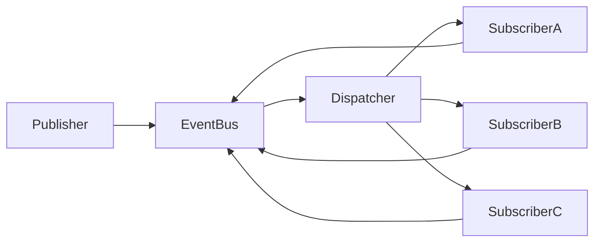
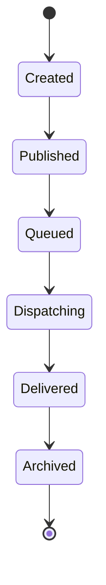

# RFC-0001

**Title:** Event System

**Document ID:** RFC-0001

**Version:** 1.0

**Status:** Accepted

**Category:** Infrastructure

**Layer:** Infrastructure

**Target:** `infrastructure/event_bus.py`

---

# Abstract

This RFC defines the SH-3 Event System.

The Event System is the fundamental communication mechanism of SH-3.

Every subsystem communicates through immutable events instead of direct component dependencies.

The Event System provides deterministic execution, loose coupling, runtime extensibility, observability, and future distributed execution.

This specification is normative.

---

# Motivation

Direct communication between services introduces tight coupling, circular dependencies, and poor scalability.

An event-driven architecture allows:

- independent services
- asynchronous execution
- runtime extensibility
- plugin integration
- deterministic orchestration
- distributed evolution

Every major subsystem inside SH-3 SHALL communicate through the EventBus whenever practical.

---

# Goals

The Event System SHALL provide:

- immutable events
- deterministic dispatch
- thread safety
- synchronous execution
- asynchronous execution
- event prioritization
- event filtering
- event replay
- event tracing
- event metrics
- subscriber isolation
- extensibility

---

# Non-Goals

The Event System SHALL NOT:

- execute business logic
- implement scheduling policy
- implement workflow orchestration
- implement persistence
- implement planning
- replace Runtime

---

# Architectural Overview



Publishers never communicate with subscribers directly.

Subscribers never know publishers.

---

# Design Principles

The Event System follows these principles.

## Loose Coupling

Publishers do not know subscribers.

Subscribers do not know publishers.

---

## Immutable Events

Events SHALL never change after publication.

Mutation after publication is prohibited.

---

## Single Publication

An Event SHALL represent one completed fact.

Events SHALL NOT represent requests.

---

## Explicit Metadata

Every Event SHALL expose standardized metadata.

---

## Deterministic Behavior

Equivalent inputs SHALL produce equivalent dispatch order.

---

## Thread Safety

Concurrent publication SHALL be supported.

---

## Replaceability

The EventBus implementation SHALL remain replaceable.

---

# Requirements

The EventBus SHALL support:

- publish()
- subscribe()
- unsubscribe()
- dispatch()
- replay()
- statistics()
- tracing()
- lifecycle()
- filtering()
- priorities()

---

# Event Definition

An Event is an immutable object describing something that has already occurred.

Typical examples:

- RuntimeStarted
- GoalCreated
- PlanGenerated
- MemoryStored
- LearningCompleted
- SnapshotCreated
- PluginLoaded

Events describe history.

Commands describe intention.

---

# Event Identity

Every event SHALL possess a globally unique identifier.

Properties:

- immutable
- unique
- serializable
- hashable

Identifiers should support distributed systems.

UUIDv7 is recommended.

---

# Event Metadata

Every event SHALL contain metadata.

Required fields:

| Field | Description |
|--------|-------------|
| id | Unique identifier |
| type | Event name |
| timestamp | Creation time |
| priority | Dispatch priority |
| source | Publisher identifier |
| trace_id | Distributed trace |
| version | Schema version |
| payload | Immutable data |

Additional metadata MAY be introduced.

---

# Event Payload

Payload SHALL satisfy:

- immutable
- serializable
- typed
- deterministic

Payload SHALL NOT contain:

- open files
- sockets
- thread handles
- runtime objects
- callbacks

---

# Event Categories

SH-3 defines the following categories.

## Runtime Events

Examples:

- RuntimeStarted
- RuntimeStopped

---

## Kernel Events

Examples:

- PipelineStarted
- PipelineFinished

---

## Service Events

Examples:

- GoalCreated
- DecisionProduced
- MemoryStored

---

## Infrastructure Events

Examples:

- StorageOpened
- CacheEvicted
- PluginLoaded

---

## Diagnostic Events

Examples:

- WarningDetected
- FailureDetected
- HealthChanged

---

# Event Lifecycle



Events SHALL never return to previous states.

---

# EventBus Responsibilities

The EventBus SHALL provide:

- publication
- dispatch
- subscription
- filtering
- prioritization
- replay
- metrics
- tracing

Business processing is explicitly excluded.

---

# Publishers

Publishers SHALL:

- create events
- validate payloads
- publish once
- avoid subscriber knowledge

Publishers SHALL NOT:

- invoke handlers directly
- mutate events
- inspect subscribers

---

# Subscribers

Subscribers SHALL:

- register handlers
- process immutable events
- return promptly
- remain idempotent whenever practical

Subscribers SHALL NOT:

- modify incoming events
- assume publisher identity
- assume dispatch order beyond specification

---

# Subscription Model

The EventBus supports:

- exact event subscription
- category subscription
- wildcard subscription
- predicate filtering

Subscription policies remain implementation-defined.

---

# Handler Registration

Handlers SHALL be uniquely identifiable.

Registration SHALL support:

- add
- remove
- replace
- inspect

Duplicate registrations SHOULD be rejected.

---

# Dispatch Modes

The architecture supports:

- synchronous dispatch
- asynchronous dispatch

Synchronous dispatch is the reference implementation.

Asynchronous dispatch remains compatible with this specification.

---

# Dispatch Order

Within the same priority:

FIFO ordering is recommended.

Across priorities:

Higher priority SHALL execute first.

Ordering SHALL remain deterministic.

---

# Event Priority

Recommended priorities:

| Level | Description |
|--------|-------------|
| Critical | Immediate execution |
| High | High importance |
| Normal | Default |
| Low | Deferred |
| Background | Opportunistic |

Priority definitions remain extensible.

---

# Event Filtering

Filtering occurs before dispatch.

Typical filters include:

- event type
- publisher
- priority
- tags
- trace id

Filtering SHALL NOT modify events.

---

# Exception Handling

Subscriber exceptions SHALL NOT terminate the EventBus.

The dispatcher SHALL:

- capture exception
- publish diagnostic event
- continue dispatch when safe

Failure policy remains configurable.

---

# Thread Safety

The EventBus SHALL support concurrent:

- publish
- subscribe
- unsubscribe

Internal synchronization SHALL remain hidden from consumers.

# Thread Model

The SH-3 Event System is designed to operate correctly in both single-threaded and multi-threaded environments.

The implementation shall expose identical observable behavior regardless of execution strategy.

The reference implementation is synchronous.

Alternative implementations may support parallel dispatch provided all guarantees defined by this RFC are preserved.

---

## Concurrent Publication

Multiple publishers may publish events concurrently.

The EventBus SHALL ensure:

- event integrity
- metadata integrity
- queue consistency
- deterministic ordering within the selected dispatch policy

Publishers must never coordinate directly with one another.

---

## Concurrent Subscription

Handler registration and removal may occur concurrently.

Implementations shall prevent:

- duplicated registrations
- inconsistent handler state
- iterator invalidation
- race conditions

Subscription updates should become visible atomically.

---

## Reentrancy

Subscribers may publish additional events while processing an event.

This behavior is explicitly supported.

Implementations shall define one of the following policies:

- immediate nested dispatch
- queued dispatch

The selected policy must remain consistent.

---

# Event Queue

The Event Queue represents pending events awaiting dispatch.

Responsibilities include:

- insertion
- ordering
- prioritization
- retrieval
- inspection

The queue is an Infrastructure component.

Business services must not manipulate queue internals.

---

## Queue Requirements

The queue SHALL support:

- FIFO insertion
- priority ordering
- bounded or unbounded capacity
- inspection
- metrics

Queue implementation remains replaceable.

---

## Queue Overflow

Overflow behavior must be explicitly defined.

Possible policies include:

- reject publication
- block publisher
- discard lowest priority
- expand capacity

Silent data loss is prohibited.

---

# Event Replay

Replay enables deterministic re-execution of historical events.

Replay supports:

- debugging
- testing
- simulation
- recovery

Replay does not replace persistence.

---

## Replay Requirements

Replay SHALL preserve:

- event identifier
- timestamp
- metadata
- payload
- ordering

Replay implementations may annotate replayed events to distinguish them from live events.

---

## Replay Sources

Possible replay sources include:

- in-memory history
- persistent storage
- event logs
- snapshots

Replay source selection is implementation-specific.

---

# Event History

The EventBus may maintain an event history.

History supports:

- diagnostics
- replay
- auditing
- tracing

History retention policy remains configurable.

---

## Retention Policy

Typical retention strategies include:

- unlimited
- fixed capacity
- time-based expiration
- persistent archive

Retention must be documented by the implementation.

---

# Event Versioning

Events evolve over time.

Backward compatibility should be preserved whenever practical.

Every event schema SHALL expose a version identifier.

Consumers should validate supported versions before processing.

---

## Schema Evolution

Compatible changes include:

- optional fields
- metadata expansion
- documentation improvements

Breaking changes include:

- removed fields
- renamed required fields
- incompatible payload types

Breaking changes require a schema version increment.

---

# Event Serialization

Events SHALL support serialization.

Recommended formats include:

- JSON
- MessagePack
- CBOR
- Protocol Buffers

Serialization format is implementation-specific.

The public event model must remain format-independent.

---

## Serialization Requirements

Serialized events SHALL preserve:

- identifiers
- timestamps
- priorities
- payload
- metadata

Round-trip serialization should preserve semantic equivalence.

---

# Event Validation

Events shall be validated before publication.

Validation includes:

- identifier validation
- payload validation
- metadata validation
- schema validation
- version validation

Invalid events SHALL be rejected.

---

# Event Tracing

The Event System integrates with the Tracing subsystem.

Tracing enables end-to-end execution visibility.

Every published event should participate in a trace.

---

## Trace Metadata

Recommended trace metadata includes:

| Field | Description |
|--------|-------------|
| trace_id | Global trace identifier |
| span_id | Current execution span |
| parent_span_id | Parent execution span |
| publisher | Event source |
| subscriber | Event destination |
| duration | Processing duration |

Additional tracing information may be recorded.

---

# Event Metrics

The EventBus shall expose operational metrics.

Representative metrics include:

- published events
- dispatched events
- failed dispatches
- subscriber count
- queue depth
- replay count
- dispatch latency
- handler latency

Metric collection should impose minimal runtime overhead.

---

# Health Monitoring

The EventBus participates in the Infrastructure Health System.

Health states include:

- Healthy
- Degraded
- Recovering
- Failed
- Offline

Health transitions should publish corresponding events.

---

# Observability

The Event System shall integrate with:

- Logging
- Metrics
- Tracing
- Diagnostics

Operational visibility is a core architectural requirement.

---

# Security Considerations

The EventBus is responsible for transporting events, not enforcing business authorization.

However, the Event System shall ensure:

- immutable event contents
- metadata integrity
- subscriber isolation
- safe failure behavior

Sensitive payloads should be protected by higher-level security mechanisms.

---

# Failure Handling

The EventBus should remain operational despite individual subscriber failures.

Failure handling should include:

- exception capture
- structured logging
- diagnostic events
- metrics updates
- configurable retry policies

Catastrophic failures should transition the EventBus to a Failed health state.

---

# Performance Objectives

The reference implementation should optimize for:

- predictable latency
- low allocation overhead
- deterministic ordering
- efficient subscription lookup

Performance optimizations must not violate architectural guarantees.

---

# Public Interfaces

The EventBus public interface is defined separately in:

```
docs/api/event_api.md
```

This RFC defines behavior.

API documents define callable contracts.

---

# Compatibility

Future EventBus implementations shall remain compatible with this RFC.

Alternative implementations may include:

- distributed event buses
- clustered event buses
- persistent event buses
- remote event buses

Observable behavior must remain consistent.

---

# Future Work

Potential future enhancements include:

- distributed dispatch
- event persistence
- remote subscribers
- event streaming
- event compression
- adaptive prioritization
- distributed tracing integration

These enhancements should extend, rather than replace, the architecture defined by this RFC.

---

# References

- SH-3 Architecture Specification v2.1
- RFC-0000 Documentation Standard
- RFC-2119
- RFC-8174

---

# End of RFC-0001