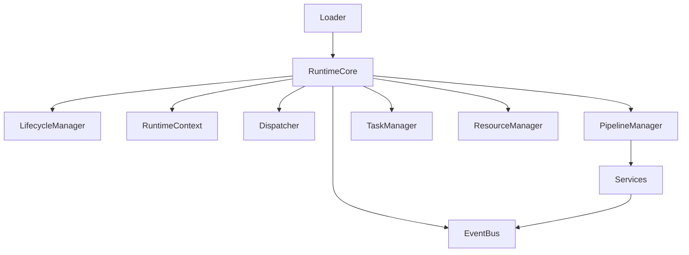
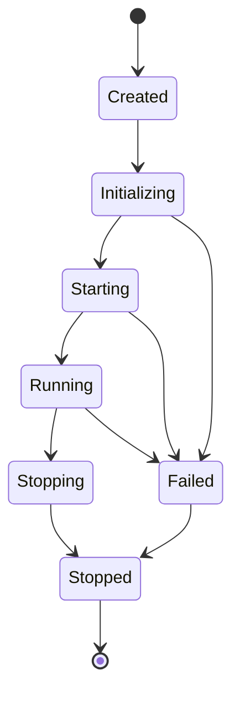

# RFC-0002

**Title:** Runtime System

**Document ID:** RFC-0002

**Version:** 1.0

**Status:** Accepted

**Category:** Runtime

**Layer:** Runtime

**Target:** `runtime/`

---

# Abstract

This RFC defines the SH-3 Runtime System.

The Runtime is responsible for constructing, managing, supervising, and terminating every execution within SH-3.

It provides lifecycle management, execution context, scheduling coordination, pipeline execution, and service supervision.

The Runtime does not implement business intelligence.

Planning, learning, optimization, and reasoning belong to higher layers.

This document is normative.

---

# Motivation

A large AI Operating System requires a deterministic execution environment.

Without a dedicated Runtime layer:

- lifecycle becomes inconsistent
- execution ordering becomes undefined
- services become tightly coupled
- recovery becomes difficult
- observability becomes fragmented

The Runtime establishes one execution model for every subsystem.

---

# Goals

The Runtime SHALL provide:

- deterministic lifecycle management
- execution context propagation
- dependency composition support
- task execution
- pipeline execution
- service supervision
- graceful shutdown
- restart capability
- resource management
- runtime diagnostics
- runtime metrics
- health monitoring

---

# Non-Goals

The Runtime SHALL NOT:

- perform planning
- evaluate policies
- execute learning algorithms
- implement persistence engines
- coordinate deployment
- replace the Kernel

---

# Architectural Overview



The Runtime owns execution.

It does not own business behavior.

---

# Design Principles

The Runtime follows these principles.

## Deterministic Execution

Equivalent inputs SHALL produce equivalent execution behavior.

Random behavior shall be isolated behind explicit interfaces.

---

## Explicit Lifecycle

Every execution SHALL have a clearly defined lifecycle.

Hidden execution states are prohibited.

---

## Context Propagation

Execution context SHALL propagate automatically throughout one execution flow.

---

## Replaceability

Schedulers, dispatchers, and resource managers SHALL remain replaceable.

---

## Isolation

Execution state shall remain isolated between independent runtime instances.

---

## Observability

Every significant runtime operation shall be observable.

---

# Runtime Architecture

The Runtime consists of the following components.

| Component | Responsibility |
|-----------|----------------|
| RuntimeCore | Primary execution controller |
| Loader | Runtime construction |
| LifecycleManager | State transitions |
| RuntimeContext | Execution state |
| Dispatcher | Execution dispatch |
| PipelineManager | Pipeline coordination |
| TaskManager | Task supervision |
| ResourceManager | Resource ownership |

Each component owns one responsibility.

---

# Runtime Core

RuntimeCore is the central execution controller.

Responsibilities include:

- runtime startup
- runtime shutdown
- runtime supervision
- scheduler coordination
- service activation
- event integration

RuntimeCore SHALL remain lightweight.

Business logic belongs elsewhere.

---

# Loader

The Loader constructs the runtime environment.

Responsibilities include:

- configuration loading
- dependency creation
- registry initialization
- plugin discovery
- infrastructure initialization
- service registration

The Loader executes before Runtime startup.

---

# Lifecycle Manager

LifecycleManager governs runtime state transitions.

Supported states include:

```text
Created

↓

Initializing

↓

Starting

↓

Running

↓

Stopping

↓

Stopped
```

Failure transitions are supported from every active state.

---

# Runtime Context

RuntimeContext represents execution-local state.

Typical contents include:

- execution identifier
- runtime identifier
- trace identifier
- configuration snapshot
- active pipeline
- execution metadata

Context is transient.

Persistent information belongs to Persistence.

---

# Dispatcher

Dispatcher executes work units.

Responsibilities include:

- task dispatch
- event dispatch
- handler execution
- completion reporting

Dispatch policy remains replaceable.

---

# Pipeline Manager

PipelineManager supervises execution pipelines.

Responsibilities include:

- pipeline registration
- dependency validation
- execution ordering
- cancellation
- completion

Pipelines remain declarative.

---

# Task Manager

TaskManager supervises executable work.

Capabilities include:

- scheduling
- prioritization
- timeout handling
- retry coordination
- cancellation

Task ownership shall remain explicit.

---

# Resource Manager

ResourceManager owns runtime resources.

Managed resources include:

- threads
- executors
- file handles
- network connections
- caches
- storage sessions

Resources shall have deterministic ownership.

---

# Runtime State Model



State transitions SHALL be explicit.

Invalid transitions SHALL raise Runtime exceptions.

---

# Runtime Lifecycle

Every Runtime SHALL execute the following sequence.

1. Construct
2. Load configuration
3. Initialize infrastructure
4. Register services
5. Build pipelines
6. Start dispatcher
7. Begin execution
8. Process events
9. Shutdown
10. Cleanup

Skipping lifecycle phases is prohibited.

---

# Runtime Events

Representative events include:

- RuntimeCreated
- RuntimeInitializing
- RuntimeInitialized
- RuntimeStarted
- RuntimePaused
- RuntimeStopping
- RuntimeStopped
- RuntimeFailed

Runtime components communicate through the EventBus.

---

# Service Registration

Services SHALL register before Runtime startup.

Registration includes:

- identifier
- capabilities
- dependencies
- lifecycle hooks
- health information

Late registration is implementation-defined.

---

# Service Activation

Activation SHALL occur after successful initialization.

Activation order should satisfy dependency requirements.

Circular activation dependencies are prohibited.

---

# Execution Context

Every execution SHALL possess exactly one RuntimeContext.

Child operations inherit the parent context unless explicitly overridden.

Context propagation SHALL preserve:

- trace identifier
- execution identifier
- metadata
- configuration snapshot

Context mutation should be minimized.

---

# Runtime Scheduler

Scheduling policies remain replaceable.

Supported scheduling models may include:

- synchronous
- cooperative
- thread pool
- asynchronous

The reference implementation is synchronous.

---

# Runtime Configuration

Runtime configuration should include:

- scheduler selection
- dispatcher configuration
- resource limits
- timeout policies
- retry policies
- diagnostic settings

Configuration should remain immutable during execution whenever practical.

---

# Thread Model

The Runtime shall support both single-threaded and multi-threaded execution models.

The observable behavior of the Runtime shall remain consistent regardless of the underlying execution strategy.

The reference implementation executes synchronously.

Alternative implementations may introduce concurrency provided that all guarantees defined by this RFC are preserved.

---

## Execution Model

The Runtime processes execution through discrete execution units.

An execution unit represents one independently schedulable operation.

Typical execution units include:

- pipeline execution
- task execution
- event dispatch
- lifecycle transition
- service activation

Execution units shall expose explicit lifecycle information.

---

## Runtime Isolation

Each Runtime instance shall be isolated.

Isolation includes:

- execution state
- resource ownership
- lifecycle
- service registry
- runtime context
- metrics

One Runtime instance must never directly manipulate another Runtime instance.

---

## Startup Sequence

The Runtime startup sequence SHALL execute in the following order.

```text
Load Configuration
        │
Initialize Foundation
        │
Initialize Infrastructure
        │
Create Runtime Context
        │
Initialize Runtime Core
        │
Register Services
        │
Build Pipelines
        │
Start Dispatcher
        │
Start Scheduler
        │
Enter Running State
```

Each stage must complete successfully before the next stage begins.

---

## Shutdown Sequence

Shutdown shall occur in reverse dependency order.

Recommended sequence:

```text
Stop Accepting Work
        │
Drain Event Queue
        │
Cancel Remaining Tasks
        │
Stop Pipelines
        │
Stop Services
        │
Release Resources
        │
Close Infrastructure
        │
Terminate Runtime
```

Shutdown should be graceful whenever possible.

---

## Failure Recovery

The Runtime shall provide standardized recovery entry points.

Recovery strategies may include:

- restart service
- restart pipeline
- restore snapshot
- replay events
- rebuild execution context

Recovery policies remain configurable.

---

## Runtime Supervision

Runtime supervision continuously evaluates execution health.

Supervisor responsibilities include:

- execution monitoring
- timeout detection
- stalled execution detection
- failure escalation
- recovery notification

The Supervisor coordinates with the Self-Healing service through events.

---

## Health Model

Every Runtime exposes one health state.

Valid states are:

| State | Description |
|--------|-------------|
| Healthy | Normal operation |
| Degraded | Reduced capability |
| Recovering | Active recovery |
| Failed | Runtime failure |
| Offline | Not executing |

Health transitions shall generate Runtime events.

---

## Metrics

The Runtime shall expose operational metrics.

Recommended metrics include:

- startup duration
- shutdown duration
- active pipelines
- active tasks
- completed tasks
- failed tasks
- scheduler utilization
- dispatcher latency
- resource usage
- context count

Metric collection should not significantly impact execution performance.

---

## Logging

The Runtime shall produce structured logs.

Recommended log categories include:

- lifecycle
- scheduler
- dispatcher
- resources
- failures
- diagnostics

Log records should include trace identifiers whenever available.

---

## Tracing

Runtime execution shall integrate with the SH-3 Tracing subsystem.

Every execution flow should belong to exactly one trace.

Trace propagation shall preserve:

- trace identifier
- parent span
- execution identifier
- pipeline identifier

Tracing enables deterministic diagnostics.

---

## Resource Ownership

Every runtime-managed resource shall have exactly one owner.

Ownership transfers must be explicit.

Examples include:

- scheduler threads
- event queues
- storage sessions
- executor pools
- runtime contexts

Implicit ownership is prohibited.

---

## Timeout Handling

The Runtime should support configurable timeout policies.

Timeouts may apply to:

- tasks
- pipelines
- service startup
- service shutdown
- dispatcher operations

Timeout expiration should generate diagnostic events.

---

## Exception Handling

Unhandled exceptions shall never terminate the Runtime unexpectedly.

The Runtime shall:

- capture exceptions
- publish diagnostic events
- update health state
- notify supervisors
- invoke recovery policies when appropriate

Fatal failures should result in a controlled transition to the Failed state.

---

## Security Considerations

The Runtime shall enforce execution boundaries.

Responsibilities include:

- execution isolation
- resource ownership
- lifecycle integrity
- context integrity

Authentication and authorization remain outside the Runtime.

---

## Performance Objectives

The Runtime should optimize for:

- deterministic startup
- predictable latency
- low scheduling overhead
- efficient context propagation
- bounded resource allocation

Performance optimizations must never compromise correctness.

---

## Compatibility

Future Runtime implementations shall remain compatible with this specification.

Supported future implementations may include:

- asynchronous runtime
- distributed runtime
- clustered runtime
- actor-based runtime
- multi-node runtime

The public Runtime behavior shall remain stable.

---

## Public Interfaces

The Runtime public API is defined in:

```text
docs/api/runtime_api.md
```

This RFC defines Runtime behavior.

API specifications define callable interfaces.

---

## Future Work

Potential future enhancements include:

- distributed scheduling
- cooperative task migration
- adaptive resource allocation
- NUMA-aware execution
- GPU execution contexts
- cross-node Runtime coordination

These enhancements extend the Runtime architecture without changing its fundamental design.

---

## References

- SH-3 Architecture Specification v2.1
- RFC-0000 Documentation Standard
- RFC-0001 Event System

---

# End of RFC-0002
