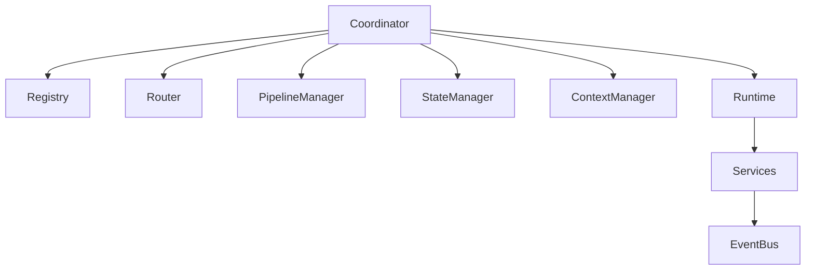
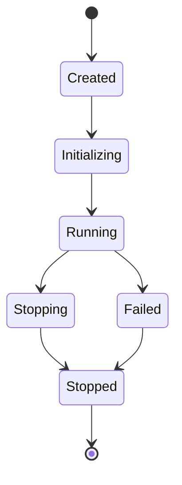

# RFC-0003

**Title:** Kernel System

**Document ID:** RFC-0003

**Version:** 1.0

**Status:** Accepted

**Category:** Kernel

**Layer:** Kernel

**Target:**

```
kernel/
```

---

# Abstract

This RFC defines the SH-3 Kernel.

The Kernel is the orchestration layer responsible for coordinating all Runtime and Service components.

The Kernel itself performs no intelligent computation.

Planning, reasoning, memory management, optimization, learning, persistence, and policy evaluation remain the responsibility of Services.

The Kernel exists solely to coordinate execution.

This document is normative.

---

# Motivation

As SH-3 grows, independent services require a central coordination mechanism.

Without a Kernel:

- services become tightly coupled
- orchestration logic becomes duplicated
- execution flow becomes inconsistent
- lifecycle management becomes fragmented

The Kernel provides one authoritative coordination model.

---

# Goals

The Kernel SHALL provide:

- service orchestration
- execution coordination
- pipeline management
- service discovery
- runtime supervision
- execution routing
- global context management
- lifecycle coordination
- deterministic execution
- extensibility

---

# Non-Goals

The Kernel SHALL NOT:

- perform planning
- perform reasoning
- execute machine learning
- store persistent data
- replace Runtime
- replace Infrastructure

---

# Architecture



The Kernel owns coordination.

Services own intelligence.

---

# Design Principles

The Kernel follows the principles below.

## Lightweight

The Kernel should remain as small as practical.

Business logic belongs elsewhere.

---

## Deterministic

Equivalent execution shall produce equivalent orchestration behavior.

---

## Stateless Coordination

Whenever practical, orchestration decisions should derive from RuntimeContext instead of mutable global state.

---

## Explicit Ownership

The Kernel coordinates components.

It does not own their internal implementations.

---

## Replaceability

Every Kernel subsystem shall remain independently replaceable.

---

# Kernel Components

The Kernel consists of the following components.

| Component | Responsibility |
|------------|----------------|
| Coordinator | Global orchestration |
| Registry | Service discovery |
| Router | Execution routing |
| PipelineManager | Pipeline execution |
| StateManager | Kernel state |
| ContextManager | Global execution context |

Each component owns one architectural responsibility.

---

# Coordinator

Coordinator is the primary Kernel component.

Responsibilities include:

- orchestrating services
- coordinating execution
- supervising pipelines
- requesting Runtime execution
- publishing coordination events

Coordinator SHALL NOT implement business decisions.

---

# Registry

Registry maintains discoverable runtime objects.

Typical registrations include:

- services
- planners
- memories
- policies
- pipelines
- plugins
- schedulers

Registry provides lookup only.

Lifecycle management belongs elsewhere.

---

# Router

Router determines execution destinations.

Routing decisions may consider:

- capability
- priority
- availability
- runtime health
- execution policy

Routing algorithms remain replaceable.

---

# Pipeline Manager

PipelineManager supervises execution pipelines.

Responsibilities include:

- pipeline registration
- dependency validation
- execution ordering
- cancellation
- completion

Pipeline execution is delegated to Runtime.

---

# State Manager

StateManager maintains Kernel-wide operational state.

Typical information includes:

- active pipelines
- active executions
- registered services
- runtime mode
- health summary

Persistent state belongs to Persistence.

---

# Context Manager

ContextManager manages KernelContext objects.

Responsibilities include:

- creation
- propagation
- isolation
- disposal

KernelContext should remain immutable whenever practical.

---

# Kernel Context

KernelContext represents execution-wide metadata.

Typical fields include:

- kernel_id
- execution_id
- trace_id
- runtime_id
- pipeline_id
- configuration snapshot
- metadata

KernelContext exists only for the duration of execution.

---

# Service Registration

Every service SHALL register before entering Running state.

Registration requires:

- identifier
- version
- capabilities
- dependencies
- lifecycle hooks

Duplicate registrations SHALL be rejected.

---

# Service Discovery

Registry SHALL support discovery by:

- identifier
- capability
- interface
- implementation type
- metadata
- tags

Lookup behavior should remain deterministic.

---

# Execution Model

Execution follows the sequence below.

```text
Request

↓

Coordinator

↓

Router

↓

Pipeline Manager

↓

Runtime

↓

Services

↓

EventBus

↓

Runtime

↓

Coordinator

↓

Complete
```

Each stage owns one responsibility.

---

# Pipeline Definition

A Pipeline is an ordered execution graph.

Each pipeline consists of one or more stages.

Each stage defines:

- identifier
- dependencies
- inputs
- outputs
- execution policy

Pipelines should remain declarative.

---

# Pipeline Validation

Before execution, the Kernel SHALL validate:

- dependency graph
- stage identifiers
- duplicate stages
- circular dependencies
- execution policy

Invalid pipelines SHALL be rejected.

---

# Pipeline Execution

Pipeline execution responsibilities include:

- stage ordering
- dependency resolution
- progress reporting
- cancellation
- completion notification

Actual execution remains the responsibility of Runtime.

---

# Routing Policies

Supported routing strategies may include:

- direct routing
- capability routing
- priority routing
- policy-based routing
- load-aware routing

The reference implementation uses deterministic capability routing.

---

# Lifecycle

The Kernel lifecycle consists of:

```text
Constructed

↓

Initialized

↓

Services Registered

↓

Running

↓

Stopping

↓

Disposed
```

Every transition should publish lifecycle events.

---

# Kernel Events

Representative Kernel events include:

- KernelInitialized
- CoordinatorStarted
- PipelineRegistered
- PipelineStarted
- PipelineCompleted
- ServiceRegistered
- ServiceRemoved
- RoutingCompleted
- KernelStopping
- KernelStopped

Kernel events integrate with the EventBus.

---

# State Model



Invalid transitions SHALL raise Kernel exceptions.

---

# Thread Model

The Kernel shall support both synchronous and concurrent execution models.

Observable orchestration behavior shall remain deterministic regardless of execution strategy.

Concurrency is an implementation detail.

The architectural contract remains unchanged.

---

# Coordination Model

The Kernel coordinates execution but never performs execution directly.

Responsibilities are divided as follows.

| Layer | Responsibility |
|--------|----------------|
| Kernel | Coordination |
| Runtime | Execution |
| Services | Intelligence |
| Infrastructure | Mechanisms |
| Foundation | Base abstractions |

This separation shall be preserved.

---

# Dependency Rules

The Kernel may depend on:

- Foundation
- Infrastructure
- Runtime
- Service Interfaces

The Kernel SHALL NOT depend on:

- concrete service implementations
- deployment
- application code

Circular dependencies are prohibited.

---

# Service Isolation

Every registered service is treated as an independent execution unit.

The Kernel interacts with services only through public contracts.

The Kernel shall never:

- access private service state
- modify service internals
- assume implementation details

This guarantees service replaceability.

---

# Execution Supervision

The Kernel continuously supervises active execution.

Supervisor responsibilities include:

- pipeline progress
- execution completion
- timeout monitoring
- cancellation
- failure escalation

Execution supervision shall remain independent of business logic.

---

# Failure Recovery

The Kernel coordinates recovery but does not implement recovery algorithms.

Recovery requests may include:

- restart pipeline
- retry stage
- reload service
- rebuild execution graph
- request Self-Healing intervention

Recovery execution belongs to Runtime and Services.

---

# Cancellation

The Kernel shall support controlled cancellation.

Cancellation may target:

- execution
- pipeline
- stage
- task

Cancellation requests shall propagate deterministically.

Resources must be released safely.

---

# Scheduling

Scheduling policies remain outside the Kernel.

The Kernel requests execution.

The Runtime determines how execution occurs.

This separation allows:

- synchronous runtimes
- asynchronous runtimes
- distributed runtimes
- clustered runtimes

without modifying Kernel logic.

---

# Health Monitoring

The Kernel exposes one health state.

Possible values include:

| State | Description |
|--------|-------------|
| Healthy | Normal coordination |
| Degraded | Reduced capability |
| Recovering | Active recovery |
| Failed | Coordination failure |
| Offline | Not initialized |

Health changes should publish Kernel events.

---

# Metrics

The Kernel shall expose coordination metrics.

Representative metrics include:

- active pipelines
- completed pipelines
- failed pipelines
- registered services
- routing decisions
- orchestration latency
- execution throughput
- cancellation count

Metric collection should have minimal runtime overhead.

---

# Logging

Kernel logging shall produce structured records.

Recommended categories include:

- lifecycle
- orchestration
- routing
- registration
- supervision
- diagnostics

Logs should include execution identifiers and trace identifiers whenever available.

---

# Tracing

Kernel operations participate in the global tracing system.

Trace propagation shall preserve:

- trace_id
- execution_id
- pipeline_id
- runtime_id
- coordinator_id

Tracing enables end-to-end execution visibility.

---

# Security Considerations

The Kernel is responsible for orchestration integrity.

Responsibilities include:

- execution boundary enforcement
- context integrity
- routing integrity
- service registration validation

Authentication and authorization remain outside the Kernel.

---

# Resource Ownership

The Kernel owns only coordination resources.

Examples include:

- pipeline definitions
- routing tables
- execution graphs
- coordinator state

The Runtime owns executable resources.

Services own business resources.

---

# Extensibility

The Kernel shall expose extension points for:

- routers
- pipeline builders
- coordinators
- registries
- execution policies

Extension points shall use stable public interfaces.

---

# Plugin Integration

Plugins may register:

- services
- capabilities
- routing policies
- pipeline stages
- lifecycle hooks

Plugins shall never bypass the Kernel.

All registration occurs through the Registry.

---

# Public Interfaces

Kernel public interfaces are defined separately in:

```text
docs/api/kernel_api.md
```

This RFC specifies Kernel behavior.

API specifications define callable contracts.

---

# Compatibility

Future Kernel implementations shall remain compatible with this specification.

Supported future architectures may include:

- distributed Kernel
- clustered Kernel
- multi-node coordination
- federated orchestration

Observable Kernel behavior shall remain stable.

---

# Performance Objectives

The Kernel should optimize for:

- deterministic orchestration
- low coordination overhead
- efficient routing
- scalable service discovery
- predictable pipeline execution

Performance improvements must preserve architectural guarantees.

---

# Future Work

Potential future enhancements include:

- distributed coordination
- adaptive routing
- dynamic pipeline optimization
- hierarchical coordinators
- multi-cluster orchestration
- autonomous execution balancing

These enhancements extend the Kernel architecture without altering its core responsibilities.

---

# References

- SH-3 Architecture Specification v2.1
- RFC-0000 Documentation Standard
- RFC-0001 Event System
- RFC-0002 Runtime System

---

# End of RFC-0003
