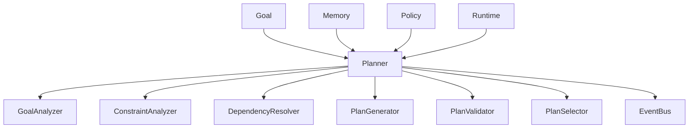

# RFC-0004

**Title:** Planner System

**Document ID:** RFC-0004

**Version:** 1.0

**Status:** Accepted

**Category:** Services

**Layer:** Services

**Target:**

```text
services/planner/
```

---

# Abstract

This RFC defines the SH-3 Planner System.

The Planner is responsible for transforming objectives into executable plans.

It performs goal decomposition, dependency analysis, alternative generation, execution strategy selection, and plan validation.

The Planner does **not** execute plans.

Execution belongs to the Runtime.

Decision enforcement belongs to the Policy Service.

Knowledge retrieval belongs to the Memory Service.

This document is normative.

---

# Motivation

An intelligent system requires a dedicated planning subsystem.

Without a Planner:

- reasoning becomes reactive
- execution becomes rigid
- long-term objectives become difficult to manage
- autonomous behavior becomes inconsistent

The Planner provides deterministic, explainable, and extensible planning capabilities.

---

# Goals

The Planner SHALL provide:

- goal analysis
- goal decomposition
- plan generation
- alternative plan generation
- dependency analysis
- execution ordering
- constraint evaluation
- plan validation
- plan optimization requests
- plan explanation
- deterministic planning

---

# Non-Goals

The Planner SHALL NOT:

- execute tasks
- evaluate permissions
- learn from rewards
- persist knowledge
- schedule runtime resources
- perform hardware management

---

# Architecture



The Planner transforms objectives into executable plans.

---

# Design Principles

The Planner follows the principles below.

## Goal-Oriented

Planning always begins with an explicit goal.

Reactive planning without a goal is discouraged.

---

## Deterministic

Equivalent inputs SHALL produce equivalent plans unless stochastic planning is explicitly enabled.

---

## Explainable

Every generated plan should be explainable.

The Planner should expose sufficient metadata to justify planning decisions.

---

## Replaceable

Planning algorithms shall remain replaceable.

The architecture depends on planning interfaces rather than implementations.

---

## Stateless

The Planner should avoid storing long-term state.

Persistent knowledge belongs to the Memory Service.

---

# Planner Components

The Planner consists of the following logical components.

| Component | Responsibility |
|-----------|----------------|
| GoalAnalyzer | Goal interpretation |
| ConstraintAnalyzer | Constraint extraction |
| DependencyResolver | Dependency graph construction |
| PlanGenerator | Plan generation |
| PlanValidator | Plan verification |
| PlanSelector | Best plan selection |

Each component owns one responsibility.

---

# Goal

A Goal represents a desired future state.

Goals SHALL be:

- explicit
- typed
- immutable
- serializable

Goals may originate from:

- user requests
- autonomous behavior
- scheduled execution
- external events
- recovery workflows

---

# Goal Analysis

Goal analysis identifies:

- objective
- inputs
- outputs
- constraints
- dependencies
- priority
- success criteria

Analysis precedes every planning operation.

---

# Constraints

Constraints define planning boundaries.

Examples include:

- resource limits
- execution deadlines
- policy restrictions
- dependency requirements
- capability requirements

Constraints SHALL remain immutable during one planning cycle.

---

# Dependency Resolution

The Planner constructs a dependency graph.

Dependencies may exist between:

- goals
- tasks
- resources
- services
- capabilities

Circular dependencies SHALL be rejected.

---

# Plan

A Plan represents an ordered sequence of executable stages.

A Plan SHALL include:

- identifier
- originating goal
- ordered stages
- dependencies
- assumptions
- estimated cost
- estimated duration
- confidence score

Plans remain immutable after validation.

---

# Plan Stage

Each stage represents one logical planning step.

A stage SHALL define:

- identifier
- description
- prerequisites
- outputs
- expected completion state

Execution details belong to Runtime.

---

# Plan Generation

Plan generation transforms analyzed goals into executable plans.

Generation may use:

- deterministic rules
- heuristics
- graph search
- symbolic planning
- learned planning models

The planning strategy remains replaceable.

---

# Alternative Plans

The Planner may generate multiple candidate plans.

Each candidate should expose:

- estimated cost
- estimated duration
- confidence
- complexity
- resource requirements

Candidate generation improves decision quality.

---

# Plan Selection

The Planner selects one candidate plan.

Selection criteria may include:

- confidence
- execution cost
- completion probability
- policy compliance
- historical performance

Selection policies remain configurable.

---

# Plan Validation

Validation verifies:

- structural correctness
- dependency completeness
- constraint satisfaction
- capability availability
- policy compatibility

Invalid plans SHALL be rejected.

---

# Planning Lifecycle

Every planning request follows the sequence below.

```text
Goal Received
        │
Goal Analysis
        │
Constraint Analysis
        │
Dependency Resolution
        │
Plan Generation
        │
Candidate Evaluation
        │
Plan Selection
        │
Validation
        │
Plan Published
```

Planning concludes when a validated plan is published.

---

# Planner Events

Representative events include:

- GoalReceived
- GoalAnalyzed
- ConstraintsResolved
- PlanGenerated
- CandidateEvaluated
- PlanValidated
- PlanRejected
- PlanSelected
- PlanPublished

Planner events integrate with the EventBus.

---

# Planning Model

The Planner transforms objectives into executable strategies.

Planning is divided into independent phases.

Each phase has one architectural responsibility.


Each phase produces immutable intermediate results.

---

# Goal Model

Every Goal SHALL contain the following information.

| Field | Description |
|--------|-------------|
| goal_id | Unique identifier |
| goal_type | Goal classification |
| objective | Desired outcome |
| priority | Goal priority |
| constraints | Execution constraints |
| deadline | Optional completion target |
| metadata | Additional information |

Goals are immutable once accepted by the Planner.

---

# Goal Hierarchy

Goals may form hierarchical structures.

Supported relationships include:

- parent goal
- child goal
- prerequisite goal
- dependent goal

Hierarchy enables decomposition of complex objectives into manageable planning units.

---

# Planning Context

Every planning operation receives one PlanningContext.

Typical contents include:

- current goal
- runtime context
- memory references
- policy constraints
- available capabilities
- execution history
- environmental information

The PlanningContext exists only during one planning cycle.

---

# Memory Integration

The Planner retrieves knowledge through the Memory Service.

Typical retrieval includes:

- previous plans
- successful strategies
- failed strategies
- capability information
- historical execution data

The Planner shall never directly access persistence.

---

# Policy Integration

The Planner consults the Policy Service before publishing a plan.

Policy evaluation may determine:

- permitted actions
- restricted resources
- execution priorities
- safety constraints

The Policy Service evaluates compliance.

The Planner adapts the generated plan accordingly.

---

# Runtime Integration

The Planner publishes validated plans to the Runtime.

The Runtime determines:

- scheduling
- execution
- resource allocation
- task dispatch

Execution never occurs inside the Planner.

---

# Capability Awareness

Planning should consider available capabilities.

Capabilities may include:

- storage
- networking
- computation
- external tools
- plugins
- AI models

Unavailable capabilities shall prevent publication of an executable plan.

---

# Cost Estimation

The Planner should estimate execution cost.

Representative metrics include:

- execution duration
- computational cost
- memory usage
- network utilization
- energy consumption

Cost estimation assists plan selection.

---

# Confidence Estimation

Each plan should expose a confidence score.

Confidence may consider:

- historical success
- dependency stability
- environmental certainty
- planner heuristics

Confidence is advisory.

It does not guarantee successful execution.

---

# Failure Handling

Planning failures shall produce structured diagnostic information.

Typical failure causes include:

- unsatisfied constraints
- unavailable capabilities
- circular dependencies
- invalid goals
- policy violations

Failures shall generate Planner events.

---

# Recovery

The Planner supports replanning.

Replanning may occur after:

- execution failure
- capability changes
- policy updates
- environmental changes
- explicit user requests

Replanning creates a new immutable plan.

Existing plans remain unchanged.

---

# Thread Model

The Planner shall support concurrent planning requests.

Independent planning sessions shall remain isolated.

Shared mutable planning state is discouraged.

The reference implementation should remain thread-safe.

---

# Metrics

The Planner shall expose operational metrics.

Representative metrics include:

- planning requests
- generated plans
- rejected plans
- average planning latency
- validation failures
- replanning count
- confidence distribution

Metric collection should have minimal performance impact.

---

# Logging

Planner logging shall produce structured records.

Recommended categories include:

- goal analysis
- dependency resolution
- plan generation
- validation
- diagnostics

Log records should include goal identifiers and trace identifiers whenever available.

---

# Tracing

Planner operations participate in the global tracing system.

Trace propagation shall preserve:

- trace_id
- execution_id
- goal_id
- plan_id

Tracing enables end-to-end visibility from goal creation through execution.

---

# Security Considerations

The Planner shall not bypass Policy decisions.

Responsibilities include:

- planning integrity
- immutable plans
- context integrity
- capability validation

Authorization remains the responsibility of the Policy Service.

---

# Public Interfaces

The Planner public API is defined in:

```text
docs/api/planner_api.md
```

This RFC specifies Planner behavior.

API specifications define callable interfaces.

---

# Compatibility

Future Planner implementations shall remain compatible with this specification.

Possible future implementations include:

- symbolic planners
- heuristic planners
- LLM-assisted planners
- hierarchical planners
- distributed planners

Observable Planner behavior shall remain consistent.

---

# Performance Objectives

The Planner should optimize for:

- deterministic planning
- low planning latency
- efficient dependency analysis
- scalable candidate evaluation
- predictable memory usage

Performance improvements shall not compromise correctness or explainability.

---

# Future Work

Potential future enhancements include:

- hierarchical task network (HTN) planning
- probabilistic planning
- temporal planning
- multi-agent collaborative planning
- adaptive planning strategies
- predictive world-model integration

These enhancements extend the Planner architecture without changing its core responsibilities.

---

# References

- SH-3 Architecture Specification v2.1
- RFC-0000 Documentation Standard
- RFC-0001 Event System
- RFC-0002 Runtime System
- RFC-0003 Kernel System

---

# End of RFC-0004
