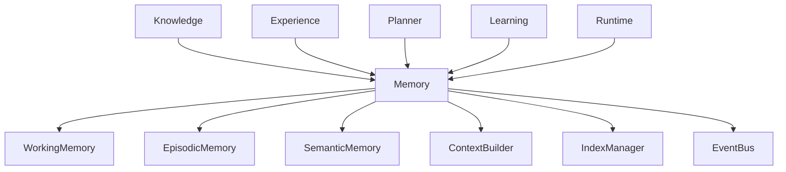

# RFC-0005

**Title:** Memory System

**Document ID:** RFC-0005

**Version:** 1.0

**Status:** Accepted

**Category:** Services

**Layer:** Services

**Target:**

```text
services/memory/
```

---

# Abstract

This RFC defines the SH-3 Memory System.

The Memory System provides knowledge acquisition, storage, retrieval, indexing, working memory management, episodic memory, semantic memory, and context construction.

The Memory System is the authoritative source of persistent and transient knowledge within SH-3.

It does not perform planning, execution, policy evaluation, or learning.

This document is normative.

---

# Motivation

An intelligent system requires more than data storage.

Knowledge must remain searchable, structured, contextual, and reusable across execution cycles.

Without a dedicated Memory System:

- context becomes fragmented
- reasoning quality degrades
- execution history is lost
- learning becomes ineffective
- planning cannot leverage prior experience

The Memory System provides a unified knowledge architecture.

---

# Goals

The Memory System SHALL provide:

- knowledge storage
- semantic retrieval
- episodic retrieval
- working memory
- context construction
- memory indexing
- metadata management
- importance scoring
- memory lifecycle management
- deterministic retrieval
- extensibility

---

# Non-Goals

The Memory System SHALL NOT:

- execute plans
- schedule tasks
- evaluate policies
- optimize execution
- perform reinforcement learning
- replace persistence engines

Persistence mechanisms belong to the Infrastructure layer.

---

# Architecture



The Memory System owns knowledge management.

---

# Design Principles

The Memory System follows these principles.

## Knowledge-Centric

Memory stores knowledge rather than raw implementation details.

---

## Immutable Records

Stored memory records should remain immutable.

Updates create new revisions whenever practical.

---

## Deterministic Retrieval

Equivalent queries SHALL produce equivalent retrieval results.

---

## Replaceable Storage

Storage engines remain replaceable.

The Memory System depends on storage interfaces.

---

## Separation of Concerns

Memory manages knowledge.

Persistence manages durability.

Learning manages adaptation.

Planner manages decision making.

---

# Memory Components

The Memory System consists of the following logical components.

| Component | Responsibility |
|-----------|----------------|
| WorkingMemory | Active execution context |
| EpisodicMemory | Execution history |
| SemanticMemory | Long-term knowledge |
| ContextBuilder | Context generation |
| IndexManager | Search indexes |
| MemoryManager | Coordination |

Each component owns one architectural responsibility.

---

# Memory Manager

MemoryManager coordinates all memory operations.

Responsibilities include:

- storage requests
- retrieval requests
- context construction
- memory selection
- lifecycle coordination

MemoryManager does not own persistence.

---

# Working Memory

WorkingMemory stores execution-local information.

Typical contents include:

- active goals
- current plans
- temporary variables
- intermediate results
- execution metadata

WorkingMemory is transient.

---

# Episodic Memory

EpisodicMemory stores historical experiences.

Representative records include:

- completed plans
- failed executions
- user interactions
- recovery operations
- autonomous activities

Episodes preserve chronological order.

---

# Semantic Memory

SemanticMemory stores long-lived knowledge.

Examples include:

- concepts
- capabilities
- procedures
- relationships
- structured facts
- learned abstractions

SemanticMemory is optimized for retrieval rather than chronology.

---

# Context Builder

ContextBuilder constructs execution context.

Typical context sources include:

- WorkingMemory
- EpisodicMemory
- SemanticMemory
- RuntimeContext
- Planner requests

Constructed context should remain immutable.

---

# Index Manager

IndexManager provides efficient retrieval.

Responsibilities include:

- index construction
- index updates
- lookup optimization
- metadata indexing
- ranking support

Index implementation remains replaceable.

---

# Memory Record

A Memory Record SHALL contain:

| Field | Description |
|--------|-------------|
| memory_id | Unique identifier |
| memory_type | Classification |
| content | Stored knowledge |
| metadata | Structured metadata |
| timestamp | Creation time |
| importance | Importance score |
| source | Origin |
| version | Schema version |

Records remain immutable once stored.

---

# Memory Types

SH-3 defines the following memory categories.

- Working Memory
- Episodic Memory
- Semantic Memory
- Procedural Memory
- Reference Memory
- Diagnostic Memory

Additional categories may be introduced through future RFCs.

---

# Memory Metadata

Metadata should include:

- tags
- author
- confidence
- language
- origin
- trace identifier
- execution identifier

Metadata supports retrieval and diagnostics.

---

# Memory Lifecycle

Every memory record follows the lifecycle below.

```text
Created
    │
Validated
    │
Indexed
    │
Stored
    │
Retrieved
    │
Archived
```

Deletion should be explicit.

Silent removal is discouraged.

---

# Knowledge Storage

Knowledge shall be validated before storage.

Validation includes:

- schema validation
- type validation
- metadata validation
- identifier validation

Invalid records SHALL be rejected.

---

# Knowledge Retrieval

The Memory System shall support retrieval by:

- identifier
- semantic similarity
- metadata
- tags
- temporal range
- importance
- execution history

Retrieval policies remain configurable.

---

# Context Construction

Context construction may combine:

- recent memories
- relevant semantic knowledge
- historical episodes
- execution metadata
- planner requests

Context should be deterministic and reproducible.

---

# Memory Events

Representative events include:

- MemoryCreated
- MemoryValidated
- MemoryIndexed
- MemoryStored
- MemoryRetrieved
- MemoryUpdated
- MemoryArchived
- ContextBuilt

Memory events integrate with the EventBus.

---

# Retrieval Model

The Memory System retrieves knowledge through deterministic query processing.

Retrieval consists of independent stages.


Each stage has one architectural responsibility.

---

# Query Model

Every retrieval request SHALL contain a MemoryQuery.

A MemoryQuery should include:

| Field | Description |
|--------|-------------|
| query_id | Unique identifier |
| query_type | Query classification |
| target | Retrieval objective |
| filters | Optional constraints |
| limit | Maximum results |
| metadata | Additional information |

Queries are immutable once accepted.

---

# Query Normalization

Normalization transforms incoming queries into a canonical representation.

Typical operations include:

- whitespace normalization
- type normalization
- metadata normalization
- filter validation
- identifier validation

Normalization shall not alter semantic meaning.

---

# Candidate Retrieval

Candidate retrieval identifies potentially relevant records.

Candidate selection may use:

- identifier lookup
- metadata lookup
- semantic search
- keyword search
- temporal search
- graph traversal

Candidate generation should maximize recall.

---

# Ranking

Retrieved candidates shall be ranked.

Ranking factors may include:

- semantic similarity
- importance score
- recency
- confidence
- retrieval history
- execution relevance

Ranking algorithms remain replaceable.

---

# Filtering

Filtering removes unsuitable candidates.

Typical filters include:

- memory type
- confidence threshold
- language
- tags
- access policy
- execution scope

Filtering shall occur before context construction.

---

# Importance

Each memory record should expose an importance score.

Importance may consider:

- execution frequency
- historical usefulness
- user preference
- planner feedback
- learning feedback

Importance influences ranking but does not guarantee retrieval.

---

# Context Window

The ContextBuilder constructs a bounded execution context.

Context selection should balance:

- relevance
- diversity
- recency
- importance
- size constraints

Context size remains configurable.

---

# Memory Relationships

Memory records may reference one another.

Supported relationships include:

- parent
- child
- prerequisite
- derived
- related
- duplicate

Relationship graphs shall remain acyclic whenever practical.

---

# Memory Revision

Stored knowledge may evolve.

Updates should create new revisions rather than modifying existing records.

Revision metadata should include:

- revision identifier
- previous revision
- creation timestamp
- revision reason

Historical revisions should remain accessible.

---

# Memory Expiration

The Memory System may support expiration policies.

Examples include:

- time-based expiration
- capacity-based expiration
- importance-based expiration

Expiration shall never remove records silently.

Expiration events should be published.

---

# Memory Archival

Archived memories remain recoverable.

Archival strategies may include:

- local archive
- persistent archive
- compressed archive
- external archive

Archive implementation remains independent of the Memory API.

---

# Memory Consistency

The Memory System shall preserve:

- identifier uniqueness
- metadata integrity
- revision history
- relationship consistency
- index consistency

Consistency verification should occur automatically.

---

# Memory Integration

The Memory System interacts with:

| Component | Interaction |
|-----------|-------------|
| Planner | Retrieve knowledge and build context |
| Learning | Store experiences and feedback |
| Policy | Validate memory visibility |
| Runtime | Supply execution context |
| Persistence | Store durable records |

Memory remains the authoritative knowledge interface.

---

# Thread Model

The Memory System shall support concurrent:

- storage
- retrieval
- indexing
- archival

Concurrent operations shall preserve consistency.

Shared mutable state should be minimized.

---

# Metrics

The Memory System shall expose operational metrics.

Representative metrics include:

- stored records
- retrieval requests
- retrieval latency
- indexing latency
- cache hit ratio
- archive size
- revision count
- context construction time

Metric collection should impose minimal runtime overhead.

---

# Logging

Memory logging shall produce structured records.

Recommended categories include:

- storage
- retrieval
- indexing
- archival
- diagnostics

Log records should include memory identifiers and trace identifiers whenever available.

---

# Tracing

Memory operations participate in the global tracing system.

Trace propagation shall preserve:

- trace_id
- execution_id
- memory_id
- query_id

Tracing enables end-to-end visibility across retrieval and storage operations.

---

# Security Considerations

The Memory System shall preserve:

- memory integrity
- metadata integrity
- revision integrity
- retrieval isolation

Authorization decisions remain the responsibility of the Policy Service.

Sensitive knowledge should be protected by higher-level security mechanisms.

---

# Public Interfaces

Memory public interfaces are defined separately in:

```text
docs/api/memory_api.md
```

This RFC specifies Memory behavior.

API specifications define callable interfaces.

---

# Compatibility

Future Memory implementations shall remain compatible with this specification.

Possible future implementations include:

- vector-based memory
- graph memory
- distributed memory
- hierarchical memory
- federated memory
- hybrid symbolic-neural memory

Observable Memory behavior shall remain consistent.

---

# Performance Objectives

The Memory System should optimize for:

- deterministic retrieval
- efficient indexing
- low retrieval latency
- scalable context construction
- predictable memory usage

Performance improvements shall preserve correctness and reproducibility.

---

# Future Work

Potential future enhancements include:

- adaptive memory ranking
- semantic graph expansion
- episodic summarization
- neural retrieval augmentation
- memory consolidation
- long-term forgetting strategies
- world-model-aware retrieval

These enhancements extend the Memory architecture without changing its core responsibilities.

---

# References

- SH-3 Architecture Specification v2.1
- RFC-0000 Documentation Standard
- RFC-0001 Event System
- RFC-0002 Runtime System
- RFC-0003 Kernel System
- RFC-0004 Planner System

---

# End of RFC-0005
