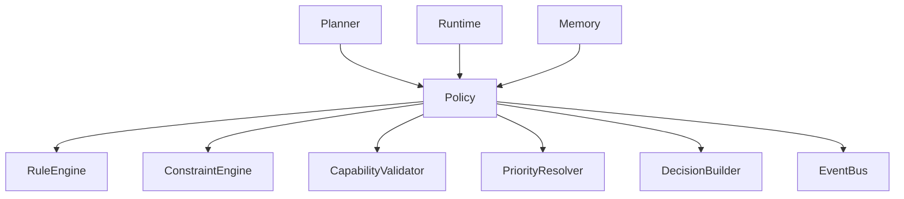

# RFC-0006

**Title:** Policy System

**Document ID:** RFC-0006

**Version:** 1.0

**Status:** Accepted

**Category:** Services

**Layer:** Services

**Target:**

```text
services/policy/
```

---

# Abstract

This RFC defines the SH-3 Policy System.

The Policy System evaluates whether proposed actions, plans, or requests comply with the operational rules of SH-3.

It provides deterministic policy evaluation, constraint enforcement, capability validation, prioritization, and safety decisions.

The Policy System does not execute actions, perform planning, or store persistent knowledge.

This document is normative.

---

# Motivation

An autonomous system requires a centralized decision policy.

Without a dedicated Policy System:

- execution becomes inconsistent
- safety rules become duplicated
- authorization logic becomes fragmented
- planners produce non-executable plans
- runtime behavior becomes unpredictable

The Policy System provides one authoritative decision layer.

---

# Goals

The Policy System SHALL provide:

- policy evaluation
- rule evaluation
- constraint enforcement
- capability validation
- priority determination
- execution authorization
- safety verification
- policy explanation
- deterministic decisions
- extensibility

---

# Non-Goals

The Policy System SHALL NOT:

- execute tasks
- generate plans
- retrieve knowledge
- learn policies autonomously
- schedule Runtime resources
- manage persistence

---

# Architecture



The Policy System evaluates.

Other systems execute.

---

# Design Principles

The Policy System follows these principles.

## Deterministic

Equivalent inputs SHALL produce equivalent policy decisions.

---

## Explicit Rules

Every policy decision shall be explainable through explicit rules.

Implicit behavior is discouraged.

---

## Separation of Concerns

Policy determines whether execution is permitted.

Runtime performs execution.

Planner generates plans.

Memory supplies knowledge.

---

## Replaceability

Rule engines and evaluation strategies shall remain replaceable.

---

## Explainability

Every policy decision should expose sufficient information for diagnostics.

---

# Policy Components

The Policy System consists of the following logical components.

| Component | Responsibility |
|-----------|----------------|
| RuleEngine | Rule evaluation |
| ConstraintEngine | Constraint verification |
| CapabilityValidator | Capability validation |
| PriorityResolver | Priority determination |
| DecisionBuilder | Decision construction |
| PolicyManager | Coordination |

Each component owns one architectural responsibility.

---

# Policy Manager

PolicyManager coordinates all policy operations.

Responsibilities include:

- evaluation requests
- rule selection
- decision publication
- lifecycle coordination
- diagnostics

PolicyManager does not own execution.

---

# Policy Rule

A Policy Rule defines one deterministic decision criterion.

Each rule shall include:

| Field | Description |
|--------|-------------|
| rule_id | Unique identifier |
| name | Rule name |
| category | Rule classification |
| condition | Evaluation condition |
| action | Result |
| priority | Evaluation priority |
| enabled | Activation state |

Rules remain immutable while active.

---

# Rule Categories

Representative categories include:

- security
- execution
- capability
- resource
- scheduling
- safety
- compliance
- optimization

Additional categories may be introduced through future RFCs.

---

# Constraint Evaluation

Constraints define mandatory execution boundaries.

Typical constraints include:

- execution limits
- resource limits
- capability requirements
- environmental restrictions
- runtime state
- dependency availability

Unsatisfied constraints SHALL prevent approval.

---

# Capability Validation

The Policy System verifies that required capabilities are available.

Examples include:

- storage
- networking
- inference
- plugins
- external services
- hardware accelerators

Unavailable capabilities shall generate rejection decisions.

---

# Priority Resolution

PriorityResolver determines evaluation precedence.

Priority factors may include:

- goal priority
- rule priority
- execution urgency
- safety level
- system health

Priority resolution shall remain deterministic.

---

# Decision Model

Every evaluation produces one immutable Policy Decision.

A Policy Decision SHALL include:

| Field | Description |
|--------|-------------|
| decision_id | Unique identifier |
| decision_type | Classification |
| status | Allow or Deny |
| reason | Human-readable explanation |
| evaluated_rules | Applied rules |
| timestamp | Decision time |
| metadata | Additional information |

Policy decisions remain immutable.

---

# Decision States

Supported decision states include:

- Allow
- Deny
- Conditional
- Deferred

Future states require a new RFC revision.

---

# Evaluation Lifecycle

Every evaluation follows the sequence below.

```text
Request
    │
Rule Selection
    │
Constraint Evaluation
    │
Capability Validation
    │
Priority Resolution
    │
Decision Construction
    │
Decision Published
```

Evaluation concludes when an immutable Policy Decision is published.

---

# Policy Events

Representative events include:

- PolicyEvaluationStarted
- RuleEvaluated
- ConstraintEvaluated
- CapabilityValidated
- PolicyAllowed
- PolicyDenied
- PolicyDeferred
- PolicyPublished

Policy events integrate with the EventBus.

---

# Evaluation Model

The Policy System evaluates requests through a deterministic evaluation pipeline.

Each evaluation stage has one architectural responsibility.


Evaluation stages shall execute in a deterministic order.

---

# Evaluation Context

Every evaluation receives one immutable PolicyContext.

A PolicyContext should contain:

| Field | Description |
|--------|-------------|
| context_id | Unique identifier |
| execution_id | Runtime execution identifier |
| request_id | Evaluation request identifier |
| planner_context | Planner metadata |
| runtime_context | Runtime metadata |
| memory_context | Retrieved knowledge |
| metadata | Additional information |

The PolicyContext exists only during one evaluation cycle.

---

# Rule Selection

Rule selection determines the applicable rule set.

Selection criteria may include:

- request type
- capability
- execution phase
- runtime mode
- security level
- policy category

Inactive rules shall not participate in evaluation.

---

# Rule Evaluation

Each selected rule is evaluated independently.

Evaluation shall produce one of the following outcomes:

- satisfied
- violated
- skipped
- not_applicable

Rule evaluation shall not mutate the incoming request.

---

# Rule Ordering

Rule execution order shall be deterministic.

Ordering may consider:

- rule priority
- dependency relationships
- category precedence

Equivalent rule sets shall always execute in the same order.

---

# Constraint Model

Constraints define non-negotiable execution boundaries.

Typical constraint types include:

- temporal
- computational
- capability
- safety
- operational
- environmental

Constraint violations shall be reported explicitly.

---

# Capability Resolution

Capability validation verifies the availability of required services.

Validation may inspect:

- registered services
- plugins
- Runtime capabilities
- hardware resources
- external providers

Validation results shall be included in the Policy Decision.

---

# Decision Construction

DecisionBuilder produces an immutable PolicyDecision.

Decision construction shall preserve:

- evaluated rules
- violated constraints
- capability status
- priority
- explanation
- metadata

The decision becomes read-only once published.

---

# Explanation Model

Every decision should expose a structured explanation.

An explanation may include:

- evaluated rules
- violated constraints
- selected capabilities
- rejection reasons
- confidence

Explanations improve observability and diagnostics.

---

# Planner Integration

The Planner shall consult the Policy System before publishing executable plans.

The Policy System may:

- approve
- reject
- request replanning
- defer execution

Planning remains independent of policy evaluation.

---

# Runtime Integration

The Runtime consults Policy when execution authorization is required.

The Runtime does not interpret policy rules.

It consumes immutable PolicyDecision objects.

---

# Memory Integration

The Policy System may retrieve contextual knowledge through the Memory Service.

Examples include:

- historical execution outcomes
- capability information
- operational limits
- compliance metadata

The Policy System shall not access persistence directly.

---

# Failure Handling

Policy evaluation failures shall produce structured diagnostic information.

Representative failures include:

- invalid request
- missing capability
- inconsistent context
- malformed rule
- evaluation timeout

Failures shall generate Policy events.

---

# Recovery

Recovery strategies may include:

- reevaluation
- rule reload
- capability refresh
- planner notification

Recovery shall never alter previously published decisions.

---

# Thread Model

The Policy System shall support concurrent evaluations.

Independent evaluation sessions shall remain isolated.

Shared mutable state should be avoided.

The reference implementation shall be thread-safe.

---

# Metrics

The Policy System shall expose operational metrics.

Representative metrics include:

- evaluation count
- approval count
- denial count
- deferred decisions
- average evaluation latency
- rule execution count
- constraint violations
- capability failures

Metrics should impose minimal runtime overhead.

---

# Logging

Policy logging shall produce structured records.

Recommended categories include:

- evaluation
- rule execution
- constraint validation
- capability validation
- diagnostics

Log records should include decision identifiers and trace identifiers whenever available.

---

# Tracing

Policy evaluations participate in the global tracing system.

Trace propagation shall preserve:

- trace_id
- execution_id
- request_id
- decision_id

Tracing enables end-to-end visibility from planning through execution.

---

# Security Considerations

The Policy System is responsible for decision integrity.

Responsibilities include:

- immutable decisions
- rule integrity
- context integrity
- deterministic evaluation

Authentication and identity management remain outside the Policy System.

---

# Public Interfaces

The Policy public API is defined separately in:

```text
docs/api/policy_api.md
```

This RFC specifies Policy behavior.

API specifications define callable interfaces.

---

# Compatibility

Future Policy implementations shall remain compatible with this specification.

Possible future implementations include:

- rule-based engines
- attribute-based policy engines
- risk-aware evaluation
- distributed policy services
- adaptive policy evaluation

Observable Policy behavior shall remain stable.

---

# Performance Objectives

The Policy System should optimize for:

- deterministic evaluation
- low decision latency
- efficient rule matching
- scalable concurrent evaluation
- predictable resource usage

Performance improvements shall preserve correctness, reproducibility, and explainability.

---

# Future Work

Potential future enhancements include:

- policy versioning
- hierarchical policy inheritance
- dynamic policy composition
- context-aware policy adaptation
- formal policy verification
- distributed policy coordination

These enhancements extend the Policy architecture without changing its core responsibilities.

---

# References

- SH-3 Architecture Specification v2.1
- RFC-0000 Documentation Standard
- RFC-0001 Event System
- RFC-0002 Runtime System
- RFC-0003 Kernel System
- RFC-0004 Planner System
- RFC-0005 Memory System

---

# End of RFC-0006
