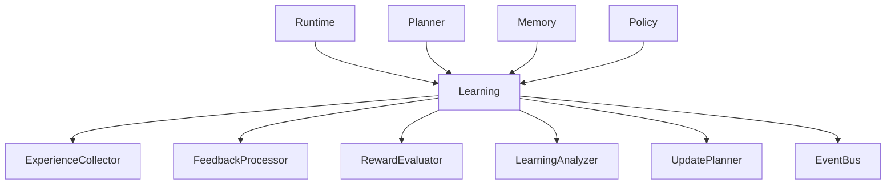
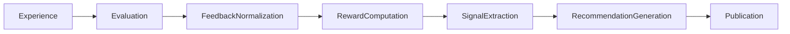

# RFC-0007

**Title:** Learning System

**Document ID:** RFC-0007

**Version:** 1.0

**Status:** Accepted

**Category:** Services

**Layer:** Services

**Target:**

```text
services/learning/
```

---

# Abstract

This RFC defines the SH-3 Learning System.

The Learning System is responsible for transforming execution outcomes into reusable knowledge.

It collects experiences, evaluates outcomes, processes feedback, extracts learning signals, requests model improvements, and records learning artifacts.

The Learning System does **not** execute plans, enforce policies, or directly modify Runtime behavior.

This document is normative.

---

# Motivation

An autonomous system must improve from experience.

Without a dedicated Learning System:

- failures repeat
- successful strategies are not reinforced
- optimization lacks evidence
- execution quality stagnates
- adaptation becomes inconsistent

The Learning System provides a deterministic and explainable learning architecture.

---

# Goals

The Learning System SHALL provide:

- experience collection
- feedback processing
- outcome evaluation
- reward computation
- learning signal extraction
- knowledge refinement
- model update requests
- learning history
- deterministic learning workflows
- extensibility

---

# Non-Goals

The Learning System SHALL NOT:

- execute Runtime tasks
- generate plans
- authorize execution
- directly modify deployed models
- manage persistence engines
- schedule infrastructure resources

---

# Architecture



The Learning System transforms experience into improvement requests.

---

# Design Principles

The Learning System follows these principles.

## Experience-Driven

Learning originates from observable execution outcomes.

---

## Deterministic

Equivalent learning inputs SHALL produce equivalent learning results.

---

## Explainable

Learning artifacts should include sufficient information to explain why a learning decision was made.

---

## Replaceable

Learning algorithms and evaluation strategies shall remain replaceable.

---

## Separation of Concerns

Learning analyzes experience.

Optimizer improves systems.

Memory stores knowledge.

Runtime executes workloads.

---

# Learning Components

The Learning System consists of the following logical components.

| Component | Responsibility |
|-----------|----------------|
| ExperienceCollector | Collect execution experiences |
| FeedbackProcessor | Normalize feedback |
| RewardEvaluator | Compute reward signals |
| LearningAnalyzer | Extract learning signals |
| UpdatePlanner | Produce improvement requests |
| LearningManager | Coordinate learning |

Each component owns one architectural responsibility.

---

# Learning Manager

LearningManager coordinates all learning activities.

Responsibilities include:

- experience ingestion
- evaluation coordination
- learning publication
- lifecycle management
- diagnostics

LearningManager does not modify deployed components directly.

---

# Experience

An Experience represents one completed execution outcome.

Every Experience SHALL contain:

| Field | Description |
|--------|-------------|
| experience_id | Unique identifier |
| execution_id | Associated execution |
| goal_id | Originating goal |
| outcome | Execution result |
| duration | Execution duration |
| metadata | Structured metadata |

Experiences are immutable once recorded.

---

# Feedback

Feedback provides additional evaluation information.

Feedback may originate from:

- Runtime
- Planner
- Policy
- User
- External systems
- Autonomous evaluation

Feedback remains independent of execution.

---

# Reward Model

The Learning System computes normalized reward values.

Representative reward sources include:

- successful execution
- failed execution
- policy compliance
- resource efficiency
- execution latency
- user satisfaction

Reward computation remains deterministic.

---

# Learning Signal

Learning signals represent actionable improvement information.

Signals may include:

- successful strategy
- failure pattern
- optimization opportunity
- capability limitation
- policy conflict
- planning weakness

Signals are immutable once generated.

---

# Outcome Evaluation

Outcome evaluation analyzes:

- success
- failure
- efficiency
- resource utilization
- correctness
- stability

Evaluation precedes reward computation.

---

# Learning Cycle

Every learning request follows the sequence below.

```text
Experience Received
        │
Outcome Evaluation
        │
Feedback Processing
        │
Reward Computation
        │
Learning Analysis
        │
Update Planning
        │
Learning Published
```

Learning concludes when an immutable Learning Result is published.

---

# Learning Result

Every completed learning cycle produces one Learning Result.

A Learning Result SHALL include:

| Field | Description |
|--------|-------------|
| result_id | Unique identifier |
| experience_id | Source experience |
| reward | Computed reward |
| signals | Extracted learning signals |
| recommendations | Improvement requests |
| confidence | Confidence estimate |
| metadata | Additional information |

Learning Results are immutable.

---

# Update Planning

UpdatePlanner converts learning signals into structured improvement requests.

Improvement requests may target:

- Planner
- Memory
- Optimizer
- Model training
- Configuration
- Diagnostics

The Learning System requests improvements.

It never applies them directly.

---

# Learning Events

Representative events include:

- ExperienceRecorded
- OutcomeEvaluated
- FeedbackProcessed
- RewardComputed
- LearningSignalGenerated
- UpdatePlanned
- LearningCompleted
- LearningPublished

Learning events integrate with the EventBus.

---

# Learning Model

The Learning System transforms execution experience into reusable improvement knowledge.

Learning is organized into deterministic processing stages.



Each stage owns one architectural responsibility.

---

# Learning Context

Every learning operation receives one immutable LearningContext.

A LearningContext should contain:

| Field | Description |
|--------|-------------|
| context_id | Unique identifier |
| execution_id | Runtime execution |
| experience_id | Source experience |
| planner_context | Planning metadata |
| runtime_context | Runtime metadata |
| memory_context | Relevant knowledge |
| metadata | Additional information |

LearningContext exists only during one learning cycle.

---

# Experience Collection

ExperienceCollector gathers execution information from participating services.

Representative inputs include:

- execution results
- planner outcomes
- policy decisions
- runtime metrics
- diagnostic events
- user feedback

Collection shall preserve chronological ordering.

---

# Feedback Processing

FeedbackProcessor normalizes incoming feedback into a common representation.

Normalization may include:

- score normalization
- confidence normalization
- metadata validation
- source verification
- duplicate elimination

Normalization shall preserve semantic meaning.

---

# Reward Computation

RewardEvaluator computes one normalized reward value.

Reward factors may include:

- task completion
- execution efficiency
- policy compliance
- resource utilization
- latency
- reliability
- user evaluation

Reward computation shall be deterministic.

---

# Signal Extraction

LearningAnalyzer extracts reusable knowledge from evaluated experiences.

Representative signals include:

- repeated failures
- successful execution patterns
- planner inefficiencies
- capability bottlenecks
- optimization opportunities
- anomalous behavior

Signals should remain implementation-independent.

---

# Recommendation Generation

UpdatePlanner converts learning signals into structured recommendations.

Recommendation targets may include:

- Planner
- Memory
- Optimizer
- Self-Healing
- configuration
- future training

Recommendations are advisory.

Execution belongs to downstream services.

---

# Knowledge Integration

Learning results may be submitted to the Memory System.

Examples include:

- successful strategies
- failure analyses
- optimization histories
- execution summaries
- learned heuristics

The Learning System shall not bypass the Memory API.

---

# Planner Integration

Learning may recommend planning improvements.

Representative recommendations include:

- improved goal decomposition
- dependency refinements
- alternative planning strategies
- confidence adjustments

The Planner determines whether recommendations are adopted.

---

# Optimizer Integration

Learning supplies evidence to the Optimizer.

Examples include:

- performance trends
- bottleneck identification
- resource utilization
- stability metrics

Optimization decisions remain outside the Learning System.

---

# Self-Healing Integration

Learning may identify recurring failures requiring automated recovery.

Examples include:

- repeated execution failures
- unstable services
- degraded performance
- resource exhaustion

Recovery execution belongs to the Self-Healing System.

---

# Memory Integration

Learning retrieves historical knowledge through the Memory System.

Representative retrieval includes:

- similar experiences
- historical rewards
- previous recommendations
- successful recoveries

The Learning System remains independent of storage implementation.

---

# Failure Handling

Learning failures shall produce structured diagnostic information.

Representative failures include:

- malformed experience
- invalid feedback
- reward computation error
- recommendation failure
- inconsistent context

Failures shall generate Learning events.

---

# Recovery

Recovery strategies may include:

- reevaluation
- feedback replay
- reward recomputation
- recommendation regeneration

Recovery shall not modify previously published Learning Results.

---

# Thread Model

The Learning System shall support concurrent learning sessions.

Independent learning cycles shall remain isolated.

Shared mutable state should be minimized.

The reference implementation shall be thread-safe.

---

# Metrics

The Learning System shall expose operational metrics.

Representative metrics include:

- processed experiences
- generated learning results
- reward distribution
- recommendation count
- learning latency
- failed learning cycles
- feedback volume
- confidence distribution

Metric collection should impose minimal runtime overhead.

---

# Logging

Learning logging shall produce structured records.

Recommended categories include:

- experience collection
- feedback processing
- reward computation
- signal extraction
- recommendation generation
- diagnostics

Log records should include experience identifiers and trace identifiers whenever available.

---

# Tracing

Learning operations participate in the global tracing system.

Trace propagation shall preserve:

- trace_id
- execution_id
- experience_id
- learning_result_id

Tracing enables complete visibility from execution through improvement generation.

---

# Security Considerations

The Learning System shall preserve:

- experience integrity
- reward integrity
- recommendation integrity
- context integrity

Authorization and identity management remain outside the Learning System.

---

# Public Interfaces

The Learning public API is defined separately in:

```text
docs/api/learning_api.md
```

This RFC specifies Learning behavior.

API specifications define callable interfaces.

---

# Compatibility

Future Learning implementations shall remain compatible with this specification.

Possible future implementations include:

- supervised learning pipelines
- reinforcement learning systems
- continual learning
- federated learning
- online learning
- self-supervised learning

Observable Learning behavior shall remain consistent.

---

# Performance Objectives

The Learning System should optimize for:

- deterministic learning
- low evaluation latency
- scalable experience processing
- efficient reward computation
- predictable resource usage

Performance improvements shall preserve correctness, reproducibility, and explainability.

---

# Future Work

Potential future enhancements include:

- causal inference analysis
- adaptive reward functions
- curriculum learning
- world-model-guided learning
- multi-agent knowledge sharing
- autonomous hypothesis generation
- long-term learning consolidation

These enhancements extend the Learning architecture without changing its core responsibilities.

---

# References

- SH-3 Architecture Specification v2.1
- RFC-0000 Documentation Standard
- RFC-0001 Event System
- RFC-0002 Runtime System
- RFC-0003 Kernel System
- RFC-0004 Planner System
- RFC-0005 Memory System
- RFC-0006 Policy System

---

# End of RFC-0007
