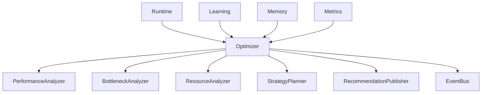
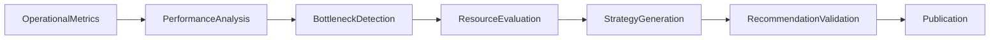

# RFC-0008

**Title:** Optimizer System

**Document ID:** RFC-0008

**Version:** 1.0

**Status:** Accepted

**Category:** Services

**Layer:** Services

**Target:**

```text
services/optimizer/
```

---

# Abstract

This RFC defines the SH-3 Optimizer System.

The Optimizer System continuously analyzes operational performance and produces optimization strategies for the SH-3 platform.

It identifies bottlenecks, evaluates resource utilization, recommends execution improvements, and coordinates optimization requests.

The Optimizer does **not** directly execute optimizations.

Execution belongs to the Runtime.

Knowledge storage belongs to the Memory System.

Learning belongs to the Learning System.

This document is normative.

---

# Motivation

An autonomous AI operating system must improve operational efficiency over time.

Without a dedicated Optimizer:

- resource usage becomes inefficient
- bottlenecks remain unresolved
- execution latency increases
- scalability deteriorates
- optimization logic becomes duplicated

The Optimizer provides centralized, explainable, and deterministic optimization.

---

# Goals

The Optimizer SHALL provide:

- performance analysis
- bottleneck detection
- optimization planning
- resource analysis
- execution analysis
- optimization recommendation
- optimization history
- optimization metrics
- deterministic optimization workflows
- extensibility

---

# Non-Goals

The Optimizer SHALL NOT:

- execute runtime tasks
- modify deployed services directly
- schedule workloads
- persist knowledge
- enforce security policies
- replace the Runtime scheduler

---

# Architecture



The Optimizer transforms operational observations into optimization recommendations.

---

# Design Principles

The Optimizer follows these principles.

## Evidence-Based

Optimization decisions shall be supported by measurable operational data.

---

## Deterministic

Equivalent optimization inputs SHALL produce equivalent recommendations.

---

## Explainable

Optimization recommendations should include sufficient evidence and justification.

---

## Replaceable

Optimization strategies shall remain independently replaceable.

---

## Separation of Concerns

The Optimizer analyzes.

Runtime executes.

Learning improves.

Memory stores.

---

# Optimizer Components

The Optimizer consists of the following logical components.

| Component | Responsibility |
|-----------|----------------|
| PerformanceAnalyzer | Analyze operational metrics |
| BottleneckAnalyzer | Detect execution bottlenecks |
| ResourceAnalyzer | Evaluate resource utilization |
| StrategyPlanner | Produce optimization strategies |
| RecommendationPublisher | Publish recommendations |
| OptimizerManager | Coordinate optimization |

Each component owns one architectural responsibility.

---

# Optimizer Manager

OptimizerManager coordinates optimization activities.

Responsibilities include:

- optimization requests
- analysis coordination
- recommendation publication
- lifecycle management
- diagnostics

OptimizerManager does not modify system components directly.

---

# Optimization Request

Every optimization cycle begins with an Optimization Request.

An Optimization Request SHALL contain:

| Field | Description |
|--------|-------------|
| request_id | Unique identifier |
| execution_scope | Optimization scope |
| metrics | Collected operational metrics |
| objectives | Optimization goals |
| metadata | Additional information |

Optimization Requests are immutable.

---

# Performance Analysis

PerformanceAnalyzer evaluates operational characteristics.

Representative measurements include:

- execution latency
- throughput
- queue depth
- service response time
- pipeline duration
- scheduler efficiency

Performance analysis precedes optimization planning.

---

# Bottleneck Analysis

BottleneckAnalyzer identifies limiting factors.

Representative bottlenecks include:

- CPU saturation
- memory pressure
- queue congestion
- synchronization delays
- pipeline imbalance
- service contention

Bottleneck identification should remain deterministic.

---

# Resource Analysis

ResourceAnalyzer evaluates utilization of available resources.

Examples include:

- processor usage
- memory allocation
- storage utilization
- network bandwidth
- accelerator usage
- cache efficiency

Resource observations become optimization inputs.

---

# Optimization Strategy

An Optimization Strategy represents a proposed system improvement.

Every strategy SHALL include:

| Field | Description |
|--------|-------------|
| strategy_id | Unique identifier |
| objective | Optimization objective |
| expected_benefit | Estimated improvement |
| estimated_cost | Estimated implementation cost |
| confidence | Confidence estimate |
| metadata | Additional information |

Optimization strategies remain immutable.

---

# Recommendation Generation

StrategyPlanner converts operational observations into optimization recommendations.

Representative recommendations include:

- scheduling improvements
- resource balancing
- configuration tuning
- pipeline restructuring
- cache optimization
- execution strategy refinement

Recommendations are advisory.

Implementation belongs to downstream services.

---

# Optimization Cycle

Every optimization request follows the sequence below.

```text
Metrics Collected
        │
Performance Analysis
        │
Bottleneck Detection
        │
Resource Analysis
        │
Strategy Generation
        │
Recommendation Publication
```

Optimization concludes when immutable recommendations are published.

---

# Optimization Events

Representative events include:

- OptimizationRequested
- PerformanceAnalyzed
- BottleneckDetected
- ResourceAnalyzed
- StrategyGenerated
- RecommendationPublished
- OptimizationCompleted

Optimizer events integrate with the EventBus.

---

# Optimization Model

The Optimizer transforms operational observations into structured optimization recommendations.

Optimization is organized into deterministic processing stages.



Each stage owns one architectural responsibility.

---

# Optimization Context

Every optimization operation receives one immutable OptimizationContext.

An OptimizationContext should contain:

| Field | Description |
|--------|-------------|
| context_id | Unique identifier |
| execution_id | Runtime execution identifier |
| request_id | Optimization request identifier |
| runtime_context | Runtime metadata |
| learning_context | Learning results |
| memory_context | Historical optimization data |
| metadata | Additional information |

The OptimizationContext exists only during one optimization cycle.

---

# Metrics Collection

The Optimizer consumes operational metrics from Runtime and Infrastructure.

Representative metrics include:

- execution latency
- throughput
- CPU utilization
- memory utilization
- storage utilization
- queue depth
- event throughput
- scheduler latency
- pipeline duration
- service response time

Metrics shall remain immutable throughout one optimization cycle.

---

# Performance Evaluation

PerformanceAnalyzer evaluates operational efficiency.

Evaluation may include:

- latency analysis
- throughput analysis
- utilization trends
- workload distribution
- execution variance
- efficiency scoring

Evaluation results become optimization evidence.

---

# Bottleneck Detection

BottleneckAnalyzer identifies execution constraints.

Representative bottleneck categories include:

- computational bottlenecks
- memory bottlenecks
- storage bottlenecks
- network bottlenecks
- synchronization bottlenecks
- scheduling bottlenecks

Detected bottlenecks shall include supporting evidence.

---

# Resource Optimization

ResourceAnalyzer evaluates opportunities to improve resource utilization.

Optimization targets may include:

- CPU allocation
- memory allocation
- cache efficiency
- thread utilization
- storage access
- network usage

Resource recommendations remain implementation-independent.

---

# Strategy Generation

StrategyPlanner generates one or more Optimization Strategies.

Strategies may target:

- Runtime
- Kernel
- Planner
- Memory
- Learning
- Infrastructure
- Deployment

Strategies shall not directly modify system behavior.

---

# Recommendation Validation

Every generated recommendation should be validated before publication.

Validation should verify:

- internal consistency
- applicability
- expected benefit
- dependency completeness

Invalid recommendations shall be rejected.

---

# Recommendation Model

Each Optimization Recommendation SHALL include:

| Field | Description |
|--------|-------------|
| recommendation_id | Unique identifier |
| strategy_id | Associated strategy |
| target | Optimization target |
| expected_gain | Estimated improvement |
| confidence | Confidence estimate |
| rationale | Structured explanation |
| metadata | Additional information |

Recommendations remain immutable after publication.

---

# Learning Integration

The Optimizer consumes Learning Results as optimization evidence.

Representative inputs include:

- repeated failures
- successful execution patterns
- reward trends
- recommendation history

Learning remains the authoritative source of improvement signals.

---

# Memory Integration

The Optimizer retrieves historical optimization information through the Memory System.

Examples include:

- previous optimizations
- historical bottlenecks
- execution summaries
- performance baselines

The Optimizer shall not access persistence directly.

---

# Runtime Integration

Optimization recommendations may be consumed by the Runtime.

Representative recommendations include:

- scheduler configuration
- pipeline optimization
- queue tuning
- timeout adjustments

Runtime determines whether recommendations are applied.

---

# Failure Handling

Optimization failures shall produce structured diagnostic information.

Representative failures include:

- missing metrics
- inconsistent measurements
- invalid optimization requests
- analysis timeout
- strategy generation failure

Failures shall generate Optimizer events.

---

# Recovery

Recovery strategies may include:

- reanalysis
- metric recollection
- strategy regeneration
- recommendation replay

Recovery shall not modify previously published recommendations.

---

# Thread Model

The Optimizer shall support concurrent optimization sessions.

Independent optimization cycles shall remain isolated.

Shared mutable state should be minimized.

The reference implementation shall be thread-safe.

---

# Metrics

The Optimizer shall expose operational metrics.

Representative metrics include:

- optimization requests
- generated strategies
- published recommendations
- optimization latency
- detected bottlenecks
- recommendation acceptance rate
- optimization confidence
- resource efficiency trends

Metric collection should impose minimal runtime overhead.

---

# Logging

Optimizer logging shall produce structured records.

Recommended categories include:

- performance analysis
- bottleneck detection
- resource analysis
- strategy generation
- diagnostics

Log records should include recommendation identifiers and trace identifiers whenever available.

---

# Tracing

Optimizer operations participate in the global tracing system.

Trace propagation shall preserve:

- trace_id
- execution_id
- optimization_id
- recommendation_id

Tracing enables complete visibility across optimization workflows.

---

# Security Considerations

The Optimizer shall preserve:

- optimization integrity
- metric integrity
- recommendation integrity
- context integrity

Authorization and execution approval remain outside the Optimizer.

---

# Public Interfaces

The Optimizer public API is defined separately in:

```text
docs/api/optimizer_api.md
```

This RFC specifies Optimizer behavior.

API specifications define callable interfaces.

---

# Compatibility

Future Optimizer implementations shall remain compatible with this specification.

Possible future implementations include:

- adaptive optimization
- predictive optimization
- reinforcement-driven optimization
- distributed optimization
- autonomous optimization planning

Observable Optimizer behavior shall remain consistent.

---

# Performance Objectives

The Optimizer should optimize for:

- deterministic analysis
- efficient metric processing
- scalable optimization planning
- low recommendation latency
- predictable resource usage

Performance improvements shall preserve correctness, reproducibility, and explainability.

---

# Future Work

Potential future enhancements include:

- self-tuning optimization policies
- predictive resource allocation
- workload forecasting
- adaptive scheduling
- energy-aware optimization
- cross-node optimization
- AI-assisted optimization strategies

These enhancements extend the Optimizer architecture without changing its core responsibilities.

---

# References

- SH-3 Architecture Specification v2.1
- RFC-0000 Documentation Standard
- RFC-0001 Event System
- RFC-0002 Runtime System
- RFC-0003 Kernel System
- RFC-0004 Planner System
- RFC-0005 Memory System
- RFC-0006 Policy System
- RFC-0007 Learning System

---

# End of RFC-0008
