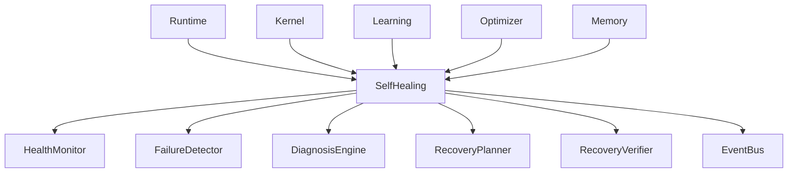
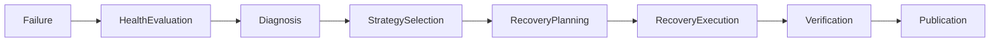

# RFC-0009

**Title:** Self-Healing System

**Document ID:** RFC-0009

**Version:** 1.0

**Status:** Accepted

**Category:** Services

**Layer:** Services

**Target:**

```text
services/self_healing/
```

---

# Abstract

This RFC defines the SH-3 Self-Healing System.

The Self-Healing System detects abnormal conditions, diagnoses failures, selects recovery strategies, coordinates recovery requests, and verifies recovery outcomes.

The Self-Healing System improves system resilience without replacing Runtime supervision, Policy evaluation, or Learning analysis.

Recovery execution is coordinated through Runtime and Kernel.

This document is normative.

---

# Motivation

Long-running autonomous systems inevitably encounter failures.

Without an integrated Self-Healing System:

- transient failures accumulate
- degraded services remain active
- recovery behavior becomes inconsistent
- operational availability decreases
- manual intervention becomes frequent

The Self-Healing System provides deterministic and explainable recovery workflows.

---

# Goals

The Self-Healing System SHALL provide:

- anomaly detection
- health evaluation
- failure diagnosis
- recovery planning
- recovery coordination
- verification
- recovery history
- resilience metrics
- deterministic recovery workflows
- extensibility

---

# Non-Goals

The Self-Healing System SHALL NOT:

- execute Runtime scheduling
- rewrite business logic
- replace the Learning System
- replace the Optimizer
- directly modify persistent storage
- bypass Policy decisions

---

# Architecture



The Self-Healing System transforms failures into structured recovery actions.

---

# Design Principles

The Self-Healing System follows these principles.

## Recovery First

Recovery should preserve system availability whenever possible.

---

## Deterministic

Equivalent failures SHALL produce equivalent recovery plans.

---

## Explainable

Every recovery decision should include structured diagnostic evidence.

---

## Replaceable

Detection, diagnosis, and recovery strategies shall remain independently replaceable.

---

## Separation of Concerns

Self-Healing coordinates recovery.

Runtime performs execution.

Learning analyzes outcomes.

Optimizer improves efficiency.

---

# Self-Healing Components

The Self-Healing System consists of the following logical components.

| Component | Responsibility |
|-----------|----------------|
| HealthMonitor | Observe operational health |
| FailureDetector | Detect failures |
| DiagnosisEngine | Analyze root causes |
| RecoveryPlanner | Build recovery plans |
| RecoveryVerifier | Validate recovery |
| SelfHealingManager | Coordinate recovery |

Each component owns one architectural responsibility.

---

# SelfHealingManager

SelfHealingManager coordinates all recovery operations.

Responsibilities include:

- anomaly processing
- diagnosis coordination
- recovery publication
- lifecycle management
- diagnostics

The manager does not directly restart services.

---

# Health Model

Every monitored object exposes one health state.

Supported states include:

| State | Description |
|--------|-------------|
| Healthy | Normal operation |
| Degraded | Reduced capability |
| Recovering | Active recovery |
| Failed | Recovery required |
| Offline | Not operational |

Health transitions shall generate events.

---

# Health Monitoring

HealthMonitor continuously evaluates operational state.

Representative observations include:

- service responsiveness
- execution latency
- queue depth
- resource exhaustion
- repeated failures
- timeout frequency

Monitoring should remain lightweight.

---

# Failure Detection

FailureDetector identifies operational abnormalities.

Representative failures include:

- execution timeout
- service crash
- dependency failure
- resource exhaustion
- communication failure
- configuration inconsistency

Detected failures become immutable Failure Records.

---

# Failure Record

Every detected failure SHALL contain:

| Field | Description |
|--------|-------------|
| failure_id | Unique identifier |
| execution_id | Associated execution |
| component | Affected component |
| severity | Failure severity |
| symptoms | Observed symptoms |
| timestamp | Detection time |
| metadata | Additional information |

Failure Records remain immutable.

---

# Diagnosis

DiagnosisEngine analyzes observed failures.

Diagnosis may consider:

- historical failures
- runtime state
- dependency graph
- recent configuration
- operational metrics
- recovery history

Diagnosis shall produce structured evidence.

---

# Recovery Strategy

A Recovery Strategy represents a proposed corrective action.

Every strategy SHALL include:

| Field | Description |
|--------|-------------|
| strategy_id | Unique identifier |
| objective | Recovery objective |
| recovery_type | Recovery classification |
| confidence | Confidence estimate |
| estimated_cost | Estimated impact |
| metadata | Additional information |

Recovery Strategies remain immutable.

---

# Recovery Planning

RecoveryPlanner converts diagnosis results into executable recovery requests.

Representative recovery actions include:

- retry execution
- restart service
- rebuild context
- reload configuration
- isolate component
- request operator intervention

Recovery execution belongs to Runtime and Kernel.

---

# Recovery Verification

RecoveryVerifier evaluates whether recovery succeeded.

Verification may inspect:

- service health
- execution completion
- operational metrics
- dependency stability
- repeated failures

Verification concludes the recovery cycle.

---

# Recovery Lifecycle

Every recovery request follows the sequence below.

```text
Failure Detected
        │
Health Evaluation
        │
Diagnosis
        │
Recovery Planning
        │
Recovery Execution
        │
Recovery Verification
        │
Recovery Completed
```

Recovery concludes after verification.

---

# Self-Healing Events

Representative events include:

- HealthChanged
- FailureDetected
- DiagnosisCompleted
- RecoveryPlanned
- RecoveryStarted
- RecoverySucceeded
- RecoveryFailed
- RecoveryVerified

Self-Healing events integrate with the EventBus.

---

# Recovery Model

The Self-Healing System transforms operational failures into validated recovery outcomes.

Recovery is organized into deterministic processing stages.



Each stage owns one architectural responsibility.

---

# Recovery Context

Every recovery operation receives one immutable RecoveryContext.

A RecoveryContext should contain:

| Field | Description |
|--------|-------------|
| context_id | Unique identifier |
| execution_id | Runtime execution identifier |
| failure_id | Failure identifier |
| runtime_context | Runtime metadata |
| learning_context | Historical learning evidence |
| memory_context | Relevant recovery history |
| metadata | Additional information |

The RecoveryContext exists only during one recovery cycle.

---

# Health Evaluation

Health evaluation determines the operational state of affected components.

Representative evaluation targets include:

- Runtime services
- Kernel coordination
- EventBus
- pipelines
- schedulers
- infrastructure resources

Health evaluation shall produce reproducible results.

---

# Failure Classification

Failures shall be classified before recovery planning.

Representative classifications include:

- transient
- persistent
- configuration
- dependency
- resource
- infrastructure
- external

Classification assists deterministic strategy selection.

---

# Root Cause Analysis

DiagnosisEngine performs structured root cause analysis.

Diagnosis may consider:

- dependency graphs
- execution traces
- historical failures
- operational metrics
- recovery outcomes
- configuration history

Diagnosis shall produce structured diagnostic evidence.

---

# Strategy Selection

RecoveryPlanner selects one or more recovery strategies.

Representative strategies include:

- retry execution
- restart component
- recreate execution context
- isolate unhealthy service
- rollback configuration
- request manual intervention

Strategies remain advisory until accepted by Runtime.

---

# Recovery Execution

The Runtime performs recovery execution.

The Self-Healing System coordinates but does not execute recovery actions.

Execution outcomes shall be reported back for verification.

---

# Verification Model

RecoveryVerifier determines whether recovery objectives were achieved.

Verification criteria may include:

- health restoration
- successful execution
- dependency stability
- resource normalization
- absence of repeated failures

Verification results become immutable Recovery Results.

---

# Recovery Result

Every completed recovery cycle SHALL produce one Recovery Result.

| Field | Description |
|--------|-------------|
| recovery_id | Unique identifier |
| failure_id | Associated failure |
| strategy_id | Applied strategy |
| outcome | Recovery outcome |
| confidence | Verification confidence |
| metadata | Additional information |

Recovery Results remain immutable.

---

# Learning Integration

Recovery outcomes may be submitted to the Learning System.

Representative learning artifacts include:

- successful recovery patterns
- failed recovery attempts
- recovery duration
- diagnosis accuracy
- recurring failures

Learning determines future improvement opportunities.

---

# Memory Integration

Recovery history shall be stored through the Memory System.

Representative records include:

- failure summaries
- diagnosis reports
- recovery strategies
- verification results

The Self-Healing System shall never bypass the Memory API.

---

# Optimizer Integration

The Optimizer may consume recovery history.

Representative optimization targets include:

- repeated bottlenecks
- unstable services
- excessive restart frequency
- degraded execution paths

Optimization remains independent of recovery.

---

# Planner Integration

The Planner may request replanning following successful recovery.

Representative scenarios include:

- unavailable capability restored
- dependency graph changed
- execution interrupted
- policy reevaluation required

Planning remains outside the Self-Healing System.

---

# Failure Handling

Failures occurring during recovery shall produce structured diagnostic information.

Representative recovery failures include:

- verification timeout
- repeated restart failure
- unrecoverable dependency
- inconsistent runtime state
- invalid recovery strategy

Recovery failures shall generate Self-Healing events.

---

# Escalation

Recovery escalation should occur when automatic recovery is unsuccessful.

Representative escalation actions include:

- alternative recovery strategy
- service isolation
- degraded operating mode
- operator notification
- controlled shutdown

Escalation policies remain configurable.

---

# Thread Model

The Self-Healing System shall support concurrent recovery sessions.

Independent recovery operations shall remain isolated.

Shared mutable state should be minimized.

The reference implementation shall be thread-safe.

---

# Metrics

The Self-Healing System shall expose operational metrics.

Representative metrics include:

- detected failures
- successful recoveries
- failed recoveries
- recovery latency
- diagnosis accuracy
- restart frequency
- escalation count
- recovery confidence

Metric collection should impose minimal runtime overhead.

---

# Logging

Self-Healing logging shall produce structured records.

Recommended categories include:

- health monitoring
- failure detection
- diagnosis
- recovery planning
- verification
- diagnostics

Log records should include failure identifiers, recovery identifiers, and trace identifiers whenever available.

---

# Tracing

Self-Healing operations participate in the global tracing system.

Trace propagation shall preserve:

- trace_id
- execution_id
- failure_id
- recovery_id

Tracing enables end-to-end visibility across failure detection, recovery, and verification.

---

# Security Considerations

The Self-Healing System shall preserve:

- recovery integrity
- diagnostic integrity
- context integrity
- verification integrity

Recovery operations shall remain subject to Policy decisions where applicable.

---

# Public Interfaces

The Self-Healing public API is defined separately in:

```text
docs/api/self_healing_api.md
```

This RFC specifies Self-Healing behavior.

API specifications define callable interfaces.

---

# Compatibility

Future Self-Healing implementations shall remain compatible with this specification.

Possible future implementations include:

- predictive recovery
- distributed self-healing
- autonomous resilience management
- AI-assisted diagnosis
- multi-node recovery coordination

Observable Self-Healing behavior shall remain consistent.

---

# Performance Objectives

The Self-Healing System should optimize for:

- deterministic diagnosis
- rapid recovery planning
- efficient verification
- scalable concurrent recovery
- predictable resource usage

Performance improvements shall preserve correctness, reproducibility, and explainability.

---

# Future Work

Potential future enhancements include:

- predictive failure detection
- autonomous recovery optimization
- cross-cluster resilience
- adaptive recovery policies
- causal diagnosis graphs
- self-healing knowledge consolidation
- resilience-aware planning

These enhancements extend the Self-Healing architecture without changing its core responsibilities.

---

# References

- SH-3 Architecture Specification v2.1
- RFC-0000 Documentation Standard
- RFC-0001 Event System
- RFC-0002 Runtime System
- RFC-0003 Kernel System
- RFC-0004 Planner System
- RFC-0005 Memory System
- RFC-0006 Policy System
- RFC-0007 Learning System
- RFC-0008 Optimizer System

---

# End of RFC-0009
