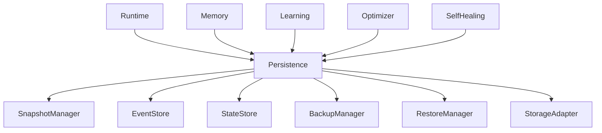

# RFC-0010

**Title:** Persistence System

**Document ID:** RFC-0010

**Version:** 1.0

**Status:** Accepted

**Category:** Infrastructure

**Layer:** Infrastructure

**Target:**

```text
infrastructure/persistence/
```

---

# Abstract

This RFC defines the SH-3 Persistence System.

The Persistence System provides durable storage for runtime state, events, configuration snapshots, memory records, execution artifacts, and recovery information.

It abstracts storage implementations behind stable interfaces and guarantees deterministic persistence semantics.

The Persistence System does not perform planning, learning, optimization, or execution.

This document is normative.

---

# Motivation

Long-running autonomous systems require reliable durability.

Without a dedicated Persistence System:

- execution history is lost
- recovery becomes unreliable
- configuration cannot be restored
- learning artifacts disappear
- auditing becomes incomplete

The Persistence System provides a unified durability architecture.

---

# Goals

The Persistence System SHALL provide:

- durable storage
- snapshot management
- event log persistence
- state persistence
- backup support
- restore support
- storage abstraction
- integrity verification
- deterministic persistence behavior
- extensibility

---

# Non-Goals

The Persistence System SHALL NOT:

- evaluate policies
- execute Runtime tasks
- generate plans
- analyze learning
- optimize execution
- replace the Memory Service

The Memory Service owns knowledge.

Persistence owns durability.

---

# Architecture



Persistence provides durable storage through abstract interfaces.

---

# Design Principles

The Persistence System follows these principles.

## Durable

Committed data shall survive process termination.

---

## Deterministic

Equivalent persistence requests SHALL produce equivalent stored representations.

---

## Replaceable

Storage engines shall remain independently replaceable.

---

## Storage Agnostic

The Persistence API shall not expose implementation-specific behavior.

---

## Immutable Records

Whenever practical, persisted records should be append-only.

Mutable state should be represented through versioned revisions.

---

# Persistence Components

The Persistence System consists of the following logical components.

| Component | Responsibility |
|-----------|----------------|
| SnapshotManager | Snapshot lifecycle |
| EventStore | Event persistence |
| StateStore | Runtime state persistence |
| BackupManager | Backup management |
| RestoreManager | Restore coordination |
| StorageAdapter | Storage abstraction |
| PersistenceManager | System coordination |

Each component owns one architectural responsibility.

---

# PersistenceManager

PersistenceManager coordinates all persistence operations.

Responsibilities include:

- persistence requests
- storage routing
- integrity verification
- lifecycle management
- diagnostics

PersistenceManager does not expose storage implementation details.

---

# Storage Adapter

StorageAdapter abstracts physical storage technologies.

Supported implementations may include:

- local filesystem
- embedded database
- relational database
- object storage
- distributed storage
- cloud storage

Storage adapters shall implement identical observable behavior.

---

# Snapshot

A Snapshot represents a complete point-in-time system state.

Every Snapshot SHALL contain:

| Field | Description |
|--------|-------------|
| snapshot_id | Unique identifier |
| timestamp | Creation time |
| version | Schema version |
| scope | Snapshot scope |
| checksum | Integrity verification |
| metadata | Additional information |

Snapshots remain immutable once committed.

---

# Event Store

EventStore persistently records EventBus traffic.

Representative event categories include:

- Runtime events
- Kernel events
- Planner events
- Memory events
- Learning events
- Recovery events

Event ordering shall be preserved.

---

# State Store

StateStore persists mutable system state.

Representative state includes:

- Runtime state
- Kernel state
- configuration
- service metadata
- scheduler state

State persistence should support versioning.

---

# Backup Manager

BackupManager coordinates backup operations.

Representative responsibilities include:

- backup scheduling
- backup validation
- backup rotation
- archive creation
- retention management

Backup policies remain configurable.

---

# Restore Manager

RestoreManager coordinates recovery from persisted data.

Restore operations may target:

- snapshots
- event logs
- state records
- configuration
- complete system recovery

Restore execution shall be deterministic.

---

# Persistence Record

Every persisted object SHALL contain:

| Field | Description |
|--------|-------------|
| record_id | Unique identifier |
| record_type | Classification |
| version | Schema version |
| checksum | Integrity verification |
| timestamp | Creation time |
| metadata | Additional information |

Persistence Records remain immutable after commitment.

---

# Persistence Lifecycle

Every persistence request follows the sequence below.

```text
Persistence Requested
        │
Validation
        │
Serialization
        │
Storage
        │
Integrity Verification
        │
Commit
        │
Publication
```

Commit concludes the persistence cycle.

---

# Persistence Events

Representative events include:

- PersistenceRequested
- SnapshotCreated
- StateStored
- EventStored
- BackupCompleted
- RestoreStarted
- RestoreCompleted
- PersistenceCommitted

Persistence events integrate with the EventBus.

---

# Persistence Model

The Persistence System transforms transient operational data into durable, verifiable records.

Persistence is organized into deterministic processing stages.


Each stage owns one architectural responsibility.

---

# Persistence Context

Every persistence operation receives one immutable PersistenceContext.

A PersistenceContext should contain:

| Field | Description |
|--------|-------------|
| context_id | Unique identifier |
| request_id | Persistence request identifier |
| execution_id | Runtime execution identifier |
| storage_target | Selected storage adapter |
| schema_version | Serialization schema |
| metadata | Additional information |

The PersistenceContext exists only during one persistence cycle.

---

# Validation

Every persistence request shall be validated before serialization.

Validation should verify:

- schema validity
- type correctness
- required fields
- version compatibility
- identifier uniqueness

Invalid requests shall be rejected.

---

# Serialization

Persistence records shall be converted into deterministic serialized representations.

Serialization shall preserve:

- field ordering
- identifier integrity
- schema version
- metadata
- timestamps

Equivalent records shall produce identical serialized output.

---

# Storage Selection

StorageAdapter selection determines the physical persistence backend.

Selection factors may include:

- storage policy
- record classification
- durability requirements
- replication requirements
- archive policies

Storage routing shall remain deterministic.

---

# Write Operation

StorageAdapter performs durable write operations.

Representative write targets include:

- snapshots
- event logs
- state records
- configuration records
- diagnostic artifacts
- recovery records

Write completion precedes integrity verification.

---

# Integrity Verification

Every committed record shall be verified.

Verification may include:

- checksum validation
- version verification
- serialization validation
- record completeness
- storage acknowledgement

Verification failures shall prevent commit.

---

# Commit Model

A Commit represents successful durable persistence.

Every Commit SHALL include:

| Field | Description |
|--------|-------------|
| commit_id | Unique identifier |
| record_id | Persisted record |
| storage_target | Storage adapter |
| timestamp | Commit time |
| checksum | Verified checksum |
| metadata | Additional information |

Committed records become immutable.

---

# Snapshot Management

SnapshotManager coordinates point-in-time system snapshots.

Snapshot scopes may include:

- Runtime
- Kernel
- Memory
- Planner
- complete system

Snapshots should support deterministic restoration.

---

# Event Persistence

EventStore preserves EventBus history.

Persisted events shall maintain:

- chronological ordering
- event identifiers
- trace identifiers
- execution identifiers
- payload integrity

Event replay support remains implementation-dependent.

---

# State Persistence

StateStore maintains durable operational state.

Representative persisted state includes:

- service state
- scheduler state
- runtime configuration
- deployment metadata
- health information

State revisions should remain versioned.

---

# Backup Integration

BackupManager creates durable backup artifacts.

Backup operations may include:

- full backup
- incremental backup
- differential backup
- archive packaging

Backup execution remains configurable.

---

# Restore Integration

RestoreManager reconstructs system state from durable records.

Restore sources may include:

- snapshots
- backups
- event logs
- state revisions

Restore operations shall preserve consistency.

---

# Memory Integration

The Memory System stores knowledge.

The Persistence System stores durable representations.

Memory persistence shall occur exclusively through Persistence APIs.

---

# Runtime Integration

Runtime requests persistence services through PersistenceManager.

Representative operations include:

- execution checkpoint
- execution completion
- runtime state update
- configuration persistence

Runtime shall remain independent of storage implementations.

---

# Failure Handling

Persistence failures shall produce structured diagnostic information.

Representative failures include:

- serialization failure
- storage unavailable
- integrity mismatch
- checksum failure
- version incompatibility
- commit failure

Failures shall generate Persistence events.

---

# Recovery

Recovery strategies may include:

- retry write
- alternate storage selection
- snapshot reconstruction
- backup restoration
- integrity revalidation

Recovery shall preserve committed data.

---

# Thread Model

The Persistence System shall support concurrent persistence operations.

Independent persistence sessions shall remain isolated.

Shared mutable state should be minimized.

The reference implementation shall be thread-safe.

---

# Metrics

The Persistence System shall expose operational metrics.

Representative metrics include:

- persisted records
- snapshots created
- backup count
- restore count
- write latency
- commit latency
- storage utilization
- integrity verification failures

Metric collection should impose minimal runtime overhead.

---

# Logging

Persistence logging shall produce structured records.

Recommended categories include:

- serialization
- storage operations
- snapshot management
- backup operations
- restore operations
- diagnostics

Log records should include record identifiers, commit identifiers, and trace identifiers whenever available.

---

# Tracing

Persistence operations participate in the global tracing system.

Trace propagation shall preserve:

- trace_id
- execution_id
- request_id
- record_id
- commit_id

Tracing enables complete visibility across persistence workflows.

---

# Security Considerations

The Persistence System shall preserve:

- data integrity
- commit integrity
- storage integrity
- schema integrity

Authentication, encryption, and authorization policies remain outside the Persistence System.

---

# Public Interfaces

The Persistence public API is defined separately in:

```text
docs/api/persistence_api.md
```

This RFC specifies Persistence behavior.

API specifications define callable interfaces.

---

# Compatibility

Future Persistence implementations shall remain compatible with this specification.

Possible future implementations include:

- distributed persistence
- replicated storage
- append-only event stores
- object storage backends
- cloud-native persistence
- immutable storage systems

Observable Persistence behavior shall remain consistent.

---

# Performance Objectives

The Persistence System should optimize for:

- deterministic serialization
- efficient durable writes
- scalable storage throughput
- low commit latency
- predictable storage utilization

Performance improvements shall preserve correctness, reproducibility, and integrity.

---

# Future Work

Potential future enhancements include:

- distributed snapshots
- event replay infrastructure
- multi-region replication
- automatic data compaction
- storage tiering
- archival optimization
- cryptographic integrity verification

These enhancements extend the Persistence architecture without changing its core responsibilities.

---

# References

- SH-3 Architecture Specification v2.1
- RFC-0000 Documentation Standard
- RFC-0001 Event System
- RFC-0002 Runtime System
- RFC-0003 Kernel System
- RFC-0004 Planner System
- RFC-0005 Memory System
- RFC-0006 Policy System
- RFC-0007 Learning System
- RFC-0008 Optimizer System
- RFC-0009 Self-Healing System

---

# End of RFC-0010
