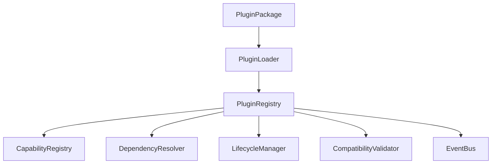

# RFC-0011

**Title:** Plugin System

**Document ID:** RFC-0011

**Version:** 1.0

**Status:** Accepted

**Category:** Infrastructure

**Layer:** Infrastructure

**Target:**

```text
infrastructure/plugins/
```

---

# Abstract

This RFC defines the SH-3 Plugin System.

The Plugin System provides a standardized mechanism for discovering, validating, registering, loading, activating, updating, and unloading extensible components.

It enables the "Everything is Replaceable" philosophy by allowing capabilities to be added or replaced without modifying the SH-3 core architecture.

The Plugin System does not execute application logic or manage business workflows.

This document is normative.

---

# Motivation

Modern AI operating systems require modular extensibility.

Without a unified Plugin System:

- capabilities become tightly coupled
- upgrades require core modifications
- extension interfaces diverge
- dependency management becomes inconsistent
- replacement of components becomes unsafe

The Plugin System provides deterministic and versioned extensibility.

---

# Goals

The Plugin System SHALL provide:

- plugin discovery
- capability registration
- dependency resolution
- lifecycle management
- version compatibility
- hot loading
- hot unloading
- plugin isolation
- deterministic loading
- extensibility

---

# Non-Goals

The Plugin System SHALL NOT:

- schedule Runtime execution
- replace Kernel coordination
- manage persistence
- perform planning
- evaluate policies
- execute optimization logic

---

# Architecture



Plugins extend capabilities through standardized interfaces.

---

# Design Principles

The Plugin System follows these principles.

## Replaceable

Every plugin shall be independently replaceable.

---

## Isolated

Plugins should operate independently from one another.

---

## Deterministic

Equivalent plugin sets SHALL produce identical registration results.

---

## Versioned

All plugins shall declare explicit compatibility information.

---

## Observable

Every lifecycle transition shall produce structured events.

---

# Plugin Components

The Plugin System consists of the following logical components.

| Component | Responsibility |
|-----------|----------------|
| PluginLoader | Load plugin packages |
| PluginRegistry | Register plugins |
| CapabilityRegistry | Register capabilities |
| DependencyResolver | Resolve dependencies |
| CompatibilityValidator | Validate compatibility |
| LifecycleManager | Manage lifecycle |
| PluginManager | Coordinate operations |

Each component owns one architectural responsibility.

---

# PluginManager

PluginManager coordinates all plugin operations.

Responsibilities include:

- plugin discovery
- registration
- activation
- update coordination
- removal
- diagnostics

PluginManager does not execute plugin functionality.

---

# Plugin Package

Every plugin SHALL be distributed as a Plugin Package.

A Plugin Package SHALL contain:

| Field | Description |
|--------|-------------|
| plugin_id | Unique identifier |
| name | Plugin name |
| version | Semantic version |
| author | Plugin author |
| capabilities | Exported capabilities |
| dependencies | Required plugins |
| metadata | Additional information |

Plugin Packages remain immutable after publication.

---

# Plugin Manifest

Each plugin shall provide a manifest.

Representative fields include:

- identifier
- version
- compatibility
- dependencies
- exported services
- required permissions
- entry point

The manifest is authoritative.

---

# Capability

A Capability represents one reusable functional unit.

Examples include:

- planner implementation
- memory provider
- policy engine
- storage adapter
- optimizer module
- external connector

Capabilities are registered independently of plugin packages.

---

# Capability Registry

CapabilityRegistry maintains all available capabilities.

Responsibilities include:

- capability registration
- lookup
- version management
- replacement
- metadata publication

Capability lookup shall be deterministic.

---

# Dependency Resolution

DependencyResolver validates plugin dependencies.

Representative dependency types include:

- required
- optional
- recommended
- version constrained

Unsatisfied required dependencies SHALL prevent activation.

---

# Compatibility Validation

CompatibilityValidator verifies plugin compatibility.

Validation includes:

- SH-3 version
- API version
- capability version
- dependency version
- platform requirements

Invalid plugins SHALL be rejected.

---

# Plugin Lifecycle

Every plugin follows the lifecycle below.

```text
Discovered
      │
Validated
      │
Registered
      │
Loaded
      │
Activated
      │
Suspended
      │
Updated
      │
Unloaded
```

Lifecycle transitions shall be deterministic.

---

# Lifecycle States

Supported lifecycle states include:

- Discovered
- Validated
- Registered
- Loaded
- Activated
- Suspended
- Updating
- Unloaded
- Failed

Each state transition shall generate lifecycle events.

---

# Plugin Events

Representative events include:

- PluginDiscovered
- PluginValidated
- PluginRegistered
- PluginLoaded
- PluginActivated
- PluginSuspended
- PluginUpdated
- PluginUnloaded
- PluginFailed

Plugin events integrate with the EventBus.

---

# Plugin Model

The Plugin System transforms plugin packages into active system capabilities.

Plugin processing is organized into deterministic lifecycle stages.


Each stage owns one architectural responsibility.

---

# Plugin Context

Every plugin operation receives one immutable PluginContext.

A PluginContext should contain:

| Field | Description |
|--------|-------------|
| context_id | Unique identifier |
| plugin_id | Plugin identifier |
| version | Plugin version |
| operation | Lifecycle operation |
| capabilities | Exported capabilities |
| metadata | Additional information |

The PluginContext exists only during one lifecycle operation.

---

# Plugin Discovery

PluginManager discovers available Plugin Packages.

Discovery sources may include:

- local directories
- deployment bundles
- package repositories
- extension folders
- remote registries

Discovery order shall remain deterministic.

---

# Plugin Validation

Every Plugin Package shall be validated before registration.

Validation shall verify:

- manifest structure
- semantic version
- identifier uniqueness
- digital signature (optional)
- required metadata
- package integrity

Invalid packages shall be rejected.

---

# Dependency Resolution

DependencyResolver evaluates plugin dependencies.

Supported dependency relationships include:

- required
- optional
- recommended
- incompatible
- version constrained

Dependency graphs should remain acyclic whenever practical.

---

# Compatibility Verification

CompatibilityValidator determines whether a plugin can execute within the current SH-3 environment.

Validation should verify:

- SH-3 version
- API compatibility
- capability interfaces
- runtime requirements
- platform compatibility

Compatibility verification precedes activation.

---

# Registration

PluginRegistry registers validated plugins.

Registration shall preserve:

- plugin identifiers
- exported capabilities
- version metadata
- dependency metadata
- lifecycle state

Registration shall not execute plugin code.

---

# Capability Registration

CapabilityRegistry publishes exported capabilities.

Capabilities may include:

- Runtime services
- Planner implementations
- Memory providers
- Policy engines
- Optimizers
- Persistence adapters
- Infrastructure services

Capabilities remain independently replaceable.

---

# Plugin Loading

PluginLoader prepares plugins for activation.

Loading may include:

- module initialization
- dependency injection
- interface binding
- configuration loading

Loading does not imply activation.

---

# Plugin Activation

Activation exposes plugin capabilities to SH-3.

Activation shall occur only after:

- successful validation
- dependency resolution
- compatibility verification
- successful loading

Activated plugins become available through CapabilityRegistry.

---

# Plugin Update

Plugin updates shall follow a deterministic sequence.

```text
Deactivate
      │
Validate
      │
Load
      │
Activate
      │
Publish
```

Updates shall preserve system consistency.

---

# Plugin Removal

Plugin removal shall verify:

- dependent capabilities
- active references
- lifecycle state
- cleanup completion

Removal shall not leave unresolved dependencies.

---

# Failure Handling

Plugin failures shall produce structured diagnostic information.

Representative failures include:

- validation failure
- dependency failure
- compatibility mismatch
- activation failure
- initialization exception
- registration conflict

Failures shall generate Plugin events.

---

# Recovery

Recovery strategies may include:

- reload
- rollback
- dependency refresh
- alternate implementation
- plugin isolation

Recovery shall preserve registry consistency.

---

# Security Model

Plugin execution should follow the principle of least privilege.

Representative controls include:

- capability permissions
- restricted APIs
- resource isolation
- lifecycle authorization
- signature verification

Security policies remain configurable.

---

# Thread Model

The Plugin System shall support concurrent lifecycle operations.

Independent plugin operations shall remain isolated.

Shared mutable state should be minimized.

The reference implementation shall be thread-safe.

---

# Metrics

The Plugin System shall expose operational metrics.

Representative metrics include:

- discovered plugins
- registered plugins
- active plugins
- failed activations
- dependency resolution time
- activation latency
- update count
- removal count

Metric collection should impose minimal runtime overhead.

---

# Logging

Plugin logging shall produce structured records.

Recommended categories include:

- discovery
- validation
- dependency resolution
- activation
- updates
- diagnostics

Log records should include plugin identifiers, lifecycle states, and trace identifiers whenever available.

---

# Tracing

Plugin lifecycle operations participate in the global tracing system.

Trace propagation shall preserve:

- trace_id
- plugin_id
- capability_id
- lifecycle_state

Tracing enables complete visibility across plugin operations.

---

# Public Interfaces

The Plugin public API is defined separately in:

```text
docs/api/plugin_api.md
```

This RFC specifies Plugin behavior.

API specifications define callable interfaces.

---

# Compatibility

Future Plugin implementations shall remain compatible with this specification.

Possible future implementations include:

- distributed plugin registries
- marketplace integration
- signed plugin ecosystems
- remote capability loading
- dynamic capability federation

Observable Plugin behavior shall remain consistent.

---

# Performance Objectives

The Plugin System should optimize for:

- deterministic discovery
- fast dependency resolution
- scalable capability registration
- efficient lifecycle management
- predictable resource usage

Performance improvements shall preserve correctness, reproducibility, and compatibility.

---

# Future Work

Potential future enhancements include:

- live plugin migration
- distributed capability discovery
- plugin sandboxing
- dependency graph optimization
- capability negotiation
- automatic compatibility adaptation
- trusted plugin repositories

These enhancements extend the Plugin architecture without changing its core responsibilities.

---

# References

- SH-3 Architecture Specification v2.1
- RFC-0000 Documentation Standard
- RFC-0001 Event System
- RFC-0002 Runtime System
- RFC-0003 Kernel System
- RFC-0004 Planner System
- RFC-0005 Memory System
- RFC-0006 Policy System
- RFC-0007 Learning System
- RFC-0008 Optimizer System
- RFC-0009 Self-Healing System
- RFC-0010 Persistence System

---

# End of RFC-0011
