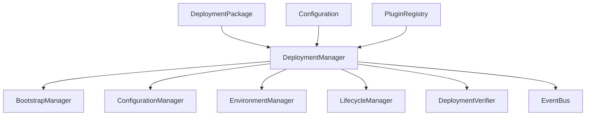

# RFC-0012

**Title:** Deployment System

**Document ID:** RFC-0012

**Version:** 1.0

**Status:** Accepted

**Category:** Deployment

**Layer:** Deployment

**Target:**

```text
deployment/
```

---

# Abstract

This RFC defines the SH-3 Deployment System.

The Deployment System is responsible for assembling, configuring, validating, initializing, operating, updating, and terminating SH-3 deployments.

It provides deterministic deployment workflows, environment abstraction, lifecycle coordination, configuration management, service orchestration, and deployment verification.

The Deployment System does not implement Runtime execution, business logic, planning, learning, or storage.

This document is normative.

---

# Motivation

An AI operating system requires reproducible deployment behavior across development, testing, and production environments.

Without a dedicated Deployment System:

- startup sequences become inconsistent
- configuration diverges
- upgrades become unsafe
- environments behave differently
- operational reliability decreases

The Deployment System provides one deterministic deployment architecture.

---

# Goals

The Deployment System SHALL provide:

- deployment orchestration
- startup coordination
- shutdown coordination
- environment management
- configuration loading
- dependency verification
- deployment validation
- update coordination
- deployment diagnostics
- extensibility

---

# Non-Goals

The Deployment System SHALL NOT:

- schedule Runtime execution
- execute Planner logic
- evaluate Policy
- perform Learning
- optimize Runtime behavior
- implement Persistence engines

Deployment prepares the system.

Runtime operates the system.

---

# Architecture



Deployment coordinates initialization of SH-3.

---

# Design Principles

The Deployment System follows these principles.

## Deterministic

Equivalent deployment inputs SHALL produce equivalent deployments.

---

## Declarative

Deployment behavior should be defined through configuration rather than implementation details.

---

## Replaceable

Deployment providers shall remain independently replaceable.

---

## Observable

Deployment operations shall emit structured lifecycle events.

---

## Environment Independent

Deployment workflows shall remain consistent across supported environments.

---

# Deployment Components

The Deployment System consists of the following logical components.

| Component | Responsibility |
|-----------|----------------|
| BootstrapManager | System initialization |
| ConfigurationManager | Configuration loading |
| EnvironmentManager | Environment abstraction |
| LifecycleManager | Deployment lifecycle |
| DeploymentVerifier | Deployment validation |
| DeploymentManager | System coordination |

Each component owns one architectural responsibility.

---

# DeploymentManager

DeploymentManager coordinates all deployment activities.

Responsibilities include:

- deployment requests
- startup orchestration
- shutdown orchestration
- update coordination
- diagnostics

DeploymentManager does not execute application workloads.

---

# Deployment Package

Every deployment SHALL originate from one Deployment Package.

A Deployment Package SHALL contain:

| Field | Description |
|--------|-------------|
| deployment_id | Unique identifier |
| version | Deployment version |
| configuration | Deployment configuration |
| plugins | Included plugins |
| metadata | Additional information |

Deployment Packages remain immutable after publication.

---

# Configuration Management

ConfigurationManager loads deployment configuration.

Representative configuration sources include:

- local files
- environment variables
- configuration bundles
- deployment manifests
- remote configuration providers

Configuration shall be validated before use.

---

# Environment Management

EnvironmentManager abstracts deployment environments.

Representative environments include:

- Development
- Testing
- Staging
- Production
- Embedded
- Distributed

Environment-specific behavior shall remain configurable.

---

# Bootstrap

BootstrapManager initializes SH-3.

Initialization includes:

- configuration loading
- infrastructure initialization
- Runtime initialization
- Kernel startup
- service activation
- plugin activation

Bootstrap completes before Runtime execution begins.

---

# Deployment Verification

DeploymentVerifier validates deployment readiness.

Representative verification includes:

- configuration validation
- dependency verification
- plugin verification
- service availability
- health verification
- compatibility verification

Deployment proceeds only after successful verification.

---

# Deployment Lifecycle

Every deployment follows the lifecycle below.

```text
Prepared
     │
Validated
     │
Bootstrapped
     │
Initialized
     │
Running
     │
Updating
     │
Stopping
     │
Stopped
```

Lifecycle transitions shall be deterministic.

---

# Deployment States

Supported deployment states include:

- Prepared
- Validated
- Initialized
- Running
- Updating
- Stopping
- Stopped
- Failed

State transitions shall generate deployment events.

---

# Deployment Events

Representative events include:

- DeploymentPrepared
- DeploymentValidated
- BootstrapCompleted
- DeploymentStarted
- DeploymentRunning
- DeploymentUpdated
- DeploymentStopping
- DeploymentStopped
- DeploymentFailed

Deployment events integrate with the EventBus.

---

# Deployment Model

The Deployment System transforms a Deployment Package into a fully operational SH-3 instance.

Deployment is organized into deterministic lifecycle stages.


Each stage owns one architectural responsibility.

---

# Deployment Context

Every deployment operation receives one immutable DeploymentContext.

A DeploymentContext should contain:

| Field | Description |
|--------|-------------|
| context_id | Unique identifier |
| deployment_id | Deployment identifier |
| environment | Deployment environment |
| configuration_version | Configuration version |
| package_version | Deployment package version |
| metadata | Additional information |

The DeploymentContext exists only during one deployment lifecycle.

---

# Configuration Loading

ConfigurationManager loads deployment configuration.

Configuration sources may include:

- deployment manifests
- environment variables
- configuration files
- secret providers
- runtime parameters

Configuration loading shall be deterministic.

---

# Configuration Validation

All deployment configuration shall be validated before bootstrap.

Validation should verify:

- schema correctness
- required parameters
- version compatibility
- dependency completeness
- configuration consistency

Invalid configuration shall prevent deployment.

---

# Environment Preparation

EnvironmentManager prepares the deployment environment.

Preparation may include:

- directory creation
- storage initialization
- network preparation
- runtime prerequisites
- plugin locations
- temporary resources

Preparation shall complete before bootstrap.

---

# Bootstrap Sequence

BootstrapManager initializes SH-3 in the following order.

```text
Foundation
      │
Infrastructure
      │
Runtime
      │
Kernel
      │
Services
      │
Plugins
      │
Deployment Verification
```

The bootstrap sequence shall remain deterministic.

---

# Service Initialization

Services are initialized according to dependency order.

Representative initialization order includes:

- EventBus
- Logging
- Metrics
- Persistence
- Runtime
- Kernel
- Memory
- Planner
- Policy
- Learning
- Optimizer
- Self-Healing
- Plugin activation

Initialization failures shall stop deployment.

---

# Dependency Verification

DeploymentVerifier validates service dependencies.

Verification should confirm:

- required services
- plugin dependencies
- storage availability
- configuration integrity
- version compatibility

Deployment shall proceed only after successful verification.

---

# Runtime Activation

Runtime becomes operational after successful deployment verification.

Activation shall include:

- event processing
- scheduler activation
- pipeline activation
- service registration
- health monitoring

Activation marks the beginning of operational execution.

---

# Update Model

Deployment updates follow a controlled lifecycle.

```text
Preparation
      │
Validation
      │
Component Update
      │
Verification
      │
Activation
```

Updates shall preserve deployment consistency.

---

# Shutdown Model

Deployment shutdown follows the reverse dependency order.

Representative sequence:

```text
Plugins
      │
Services
      │
Kernel
      │
Runtime
      │
Infrastructure
      │
Foundation Cleanup
```

Shutdown shall preserve persisted state.

---

# Failure Handling

Deployment failures shall produce structured diagnostic information.

Representative failures include:

- invalid configuration
- dependency failure
- bootstrap failure
- initialization timeout
- plugin activation failure
- verification failure

Failures shall generate Deployment events.

---

# Recovery

Recovery strategies may include:

- deployment retry
- configuration rollback
- previous snapshot restoration
- plugin rollback
- safe startup mode

Recovery shall preserve deployment integrity.

---

# Persistence Integration

Deployment uses the Persistence System for:

- configuration snapshots
- deployment history
- deployment metadata
- startup checkpoints

Deployment shall remain independent of storage implementations.

---

# Plugin Integration

Deployment activates plugins through the Plugin System.

Deployment shall not bypass Plugin lifecycle management.

Plugin activation shall occur after core service initialization.

---

# Monitoring Integration

Deployment exposes operational state to:

- Metrics
- Logging
- Tracing
- Health monitoring
- Self-Healing

Deployment observability shall remain continuous throughout the lifecycle.

---

# Thread Model

The Deployment System shall support concurrent deployment management where supported.

Independent deployment sessions shall remain isolated.

Shared mutable state should be minimized.

The reference implementation shall be thread-safe.

---

# Metrics

The Deployment System shall expose operational metrics.

Representative metrics include:

- deployment count
- successful deployments
- failed deployments
- bootstrap latency
- initialization latency
- update duration
- shutdown duration
- deployment verification time

Metric collection should impose minimal runtime overhead.

---

# Logging

Deployment logging shall produce structured records.

Recommended categories include:

- configuration loading
- bootstrap
- initialization
- verification
- updates
- shutdown
- diagnostics

Log records should include deployment identifiers, lifecycle states, and trace identifiers whenever available.

---

# Tracing

Deployment operations participate in the global tracing system.

Trace propagation shall preserve:

- trace_id
- deployment_id
- execution_id
- bootstrap_id

Tracing enables complete visibility across deployment workflows.

---

# Security Considerations

The Deployment System shall preserve:

- deployment integrity
- configuration integrity
- lifecycle integrity
- package integrity

Authentication, authorization, and secret management remain external responsibilities.

---

# Public Interfaces

The Deployment public API is defined separately in:

```text
docs/api/deployment_api.md
```

This RFC specifies Deployment behavior.

API specifications define callable interfaces.

---

# Compatibility

Future Deployment implementations shall remain compatible with this specification.

Possible future implementations include:

- container-native deployment
- Kubernetes orchestration
- distributed cluster deployment
- edge deployment
- rolling updates
- blue-green deployment
- canary deployment

Observable Deployment behavior shall remain consistent.

---

# Performance Objectives

The Deployment System should optimize for:

- deterministic startup
- fast bootstrap
- efficient dependency resolution
- scalable deployment management
- predictable resource utilization

Performance improvements shall preserve correctness, reproducibility, and operational consistency.

---

# Future Work

Potential future enhancements include:

- multi-cluster orchestration
- autonomous deployment optimization
- live service migration
- zero-downtime upgrades
- deployment policy engines
- automatic rollback orchestration
- deployment federation

These enhancements extend the Deployment architecture without changing its core responsibilities.

---

# References

- SH-3 Architecture Specification v2.1
- RFC-0000 Documentation Standard
- RFC-0001 Event System
- RFC-0002 Runtime System
- RFC-0003 Kernel System
- RFC-0004 Planner System
- RFC-0005 Memory System
- RFC-0006 Policy System
- RFC-0007 Learning System
- RFC-0008 Optimizer System
- RFC-0009 Self-Healing System
- RFC-0010 Persistence System
- RFC-0011 Plugin System

---

# End of RFC-0012
