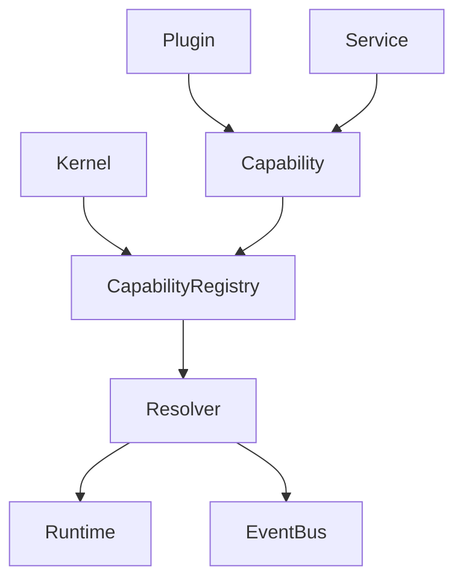
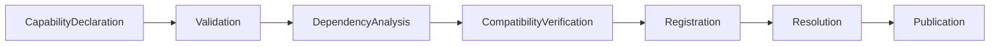

# RFC-0013

**Title:** Capability System

**Document ID:** RFC-0013

**Version:** 1.0

**Status:** Accepted

**Category:** Infrastructure

**Layer:** Infrastructure

**Target:**

```text
infrastructure/capabilities/
```

---

# Abstract

This RFC defines the SH-3 Capability System.

The Capability System provides a unified abstraction for every executable feature available within SH-3.

Capabilities represent the functional contract between services, plugins, Runtime components, and the Kernel.

Every executable feature in SH-3 SHALL be represented as a Capability.

The Capability System enables replaceability, discoverability, dependency validation, and runtime composition.

This document is normative.

---

# Motivation

SH-3 follows the principle:

> Everything is Replaceable.

Replaceability requires a common abstraction.

Without a Capability System:

- implementations become tightly coupled
- services cannot be substituted safely
- plugin interoperability decreases
- dependency resolution becomes inconsistent
- runtime composition becomes difficult

The Capability System provides a stable contract layer.

---

# Goals

The Capability System SHALL provide:

- capability abstraction
- capability discovery
- capability registration
- capability lookup
- dependency declaration
- version management
- lifecycle integration
- deterministic resolution
- extensibility

---

# Non-Goals

The Capability System SHALL NOT:

- execute Runtime workloads
- schedule tasks
- store persistent data
- evaluate policies
- implement business logic
- manage plugin lifecycle

Capability defines functionality.

Other systems implement behavior.

---

# Architecture



Capabilities define executable contracts.

---

# Design Principles

The Capability System follows these principles.

## Capability First

Every executable feature shall expose one Capability.

---

## Replaceable

Capabilities shall remain implementation independent.

---

## Discoverable

Capabilities shall be discoverable at runtime.

---

## Deterministic

Equivalent registrations SHALL produce equivalent capability graphs.

---

## Versioned

Capabilities shall expose explicit version information.

---

# Capability Components

The Capability System consists of:

| Component | Responsibility |
|------------|----------------|
| CapabilityRegistry | Registration |
| CapabilityResolver | Resolution |
| CapabilityValidator | Validation |
| CapabilityMetadata | Metadata |
| CapabilityManager | Coordination |

Each component owns exactly one architectural responsibility.

---

# Capability

A Capability represents one functional contract.

Every Capability SHALL contain:

| Field | Description |
|--------|-------------|
| capability_id | Unique identifier |
| name | Capability name |
| version | Semantic version |
| provider | Owning component |
| interface | Public contract |
| metadata | Additional information |

Capabilities remain immutable after registration.

---

# Capability Categories

Representative categories include:

- Runtime
- Kernel
- Memory
- Planner
- Policy
- Learning
- Optimizer
- Self-Healing
- Persistence
- Plugin
- Infrastructure
- External

Additional categories may be introduced by future RFCs.

---

# Capability Metadata

Metadata may include:

- author
- vendor
- compatibility
- dependencies
- tags
- priority
- stability level

Metadata shall not alter Capability semantics.

---

# Capability Registration

Capabilities shall be registered before use.

Registration shall verify:

- identifier uniqueness
- interface validity
- version compatibility
- dependency declarations
- metadata completeness

Invalid registrations shall be rejected.

---

# Capability Lifecycle

Every Capability follows the lifecycle below.

```text
Declared
      │
Validated
      │
Registered
      │
Resolved
      │
Available
      │
Deprecated
      │
Removed
```

Lifecycle transitions shall be deterministic.

---

# Capability States

Supported states include:

- Declared
- Validated
- Registered
- Available
- Deprecated
- Removed
- Failed

State transitions shall emit Capability events.

---

# Capability Events

Representative events include:

- CapabilityDeclared
- CapabilityValidated
- CapabilityRegistered
- CapabilityResolved
- CapabilityAvailable
- CapabilityDeprecated
- CapabilityRemoved
- CapabilityFailed

Capability events integrate with the EventBus.

---

# Capability Model

The Capability System transforms declared capabilities into validated, discoverable, and resolvable runtime contracts.

Capability processing is organized into deterministic lifecycle stages.



Each stage owns one architectural responsibility.

---

# Capability Context

Every capability operation receives one immutable CapabilityContext.

A CapabilityContext should contain:

| Field | Description |
|--------|-------------|
| context_id | Unique identifier |
| capability_id | Capability identifier |
| provider | Owning implementation |
| version | Semantic version |
| operation | Lifecycle operation |
| metadata | Additional information |

The CapabilityContext exists only during one lifecycle operation.

---

# Capability Declaration

Every executable implementation shall declare exactly one primary Capability.

A declaration should specify:

- identifier
- public interface
- semantic version
- provider
- category
- dependency list
- compatibility information

Capability declarations shall be immutable.

---

# Capability Validation

CapabilityValidator verifies every declared Capability.

Validation shall confirm:

- identifier uniqueness
- interface completeness
- metadata validity
- semantic version correctness
- dependency declaration
- lifecycle consistency

Invalid Capabilities shall be rejected before registration.

---

# Dependency Model

Capabilities may declare dependencies on other Capabilities.

Supported dependency types include:

| Type | Description |
|------|-------------|
| Required | Must exist before activation |
| Optional | Used when available |
| Recommended | Improves functionality |
| Replacement | Alternative implementation |
| Extension | Extends another capability |

Dependency semantics remain deterministic.

---

# Dependency Graph

Capability relationships form a directed graph.

```text
Capability
      │
      ├── Required
      │
      ├── Optional
      │
      ├── Extension
      │
      └── Replacement
```

Dependency graphs should remain acyclic whenever practical.

Circular dependencies shall be rejected unless explicitly supported by a future RFC.

---

# Compatibility Verification

CompatibilityValidator determines whether a Capability may become available.

Validation should verify:

- SH-3 version
- API compatibility
- interface compatibility
- dependency versions
- provider compatibility

Compatibility verification precedes publication.

---

# Capability Resolution

CapabilityResolver resolves executable implementations.

Resolution shall consider:

- requested interface
- semantic version
- dependency graph
- provider priority
- replacement policy

Resolution shall always produce deterministic results.

---

# Resolution Policies

Representative resolution policies include:

- HighestCompatibleVersion
- ExactVersion
- PreferredProvider
- FirstRegistered
- ExplicitSelection

The active policy shall be configurable.

---

# Replacement Model

Capabilities may replace existing implementations.

Replacement shall require:

- compatible interface
- successful validation
- dependency consistency
- lifecycle compatibility

Replacement shall not invalidate active dependency graphs.

---

# Capability Publication

Validated Capabilities become available through the CapabilityRegistry.

Publication shall expose:

- identifier
- interface
- provider
- version
- lifecycle state
- metadata

Published Capabilities become discoverable by the Runtime, Kernel, and Plugin System.

---

# Registry Integration

CapabilityRegistry is the authoritative source of registered Capabilities.

Registry responsibilities include:

- lookup
- discovery
- version selection
- metadata publication
- lifecycle tracking

The Registry shall remain implementation-independent.

---

# Plugin Integration

Plugins export Capabilities.

Capability registration shall occur only after successful Plugin activation.

Plugin removal shall automatically unregister exported Capabilities.

---

# Runtime Integration

Runtime resolves executable services exclusively through the Capability System.

Direct implementation references are discouraged.

Runtime shall remain independent of concrete providers.

---

# Kernel Integration

Kernel components request functionality through Capability resolution.

Kernel coordination shall remain independent of implementation details.

---

# Failure Handling

Capability failures shall produce structured diagnostic information.

Representative failures include:

- duplicate identifiers
- unresolved dependencies
- incompatible interfaces
- invalid semantic version
- registration conflict
- resolution ambiguity

Failures shall generate Capability events.

---

# Recovery

Recovery strategies may include:

- revalidation
- dependency refresh
- alternate provider selection
- replacement rollback
- capability isolation

Recovery shall preserve Registry consistency.

---

# Thread Model

The Capability System shall support concurrent registration, lookup, and resolution.

Independent capability operations shall remain isolated.

Shared mutable state should be minimized.

The reference implementation shall be thread-safe.

---

# Metrics

The Capability System shall expose operational metrics.

Representative metrics include:

- declared capabilities
- registered capabilities
- active capabilities
- deprecated capabilities
- resolution latency
- registration latency
- dependency resolution failures
- replacement operations

Metric collection should impose minimal runtime overhead.

---

# Logging

Capability logging shall produce structured records.

Recommended categories include:

- declaration
- validation
- registration
- resolution
- replacement
- diagnostics

Log records should include capability identifiers, provider identifiers, lifecycle states, and trace identifiers whenever available.

---

# Tracing

Capability operations participate in the global tracing system.

Trace propagation shall preserve:

- trace_id
- capability_id
- provider_id
- operation_id

Tracing enables complete visibility across capability discovery and resolution.

---

# Security Considerations

The Capability System shall preserve:

- capability integrity
- registry integrity
- interface integrity
- dependency integrity

Authorization and permission enforcement remain the responsibility of the Policy and Security Systems.

---

# Public Interfaces

The Capability public API is defined separately in:

```text
docs/api/capability_api.md
```

This RFC specifies Capability behavior.

API specifications define callable interfaces.

---

# Compatibility

Future Capability implementations shall remain compatible with this specification.

Possible future implementations include:

- distributed capability registries
- remote capability discovery
- capability federation
- dynamic capability negotiation
- AI-assisted capability selection

Observable Capability behavior shall remain consistent.

---

# Performance Objectives

The Capability System should optimize for:

- deterministic registration
- efficient dependency resolution
- fast capability lookup
- scalable registry management
- predictable resource utilization

Performance improvements shall preserve correctness, reproducibility, and compatibility.

---

# Future Work

Potential future enhancements include:

- capability negotiation protocols
- semantic capability matching
- distributed capability graphs
- capability hot migration
- automatic provider ranking
- policy-aware capability selection
- capability marketplace integration

These enhancements extend the Capability architecture without changing its core responsibilities.

---

# References

- SH-3 Architecture Specification v2.1
- RFC-0000 Documentation Standard
- RFC-0001 Event System
- RFC-0002 Runtime System
- RFC-0003 Kernel System
- RFC-0004 Planner System
- RFC-0005 Memory System
- RFC-0006 Policy System
- RFC-0007 Learning System
- RFC-0008 Optimizer System
- RFC-0009 Self-Healing System
- RFC-0010 Persistence System
- RFC-0011 Plugin System
- RFC-0012 Deployment System

---

# End of RFC-0013
