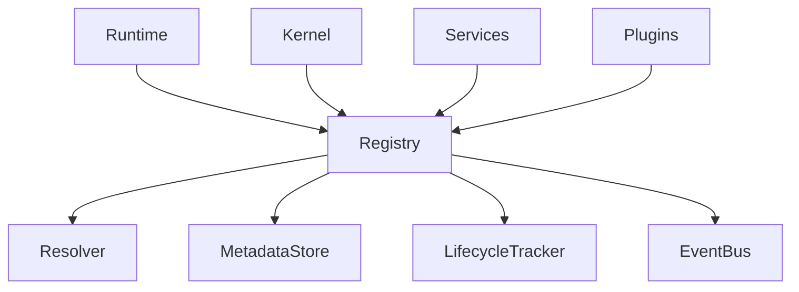

# RFC-0014

**Title:** Registry System

**Document ID:** RFC-0014

**Version:** 1.0

**Status:** Accepted

**Category:** Kernel

**Layer:** Kernel

**Target:**

```text
kernel/registry/
```

---

# Abstract

This RFC defines the SH-3 Registry System.

The Registry System is the authoritative catalog for every discoverable runtime object within SH-3.

It provides deterministic registration, lookup, lifecycle tracking, version management, dependency awareness, and metadata publication.

The Registry System enables loose coupling between Runtime, Kernel, Services, Infrastructure, and Plugins.

This document is normative.

---

# Motivation

SH-3 is composed of independently replaceable components.

Without a centralized Registry System:

- services become tightly coupled
- discovery becomes inconsistent
- duplicate implementations emerge
- dependency resolution becomes unreliable
- lifecycle management becomes fragmented

The Registry System provides one authoritative source of truth.

---

# Goals

The Registry System SHALL provide:

- object registration
- object lookup
- lifecycle tracking
- metadata publication
- dependency awareness
- version selection
- deterministic discovery
- registry events
- extensibility

---

# Non-Goals

The Registry System SHALL NOT:

- execute Runtime workloads
- schedule execution
- store persistent data
- perform planning
- evaluate policies
- activate plugins

Registration is distinct from execution.

---

# Architecture



The Registry acts as the central discovery mechanism for SH-3.

---

# Design Principles

The Registry System follows these principles.

## Single Source of Truth

Every registered object shall have one authoritative registry entry.

---

## Deterministic

Equivalent registration requests SHALL produce identical registry state.

---

## Replaceable

Registry implementations shall remain independently replaceable.

---

## Discoverable

Every registered object shall be discoverable through standardized lookup mechanisms.

---

## Observable

Every registry mutation shall generate structured events.

---

# Registry Components

The Registry System consists of:

| Component | Responsibility |
|-----------|----------------|
| RegistryManager | Coordination |
| RegistryStore | Registry entries |
| RegistryResolver | Lookup |
| MetadataStore | Metadata publication |
| LifecycleTracker | State management |
| RegistryValidator | Validation |

Each component owns one architectural responsibility.

---

# RegistryManager

RegistryManager coordinates all registry operations.

Responsibilities include:

- registration
- removal
- updates
- lookup coordination
- diagnostics

RegistryManager does not execute registered objects.

---

# Registry Entry

Every registered object SHALL produce one immutable Registry Entry.

| Field | Description |
|--------|-------------|
| registry_id | Unique identifier |
| object_id | Registered object |
| object_type | Classification |
| provider | Owning implementation |
| version | Semantic version |
| lifecycle_state | Current state |
| metadata | Additional information |

Registry Entries remain immutable except for lifecycle transitions.

---

# Registered Objects

Representative registered object types include:

- Capability
- Plugin
- Service
- Runtime Component
- Pipeline
- Factory
- Storage Adapter
- Policy Provider
- Planner
- Memory Provider
- Learning Provider

Future RFCs may define additional object types.

---

# Metadata

Registry metadata may include:

- author
- provider
- compatibility
- dependencies
- tags
- priority
- stability level
- visibility

Metadata shall not change runtime semantics.

---

# Registration

Every registration request shall be validated.

Validation shall verify:

- identifier uniqueness
- object validity
- semantic version
- dependency declarations
- metadata integrity

Invalid registrations shall be rejected.

---

# Registry Lifecycle

Every Registry Entry follows the lifecycle below.

```text
Created
    │
Validated
    │
Registered
    │
Available
    │
Deprecated
    │
Removed
```

Lifecycle transitions shall be deterministic.

---

# Registry States

Supported states include:

- Created
- Validated
- Registered
- Available
- Deprecated
- Removed
- Failed

State transitions shall generate Registry events.

---

# Registry Events

Representative events include:

- RegistryEntryCreated
- RegistryValidated
- RegistryRegistered
- RegistryAvailable
- RegistryUpdated
- RegistryDeprecated
- RegistryRemoved
- RegistryFailure

Registry events integrate with the EventBus.

---

# Registry Model

The Registry System transforms validated runtime objects into discoverable, versioned, and lifecycle-managed registry entries.

Registry processing is organized into deterministic lifecycle stages.


Each stage owns one architectural responsibility.

---

# Registry Context

Every registry operation receives one immutable RegistryContext.

A RegistryContext should contain:

| Field | Description |
|--------|-------------|
| context_id | Unique identifier |
| registry_id | Registry identifier |
| object_id | Registered object |
| object_type | Object classification |
| operation | Registry operation |
| metadata | Additional information |

The RegistryContext exists only during one registry operation.

---

# Object Classification

Every registered object shall belong to one registry classification.

Representative classifications include:

- Capability
- Service
- Plugin
- Runtime
- Pipeline
- Scheduler
- Factory
- Storage
- Adapter
- Provider

Classification shall remain immutable after registration.

---

# Namespace Model

Registry entries shall belong to one namespace.

Representative namespaces include:

```text
runtime.*

kernel.*

services.*

plugins.*

memory.*

deployment.*

infrastructure.*

foundation.*
```

Namespaces improve discovery and prevent identifier conflicts.

---

# Identifier Rules

Every Registry Entry SHALL have a globally unique identifier.

Recommended identifier format:

```text
<namespace>/<category>/<object_name>
```

Examples:

```text
runtime/scheduler/default

kernel/pipeline/main

services/memory/vector

plugins/openai/chat
```

Identifiers are immutable.

---

# Registry Index

RegistryStore maintains deterministic indexes.

Representative indexes include:

- identifier index
- namespace index
- provider index
- capability index
- version index
- lifecycle index
- metadata index

Indexes shall remain internally consistent.

---

# Lookup Model

RegistryResolver provides deterministic lookup operations.

Representative lookup methods include:

- by identifier
- by namespace
- by provider
- by capability
- by version
- by lifecycle state
- by metadata

Lookup operations shall not mutate registry state.

---

# Resolution Policies

Registry resolution supports configurable policies.

Representative policies include:

| Policy | Description |
|---------|-------------|
| Exact | Exact identifier match |
| Latest | Highest compatible version |
| Preferred | Preferred provider |
| Stable | Stable release only |
| Explicit | Caller-defined selection |

Resolution policies shall be deterministic.

---

# Version Management

Registry entries shall follow Semantic Versioning.

Version selection shall consider:

- compatibility
- provider
- dependency graph
- lifecycle state

Multiple compatible versions may coexist.

---

# Metadata Publication

Registry metadata shall be publicly discoverable.

Published metadata may include:

- provider
- version
- capabilities
- dependencies
- tags
- stability level
- documentation reference

Metadata publication shall not expose implementation details.

---

# Dependency Awareness

Registry maintains dependency relationships between registered objects.

Supported dependency relationships include:

- requires
- extends
- replaces
- recommends
- optional

Dependency graphs shall remain internally consistent.

---

# Registry Update

Registry updates follow a controlled lifecycle.

```text
Validation
      │
Replacement
      │
Index Update
      │
Publication
```

Updates shall preserve registry consistency.

---

# Registry Removal

Registry removal shall verify:

- active references
- dependency relationships
- lifecycle state
- replacement availability

Removal shall not invalidate active runtime dependencies.

---

# Failure Handling

Registry failures shall produce structured diagnostic information.

Representative failures include:

- duplicate identifiers
- namespace conflicts
- invalid metadata
- dependency inconsistency
- resolution ambiguity
- index corruption

Failures shall generate Registry events.

---

# Recovery

Recovery strategies may include:

- registry rebuild
- index reconstruction
- metadata refresh
- dependency reconciliation
- rollback to previous registry state

Recovery shall preserve registry integrity.

---

# Capability Integration

CapabilityRegistry extends the Registry System.

Capabilities become discoverable through standard Registry lookup.

Capability lifecycle shall remain synchronized with Registry lifecycle.

---

# Plugin Integration

Plugin activation registers exported objects.

Plugin removal automatically unregisters exported objects.

Registry shall remain synchronized with Plugin lifecycle events.

---

# Runtime Integration

Runtime resolves executable implementations through Registry lookup.

Runtime shall not depend upon concrete implementation classes.

---

# Thread Model

The Registry System shall support concurrent registration, lookup, update, and removal.

Independent registry operations shall remain isolated.

Shared mutable state should be minimized.

The reference implementation shall be thread-safe.

---

# Metrics

The Registry System shall expose operational metrics.

Representative metrics include:

- registered objects
- active objects
- namespace count
- lookup latency
- registration latency
- update count
- removal count
- resolution failures

Metric collection should impose minimal runtime overhead.

---

# Logging

Registry logging shall produce structured records.

Recommended categories include:

- registration
- lookup
- updates
- removal
- dependency analysis
- diagnostics

Log records should include registry identifiers, object identifiers, namespaces, lifecycle states, and trace identifiers whenever available.

---

# Tracing

Registry operations participate in the global tracing system.

Trace propagation shall preserve:

- trace_id
- registry_id
- object_id
- namespace
- operation_id

Tracing enables complete visibility across registration and discovery workflows.

---

# Security Considerations

The Registry System shall preserve:

- registry integrity
- identifier integrity
- metadata integrity
- dependency integrity

Authorization and permission enforcement remain the responsibility of the Security and Policy Systems.

---

# Public Interfaces

The Registry public API is defined separately in:

```text
docs/api/registry_api.md
```

This RFC specifies Registry behavior.

API specifications define callable interfaces.

---

# Compatibility

Future Registry implementations shall remain compatible with this specification.

Possible future implementations include:

- distributed registries
- federated discovery
- remote registry synchronization
- hierarchical registries
- multi-cluster registry services

Observable Registry behavior shall remain consistent.

---

# Performance Objectives

The Registry System should optimize for:

- deterministic registration
- fast lookup
- scalable indexing
- efficient namespace resolution
- predictable memory utilization

Performance improvements shall preserve correctness, reproducibility, and compatibility.

---

# Future Work

Potential future enhancements include:

- distributed namespace federation
- semantic registry queries
- AI-assisted registry optimization
- automatic dependency reconciliation
- registry replication
- registry snapshot synchronization
- cross-cluster discovery

These enhancements extend the Registry architecture without changing its core responsibilities.

---

# References

- SH-3 Architecture Specification v2.1
- RFC-0000 Documentation Standard
- RFC-0001 Event System
- RFC-0002 Runtime System
- RFC-0003 Kernel System
- RFC-0004 Planner System
- RFC-0005 Memory System
- RFC-0006 Policy System
- RFC-0007 Learning System
- RFC-0008 Optimizer System
- RFC-0009 Self-Healing System
- RFC-0010 Persistence System
- RFC-0011 Plugin System
- RFC-0012 Deployment System
- RFC-0013 Capability System

---

# End of RFC-0014
