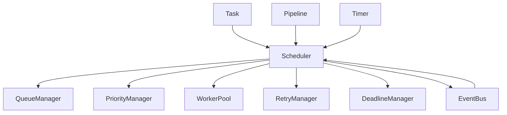

# RFC-0015

**Title:** Scheduler System

**Document ID:** RFC-0015

**Version:** 1.0

**Status:** Accepted

**Category:** Runtime

**Layer:** Runtime

**Target:**

```text
runtime/scheduler/
```

---

# Abstract

This RFC defines the SH-3 Scheduler System.

The Scheduler System is responsible for deterministic execution scheduling of tasks, pipelines, events, timers, and background workloads.

It coordinates execution order, priorities, concurrency, retries, cancellation, deadlines, and resource-aware scheduling while remaining independent of business logic.

The Scheduler does not execute task implementations directly. It determines **when**, **where**, and **under what constraints** execution occurs.

This document is normative.

---

# Motivation

Every AI Operating System requires a predictable execution model.

Without a unified Scheduler System:

- execution order becomes nondeterministic
- priorities conflict
- retries become inconsistent
- concurrency is unmanaged
- starvation becomes likely
- resource utilization becomes unstable

The Scheduler provides one deterministic execution policy for SH-3.

---

# Goals

The Scheduler System SHALL provide:

- task scheduling
- priority scheduling
- queue management
- deadline scheduling
- delayed execution
- recurring execution
- retry scheduling
- cancellation
- concurrency control
- deterministic execution ordering
- extensibility

---

# Non-Goals

The Scheduler System SHALL NOT:

- execute application logic
- evaluate Policy
- perform Planning
- manage Persistence
- resolve Capabilities
- optimize Learning

Execution responsibility belongs to Runtime workers.

Scheduling responsibility belongs to the Scheduler.

---

# Architecture



The Scheduler coordinates execution timing and ordering.

---

# Design Principles

The Scheduler System follows these principles.

## Deterministic

Equivalent scheduling inputs SHALL produce identical scheduling decisions.

---

## Fair

No schedulable task should experience indefinite starvation.

---

## Priority Aware

Higher priority workloads shall be scheduled before lower priority workloads unless scheduling policy specifies otherwise.

---

## Observable

Every scheduling decision shall generate structured events.

---

## Replaceable

Scheduling algorithms shall remain independently replaceable.

---

# Scheduler Components

The Scheduler System consists of:

| Component | Responsibility |
|-----------|----------------|
| SchedulerManager | Coordination |
| QueueManager | Queue management |
| PriorityManager | Priority calculation |
| RetryManager | Retry coordination |
| DeadlineManager | Deadline management |
| WorkerPool | Execution dispatch |
| SchedulerPolicy | Scheduling strategy |

Each component owns one architectural responsibility.

---

# SchedulerManager

SchedulerManager coordinates all scheduling operations.

Responsibilities include:

- task admission
- scheduling decisions
- dispatch coordination
- retry coordination
- diagnostics

SchedulerManager does not execute task implementations.

---

# Schedulable Unit

Every executable workload SHALL be represented as a Schedulable Unit.

A Schedulable Unit SHALL contain:

| Field | Description |
|--------|-------------|
| task_id | Unique identifier |
| execution_id | Runtime execution identifier |
| priority | Scheduling priority |
| deadline | Optional execution deadline |
| retry_policy | Retry configuration |
| metadata | Additional information |

Schedulable Units remain immutable after admission.

---

# Scheduling Categories

Representative schedulable workloads include:

- Runtime Task
- Event
- Pipeline Stage
- Timer
- Background Job
- Plugin Task
- Maintenance Job
- Recovery Task

Future RFCs may define additional workload types.

---

# Queue Model

QueueManager maintains deterministic execution queues.

Representative queue classes include:

- Immediate
- High Priority
- Normal
- Low Priority
- Delayed
- Retry
- Background

Queue implementations shall preserve ordering guarantees defined by the active scheduling policy.

---

# Priority Model

PriorityManager assigns execution priority.

Representative priority levels include:

| Level | Description |
|--------|-------------|
| Critical | Immediate execution |
| High | Preferred execution |
| Normal | Default execution |
| Low | Deferred execution |
| Idle | Opportunistic execution |

Priority ordering shall be deterministic.

---

# Scheduling Policies

Representative scheduling policies include:

- First-In First-Out (FIFO)
- Priority First
- Deadline First
- Fair Scheduling
- Weighted Fair Scheduling
- Round Robin

The active scheduling policy shall be configurable.

---

# Task Admission

Every scheduling request shall be validated before queue admission.

Validation shall verify:

- identifier uniqueness
- dependency readiness
- resource requirements
- execution state
- scheduling constraints

Invalid requests shall be rejected.

---

# Scheduler Lifecycle

Every Schedulable Unit follows the lifecycle below.

```text
Created
    │
Validated
    │
Queued
    │
Scheduled
    │
Dispatched
    │
Executing
    │
Completed
```

Lifecycle transitions shall be deterministic.

---

# Scheduler States

Supported scheduler states include:

- Created
- Queued
- Scheduled
- Executing
- Waiting
- Retrying
- Cancelled
- Completed
- Failed

State transitions shall generate Scheduler events.

---

# Scheduler Events

Representative events include:

- TaskQueued
- TaskScheduled
- TaskDispatched
- TaskStarted
- TaskCompleted
- TaskRetried
- TaskCancelled
- TaskFailed
- DeadlineExceeded

Scheduler events integrate with the EventBus.

---

# Scheduling Model

The Scheduler System transforms admitted workloads into deterministic execution schedules.

Scheduling is organized into deterministic processing stages.


Each stage owns one architectural responsibility.

---

# Scheduling Context

Every scheduling operation receives one immutable SchedulingContext.

A SchedulingContext should contain:

| Field | Description |
|--------|-------------|
| context_id | Unique identifier |
| task_id | Scheduled task identifier |
| execution_id | Runtime execution identifier |
| scheduling_policy | Active scheduling policy |
| priority | Assigned priority |
| metadata | Additional information |

The SchedulingContext exists only during one scheduling lifecycle.

---

# Queue Selection

QueueManager selects the appropriate execution queue.

Queue selection may consider:

- priority
- execution class
- retry state
- delay policy
- resource requirements
- execution deadline

Queue selection shall remain deterministic.

---

# Resource Allocation

SchedulerManager evaluates execution resources before dispatch.

Representative resources include:

- worker threads
- execution slots
- memory budget
- CPU budget
- accelerator resources
- external execution quotas

Scheduling shall not exceed configured resource limits.

---

# Dispatch Model

WorkerPool dispatches executable workloads.

Dispatch responsibilities include:

- worker selection
- execution assignment
- execution tracking
- completion notification

Dispatch does not modify task semantics.

---

# Worker Pool

WorkerPool manages execution workers.

Representative worker types include:

- synchronous workers
- asynchronous workers
- scheduled workers
- background workers
- maintenance workers

Worker implementations remain replaceable.

---

# Concurrency Model

The Scheduler supports concurrent execution.

Concurrency shall preserve:

- execution isolation
- deterministic scheduling decisions
- dependency ordering
- lifecycle consistency

Concurrent execution shall not violate declared scheduling constraints.

---

# Dependency Scheduling

Tasks may depend upon completion of other tasks.

Supported dependency relationships include:

- sequential
- parallel
- barrier
- conditional
- event-driven

Dependencies shall be validated before dispatch.

---

# Retry Model

RetryManager coordinates retry scheduling.

Retry policies may include:

- immediate retry
- delayed retry
- exponential backoff
- fixed interval
- bounded retry count

Retry execution shall preserve task identity.

---

# Retry Policy

Every retry configuration should define:

| Field | Description |
|--------|-------------|
| maximum_attempts | Retry limit |
| interval | Retry interval |
| strategy | Retry algorithm |
| timeout | Retry timeout |
| metadata | Additional information |

Retry policies remain immutable during execution.

---

# Cancellation

Cancellation requests shall transition tasks into a terminal state.

Cancellation should verify:

- execution state
- dependency impact
- resource ownership
- cleanup requirements

Cancelled tasks shall not be redispatched.

---

# Deadline Scheduling

DeadlineManager monitors execution deadlines.

Representative deadline actions include:

- immediate dispatch
- priority escalation
- cancellation
- timeout notification
- recovery request

Deadline violations shall generate Scheduler events.

---

# Delayed Execution

The Scheduler supports delayed execution.

Delayed workloads shall remain inactive until their scheduled activation time.

Delayed execution shall preserve ordering guarantees.

---

# Periodic Scheduling

Recurring workloads may be scheduled periodically.

Representative scheduling intervals include:

- fixed interval
- cron expression
- calendar schedule
- event-triggered recurrence

Recurring schedules shall produce deterministic execution sequences.

---

# Backpressure

The Scheduler shall apply backpressure when execution demand exceeds available capacity.

Representative strategies include:

- queue throttling
- admission control
- priority degradation
- delayed dispatch
- workload rejection

Backpressure policies shall remain configurable.

---

# Failure Handling

Scheduler failures shall produce structured diagnostic information.

Representative failures include:

- queue overflow
- dispatch failure
- worker exhaustion
- dependency violation
- deadline expiration
- retry exhaustion

Failures shall generate Scheduler events.

---

# Recovery

Recovery strategies may include:

- redispatch
- worker replacement
- queue reconstruction
- retry scheduling
- workload isolation

Recovery shall preserve scheduling consistency.

---

# Runtime Integration

Runtime executes workloads selected by the Scheduler.

The Scheduler remains responsible only for execution coordination.

Execution logic remains independent of scheduling decisions.

---

# EventBus Integration

Scheduler lifecycle events shall be published through the EventBus.

Event publication shall preserve:

- task identifiers
- execution identifiers
- scheduling state
- timestamps

Event ordering shall remain deterministic.

---

# Thread Model

The Scheduler System shall support highly concurrent scheduling operations.

Independent scheduling decisions shall remain isolated.

Shared mutable state should be minimized.

The reference implementation shall be thread-safe.

---

# Metrics

The Scheduler System shall expose operational metrics.

Representative metrics include:

- queued tasks
- dispatched tasks
- completed tasks
- cancelled tasks
- retry count
- scheduling latency
- queue depth
- worker utilization
- deadline violations

Metric collection should impose minimal runtime overhead.

---

# Logging

Scheduler logging shall produce structured records.

Recommended categories include:

- queue operations
- scheduling decisions
- dispatch
- retries
- cancellations
- diagnostics

Log records should include task identifiers, execution identifiers, queue identifiers, scheduling policy, and trace identifiers whenever available.

---

# Tracing

Scheduler operations participate in the global tracing system.

Trace propagation shall preserve:

- trace_id
- task_id
- execution_id
- worker_id
- scheduling_id

Tracing enables end-to-end visibility across scheduling and execution workflows.

---

# Security Considerations

The Scheduler System shall preserve:

- scheduling integrity
- queue integrity
- execution ordering
- resource isolation

Authorization and execution permissions remain the responsibility of the Policy and Security Systems.

---

# Public Interfaces

The Scheduler public API is defined separately in:

```text
docs/api/scheduler_api.md
```

This RFC specifies Scheduler behavior.

API specifications define callable interfaces.

---

# Compatibility

Future Scheduler implementations shall remain compatible with this specification.

Possible future implementations include:

- distributed schedulers
- cluster-aware scheduling
- GPU-aware scheduling
- NUMA-aware scheduling
- predictive scheduling
- AI-assisted scheduling

Observable Scheduler behavior shall remain consistent.

---

# Performance Objectives

The Scheduler System should optimize for:

- deterministic scheduling
- low dispatch latency
- efficient queue management
- scalable concurrency
- predictable resource utilization

Performance improvements shall preserve correctness, reproducibility, and fairness.

---

# Future Work

Potential future enhancements include:

- adaptive scheduling policies
- distributed execution queues
- workload affinity optimization
- autonomous queue balancing
- predictive deadline management
- heterogeneous hardware scheduling
- cross-node workload migration

These enhancements extend the Scheduler architecture without changing its core responsibilities.

---

# References

- SH-3 Architecture Specification v2.1
- RFC-0000 Documentation Standard
- RFC-0001 Event System
- RFC-0002 Runtime System
- RFC-0003 Kernel System
- RFC-0004 Planner System
- RFC-0005 Memory System
- RFC-0006 Policy System
- RFC-0007 Learning System
- RFC-0008 Optimizer System
- RFC-0009 Self-Healing System
- RFC-0010 Persistence System
- RFC-0011 Plugin System
- RFC-0012 Deployment System
- RFC-0013 Capability System
- RFC-0014 Registry System

---

# End of RFC-0015
