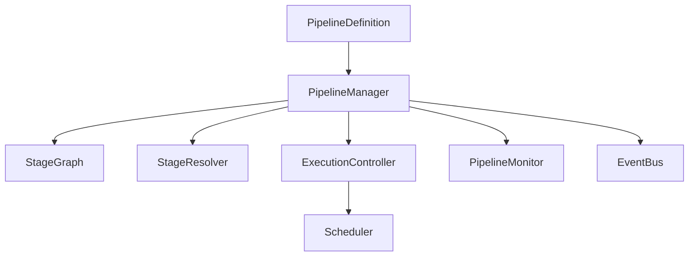
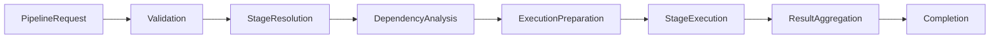

# RFC-0016

**Title:** Pipeline System

**Document ID:** RFC-0016

**Version:** 1.0

**Status:** Accepted

**Category:** Kernel

**Layer:** Kernel

**Target:**

```text
kernel/pipeline/
```

---

# Abstract

This RFC defines the SH-3 Pipeline System.

The Pipeline System provides a deterministic execution model for composing executable stages into reusable workflows.

Pipelines coordinate data flow, execution order, branching, synchronization, error propagation, and completion semantics while remaining independent of business logic.

The Pipeline System is the primary execution orchestration mechanism above the Runtime Scheduler.

This document is normative.

---

# Motivation

Modern AI systems execute multi-stage workflows rather than isolated tasks.

Without a Pipeline System:

- workflow execution becomes inconsistent
- execution ordering becomes implicit
- data propagation becomes unreliable
- recovery becomes difficult
- reusable workflows cannot be standardized

The Pipeline System provides deterministic workflow orchestration.

---

# Goals

The Pipeline System SHALL provide:

- pipeline definition
- stage composition
- deterministic execution order
- branching
- synchronization
- parallel execution
- data propagation
- lifecycle management
- execution monitoring
- extensibility

---

# Non-Goals

The Pipeline System SHALL NOT:

- execute stage implementations
- schedule Runtime workers
- evaluate Policy
- implement Learning logic
- store persistent data

Pipeline coordinates execution.

Runtime executes workloads.

---

# Architecture



Pipelines coordinate ordered execution of executable stages.

---

# Design Principles

The Pipeline System follows these principles.

## Deterministic

Equivalent pipeline definitions SHALL produce identical execution graphs.

---

## Composable

Pipelines shall be composed from reusable stages.

---

## Observable

Pipeline execution shall emit structured lifecycle events.

---

## Replaceable

Stages shall remain independently replaceable through the Capability System.

---

## Declarative

Pipeline topology should be defined declaratively rather than procedurally.

---

# Pipeline Components

The Pipeline System consists of:

| Component | Responsibility |
|-----------|----------------|
| PipelineManager | Coordination |
| StageGraph | Dependency graph |
| StageResolver | Stage lookup |
| ExecutionController | Execution coordination |
| PipelineMonitor | Monitoring |
| PipelineValidator | Validation |

Each component owns one architectural responsibility.

---

# PipelineManager

PipelineManager coordinates all pipeline operations.

Responsibilities include:

- pipeline creation
- validation
- execution requests
- lifecycle tracking
- diagnostics

PipelineManager does not execute stage implementations.

---

# Pipeline

A Pipeline represents one executable workflow.

Every Pipeline SHALL contain:

| Field | Description |
|--------|-------------|
| pipeline_id | Unique identifier |
| version | Semantic version |
| entry_stage | Initial stage |
| stage_graph | Execution graph |
| metadata | Additional information |

Pipelines remain immutable after publication.

---

# Stage

A Stage represents one executable unit within a Pipeline.

Every Stage SHALL contain:

| Field | Description |
|--------|-------------|
| stage_id | Unique identifier |
| capability | Executable capability |
| input_schema | Expected input |
| output_schema | Produced output |
| metadata | Additional information |

Stages remain immutable after registration.

---

# Pipeline Categories

Representative pipeline categories include:

- Runtime Pipeline
- Planning Pipeline
- Learning Pipeline
- Memory Pipeline
- Recovery Pipeline
- Deployment Pipeline
- Maintenance Pipeline

Future RFCs may define additional pipeline categories.

---

# Stage Graph

StageGraph represents execution dependencies.

Supported relationships include:

- sequential
- parallel
- conditional
- merge
- split
- barrier

The execution graph shall be acyclic unless explicitly supported by a future RFC.

---

# Pipeline Validation

Every Pipeline shall be validated before execution.

Validation shall verify:

- graph consistency
- stage availability
- dependency completeness
- schema compatibility
- capability resolution

Invalid pipelines shall be rejected.

---

# Pipeline Lifecycle

Every Pipeline follows the lifecycle below.

```text
Defined
    │
Validated
    │
Registered
    │
Prepared
    │
Executing
    │
Completed
```

Lifecycle transitions shall be deterministic.

---

# Pipeline States

Supported states include:

- Defined
- Validated
- Registered
- Prepared
- Executing
- Suspended
- Completed
- Failed

State transitions shall generate Pipeline events.

---

# Pipeline Events

Representative events include:

- PipelineDefined
- PipelineValidated
- PipelineRegistered
- PipelineStarted
- StageStarted
- StageCompleted
- PipelineCompleted
- PipelineFailed

Pipeline events integrate with the EventBus.

---

# Pipeline Model

The Pipeline System transforms a declarative Pipeline Definition into a deterministic execution workflow.

Pipeline execution is organized into deterministic processing stages.



Each stage owns one architectural responsibility.

---

# Pipeline Context

Every pipeline execution receives one immutable PipelineContext.

A PipelineContext should contain:

| Field | Description |
|--------|-------------|
| context_id | Unique identifier |
| pipeline_id | Pipeline identifier |
| execution_id | Runtime execution identifier |
| entry_stage | Initial stage |
| pipeline_version | Semantic version |
| metadata | Additional information |

The PipelineContext exists only during one pipeline execution.

---

# Stage Resolution

StageResolver resolves executable stages through the Capability System.

Resolution shall verify:

- capability availability
- interface compatibility
- semantic version
- dependency consistency
- lifecycle state

Only validated stages may participate in execution.

---

# Execution Preparation

ExecutionController prepares the execution graph.

Preparation may include:

- dependency expansion
- execution ordering
- parallel stage grouping
- barrier creation
- execution context initialization

Preparation shall be deterministic.

---

# Execution Model

Pipeline execution proceeds according to the validated Stage Graph.

Execution guarantees:

- dependency ordering
- deterministic stage selection
- immutable execution graph
- isolated execution contexts

Stage execution remains the responsibility of the Runtime.

---

# Data Flow

Pipeline data flows through immutable execution artifacts.

Representative artifacts include:

- execution context
- stage output
- shared metadata
- execution status
- diagnostics

Stages shall not mutate upstream outputs.

---

# Input Model

Each Stage receives:

| Field | Description |
|--------|-------------|
| input | Stage input payload |
| context | Pipeline context |
| metadata | Execution metadata |
| trace | Tracing information |

Input shall satisfy the declared input schema.

---

# Output Model

Each Stage produces:

| Field | Description |
|--------|-------------|
| output | Stage result |
| status | Execution status |
| diagnostics | Diagnostic information |
| metadata | Additional metadata |

Output shall satisfy the declared output schema.

---

# Branching

Conditional execution shall be supported.

Representative branch types include:

- conditional
- predicate
- event-driven
- capability-based
- policy-driven

Branch evaluation shall be deterministic.

---

# Parallel Execution

Independent stages may execute concurrently.

Parallel execution shall preserve:

- dependency ordering
- execution isolation
- deterministic completion semantics

The Scheduler determines execution timing.

---

# Merge Model

Multiple execution branches may converge.

Merge operations shall define:

- merge strategy
- conflict resolution
- output composition
- completion policy

Merge behavior shall be deterministic.

---

# Barrier Synchronization

Barrier stages synchronize concurrent execution.

A Barrier completes only after all required predecessor stages have completed successfully.

Barrier behavior shall remain deterministic.

---

# Error Propagation

Stage failures propagate through the Pipeline according to the configured error policy.

Representative propagation strategies include:

- fail-fast
- continue
- isolate
- retry
- fallback

Error propagation policies shall be explicit.

---

# Rollback

Pipelines may declare rollback behavior.

Representative rollback actions include:

- compensating stage execution
- resource cleanup
- state restoration
- event publication

Rollback execution shall preserve system consistency.

---

# Pipeline Recovery

Recovery may include:

- stage retry
- branch restart
- pipeline restart
- checkpoint restoration
- alternative stage resolution

Recovery shall preserve dependency correctness.

---

# Completion Model

A Pipeline completes when:

- all required stages complete successfully
- completion criteria are satisfied
- final outputs are published

Completion shall generate PipelineCompleted.

---

# EventBus Integration

Pipeline lifecycle events shall be published through the EventBus.

Published events shall preserve:

- pipeline identifiers
- stage identifiers
- execution identifiers
- timestamps
- lifecycle states

Event ordering shall remain deterministic.

---

# Scheduler Integration

The Scheduler dispatches executable stages.

The Pipeline System determines execution topology.

Scheduling policy shall remain independent of pipeline semantics.

---

# Registry Integration

Pipeline definitions shall be registered through the Registry System.

Execution shall reference registered Pipeline Definitions exclusively.

---

# Capability Integration

Every executable Stage references exactly one Capability.

Capabilities remain independently replaceable without modifying Pipeline Definitions.

---

# Failure Handling

Pipeline failures shall produce structured diagnostic information.

Representative failures include:

- stage resolution failure
- dependency violation
- schema mismatch
- barrier timeout
- merge conflict
- execution timeout

Failures shall generate Pipeline events.

---

# Thread Model

The Pipeline System shall support concurrent pipeline executions.

Independent Pipeline Contexts shall remain isolated.

Shared mutable state should be minimized.

The reference implementation shall be thread-safe.

---

# Metrics

The Pipeline System shall expose operational metrics.

Representative metrics include:

- executed pipelines
- completed pipelines
- failed pipelines
- stage execution latency
- pipeline duration
- parallel stage count
- retry count
- rollback count

Metric collection should impose minimal runtime overhead.

---

# Logging

Pipeline logging shall produce structured records.

Recommended categories include:

- pipeline creation
- validation
- stage execution
- branching
- synchronization
- completion
- diagnostics

Log records should include pipeline identifiers, stage identifiers, execution identifiers, lifecycle states, and trace identifiers whenever available.

---

# Tracing

Pipeline operations participate in the global tracing system.

Trace propagation shall preserve:

- trace_id
- pipeline_id
- stage_id
- execution_id
- context_id

Tracing enables end-to-end visibility across workflow execution.

---

# Security Considerations

The Pipeline System shall preserve:

- execution integrity
- stage integrity
- dependency integrity
- execution isolation

Authorization and policy enforcement remain the responsibility of the Security and Policy Systems.

---

# Public Interfaces

The Pipeline public API is defined separately in:

```text
docs/api/pipeline_api.md
```

This RFC specifies Pipeline behavior.

API specifications define callable interfaces.

---

# Compatibility

Future Pipeline implementations shall remain compatible with this specification.

Possible future implementations include:

- distributed pipelines
- streaming pipelines
- DAG optimization
- speculative execution
- adaptive workflow routing
- AI-assisted pipeline optimization

Observable Pipeline behavior shall remain consistent.

---

# Performance Objectives

The Pipeline System should optimize for:

- deterministic execution planning
- efficient dependency resolution
- scalable parallel execution
- low orchestration overhead
- predictable execution latency

Performance improvements shall preserve correctness, reproducibility, and execution consistency.

---

# Future Work

Potential future enhancements include:

- dynamic pipeline composition
- distributed execution graphs
- checkpoint-aware execution
- pipeline version negotiation
- workflow federation
- adaptive branch optimization
- autonomous pipeline tuning

These enhancements extend the Pipeline architecture without changing its core responsibilities.

---

# References

- SH-3 Architecture Specification v2.1
- RFC-0000 Documentation Standard
- RFC-0001 Event System
- RFC-0002 Runtime System
- RFC-0003 Kernel System
- RFC-0004 Planner System
- RFC-0005 Memory System
- RFC-0006 Policy System
- RFC-0007 Learning System
- RFC-0008 Optimizer System
- RFC-0009 Self-Healing System
- RFC-0010 Persistence System
- RFC-0011 Plugin System
- RFC-0012 Deployment System
- RFC-0013 Capability System
- RFC-0014 Registry System
- RFC-0015 Scheduler System

---

# End of RFC-0016
