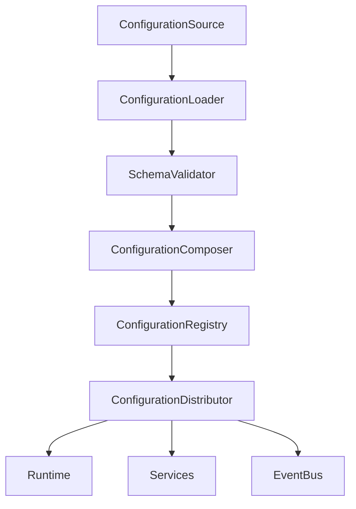

# RFC-0017

**Title:** Configuration System

**Document ID:** RFC-0017

**Version:** 1.0

**Status:** Accepted

**Category:** Infrastructure

**Layer:** Infrastructure

**Target:**

```text
infrastructure/configuration/
```

---

# Abstract

This RFC defines the SH-3 Configuration System.

The Configuration System provides a deterministic, versioned, and extensible mechanism for loading, validating, composing, distributing, and observing configuration throughout the SH-3 platform.

Configuration is treated as immutable runtime input. Configuration changes produce new configuration revisions rather than mutating existing configuration objects.

The Configuration System does not execute application logic or manage business workflows.

This document is normative.

---

# Motivation

Every component of SH-3 depends upon reliable configuration.

Without a unified Configuration System:

- configuration formats diverge
- validation becomes inconsistent
- environments drift over time
- deployments become difficult to reproduce
- component initialization becomes unreliable

The Configuration System establishes one authoritative configuration model.

---

# Goals

The Configuration System SHALL provide:

- configuration loading
- schema validation
- profile management
- environment overlays
- configuration composition
- revision management
- dynamic reload support
- secret reference integration
- deterministic resolution
- extensibility

---

# Non-Goals

The Configuration System SHALL NOT:

- execute Runtime tasks
- schedule workloads
- store application state
- perform planning
- evaluate policies
- replace the Persistence System

Configuration defines runtime behavior.

Runtime performs execution.

---

# Architecture



Configuration flows through deterministic processing stages before becoming active.

---

# Design Principles

The Configuration System follows these principles.

## Immutable

Active configuration objects shall remain immutable.

Configuration changes create new revisions.

---

## Deterministic

Equivalent configuration sources SHALL produce identical resolved configurations.

---

## Declarative

Configuration expresses desired system behavior.

Implementation details shall remain outside configuration.

---

## Versioned

Every configuration revision shall expose explicit version information.

---

## Observable

Configuration lifecycle events shall be published through the EventBus.

---

# Configuration Components

The Configuration System consists of:

| Component | Responsibility |
|-----------|----------------|
| ConfigurationLoader | Source loading |
| SchemaValidator | Validation |
| ConfigurationComposer | Composition |
| ConfigurationRegistry | Active revisions |
| ConfigurationDistributor | Distribution |
| ConfigurationManager | Coordination |

Each component owns one architectural responsibility.

---

# ConfigurationManager

ConfigurationManager coordinates all configuration operations.

Responsibilities include:

- configuration loading
- validation
- activation
- revision tracking
- diagnostics

ConfigurationManager does not interpret application semantics.

---

# Configuration

A Configuration represents one immutable runtime configuration.

Every Configuration SHALL contain:

| Field | Description |
|--------|-------------|
| configuration_id | Unique identifier |
| revision | Revision number |
| schema_version | Schema version |
| profile | Active profile |
| metadata | Additional information |

Configurations remain immutable after activation.

---

# Configuration Sources

Representative configuration sources include:

- YAML files
- JSON files
- TOML files
- environment variables
- deployment manifests
- remote configuration providers
- generated configuration

Future RFCs may define additional configuration sources.

---

# Profiles

Configuration Profiles represent deployment-specific configuration.

Representative profiles include:

- Development
- Testing
- Staging
- Production
- Embedded
- Distributed

Exactly one profile shall be active during configuration resolution.

---

# Environment Overlays

Environment-specific values may override base configuration.

Representative overlay sources include:

- profile overlay
- environment variables
- deployment overrides
- runtime parameters

Overlay application shall be deterministic.

---

# Schema Validation

Every Configuration shall be validated before activation.

Validation shall verify:

- schema correctness
- required fields
- type consistency
- version compatibility
- reference integrity

Invalid configurations shall be rejected.

---

# Configuration Lifecycle

Every Configuration follows the lifecycle below.

```text
Loaded
    │
Validated
    │
Composed
    │
Registered
    │
Activated
    │
Deprecated
    │
Archived
```

Lifecycle transitions shall be deterministic.

---

# Configuration States

Supported configuration states include:

- Loaded
- Validated
- Composed
- Registered
- Activated
- Deprecated
- Archived
- Failed

State transitions shall generate Configuration events.

---

# Configuration Events

Representative events include:

- ConfigurationLoaded
- ConfigurationValidated
- ConfigurationComposed
- ConfigurationRegistered
- ConfigurationActivated
- ConfigurationReloaded
- ConfigurationArchived
- ConfigurationFailed

Configuration events integrate with the EventBus.

---

# Configuration Model

The Configuration System transforms configuration sources into validated, immutable runtime configuration revisions.

Configuration processing is organized into deterministic lifecycle stages.


Each stage owns one architectural responsibility.

---

# Configuration Context

Every configuration operation receives one immutable ConfigurationContext.

A ConfigurationContext should contain:

| Field | Description |
|--------|-------------|
| context_id | Unique identifier |
| configuration_id | Configuration identifier |
| revision | Configuration revision |
| profile | Active profile |
| schema_version | Schema version |
| metadata | Additional information |

The ConfigurationContext exists only during one configuration lifecycle.

---

# Source Loading

ConfigurationLoader discovers and loads configuration sources.

Representative source types include:

- local files
- deployment packages
- environment variables
- remote configuration providers
- generated configuration
- embedded defaults

Source loading shall be deterministic.

---

# Configuration Composition

ConfigurationComposer produces one immutable Configuration.

Composition order shall follow:

```text
Base Configuration
        │
Profile Overlay
        │
Environment Overlay
        │
Deployment Override
        │
Runtime Parameters
        │
Resolved Configuration
```

Composition order shall not vary between executions.

---

# Overlay Resolution

Environment overlays modify configuration values according to precedence rules.

Representative overlay mechanisms include:

- profile override
- environment override
- deployment override
- runtime override

Higher-precedence overlays shall replace lower-precedence values.

---

# Configuration Resolution

Configuration resolution shall produce exactly one active Configuration Revision.

Resolution shall verify:

- schema compatibility
- overlay consistency
- dependency references
- required values
- configuration integrity

Resolution failures shall prevent activation.

---

# Secret References

Sensitive configuration values should be referenced rather than embedded.

Representative secret providers include:

- environment variables
- operating system secret stores
- cloud secret managers
- encrypted configuration providers

Secret resolution shall occur before activation.

Secret values shall not appear in logs or diagnostics.

---

# Dynamic Reload

The Configuration System may support dynamic configuration reload.

Reload shall follow the lifecycle below.

```text
Load
    │
Validate
    │
Compose
    │
Verify
    │
Activate
```

Reload shall create a new Configuration Revision.

Existing revisions remain immutable.

---

# Revision Management

Every active configuration revision shall be uniquely identifiable.

Revision metadata should include:

| Field | Description |
|--------|-------------|
| revision_id | Unique revision identifier |
| timestamp | Activation time |
| profile | Active profile |
| checksum | Integrity verification |
| metadata | Additional information |

Older revisions may be retained for diagnostics or rollback.

---

# Rollback

Rollback restores a previously activated Configuration Revision.

Rollback shall verify:

- schema compatibility
- runtime compatibility
- dependency consistency
- revision integrity

Rollback creates a new activation event.

---

# Distribution Model

ConfigurationDistributor distributes active configuration to consumers.

Representative consumers include:

- Runtime
- Kernel
- Infrastructure
- Services
- Plugins

Distribution shall preserve revision consistency.

---

# Consumer Model

Configuration consumers receive immutable configuration snapshots.

Consumers shall not modify active configuration.

Configuration updates require activation of a new revision.

---

# Registry Integration

Active Configuration Revisions shall be discoverable through the Registry System.

Registry entries shall include:

- configuration identifier
- active revision
- profile
- schema version

Registry publication shall occur after successful activation.

---

# Deployment Integration

DeploymentManager activates configuration before Runtime initialization.

Deployment shall not continue with invalid configuration.

---

# Persistence Integration

Configuration revisions may be persisted through the Persistence System.

Representative persisted artifacts include:

- active revisions
- revision history
- activation metadata
- rollback checkpoints

Persistence behavior remains implementation-independent.

---

# EventBus Integration

Configuration lifecycle events shall be published through the EventBus.

Published events shall preserve:

- configuration identifier
- revision identifier
- profile
- activation timestamp

Event ordering shall remain deterministic.

---

# Failure Handling

Configuration failures shall produce structured diagnostic information.

Representative failures include:

- schema violation
- missing required values
- unresolved secret reference
- overlay conflict
- incompatible revision
- activation failure

Failures shall generate Configuration events.

---

# Recovery

Recovery strategies may include:

- reload
- fallback configuration
- previous revision activation
- safe configuration mode
- deployment retry

Recovery shall preserve configuration integrity.

---

# Thread Model

The Configuration System shall support concurrent configuration reads.

Configuration activation shall be serialized.

Shared mutable state should be minimized.

The reference implementation shall be thread-safe.

---

# Metrics

The Configuration System shall expose operational metrics.

Representative metrics include:

- loaded configurations
- active revisions
- reload count
- rollback count
- validation failures
- activation latency
- distribution latency
- configuration age

Metric collection should impose minimal runtime overhead.

---

# Logging

Configuration logging shall produce structured records.

Recommended categories include:

- source loading
- validation
- composition
- activation
- reload
- rollback
- diagnostics

Sensitive values shall be redacted from log records.

Log records should include configuration identifiers, revision identifiers, lifecycle states, and trace identifiers whenever available.

---

# Tracing

Configuration operations participate in the global tracing system.

Trace propagation shall preserve:

- trace_id
- configuration_id
- revision_id
- profile
- operation_id

Tracing enables end-to-end visibility across configuration processing.

---

# Security Considerations

The Configuration System shall preserve:

- configuration integrity
- revision integrity
- secret confidentiality
- activation consistency

Authentication, authorization, and secret storage remain external responsibilities.

---

# Public Interfaces

The Configuration public API is defined separately in:

```text
docs/api/configuration_api.md
```

This RFC specifies Configuration behavior.

API specifications define callable interfaces.

---

# Compatibility

Future Configuration implementations shall remain compatible with this specification.

Possible future implementations include:

- distributed configuration services
- hierarchical configuration
- policy-aware configuration
- live cluster synchronization
- signed configuration bundles
- configuration federation

Observable Configuration behavior shall remain consistent.

---

# Performance Objectives

The Configuration System should optimize for:

- deterministic resolution
- efficient validation
- fast activation
- scalable distribution
- predictable memory utilization

Performance improvements shall preserve correctness, reproducibility, and operational consistency.

---

# Future Work

Potential future enhancements include:

- incremental configuration updates
- configuration dependency graphs
- semantic configuration validation
- AI-assisted configuration optimization
- cross-cluster configuration synchronization
- autonomous configuration repair
- policy-driven configuration governance

These enhancements extend the Configuration architecture without changing its core responsibilities.

---

# References

- SH-3 Architecture Specification v2.1
- RFC-0000 Documentation Standard
- RFC-0001 Event System
- RFC-0002 Runtime System
- RFC-0003 Kernel System
- RFC-0004 Planner System
- RFC-0005 Memory System
- RFC-0006 Policy System
- RFC-0007 Learning System
- RFC-0008 Optimizer System
- RFC-0009 Self-Healing System
- RFC-0010 Persistence System
- RFC-0011 Plugin System
- RFC-0012 Deployment System
- RFC-0013 Capability System
- RFC-0014 Registry System
- RFC-0015 Scheduler System
- RFC-0016 Pipeline System

---

# End of RFC-0017
