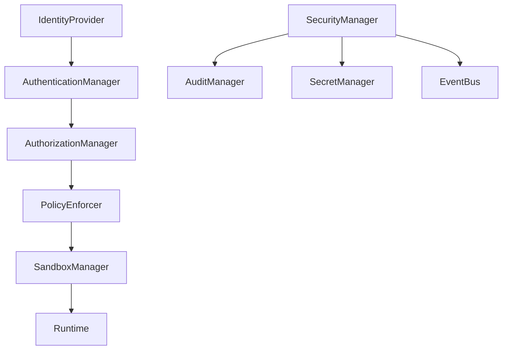
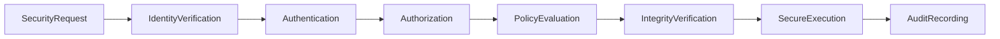

# RFC-0018

**Title:** Security System

**Document ID:** RFC-0018

**Version:** 1.0

**Status:** Accepted

**Category:** Infrastructure

**Layer:** Infrastructure

**Target:**

```text
infrastructure/security/
```

---

# Abstract

This RFC defines the SH-3 Security System.

The Security System provides a unified security architecture for identity, authentication, authorization, integrity verification, secret management, auditing, sandboxing, and policy enforcement across all SH-3 components.

Security is enforced as a platform capability rather than an application feature.

Every operation that crosses a trust boundary SHALL be evaluated by the Security System.

This document is normative.

---

# Motivation

AI Operating Systems execute privileged operations across multiple services, plugins, runtimes, and deployment environments.

Without a unified Security System:

- authorization becomes inconsistent
- secrets become difficult to protect
- plugin execution becomes unsafe
- auditing becomes incomplete
- trust boundaries become ambiguous

The Security System establishes one consistent trust model for SH-3.

---

# Goals

The Security System SHALL provide:

- authentication
- authorization
- identity management
- secret reference integration
- integrity verification
- digital signature verification
- sandbox enforcement
- audit logging
- policy enforcement
- extensibility

---

# Non-Goals

The Security System SHALL NOT:

- implement business rules
- execute Runtime workloads
- replace Policy evaluation
- replace Persistence encryption
- schedule workloads

Security validates and protects.

Other systems perform execution.

---

# Architecture



Security decisions are evaluated before protected operations execute.

---

# Design Principles

The Security System follows these principles.

## Zero Trust

No component is implicitly trusted.

Every protected operation shall be verified.

---

## Least Privilege

Every component shall operate with the minimum required permissions.

---

## Defense in Depth

Security controls shall exist at multiple architectural layers.

---

## Deterministic

Equivalent security requests SHALL produce identical authorization decisions.

---

## Observable

Every security decision shall generate structured audit events.

---

# Security Components

The Security System consists of:

| Component | Responsibility |
|-----------|----------------|
| SecurityManager | Coordination |
| AuthenticationManager | Identity verification |
| AuthorizationManager | Permission evaluation |
| PolicyEnforcer | Policy application |
| SandboxManager | Execution isolation |
| SecretManager | Secret resolution |
| AuditManager | Security auditing |
| IntegrityValidator | Signature verification |

Each component owns one architectural responsibility.

---

# SecurityManager

SecurityManager coordinates all platform security operations.

Responsibilities include:

- authentication
- authorization
- audit coordination
- secret coordination
- diagnostics

SecurityManager does not execute protected workloads.

---

# Identity

Every authenticated subject SHALL possess one unique identity.

Representative identity types include:

- user
- service
- plugin
- runtime
- deployment
- external provider

Identity remains immutable throughout one authenticated session.

---

# Authentication

Authentication verifies identity before protected operations.

Representative authentication mechanisms include:

- local credentials
- API tokens
- certificates
- cryptographic signatures
- federated identity
- hardware-backed identity

Authentication shall precede authorization.

---

# Authorization

Authorization determines whether an authenticated identity may perform an operation.

Authorization decisions should consider:

- identity
- permissions
- resource
- capability
- execution context
- policy

Authorization decisions shall be deterministic.

---

# Permissions

Representative permission categories include:

- Runtime
- Memory
- Storage
- Planner
- Learning
- Plugin
- Deployment
- Configuration
- Administration

Permissions shall be explicitly granted.

Implicit permissions are prohibited.

---

# Security Domains

Representative security domains include:

- Runtime
- Infrastructure
- Kernel
- Services
- Deployment
- Plugin
- External Integration

Security domains define trust boundaries.

---

# Integrity Verification

IntegrityValidator verifies protected artifacts.

Representative artifacts include:

- plugins
- deployment packages
- configuration bundles
- executable modules
- capability manifests

Integrity verification shall precede activation.

---

# Security Lifecycle

Every protected operation follows the lifecycle below.

```text
Requested
     │
Authenticated
     │
Authorized
     │
Validated
     │
Executed
     │
Audited
```

Lifecycle transitions shall be deterministic.

---

# Security States

Supported security states include:

- Requested
- Authenticated
- Authorized
- Denied
- Executed
- Audited
- Failed

State transitions shall generate Security events.

---

# Security Events

Representative events include:

- AuthenticationSucceeded
- AuthenticationFailed
- AuthorizationGranted
- AuthorizationDenied
- IntegrityVerified
- SandboxEntered
- SandboxExited
- AuditRecorded
- SecurityViolation

Security events integrate with the EventBus.

---

# Security Model

The Security System transforms security requests into authenticated, authorized, audited, and policy-enforced operations.

Security processing is organized into deterministic lifecycle stages.



Each stage owns one architectural responsibility.

---

# Security Context

Every protected operation receives one immutable SecurityContext.

A SecurityContext should contain:

| Field | Description |
|--------|-------------|
| context_id | Unique identifier |
| security_id | Security operation identifier |
| identity | Authenticated identity |
| permissions | Granted permissions |
| trust_domain | Active trust domain |
| metadata | Additional information |

The SecurityContext exists only during one protected operation.

---

# Trust Model

The Security System follows a Zero Trust architecture.

Trust assumptions include:

- no implicit trust
- explicit identity verification
- explicit authorization
- continuous policy evaluation
- verified integrity

Trust shall never be inferred solely from deployment location.

---

# Trust Boundaries

Representative trust boundaries include:

- Runtime ↔ Plugin
- Kernel ↔ Service
- Infrastructure ↔ External System
- Deployment ↔ Runtime
- User ↔ Platform
- Node ↔ Node

Every boundary crossing shall require security evaluation.

---

# Sandbox Model

SandboxManager isolates untrusted execution.

Representative isolation mechanisms include:

- process isolation
- container isolation
- virtual environments
- restricted capabilities
- resource quotas
- filesystem isolation

Sandbox implementations remain replaceable.

---

# Execution Restrictions

Sandbox execution may restrict:

- filesystem access
- network access
- environment variables
- capability resolution
- external processes
- operating system interfaces

Restrictions shall follow the principle of least privilege.

---

# Secret Management

SecretManager resolves confidential values securely.

Representative secret sources include:

- operating system secret stores
- cloud secret managers
- encrypted configuration providers
- hardware security modules
- deployment secret providers

Secret values shall never be persisted in plaintext by the Security System.

---

# Secret Lifecycle

Secrets follow the lifecycle below.

```text
Referenced
      │
Resolved
      │
Validated
      │
Consumed
      │
Expired
```

Resolved secret values shall exist only for the minimum required duration.

---

# Audit Model

AuditManager records security-relevant events.

Representative audit records include:

- authentication attempts
- authorization decisions
- policy evaluations
- sandbox violations
- secret access
- integrity verification
- administrative actions

Audit records shall be immutable.

---

# Policy Integration

Security integrates with the Policy System.

Policy evaluation may consider:

- identity
- capability
- resource
- execution context
- deployment profile
- environmental constraints

Security decisions shall honor policy outcomes.

---

# Capability Integration

Capabilities may declare security requirements.

Representative requirements include:

- minimum permission level
- trusted execution
- sandbox requirement
- integrity verification
- authenticated caller

Capability activation shall satisfy declared requirements.

---

# Plugin Security

Plugins shall satisfy security validation before activation.

Validation should verify:

- digital signature
- integrity checksum
- compatibility
- required permissions
- capability declarations

Untrusted plugins shall not be activated.

---

# Threat Model

Representative threats include:

- privilege escalation
- unauthorized execution
- configuration tampering
- dependency substitution
- malicious plugins
- replay attacks
- secret disclosure

The Security System shall mitigate known platform threats whenever practical.

---

# Failure Handling

Security failures shall produce structured diagnostic information.

Representative failures include:

- authentication failure
- authorization denial
- integrity mismatch
- invalid signature
- sandbox violation
- policy violation

Failures shall generate Security events.

---

# Recovery

Recovery strategies may include:

- re-authentication
- permission re-evaluation
- sandbox recreation
- capability isolation
- plugin quarantine
- configuration rollback

Recovery shall preserve platform integrity.

---

# Deployment Integration

DeploymentManager shall perform security validation before Runtime activation.

Deployment shall not continue after critical security failures.

---

# Registry Integration

Registry entries may expose security metadata.

Representative metadata includes:

- trust level
- signature status
- provider identity
- permission requirements

Registry publication shall follow successful validation.

---

# EventBus Integration

Security lifecycle events shall be published through the EventBus.

Published events shall preserve:

- security identifier
- identity
- authorization result
- trust domain
- timestamp

Security event ordering shall remain deterministic.

---

# Thread Model

The Security System shall support concurrent authentication and authorization requests.

Security decisions shall remain isolated.

Shared mutable state should be minimized.

The reference implementation shall be thread-safe.

---

# Metrics

The Security System shall expose operational metrics.

Representative metrics include:

- successful authentications
- failed authentications
- authorization denials
- policy evaluations
- integrity verification failures
- sandbox violations
- audit record count
- secret resolution latency

Metric collection should impose minimal runtime overhead.

---

# Logging

Security logging shall produce structured records.

Recommended categories include:

- authentication
- authorization
- policy enforcement
- integrity verification
- sandbox
- auditing
- diagnostics

Sensitive information shall be redacted.

Log records should include security identifiers, identity identifiers, trust domains, decision outcomes, and trace identifiers whenever available.

---

# Tracing

Security operations participate in the global tracing system.

Trace propagation shall preserve:

- trace_id
- security_id
- identity_id
- authorization_id
- operation_id

Tracing enables complete visibility across protected operations.

---

# Security Considerations

The Security System shall preserve:

- identity integrity
- authorization integrity
- audit integrity
- secret confidentiality
- execution isolation

Cryptographic algorithm selection and key management remain implementation-specific.

---

# Public Interfaces

The Security public API is defined separately in:

```text
docs/api/security_api.md
```

This RFC specifies Security behavior.

API specifications define callable interfaces.

---

# Compatibility

Future Security implementations shall remain compatible with this specification.

Possible future implementations include:

- distributed identity federation
- hardware-backed attestation
- confidential computing
- remote trust verification
- post-quantum cryptography
- adaptive risk evaluation

Observable Security behavior shall remain consistent.

---

# Performance Objectives

The Security System should optimize for:

- deterministic authorization
- low authentication latency
- efficient policy evaluation
- scalable audit processing
- predictable resource utilization

Performance improvements shall preserve correctness, reproducibility, and platform integrity.

---

# Future Work

Potential future enhancements include:

- continuous trust evaluation
- adaptive authorization
- distributed security domains
- autonomous threat detection
- behavioral anomaly analysis
- AI-assisted policy generation
- confidential multi-node execution

These enhancements extend the Security architecture without changing its core responsibilities.

---

# References

- SH-3 Architecture Specification v2.1
- RFC-0000 Documentation Standard
- RFC-0001 Event System
- RFC-0002 Runtime System
- RFC-0003 Kernel System
- RFC-0004 Planner System
- RFC-0005 Memory System
- RFC-0006 Policy System
- RFC-0007 Learning System
- RFC-0008 Optimizer System
- RFC-0009 Self-Healing System
- RFC-0010 Persistence System
- RFC-0011 Plugin System
- RFC-0012 Deployment System
- RFC-0013 Capability System
- RFC-0014 Registry System
- RFC-0015 Scheduler System
- RFC-0016 Pipeline System
- RFC-0017 Configuration System

---

# End of RFC-0018
