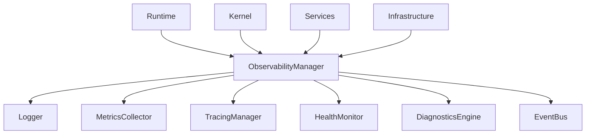
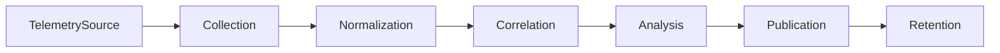

# RFC-0019

**Title:** Observability System

**Document ID:** RFC-0019

**Version:** 1.0

**Status:** Accepted

**Category:** Infrastructure

**Layer:** Infrastructure

**Target:**

```text
infrastructure/observability/
```

---

# Abstract

This RFC defines the SH-3 Observability System.

The Observability System provides a unified architecture for collecting, processing, correlating, and publishing operational telemetry across the entire SH-3 platform.

Observability encompasses logging, metrics, tracing, health monitoring, diagnostics, telemetry, alert generation, and performance profiling.

Every major subsystem SHALL expose standardized observability signals through this system.

This document is normative.

---

# Motivation

A distributed AI Operating System cannot be reliably operated without comprehensive observability.

Without a unified Observability System:

- failures become difficult to diagnose
- performance regressions remain undetected
- distributed tracing becomes fragmented
- operational metrics become inconsistent
- root cause analysis becomes unreliable

The Observability System establishes one consistent operational visibility model.

---

# Goals

The Observability System SHALL provide:

- structured logging
- metrics collection
- distributed tracing
- health monitoring
- diagnostics
- telemetry aggregation
- alert generation
- performance profiling
- execution correlation
- extensibility

---

# Non-Goals

The Observability System SHALL NOT:

- execute Runtime workloads
- schedule tasks
- replace business analytics
- perform Planning
- manage Persistence
- evaluate application logic

Observability measures system behavior.

It does not change system behavior.

---

# Architecture



Observability integrates all operational signals into one coherent platform.

---

# Design Principles

The Observability System follows these principles.

## Observable by Default

Every subsystem shall expose standardized telemetry.

---

## Structured

Observability data shall be machine-readable.

---

## Correlated

Logs, metrics, traces, and diagnostics shall share common identifiers.

---

## Deterministic

Equivalent operational behavior SHALL produce equivalent observability outputs.

---

## Replaceable

Telemetry backends shall remain independently replaceable.

---

# Observability Components

The Observability System consists of:

| Component | Responsibility |
|-----------|----------------|
| ObservabilityManager | Coordination |
| Logger | Structured logging |
| MetricsCollector | Metrics collection |
| TracingManager | Distributed tracing |
| HealthMonitor | Health evaluation |
| DiagnosticsEngine | Diagnostics |
| AlertManager | Alert generation |
| ProfilingManager | Performance profiling |

Each component owns one architectural responsibility.

---

# ObservabilityManager

ObservabilityManager coordinates all telemetry operations.

Responsibilities include:

- telemetry collection
- telemetry publication
- correlation
- diagnostics
- operational reporting

ObservabilityManager does not interpret business semantics.

---

# Logging

The Logger records structured operational events.

Every log entry SHALL contain:

| Field | Description |
|--------|-------------|
| timestamp | Event timestamp |
| level | Log severity |
| component | Source component |
| trace_id | Trace identifier |
| message | Human-readable message |
| metadata | Additional structured data |

Log formats shall remain implementation-independent.

---

# Metrics

MetricsCollector records quantitative operational measurements.

Representative metric categories include:

- execution
- performance
- resource utilization
- availability
- throughput
- latency
- reliability
- security

Metrics shall be numeric and time-series compatible.

---

# Tracing

TracingManager records execution flow across components.

Every Trace SHALL contain:

| Field | Description |
|--------|-------------|
| trace_id | Global trace identifier |
| span_id | Current span |
| parent_span | Parent span |
| component | Executing component |
| metadata | Additional information |

Tracing shall preserve causal relationships.

---

# Health Monitoring

HealthMonitor continuously evaluates subsystem health.

Representative health states include:

- Healthy
- Degraded
- Recovering
- Unavailable
- Failed

Health evaluations shall be deterministic.

---

# Diagnostics

DiagnosticsEngine aggregates operational evidence.

Representative diagnostic sources include:

- logs
- metrics
- traces
- health reports
- runtime statistics
- event history

Diagnostics shall support root cause analysis.

---

# Observability Lifecycle

Every telemetry artifact follows the lifecycle below.

```text
Generated
     │
Collected
     │
Correlated
     │
Published
     │
Archived
```

Lifecycle transitions shall be deterministic.

---

# Observability States

Supported states include:

- Generated
- Collected
- Correlated
- Published
- Archived
- Failed

State transitions shall generate Observability events.

---

# Observability Events

Representative events include:

- LogRecorded
- MetricCollected
- TraceStarted
- TraceCompleted
- HealthChanged
- DiagnosticGenerated
- AlertRaised
- ProfilingCompleted

Observability events integrate with the EventBus.

---

# Observability Model

The Observability System transforms raw operational signals into correlated, actionable, and persistent operational intelligence.

Observability processing is organized into deterministic stages.



Each stage owns one architectural responsibility.

---

# Observability Context

Every observability operation receives one immutable ObservabilityContext.

An ObservabilityContext should contain:

| Field | Description |
|--------|-------------|
| context_id | Unique identifier |
| trace_id | Global trace identifier |
| component_id | Source component |
| operation_id | Operation identifier |
| timestamp | Operation timestamp |
| metadata | Additional information |

The ObservabilityContext enables correlation across all telemetry sources.

---

# Telemetry Model

Telemetry represents all operational information generated by SH-3.

Representative telemetry types include:

- logs
- metrics
- traces
- health reports
- diagnostics
- profiling data
- audit records

All telemetry SHALL support correlation identifiers.

---

# Telemetry Collection

TelemetryCollector gathers signals from SH-3 components.

Collection sources include:

- Runtime
- Kernel
- Services
- Infrastructure
- Plugins
- Deployment components

Collection shall impose minimal runtime overhead.

---

# Telemetry Normalization

Collected telemetry shall be normalized into standard internal formats.

Normalization shall verify:

- required fields
- timestamps
- identifiers
- schema compatibility
- metadata consistency

Invalid telemetry shall be rejected or marked as degraded.

---

# Correlation Model

Observability correlation connects related operational events.

Correlation identifiers include:

- trace_id
- span_id
- execution_id
- task_id
- pipeline_id
- component_id

Correlation enables complete execution visibility.

---

# Distributed Tracing Model

TracingManager maintains execution relationships across components.

Trace hierarchy:

```text
Trace

 └── Span

      └── Child Span

            └── Operation
```

Trace relationships shall preserve causal order.

---

# Metrics Model

Metrics are classified into:

## System Metrics

Examples:

- CPU usage
- memory usage
- resource consumption
- worker utilization

---

## Runtime Metrics

Examples:

- execution latency
- queue depth
- scheduling delay
- task completion rate

---

## AI Metrics

Examples:

- inference latency
- confidence distribution
- learning progress
- reward statistics

---

## Reliability Metrics

Examples:

- failure rate
- recovery success
- retry frequency
- availability

---

# Alerting Model

AlertManager generates operational notifications.

Alert conditions may include:

- threshold violation
- anomaly detection
- health degradation
- security event
- performance regression

Alerts shall contain:

| Field | Description |
|--------|-------------|
| alert_id | Unique identifier |
| severity | Alert priority |
| source | Origin component |
| condition | Trigger reason |
| metadata | Additional information |

---

# Alert Severity

Supported severity levels:

| Level | Description |
|--------|-------------|
| Critical | Immediate action required |
| High | Significant impact |
| Warning | Potential issue |
| Info | Informational |

Severity evaluation shall remain deterministic.

---

# Health Check Model

HealthMonitor evaluates subsystem status.

Health checks may include:

- availability checks
- dependency checks
- resource checks
- performance checks
- security checks

Health checks shall remain lightweight.

---

# Performance Profiling

ProfilingManager measures execution behavior.

Representative profiling targets include:

- CPU usage
- memory allocation
- latency
- throughput
- I/O behavior
- model execution time

Profiling shall be configurable.

---

# Diagnostic Model

DiagnosticsEngine produces structured diagnostic reports.

Diagnostic reports may include:

- affected components
- recent events
- trace information
- metrics history
- health state
- recommended actions

Diagnostics shall support automated analysis.

---

# EventBus Integration

Observability lifecycle events shall be published through the EventBus.

Events shall preserve:

- trace identifiers
- component identifiers
- timestamps
- lifecycle state

Event ordering shall remain deterministic.

---

# Registry Integration

Observability components shall be discoverable through the Registry System.

Registry metadata may include:

- telemetry providers
- exporters
- monitoring adapters
- diagnostic modules

---

# Configuration Integration

Observability behavior shall be controlled through the Configuration System.

Configurable items include:

- log level
- sampling rate
- retention period
- metric interval
- tracing mode
- profiling options

Configuration changes create new revisions.

---

# Export Model

Telemetry may be exported through replaceable exporters.

Representative exporters include:

- local storage exporter
- remote monitoring exporter
- event exporter
- analytics exporter

Exporter implementations remain replaceable.

---

# Retention Model

Observability data retention shall be configurable.

Retention policies may define:

- storage duration
- compression
- archival rules
- deletion policy

Retention shall not affect active runtime behavior.

---

# Failure Handling

Observability failures shall not directly stop core execution.

Representative failures include:

- exporter unavailable
- telemetry overflow
- storage failure
- collector failure

Failures shall generate internal diagnostics.

---

# Recovery

Recovery strategies may include:

- exporter restart
- telemetry buffering
- degraded collection mode
- collector replacement
- storage recovery

Recovery shall preserve telemetry consistency.

---

# Thread Model

The Observability System shall support concurrent telemetry generation.

Collection, processing, and export operations should be isolated.

Shared mutable state should be minimized.

The reference implementation shall be thread-safe.

---

# Metrics

The Observability System shall expose self-monitoring metrics.

Representative metrics include:

- telemetry volume
- collection latency
- export latency
- dropped events
- buffer utilization
- trace count
- alert count
- diagnostic generation time

---

# Logging

Observability internal logs shall remain structured.

Recommended categories include:

- collection
- normalization
- correlation
- export
- alerting
- diagnostics

Sensitive information shall be filtered.

---

# Security Considerations

The Observability System shall preserve:

- telemetry integrity
- audit integrity
- sensitive data protection
- access control

Telemetry access shall follow Security System permissions.

---

# Public Interfaces

The Observability public API is defined separately in:

```text
docs/api/observability_api.md
```

This RFC specifies Observability behavior.

API specifications define callable interfaces.

---

# Compatibility

Future Observability implementations shall remain compatible with this specification.

Possible future implementations include:

- distributed telemetry clusters
- AI-assisted anomaly detection
- predictive failure analysis
- autonomous incident response
- federated monitoring

Observable behavior shall remain consistent.

---

# Performance Objectives

The Observability System should optimize for:

- low telemetry overhead
- efficient correlation
- scalable collection
- fast diagnostics
- predictable resource usage

Performance improvements shall preserve accuracy and reliability.

---

# Future Work

Potential future enhancements include:

- autonomous root cause analysis
- predictive maintenance
- AI-generated diagnostics
- adaptive telemetry sampling
- self-optimizing monitoring policies
- cross-cluster observability federation

These enhancements extend the Observability architecture without changing its core responsibilities.

---

# References

- SH-3 Architecture Specification v2.1
- RFC-0000 Documentation Standard
- RFC-0001 Event System
- RFC-0002 Runtime System
- RFC-0003 Kernel System
- RFC-0004 Planner System
- RFC-0005 Memory System
- RFC-0006 Policy System
- RFC-0007 Learning System
- RFC-0008 Optimizer System
- RFC-0009 Self-Healing System
- RFC-0010 Persistence System
- RFC-0011 Plugin System
- RFC-0012 Deployment System
- RFC-0013 Capability System
- RFC-0014 Registry System
- RFC-0015 Scheduler System
- RFC-0016 Pipeline System
- RFC-0017 Configuration System
- RFC-0018 Security System

---

# End of RFC-0019
