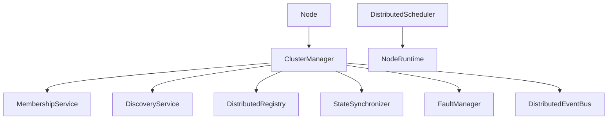
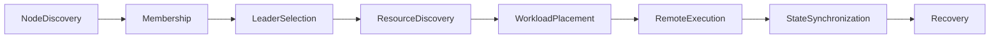

# RFC-0020

**Title:** Distributed Cluster System

**Document ID:** RFC-0020

**Version:** 1.0

**Status:** Accepted

**Category:** Deployment

**Layer:** Deployment

**Target:**

```text
deployment/cluster/
```

---

# Abstract

This RFC defines the SH-3 Distributed Cluster System.

The Distributed Cluster System extends SH-3 from a single execution environment into a coordinated multi-node AI operating platform.

It provides node discovery, cluster formation, distributed execution coordination, service discovery, state synchronization, fault tolerance, distributed event propagation, and resource-aware workload distribution.

The Distributed Cluster System preserves SH-3's core principles:

- Everything is Event Driven.
- Everything is Replaceable.
- Everything is Typed.
- Everything is Testable.

This document is normative.

---

# Motivation

Future AI systems require more than a single execution environment.

Large-scale intelligence requires:

- distributed computation
- multiple specialized nodes
- shared knowledge
- fault tolerance
- scalable resources
- autonomous workload distribution

Without a unified Cluster System:

- nodes cannot coordinate reliably
- resources cannot be discovered
- failures cannot be isolated
- distributed execution becomes inconsistent

The Distributed Cluster System provides a foundation for scalable SH-3 deployments.

---

# Goals

The Distributed Cluster System SHALL provide:

- node registration
- cluster membership
- service discovery
- distributed capability discovery
- remote execution coordination
- state synchronization
- fault detection
- recovery
- workload distribution
- cluster observability

---

# Non-Goals

The Distributed Cluster System SHALL NOT:

- replace local Runtime execution
- replace Scheduler logic
- replace Pipeline orchestration
- replace Memory architecture
- define AI reasoning behavior

The Cluster System coordinates distributed resources.

---

# Architecture



The Cluster System coordinates multiple SH-3 nodes as one logical platform.

---

# Design Principles

The Distributed Cluster System follows these principles.

---

## Decentralized Capability

Each node remains independently functional.

Cluster participation extends capability but does not remove autonomy.

---

## Fault Tolerant

Individual node failures shall not necessarily terminate cluster operation.

---

## Event Driven

Cluster state changes shall propagate through events.

---

## Eventually Consistent

Distributed state synchronization shall prioritize availability and resilience.

---

## Replaceable

Network, discovery, and synchronization implementations shall remain replaceable.

---

# Cluster Components

The Distributed Cluster System consists of:

| Component | Responsibility |
|-----------|----------------|
| ClusterManager | Coordination |
| NodeManager | Node lifecycle |
| MembershipService | Cluster membership |
| DiscoveryService | Resource discovery |
| DistributedRegistry | Shared registry |
| StateSynchronizer | State replication |
| FaultManager | Failure handling |
| DistributedEventBus | Event propagation |
| ClusterMonitor | Observation |

Each component owns one architectural responsibility.

---

# ClusterManager

ClusterManager coordinates distributed operations.

Responsibilities include:

- cluster initialization
- node coordination
- membership management
- synchronization control
- recovery coordination

ClusterManager does not execute workloads.

---

# Node Model

A Node represents one SH-3 execution environment.

Every Node SHALL contain:

| Field | Description |
|--------|-------------|
| node_id | Unique identifier |
| node_type | Node classification |
| capabilities | Available capabilities |
| resources | Available resources |
| version | SH-3 version |
| metadata | Additional information |

Nodes remain independently addressable.

---

# Node Types

Representative node types include:

- Compute Node
- Memory Node
- Learning Node
- Tool Node
- Storage Node
- Gateway Node
- Coordinator Node

Future implementations may introduce additional node types.

---

# Cluster Model

A Cluster represents a group of cooperating SH-3 Nodes.

Every Cluster SHALL contain:

| Field | Description |
|--------|-------------|
| cluster_id | Unique identifier |
| nodes | Member nodes |
| version | Cluster version |
| topology | Network topology |
| metadata | Additional information |

---

# Cluster Lifecycle

Every Cluster follows the lifecycle below.

```text
Created
    │
Initialized
    │
Discovering
    │
Formed
    │
Operational
    │
Degraded
    │
Recovering
    │
Shutdown
```

Lifecycle transitions shall be deterministic.

---

# Node Lifecycle

Every Node follows the lifecycle below.

```text
Registered
    │
Validated
    │
Connected
    │
Active
    │
Degraded
    │
Disconnected
    │
Removed
```

Node state transitions shall generate Cluster events.

---

# Cluster Events

Representative events include:

- ClusterCreated
- NodeRegistered
- NodeConnected
- NodeAvailable
- NodeUnavailable
- NodeRecovered
- ClusterDegraded
- ClusterRecovered

Cluster events integrate with the Distributed EventBus.

---

# Membership Model

MembershipService maintains active cluster membership.

Membership information includes:

- active nodes
- node health
- node capabilities
- resource availability
- network status

Membership updates shall be observable.

---

# Discovery Model

DiscoveryService discovers distributed resources.

Discoverable resources include:

- capabilities
- services
- nodes
- execution resources
- storage providers

Discovery shall integrate with the Registry System.

---

# Distributed Registry

DistributedRegistry extends the local Registry System.

It provides:

- remote capability discovery
- node resource discovery
- service discovery
- metadata synchronization

Local Registry remains authoritative for local components.

---

# State Synchronization

StateSynchronizer maintains distributed state consistency.

Synchronization targets include:

- cluster metadata
- node state
- capability availability
- health status
- configuration revision

Synchronization strategy remains implementation-dependent.

---

# Failure Detection

FaultManager monitors node availability.

Detection mechanisms may include:

- heartbeat
- timeout detection
- health checks
- event monitoring

Failures shall produce Cluster events.

---

# Distributed Cluster Model

The Distributed Cluster System transforms independent SH-3 nodes into a coordinated distributed execution environment.

Distributed processing is organized into deterministic coordination stages.



Each stage owns one architectural responsibility.

---

# Cluster Context

Every distributed operation receives one immutable ClusterContext.

A ClusterContext should contain:

| Field | Description |
|--------|-------------|
| context_id | Unique identifier |
| cluster_id | Cluster identifier |
| node_id | Current node |
| operation_id | Operation identifier |
| topology_version | Network topology revision |
| metadata | Additional information |

The ClusterContext exists only during one distributed operation.

---

# Leader Election

The Cluster System may elect coordination leaders.

Leader responsibilities include:

- coordination
- membership synchronization
- distributed scheduling assistance
- cluster state publication

Leadership shall not create a single point of execution dependency.

---

# Leader Election Model

Supported election strategies may include:

- consensus-based election
- priority-based election
- deterministic selection
- external coordinator election

Election algorithms remain implementation-independent.

---

# Leader Lifecycle

Leadership follows the lifecycle below.

```text
Candidate

↓

Selected

↓

Active

↓

Transferred

↓

Released
```

Leadership transitions shall generate Cluster events.

---

# Distributed Scheduler

DistributedScheduler extends the local Scheduler System.

Responsibilities include:

- workload placement
- node selection
- resource matching
- remote dispatch coordination

Local Scheduler remains responsible for node-level execution ordering.

---

# Workload Placement

Workload placement evaluates:

- node capability
- resource availability
- network latency
- execution constraints
- security requirements
- workload priority

Placement decisions shall be deterministic.

---

# Remote Execution Model

Remote execution allows one node to request execution on another node.

Execution flow:

```text
Request

↓

Capability Resolution

↓

Security Validation

↓

Remote Dispatch

↓

Execution

↓

Result Synchronization
```

Remote execution shall preserve execution identity.

---

# Execution Identity

Distributed executions SHALL maintain:

| Field | Description |
|--------|-------------|
| cluster_execution_id | Global execution identifier |
| node_execution_id | Local execution identifier |
| task_id | Task identifier |
| trace_id | Distributed trace identifier |

Identity correlation enables complete observability.

---

# Distributed EventBus

DistributedEventBus extends the local EventBus architecture.

Responsibilities include:

- event propagation
- event routing
- event synchronization
- remote event delivery

Local EventBus behavior remains unchanged.

---

# Event Delivery Model

Supported delivery models include:

- reliable delivery
- ordered delivery
- best effort delivery
- broadcast delivery

Delivery guarantees shall be explicitly defined.

---

# Consistency Model

The Distributed Cluster System supports configurable consistency models.

Representative models include:

| Model | Description |
|--------|-------------|
| Strong | Immediate consistency |
| Eventual | Asynchronous convergence |
| Causal | Causal ordering preservation |
| Local | Node-local authority |

Each subsystem shall define its required consistency level.

---

# State Synchronization

State synchronization follows:

```text
Local State

↓

Change Detection

↓

Synchronization Event

↓

Remote Update

↓

Consistency Verification
```

Synchronization shall avoid unnecessary state transfer.

---

# Network Model

The Cluster System abstracts network communication.

Supported communication models include:

- direct node communication
- message queues
- RPC
- event streams
- service mesh

Network implementations remain replaceable.

---

# Network Failure Handling

Network failures may include:

- connection loss
- latency increase
- partition
- message loss
- node isolation

FaultManager shall detect and classify failures.

---

# Recovery Model

Recovery strategies include:

- node reconnection
- workload migration
- replica activation
- state synchronization
- cluster topology update

Recovery shall preserve cluster consistency.

---

# Node Recovery

Recovered nodes shall follow:

```text
Disconnected

↓

Reconnecting

↓

Validated

↓

Synchronizing

↓

Active
```

A recovered node shall not receive workloads before validation.

---

# Workload Migration

The Cluster System may migrate workloads.

Migration may consider:

- node failure
- resource optimization
- maintenance
- load balancing

Migration shall preserve execution identity.

---

# Cluster Security

Distributed operations shall integrate with the Security System.

Security requirements include:

- node authentication
- communication integrity
- authorization
- capability verification
- encrypted transport

Untrusted nodes shall not join active clusters.

---

# Configuration Integration

Cluster behavior shall be controlled through the Configuration System.

Configurable items include:

- topology
- node roles
- synchronization policy
- election strategy
- network settings
- recovery policy

Configuration changes create new revisions.

---

# Registry Integration

DistributedRegistry synchronizes discoverable resources.

Registry synchronization includes:

- capabilities
- services
- node metadata
- execution providers

Registry consistency shall follow declared synchronization policy.

---

# Observability Integration

Cluster operations participate in the Observability System.

Telemetry includes:

- node health
- network state
- workload distribution
- synchronization latency
- recovery events

Distributed tracing shall preserve cross-node execution flow.

---

# Failure Handling

Cluster failures shall produce structured diagnostic information.

Representative failures include:

- node loss
- leader failure
- synchronization failure
- network partition
- remote execution failure

Failures shall generate Cluster events.

---

# Thread Model

The Distributed Cluster System shall support concurrent distributed operations.

Independent nodes shall execute independently.

Shared distributed state access shall follow synchronization rules.

---

# Metrics

The Distributed Cluster System shall expose operational metrics.

Representative metrics include:

- active nodes
- cluster size
- workload distribution
- network latency
- synchronization delay
- recovery count
- migration count
- leader changes

---

# Logging

Cluster logging shall produce structured records.

Recommended categories include:

- membership
- discovery
- election
- synchronization
- execution
- recovery

Sensitive information shall be filtered.

---

# Tracing

Distributed tracing shall preserve:

- trace_id
- cluster_id
- node_id
- execution_id
- task_id

Tracing enables complete multi-node execution visibility.

---

# Performance Objectives

The Distributed Cluster System should optimize for:

- scalable node coordination
- efficient resource discovery
- low communication overhead
- reliable synchronization
- fast recovery

Performance improvements shall preserve correctness and resilience.

---

# Future Work

Potential future enhancements include:

- autonomous cluster optimization
- geographic distributed clusters
- edge AI nodes
- heterogeneous accelerator scheduling
- federated intelligence
- self-organizing node topology
- multi-cluster federation

These enhancements extend the Cluster architecture without changing its core responsibilities.

---

# References

- SH-3 Architecture Specification v2.1
- RFC-0000 Documentation Standard
- RFC-0001 Event System
- RFC-0002 Runtime System
- RFC-0003 Kernel System
- RFC-0004 Planner System
- RFC-0005 Memory System
- RFC-0006 Policy System
- RFC-0007 Learning System
- RFC-0008 Optimizer System
- RFC-0009 Self-Healing System
- RFC-0010 Persistence System
- RFC-0011 Plugin System
- RFC-0012 Deployment System
- RFC-0013 Capability System
- RFC-0014 Registry System
- RFC-0015 Scheduler System
- RFC-0016 Pipeline System
- RFC-0017 Configuration System
- RFC-0018 Security System
- RFC-0019 Observability System

---

# End of RFC-0020
