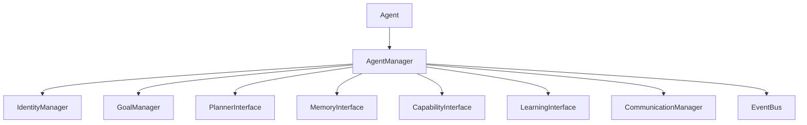

# RFC-0021

**Title:** Agent System

**Document ID:** RFC-0021

**Version:** 1.0

**Status:** Accepted

**Category:** Services

**Layer:** Services

**Target:**

```text
services/agent/
```

---

# Abstract

This RFC defines the SH-3 Agent System.

The Agent System provides the foundation for autonomous entities operating within SH-3.

An Agent represents an independent intelligent execution unit capable of maintaining identity, managing goals, interacting with memory, using capabilities, executing plans, communicating with other agents, and improving through learning.

The Agent System integrates existing SH-3 subsystems:

- Memory System
- Planning System
- Capability System
- Learning System
- Policy System
- Pipeline System
- Observability System

This document is normative.

---

# Motivation

Advanced AI systems require autonomous entities that can:

- maintain objectives
- reason about tasks
- interact with tools
- learn from experience
- cooperate with other agents
- adapt to changing environments

Without a unified Agent System:

- autonomous behavior becomes inconsistent
- agent identity becomes undefined
- learning integration becomes fragmented
- multi-agent coordination becomes difficult

The Agent System provides a standardized autonomous execution model.

---

# Goals

The Agent System SHALL provide:

- agent identity
- lifecycle management
- goal management
- planning integration
- memory integration
- capability access
- communication
- learning integration
- autonomy control
- self-improvement support

---

# Non-Goals

The Agent System SHALL NOT:

- replace Planning System
- replace Memory System
- replace Learning System
- replace Runtime Scheduler
- replace Capability System

The Agent coordinates intelligence.

Existing systems provide specialized functions.

---

# Architecture



The Agent System acts as an intelligent coordination layer.

---

# Design Principles

The Agent System follows these principles.

---

## Autonomous but Controlled

Agents may act independently while remaining constrained by Security and Policy Systems.

---

## Goal Driven

Agent behavior SHALL be organized around explicit goals.

---

## Memory Enabled

Agents SHALL maintain access to relevant knowledge and experience.

---

## Capability Based

Agents SHALL use capabilities rather than concrete implementations.

---

## Observable

Agent decisions and lifecycle transitions SHALL be traceable.

---

## Replaceable

Agent components SHALL remain modular and replaceable.

---

# Agent Components

The Agent System consists of:

| Component | Responsibility |
|-----------|----------------|
| AgentManager | Coordination |
| IdentityManager | Agent identity |
| GoalManager | Goal lifecycle |
| PlannerInterface | Planning integration |
| MemoryInterface | Memory access |
| CapabilityInterface | Tool access |
| LearningInterface | Learning integration |
| CommunicationManager | Agent communication |
| AutonomyController | Autonomy control |

---

# AgentManager

AgentManager coordinates all Agent operations.

Responsibilities include:

- agent creation
- lifecycle control
- goal coordination
- subsystem integration
- diagnostics

AgentManager does not implement reasoning algorithms.

---

# Agent Identity

Every Agent SHALL have a unique identity.

Agent Identity contains:

| Field | Description |
|--------|-------------|
| agent_id | Unique identifier |
| name | Human-readable name |
| type | Agent category |
| version | Agent version |
| capabilities | Available capabilities |
| metadata | Additional information |

Agent identity remains stable during its lifecycle.

---

# Agent Types

Representative agent types include:

- General Agent
- Planning Agent
- Research Agent
- Tool Agent
- Monitoring Agent
- Learning Agent
- Coordinator Agent

Future implementations may introduce additional types.

---

# Agent Lifecycle

Every Agent follows the lifecycle below.

```text
Created

↓

Initialized

↓

Registered

↓

Active

↓

Learning

↓

Suspended

↓

Archived
```

Lifecycle transitions shall be deterministic.

---

# Agent States

Supported states include:

- Created
- Initialized
- Registered
- Active
- Thinking
- Planning
- Executing
- Learning
- Suspended
- Failed
- Archived

State transitions shall generate Agent events.

---

# Agent Events

Representative events include:

- AgentCreated
- AgentInitialized
- AgentActivated
- GoalCreated
- PlanGenerated
- ActionStarted
- ActionCompleted
- LearningStarted
- AgentSuspended
- AgentFailed

Agent events integrate with the EventBus.

---

# Goal Management

GoalManager manages agent objectives.

A Goal SHALL contain:

| Field | Description |
|--------|-------------|
| goal_id | Unique identifier |
| objective | Goal description |
| priority | Importance |
| constraints | Restrictions |
| status | Goal state |

Goals remain explicit and observable.

---

# Goal Lifecycle

```text
Created

↓

Evaluated

↓

Accepted

↓

Executing

↓

Completed

↓

Archived
```

Goal transitions shall be deterministic.

---

# Autonomy Levels

Agents may operate under different autonomy levels.

Supported levels include:

| Level | Description |
|--------|-------------|
| L0 | Passive |
| L1 | Assisted |
| L2 | Task Autonomous |
| L3 | Goal Autonomous |
| L4 | Self Improving |
| L5 | Fully Autonomous |

Autonomy level shall be controlled by Policy.

---

# Planning Integration

Agents request planning through the Planning System.

Agent responsibilities:

- define goals
- provide context
- evaluate outcomes

Planning System responsibilities:

- generate plans
- evaluate alternatives
- optimize execution paths

---

# Memory Integration

Agents access memory through the Memory System interface.

Memory responsibilities:

- knowledge retrieval
- experience storage
- context management
- relevance ranking

Agents do not directly manage storage implementations.

---

# Agent Execution Model

The Agent System transforms goals into autonomous actions through deterministic coordination between SH-3 subsystems.

Agent execution is organized into the following lifecycle.


Each stage maintains a clear architectural responsibility.

---

# Agent Context

Every Agent operation receives one immutable AgentContext.

An AgentContext should contain:

| Field | Description |
|--------|-------------|
| context_id | Unique identifier |
| agent_id | Agent identifier |
| goal_id | Current goal identifier |
| execution_id | Execution identifier |
| memory_context | Retrieved knowledge |
| metadata | Additional information |

The AgentContext represents one autonomous reasoning cycle.

---

# Reasoning Cycle

An Agent reasoning cycle consists of:

```text
Observe

↓

Understand

↓

Plan

↓

Act

↓

Evaluate

↓

Learn
```

Each cycle shall generate observable events.

---

# Capability Binding

Agents access external functions through the Capability System.

Capability binding provides:

- dynamic capability discovery
- version validation
- permission verification
- execution routing
- replacement support

Agents SHALL NOT directly depend on concrete tools.

---

# Capability Selection

Capability selection may consider:

- goal requirements
- available capabilities
- permissions
- execution cost
- reliability
- previous experience

Selection decisions shall remain observable.

---

# Tool Usage Model

Agents may invoke tools through Capability interfaces.

Execution flow:

```text
Agent

↓

Capability Request

↓

Security Validation

↓

Capability Resolution

↓

Runtime Execution

↓

Result Evaluation
```

Tool execution remains controlled by Runtime and Security Systems.

---

# Memory Interaction

Agents interact with Memory through abstract interfaces.

Supported operations include:

- retrieve knowledge
- store experience
- update importance
- retrieve context
- access episodic memory

Memory implementation remains independent.

---

# Planning Interaction

Agents delegate planning decisions to the Planning System.

Planning request contains:

```text
goal

context

constraints

available_capabilities

memory_context
```

Planning response contains:

```text
plan

confidence

expected_result

metadata
```

---

# Communication Model

CommunicationManager enables agent-to-agent interaction.

Supported communication types include:

- direct messaging
- event communication
- shared workspace
- task delegation
- negotiation

Communication remains asynchronous by default.

---

# Multi-Agent Coordination

Multiple Agents may cooperate through coordination mechanisms.

Supported coordination models include:

- leader-based coordination
- peer collaboration
- task delegation
- consensus
- competition

Coordination strategy remains configurable.

---

# Agent Collaboration

Collaborating agents SHALL define:

- shared objective
- responsibility boundaries
- communication protocol
- result aggregation method

Agent responsibilities shall remain explicit.

---

# Agent Delegation

Agents may delegate goals to other agents.

Delegation requires:

- capability compatibility
- permission validation
- goal compatibility
- resource availability

Delegated goals remain traceable to the originating agent.

---

# Learning Integration

Agents improve through the Learning System.

Learning sources include:

- successful executions
- failed executions
- feedback
- rewards
- environmental changes

Learning SHALL NOT bypass Policy restrictions.

---

# Self Improvement Loop

Agents may participate in controlled self-improvement.

Self-improvement cycle:

```text
Experience

↓

Evaluation

↓

Pattern Extraction

↓

Learning Update

↓

Behavior Adjustment
```

Self-improvement requires explicit authorization.

---

# Reflection Model

Agents may perform reflection after execution.

Reflection evaluates:

- goal achievement
- execution quality
- efficiency
- failures
- improvements

Reflection results may be stored as experience.

---

# Policy Control

Agent behavior is governed by the Policy System.

Policy controls:

- allowed goals
- available capabilities
- autonomy level
- resource usage
- communication permissions
- learning permissions

Agents cannot override Policy decisions.

---

# Security Model

Agent operations integrate with the Security System.

Security requirements include:

- authenticated identity
- capability authorization
- execution isolation
- communication security
- audit recording

Untrusted Agents shall operate under restricted permissions.

---

# Agent Persistence

Agent state may be persisted through the Persistence System.

Persisted information may include:

- identity
- goals
- preferences
- learned behavior
- execution history
- metadata

Transient reasoning state should not necessarily be persisted.

---

# EventBus Integration

Agent lifecycle events shall be published through the EventBus.

Events include:

- AgentCreated
- GoalStarted
- PlanRequested
- ActionExecuted
- ResultEvaluated
- LearningCompleted
- AgentImproved

Event ordering shall remain deterministic.

---

# Observability Integration

Agent execution participates in the Observability System.

Telemetry includes:

- reasoning cycles
- goal progress
- capability usage
- execution latency
- learning outcomes
- communication patterns

Agent behavior shall remain traceable.

---

# Failure Handling

Agent failures shall produce structured diagnostics.

Representative failures include:

- planning failure
- capability unavailable
- execution failure
- communication failure
- learning failure
- policy denial

Failures shall generate Agent events.

---

# Recovery

Recovery strategies may include:

- replanning
- alternative capability selection
- goal decomposition
- agent restart
- delegation
- human approval request

Recovery shall preserve goal consistency.

---

# Thread Model

The Agent System shall support concurrent agent execution.

Independent Agents shall maintain isolated contexts.

Shared information exchange shall occur through defined interfaces.

The reference implementation shall be thread-safe.

---

# Metrics

The Agent System shall expose operational metrics.

Representative metrics include:

- active agents
- completed goals
- planning success rate
- capability usage
- learning improvement
- communication volume
- recovery count
- autonomy level distribution

---

# Logging

Agent logging shall produce structured records.

Recommended categories include:

- lifecycle
- goals
- planning
- execution
- communication
- learning
- reflection

Sensitive reasoning information shall follow Security policy.

---

# Tracing

Agent traces shall preserve:

- trace_id
- agent_id
- goal_id
- execution_id
- capability_id
- learning_id

Tracing enables complete autonomous behavior analysis.

---

# Performance Objectives

The Agent System should optimize for:

- efficient reasoning cycles
- low coordination overhead
- scalable multi-agent execution
- predictable resource usage
- reliable autonomous operation

Performance improvements shall preserve safety and determinism.

---

# Future Work

Potential future enhancements include:

- autonomous agent creation
- agent specialization evolution
- agent marketplace
- collective intelligence
- distributed agent societies
- emergent coordination
- self-organizing agent networks

These enhancements extend the Agent architecture without changing its core responsibilities.

---

# References

- SH-3 Architecture Specification v2.1
- RFC-0000 Documentation Standard
- RFC-0001 Event System
- RFC-0002 Runtime System
- RFC-0003 Kernel System
- RFC-0004 Planner System
- RFC-0005 Memory System
- RFC-0006 Policy System
- RFC-0007 Learning System
- RFC-0008 Optimizer System
- RFC-0009 Self-Healing System
- RFC-0010 Persistence System
- RFC-0011 Plugin System
- RFC-0012 Deployment System
- RFC-0013 Capability System
- RFC-0014 Registry System
- RFC-0015 Scheduler System
- RFC-0016 Pipeline System
- RFC-0017 Configuration System
- RFC-0018 Security System
- RFC-0019 Observability System
- RFC-0020 Distributed Cluster System

---

# End of RFC-0021
