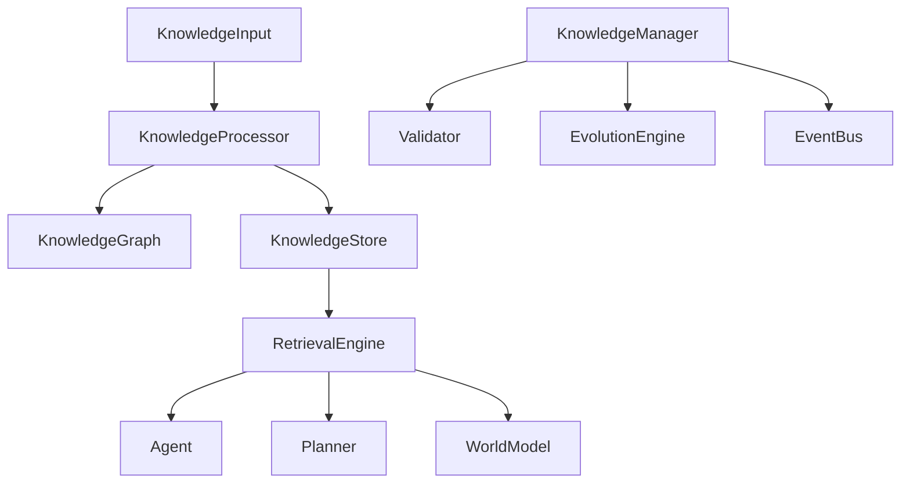

# RFC-0022

**Title:** Knowledge System

**Document ID:** RFC-0022

**Version:** 1.0

**Status:** Accepted

**Category:** Services

**Layer:** Services

**Target:**

```text
services/knowledge/
```

---

# Abstract

This RFC defines the SH-3 Knowledge System.

The Knowledge System provides a unified architecture for representing, storing, retrieving, validating, evolving, and sharing knowledge across the SH-3 platform.

Knowledge is treated as a first-class intelligence resource.

The Knowledge System integrates with:

- Memory System
- Agent System
- Planning System
- Learning System
- World Model System
- Retrieval Systems

The system provides semantic knowledge management beyond simple data storage.

This document is normative.

---

# Motivation

Advanced AI systems require structured knowledge rather than only raw information.

Without a unified Knowledge System:

- knowledge representation becomes inconsistent
- retrieval quality decreases
- reasoning becomes unreliable
- learned information cannot be reused effectively
- knowledge evolution cannot be controlled

The Knowledge System provides the foundation for persistent intelligence.

---

# Goals

The Knowledge System SHALL provide:

- knowledge representation
- semantic relationships
- knowledge storage
- knowledge retrieval
- knowledge validation
- knowledge versioning
- knowledge evolution
- knowledge sharing
- RAG integration
- reasoning support

---

# Non-Goals

The Knowledge System SHALL NOT:

- replace Memory System
- replace Learning System
- replace Planning System
- execute actions
- control Runtime execution

Knowledge provides information.

Other systems perform reasoning and execution.

---

# Architecture



The Knowledge System transforms information into reusable intelligence assets.

---

# Design Principles

The Knowledge System follows these principles.

---

## Semantic First

Knowledge SHALL represent meaning and relationships.

---

## Evolvable

Knowledge SHALL support continuous improvement.

---

## Validated

Knowledge quality SHALL be evaluated.

---

## Context Aware

Knowledge retrieval SHALL consider usage context.

---

## Observable

Knowledge changes SHALL be traceable.

---

## Replaceable

Storage and retrieval implementations SHALL remain replaceable.

---

# Knowledge Components

The Knowledge System consists of:

| Component | Responsibility |
|-----------|----------------|
| KnowledgeManager | Coordination |
| KnowledgeGraph | Semantic relationships |
| KnowledgeStore | Persistence |
| RetrievalEngine | Search |
| KnowledgeValidator | Validation |
| EvolutionEngine | Improvement |
| KnowledgeIndexer | Index management |
| KnowledgeExporter | Sharing |

---

# KnowledgeManager

KnowledgeManager coordinates knowledge operations.

Responsibilities include:

- ingestion
- validation
- indexing
- retrieval
- evolution management
- diagnostics

KnowledgeManager does not perform reasoning.

---

# Knowledge Model

A Knowledge Object represents one unit of knowledge.

Every Knowledge Object SHALL contain:

| Field | Description |
|--------|-------------|
| knowledge_id | Unique identifier |
| type | Knowledge category |
| content | Knowledge data |
| relationships | Semantic links |
| confidence | Reliability score |
| version | Knowledge version |
| metadata | Additional information |

Knowledge Objects remain versioned.

---

# Knowledge Types

Representative knowledge types include:

- Fact Knowledge
- Concept Knowledge
- Procedural Knowledge
- Episodic Knowledge
- Relational Knowledge
- Rule Knowledge
- Domain Knowledge
- Experience Knowledge

Future implementations may introduce additional types.

---

# Semantic Graph

KnowledgeGraph represents relationships between knowledge entities.

Representative relationships include:

- is_a
- contains
- depends_on
- causes
- precedes
- similar_to
- derived_from

Relationships SHALL be explicitly represented.

---

# Knowledge Entity

A Knowledge Entity represents an identifiable concept.

Every entity SHALL contain:

| Field | Description |
|--------|-------------|
| entity_id | Unique identifier |
| label | Human-readable name |
| category | Entity type |
| attributes | Properties |
| metadata | Additional information |

---

# Knowledge Relationship

A Knowledge Relationship connects entities.

Every relationship SHALL contain:

| Field | Description |
|--------|-------------|
| relation_id | Unique identifier |
| source | Source entity |
| target | Target entity |
| type | Relationship type |
| confidence | Reliability |
| metadata | Additional information |

---

# Knowledge Lifecycle

Every Knowledge Object follows:

```text
Created

↓

Validated

↓

Indexed

↓

Available

↓

Updated

↓

Archived
```

Lifecycle transitions shall be deterministic.

---

# Knowledge States

Supported states include:

- Created
- Validating
- Validated
- Indexed
- Active
- Deprecated
- Archived
- Rejected

State transitions shall generate Knowledge events.

---

# Knowledge Events

Representative events include:

- KnowledgeCreated
- KnowledgeValidated
- KnowledgeIndexed
- KnowledgeRetrieved
- KnowledgeUpdated
- KnowledgeDeprecated
- KnowledgeArchived

Knowledge events integrate with the EventBus.

---

# Knowledge Ingestion

Knowledge ingestion accepts information from:

- Agents
- Memory System
- Internet Core
- Learning System
- External sources
- Human feedback

All incoming knowledge SHALL be validated before activation.

---

# Knowledge Validation

KnowledgeValidator evaluates:

- consistency
- confidence
- source reliability
- duplication
- contradiction
- freshness

Invalid knowledge shall not become active.

---

# Knowledge Versioning

Knowledge changes shall create new versions.

Versioning preserves:

- historical knowledge
- change reasons
- source information
- confidence changes

Previous versions remain accessible.

---

# Knowledge Retrieval

RetrievalEngine provides context-aware knowledge access.

Retrieval may use:

- semantic search
- vector search
- graph traversal
- keyword search
- hybrid retrieval

Retrieval implementation remains replaceable.

---

# Knowledge Execution Model

The Knowledge System transforms information into validated, searchable, evolving intelligence resources.

Knowledge processing is organized into deterministic stages.


Each stage owns one architectural responsibility.

---

# Knowledge Context

Every knowledge operation receives one immutable KnowledgeContext.

A KnowledgeContext should contain:

| Field | Description |
|--------|-------------|
| context_id | Unique identifier |
| knowledge_id | Knowledge identifier |
| source_id | Information source |
| version | Knowledge version |
| confidence | Reliability score |
| metadata | Additional information |

The KnowledgeContext represents one knowledge lifecycle operation.

---

# Retrieval Model

RetrievalEngine provides knowledge access to SH-3 components.

Supported retrieval strategies include:

- semantic retrieval
- vector similarity search
- graph traversal
- keyword matching
- hybrid retrieval

Retrieval results SHALL contain relevance information.

---

# Retrieval Result

Every retrieval result should contain:

| Field | Description |
|--------|-------------|
| knowledge_id | Knowledge identifier |
| relevance | Relevance score |
| confidence | Knowledge confidence |
| source | Origin |
| context | Supporting information |

Retrieval ranking shall remain deterministic.

---

# RAG Integration

The Knowledge System integrates with Retrieval Augmented Generation.

RAG flow:

```text
Query

↓

Intent Analysis

↓

Knowledge Retrieval

↓

Context Construction

↓

Generation

↓

Evaluation
```

The Knowledge System provides information.

The LLM System performs generation.

---

# Embedding Integration

Knowledge may be indexed through embedding representations.

Embedding usage includes:

- semantic similarity
- clustering
- retrieval ranking
- concept discovery

Embedding implementations remain replaceable.

---

# Hybrid Retrieval

SH-3 supports combined retrieval strategies.

Representative combination:

```text
Semantic Search

+

Vector Search

+

Keyword Search

+

Knowledge Graph Search
```

Ranking shall combine multiple signals.

---

# Knowledge Graph Operations

KnowledgeGraph supports:

- entity creation
- relationship creation
- graph traversal
- relationship inference
- concept expansion

Graph operations shall preserve semantic consistency.

---

# Relationship Inference

The Knowledge System may infer relationships.

Inference sources include:

- existing relationships
- learned patterns
- similarity analysis
- causal information

Inferred relationships SHALL contain confidence values.

---

# Contradiction Detection

KnowledgeValidator detects conflicting information.

Conflict types include:

- direct contradiction
- outdated information
- inconsistent relationship
- confidence conflict

Conflicts shall be recorded.

---

# Contradiction Resolution

Resolution strategies include:

- source reliability comparison
- confidence evaluation
- temporal preference
- human feedback
- Learning System evaluation

Resolution decisions shall remain traceable.

---

# Knowledge Evolution

EvolutionEngine improves knowledge quality over time.

Evolution operations include:

- merging knowledge
- updating confidence
- discovering relationships
- removing obsolete information
- restructuring concepts

Evolution shall preserve historical versions.

---

# Knowledge Importance

Knowledge may have importance scores.

Importance factors include:

- usage frequency
- retrieval frequency
- confidence
- recency
- learning impact
- dependency count

Importance influences retention and prioritization.

---

# Memory Integration

The Knowledge System integrates with Memory.

Memory provides:

- episodic experiences
- contextual history
- usage patterns

Knowledge provides:

- validated concepts
- semantic relationships
- reusable information

The two systems remain independent.

---

# Learning Integration

LearningSystem improves knowledge quality.

Learning sources include:

- feedback
- successful reasoning
- failures
- environmental changes

Learning updates SHALL preserve Knowledge versioning.

---

# World Model Integration

Knowledge may contribute to World Model construction.

Supported contributions include:

- entities
- relationships
- causal information
- environmental facts
- prediction context

World Model remains responsible for simulation and prediction.

---

# Agent Integration

Agents use Knowledge for:

- context gathering
- reasoning support
- planning
- decision improvement

Agents do not directly modify core knowledge structures.

---

# Security Model

Knowledge operations integrate with the Security System.

Security controls include:

- access authorization
- source verification
- integrity validation
- audit recording

Sensitive knowledge SHALL follow access policies.

---

# Persistence Integration

Knowledge may be persisted through the Persistence System.

Persisted artifacts include:

- knowledge objects
- graph structures
- indexes
- versions
- validation history

Persistence implementation remains replaceable.

---

# EventBus Integration

Knowledge lifecycle events shall be published through the EventBus.

Events include:

- KnowledgeCreated
- KnowledgeValidated
- KnowledgeRetrieved
- KnowledgeUpdated
- KnowledgeMerged
- KnowledgeArchived

Event ordering shall remain deterministic.

---

# Failure Handling

Knowledge failures shall produce structured diagnostics.

Representative failures include:

- invalid knowledge
- index failure
- retrieval failure
- graph inconsistency
- storage failure

Failures shall generate Knowledge events.

---

# Recovery

Recovery strategies include:

- index rebuilding
- version restoration
- source revalidation
- graph repair
- knowledge rollback

Recovery shall preserve knowledge integrity.

---

# Thread Model

The Knowledge System shall support concurrent operations.

Supported concurrent operations include:

- retrieval
- indexing
- validation
- graph traversal

Knowledge updates shall preserve consistency.

The reference implementation shall be thread-safe.

---

# Metrics

The Knowledge System shall expose operational metrics.

Representative metrics include:

- knowledge count
- retrieval count
- retrieval latency
- validation failures
- contradiction count
- update frequency
- embedding generation time
- index size

---

# Logging

Knowledge logging shall produce structured records.

Recommended categories include:

- ingestion
- validation
- retrieval
- indexing
- evolution
- conflict resolution

Sensitive knowledge content shall follow Security policies.

---

# Tracing

Knowledge operations participate in the global tracing system.

Trace information shall preserve:

- trace_id
- knowledge_id
- query_id
- retrieval_id
- source_id

Tracing enables knowledge flow analysis.

---

# Performance Objectives

The Knowledge System should optimize for:

- fast retrieval
- scalable indexing
- efficient graph traversal
- low update latency
- accurate ranking

Performance improvements shall preserve knowledge quality.

---

# Future Work

Potential future enhancements include:

- autonomous knowledge discovery
- causal knowledge graphs
- neural-symbolic reasoning
- distributed knowledge federation
- self-organizing knowledge structures
- AI-generated ontology evolution

These enhancements extend the Knowledge architecture without changing its core responsibilities.

---

# References

- SH-3 Architecture Specification v2.1
- RFC-0000 Documentation Standard
- RFC-0001 Event System
- RFC-0002 Runtime System
- RFC-0003 Kernel System
- RFC-0004 Planner System
- RFC-0005 Memory System
- RFC-0006 Policy System
- RFC-0007 Learning System
- RFC-0008 Optimizer System
- RFC-0009 Self-Healing System
- RFC-0010 Persistence System
- RFC-0011 Plugin System
- RFC-0012 Deployment System
- RFC-0013 Capability System
- RFC-0014 Registry System
- RFC-0015 Scheduler System
- RFC-0016 Pipeline System
- RFC-0017 Configuration System
- RFC-0018 Security System
- RFC-0019 Observability System
- RFC-0020 Distributed Cluster System
- RFC-0021 Agent System

---

# End of RFC-0022
