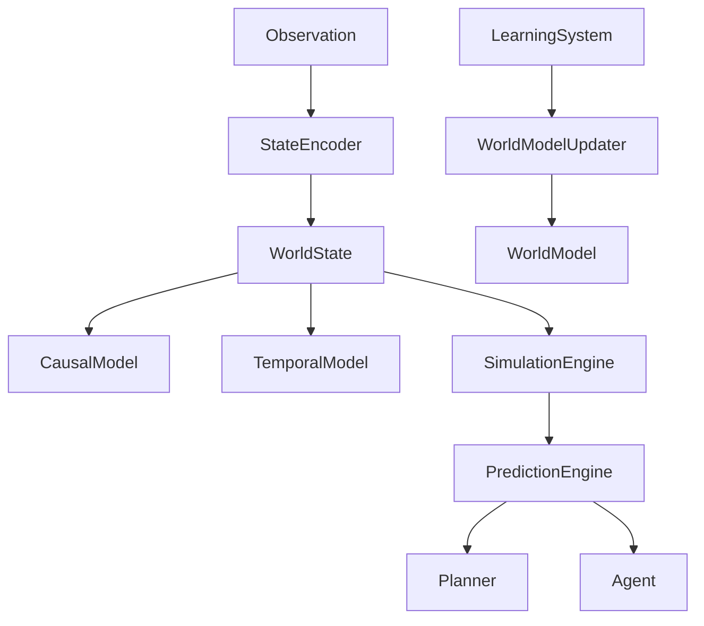

# RFC-0023

**Title:** World Model System

**Document ID:** RFC-0023

**Version:** 1.0

**Status:** Accepted

**Category:** Services

**Layer:** Services

**Target:**

```text
services/world_model/
```

---

# Abstract

This RFC defines the SH-3 World Model System.

The World Model System provides an internal representation of the external and internal environment, enabling prediction, simulation, causal reasoning, scenario generation, and future state estimation.

The World Model acts as a predictive intelligence layer between perception, planning, execution, and learning.

The system integrates with:

- Knowledge System
- Memory System
- Planning System
- Agent System
- Learning System
- Global Workspace System

This document is normative.

---

# Motivation

Intelligent systems require the ability to predict consequences before acting.

Without a World Model:

- decisions become reactive
- planning lacks future simulation
- causal understanding remains limited
- learning cannot efficiently evaluate outcomes
- agents cannot reason about possible futures

The World Model provides predictive intelligence.

---

# Goals

The World Model System SHALL provide:

- environment representation
- state modeling
- temporal reasoning
- causal modeling
- prediction
- simulation
- scenario generation
- planning support
- learning feedback
- model evolution

---

# Non-Goals

The World Model System SHALL NOT:

- replace Planning System
- replace Knowledge System
- execute actions
- control Runtime
- store all historical memory

World Model predicts.

Other systems decide and execute.

---

# Architecture



The World Model transforms observations into predictive representations.

---

# Design Principles

The World Model System follows these principles.

---

## Predictive First

The primary responsibility is future state prediction.

---

## Causal Aware

The system should represent cause-effect relationships.

---

## Temporal

The system shall model state changes over time.

---

## Adaptive

The model shall improve through experience.

---

## Observable

Predictions and updates shall be traceable.

---

## Replaceable

Prediction and simulation implementations shall remain replaceable.

---

# World Model Components

The World Model System consists of:

| Component | Responsibility |
|-----------|----------------|
| WorldModelManager | Coordination |
| StateEncoder | State representation |
| WorldStateStore | Current world state |
| CausalModel | Cause-effect relationships |
| TemporalModel | Time evolution |
| PredictionEngine | Future prediction |
| SimulationEngine | Scenario simulation |
| ModelUpdater | Learning integration |

---

# WorldModelManager

WorldModelManager coordinates world modeling operations.

Responsibilities include:

- state updates
- prediction requests
- simulation control
- model versioning
- diagnostics

WorldModelManager does not make decisions.

---

# World Representation

World Representation defines how SH-3 models reality.

A World Representation contains:

| Field | Description |
|--------|-------------|
| world_id | Unique identifier |
| entities | Known entities |
| states | Current states |
| relationships | Connections |
| events | Historical events |
| metadata | Additional information |

---

# World Entity

A World Entity represents an object, agent, or concept in the modeled environment.

Every entity SHALL contain:

| Field | Description |
|--------|-------------|
| entity_id | Unique identifier |
| type | Entity category |
| attributes | Properties |
| state | Current condition |
| confidence | Reliability |

---

# World State

WorldState represents the current estimated world condition.

A WorldState SHALL contain:

| Field | Description |
|--------|-------------|
| state_id | Unique identifier |
| timestamp | Observation time |
| entities | Current entities |
| variables | Environmental values |
| uncertainty | Confidence information |

---

# State Update

WorldState updates may originate from:

- perception
- memory retrieval
- knowledge updates
- agent observations
- external data
- simulation results

Updates SHALL preserve temporal consistency.

---

# Temporal Model

TemporalModel represents world evolution over time.

Supported concepts include:

- current state
- previous state
- future state
- transition probability
- temporal dependency

---

# Causal Model

CausalModel represents cause-effect relationships.

Representative relations include:

- causes
- enables
- prevents
- influences
- depends_on

Causal relationships SHALL include confidence values.

---

# Prediction Engine

PredictionEngine estimates future states.

Prediction inputs include:

```text
current_state

+

action

+

context

+

causal_model
```

Prediction output includes:

```text
future_state

probability

uncertainty

metadata
```

---

# Simulation Engine

SimulationEngine generates possible future scenarios.

Simulation supports:

- what-if analysis
- alternative actions
- consequence estimation
- risk evaluation

Simulation results remain separate from actual world state.

---

# Prediction Lifecycle

Every prediction follows:

```text
Requested

↓

Context Gathering

↓

Simulation

↓

Prediction

↓

Evaluation

↓

Feedback
```

Prediction lifecycle shall be observable.

---

# Prediction Events

Representative events include:

- PredictionRequested
- SimulationStarted
- PredictionGenerated
- PredictionEvaluated
- ModelUpdated

World Model events integrate with the EventBus.

---

# Planning Integration

Planning System uses World Model predictions for:

- plan evaluation
- future simulation
- risk estimation
- alternative selection

Planning decides.

World Model predicts.

---

# Agent Integration

Agents use World Model for:

- environment understanding
- consequence estimation
- goal evaluation
- decision support

Agents do not directly modify prediction algorithms.

---

# Memory Integration

Memory provides:

- historical experiences
- observations
- previous outcomes

World Model transforms these into predictive structures.

---

# Knowledge Integration

Knowledge provides:

- semantic entities
- relationships
- domain information

World Model provides:

- dynamic state
- prediction
- simulation

---

# Learning Integration

LearningSystem improves World Model accuracy.

Learning sources include:

- prediction errors
- real outcomes
- feedback
- environmental changes

Model updates SHALL preserve versioning.

---

# World Model Execution Model

The World Model System transforms observations and knowledge into predictive internal representations.

World Model processing follows:


Each stage maintains a clear architectural responsibility.

---

# World Model Context

Every World Model operation receives one immutable WorldModelContext.

A WorldModelContext should contain:

| Field | Description |
|--------|-------------|
| context_id | Unique identifier |
| world_id | World model identifier |
| state_id | Current state |
| prediction_id | Prediction identifier |
| timestamp | Operation time |
| metadata | Additional information |

The context represents one world modeling operation.

---

# Causal Inference Model

CausalModel supports inference between events and states.

Causal inference may use:

- historical observations
- Knowledge Graph relationships
- Learning outcomes
- simulation results
- external evidence

Causal conclusions SHALL contain confidence values.

---

# Causal Graph

The causal graph represents:

```text
Cause

↓

Mechanism

↓

Effect
```

A causal relationship contains:

| Field | Description |
|--------|-------------|
| cause | Source event |
| effect | Result event |
| strength | Influence level |
| confidence | Reliability |
| evidence | Supporting data |

---

# Counterfactual Reasoning

World Model may support counterfactual simulation.

Example:

```text
Current State

+

Alternative Action

↓

Possible Future State
```

Counterfactual results SHALL remain separate from actual observations.

---

# Prediction Evaluation

PredictionEngine evaluates predictions against actual outcomes.

Evaluation compares:

- predicted state
- observed state
- error magnitude
- confidence
- uncertainty

Prediction error becomes learning input.

---

# Prediction Metrics

Representative metrics include:

- accuracy
- calibration
- uncertainty quality
- causal consistency
- temporal consistency

Evaluation results shall be stored.

---

# Simulation Management

SimulationEngine manages hypothetical environments.

A Simulation Context contains:

| Field | Description |
|--------|-------------|
| simulation_id | Identifier |
| initial_state | Starting state |
| parameters | Simulation settings |
| actions | Tested actions |
| results | Generated outcomes |

Simulation does not modify the real World Model.

---

# Scenario Generation

World Model may generate future scenarios.

Scenario generation considers:

- possible actions
- environmental uncertainty
- causal relationships
- historical patterns
- constraints

Generated scenarios support Planning.

---

# Planning Feedback Loop

World Model and Planning System form a prediction loop.

```text
Planner

↓

Action Candidate

↓

World Simulation

↓

Future Evaluation

↓

Plan Selection
```

Planning selects.

World Model predicts.

---

# Learning Feedback Loop

World Model improves through prediction errors.

```text
Prediction

↓

Real Outcome

↓

Error Analysis

↓

Model Update

↓

Improved Prediction
```

Learning System controls optimization.

---

# Model Versioning

World Models SHALL support version control.

A model version contains:

| Field | Description |
|--------|-------------|
| model_id | Identifier |
| version | Version number |
| timestamp | Creation time |
| training_source | Data source |
| accuracy | Evaluation result |

Previous versions remain available.

---

# Model Evolution

ModelUpdater improves World Model structures.

Evolution operations include:

- parameter adjustment
- causal relationship update
- entity refinement
- prediction improvement
- uncertainty calibration

Evolution SHALL be traceable.

---

# Uncertainty Model

World Model predictions SHALL represent uncertainty.

Uncertainty sources include:

- incomplete information
- noisy observations
- unknown variables
- prediction limitations

Uncertainty shall not be discarded.

---

# Knowledge Integration

World Model receives semantic updates from Knowledge System.

Integration includes:

- entity discovery
- relationship updates
- causal information
- domain constraints

Knowledge remains independent from dynamic state.

---

# Memory Integration

World Model receives historical information from Memory System.

Memory provides:

- past states
- previous actions
- outcomes
- experiences

World Model extracts predictive patterns.

---

# Agent Integration

Agents use World Model predictions for:

- decision support
- risk evaluation
- goal selection
- action comparison

Agent decisions remain independent.

---

# Security Model

World Model operations integrate with Security System.

Security controls include:

- model access authorization
- simulation permission
- sensitive world state protection
- audit recording

Restricted world models require explicit permissions.

---

# Persistence Integration

World Model artifacts may be persisted.

Persisted artifacts include:

- world states
- model versions
- causal graphs
- simulation results
- evaluation history

Persistence remains replaceable.

---

# EventBus Integration

World Model events shall be published through EventBus.

Events include:

- WorldStateUpdated
- PredictionGenerated
- SimulationCompleted
- CausalUpdated
- ModelImproved

Event ordering shall remain deterministic.

---

# Failure Handling

World Model failures include:

- invalid state update
- prediction failure
- simulation failure
- model inconsistency
- storage failure

Failures shall generate diagnostics.

---

# Recovery

Recovery strategies include:

- model rollback
- state restoration
- simulation restart
- causal graph repair
- fallback prediction model

Recovery shall preserve model integrity.

---

# Thread Model

World Model supports concurrent operations:

- state reading
- prediction requests
- simulations
- evaluation

Model updates shall be synchronized.

The reference implementation shall be thread-safe.

---

# Metrics

World Model exposes operational metrics.

Representative metrics include:

- prediction count
- prediction accuracy
- simulation count
- model update frequency
- causal inference count
- uncertainty level
- prediction latency

---

# Logging

World Model logging categories include:

- state update
- prediction
- simulation
- evaluation
- model evolution

Sensitive environment information shall follow Security policies.

---

# Tracing

World Model traces preserve:

- trace_id
- world_id
- prediction_id
- simulation_id
- model_version

Tracing enables predictive process analysis.

---

# Performance Objectives

The World Model System should optimize for:

- fast prediction
- efficient simulation
- scalable state representation
- accurate causal inference
- controlled memory usage

Performance improvements shall preserve predictive quality.

---

# Future Work

Potential future enhancements include:

- neural world models
- large-scale environment simulation
- autonomous causal discovery
- multi-world reasoning
- hierarchical world models
- self-improving simulation engines

These enhancements extend the World Model architecture without changing its core responsibilities.

---

# References

- SH-3 Architecture Specification v2.1
- RFC-0000 Documentation Standard
- RFC-0001 Event System
- RFC-0002 Runtime System
- RFC-0003 Kernel System
- RFC-0004 Planner System
- RFC-0005 Memory System
- RFC-0006 Policy System
- RFC-0007 Learning System
- RFC-0008 Optimizer System
- RFC-0009 Self-Healing System
- RFC-0010 Persistence System
- RFC-0011 Plugin System
- RFC-0012 Deployment System
- RFC-0013 Capability System
- RFC-0014 Registry System
- RFC-0015 Scheduler System
- RFC-0016 Pipeline System
- RFC-0017 Configuration System
- RFC-0018 Security System
- RFC-0019 Observability System
- RFC-0020 Distributed Cluster System
- RFC-0021 Agent System
- RFC-0022 Knowledge System

---

# End of RFC-0023
