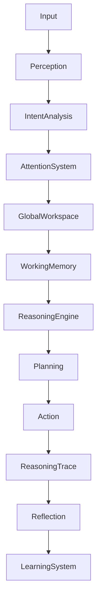

# RFC-0024

**Title:** Cognitive Architecture System

**Document ID:** RFC-0024

**Version:** 1.0

**Status:** Accepted

**Category:** Services

**Layer:** Services

**Target:**

```text
services/cognition/
```

---

# Abstract

This RFC defines the SH-3 Cognitive Architecture System.

The Cognitive Architecture System provides the integrated cognitive processing framework of SH-3.

It coordinates perception, attention, working memory, reasoning, reflection, conscious processing, and internal state management.

The system provides the bridge between raw information processing and intelligent behavior.

The Cognitive Architecture System integrates:

- Global Workspace System
- Intent System
- Reasoning Trace System
- Working Memory System
- Attention System
- Planning System
- World Model System
- Memory System
- Learning System

This document is normative.

---

# Motivation

Advanced AI systems require more than independent modules.

Intelligent behavior emerges from coordination between:

- information selection
- context maintenance
- reasoning
- self-evaluation
- learning
- action preparation

Without a Cognitive Architecture:

- information processing becomes fragmented
- attention cannot prioritize
- reasoning history is lost
- reflection cannot improve behavior
- learning lacks cognitive context

The Cognitive Architecture System provides the integration layer for intelligence.

---

# Goals

The Cognitive Architecture System SHALL provide:

- perception integration
- attention management
- working memory
- cognitive state management
- reasoning coordination
- reflection
- self-evaluation
- cognitive feedback
- learning integration

---

# Non-Goals

The Cognitive Architecture System SHALL NOT:

- replace LLM generation
- replace Planning
- replace Memory storage
- replace Learning optimization
- directly execute actions

Cognition coordinates intelligence processing.

---

# Architecture



The Cognitive Architecture manages the intelligent processing cycle.

---

# Design Principles

The Cognitive Architecture System follows these principles.

---

## Information Competition

Information SHALL compete for limited cognitive resources.

---

## Attention Driven

Important information receives processing priority.

---

## Context Preserving

Relevant context SHALL remain available during reasoning.

---

## Reflective

The system SHALL evaluate its own processes.

---

## Learning Enabled

Cognitive outcomes SHALL contribute to improvement.

---

## Observable

Cognitive transitions SHALL be traceable.

---

# Cognitive Components

The Cognitive Architecture consists of:

| Component | Responsibility |
|-----------|----------------|
| CognitiveManager | Coordination |
| PerceptionInterface | Input processing |
| IntentParser | Intent understanding |
| AttentionManager | Priority control |
| GlobalWorkspace | Information integration |
| WorkingMemory | Active context |
| ReasoningEngine | Reasoning coordination |
| ReflectionEngine | Self evaluation |
| ReasoningTrace | Process recording |

---

# CognitiveManager

CognitiveManager coordinates cognitive processing.

Responsibilities include:

- cognitive cycle management
- information routing
- state coordination
- subsystem integration
- diagnostics

CognitiveManager does not generate final responses.

---

# Cognitive Cycle

The Cognitive System follows:

```text
Input

↓

Perception

↓

Intent

↓

Attention

↓

Workspace

↓

Reasoning

↓

Planning

↓

Action

↓

Reflection

↓

Learning
```

Each cycle generates cognitive events.

---

# Cognitive Context

Every cognitive operation receives one immutable CognitiveContext.

A CognitiveContext contains:

| Field | Description |
|--------|-------------|
| context_id | Unique identifier |
| session_id | Session identifier |
| cognitive_state | Current state |
| active_information | Current focus |
| metadata | Additional information |

---

# Cognitive State

CognitiveState represents the current internal processing condition.

A CognitiveState contains:

| Field | Description |
|--------|-------------|
| attention | Current focus |
| goals | Active goals |
| memories | Relevant memories |
| reasoning_state | Current reasoning |
| uncertainty | Confidence |

---

# Perception Integration

PerceptionInterface receives external information.

Sources include:

- user input
- tools
- sensors
- environment
- internal events

Perception converts raw input into cognitive information.

---

# Intent Processing

IntentParser identifies:

- user intention
- task objective
- constraints
- required context
- expected outcome

Intent information is passed into cognitive processing.

---

# Attention System

AttentionManager controls cognitive resource allocation.

Attention evaluates:

- relevance
- importance
- urgency
- goal alignment
- uncertainty

Attention determines what enters the Global Workspace.

---

# Attention Priority Model

Priority may consider:

```text
Importance

+

Goal Relevance

+

Novelty

+

Uncertainty

+

Reward Value
```

Priority calculation shall remain deterministic.

---

# Global Workspace

GlobalWorkspace provides shared cognitive space.

Responsibilities:

- information integration
- competition resolution
- context broadcasting
- cognitive synchronization

Only selected information enters active processing.

---

# Workspace Capacity

GlobalWorkspace has limited capacity.

Information exceeding capacity shall be:

- deprioritized
- stored in Memory
- discarded according to policy

---

# Working Memory

WorkingMemory maintains active reasoning context.

Working Memory contains:

- current task
- intermediate results
- active assumptions
- relevant knowledge
- temporary conclusions

Working Memory is temporary.

---

# Working Memory Lifecycle

```text
Created

↓

Activated

↓

Updated

↓

Evaluated

↓

Cleared
```

---

# Reasoning Engine

ReasoningEngine coordinates internal reasoning processes.

Responsibilities:

- reasoning flow control
- inference coordination
- hypothesis management
- evidence evaluation

ReasoningEngine does not replace LLM generation.

---

# Reasoning Trace

ReasoningTrace records cognitive processing history.

Records include:

- reasoning steps
- evidence
- decisions
- confidence
- evaluation

ReasoningTrace supports reflection and learning.

---

# Reflection Engine

ReflectionEngine evaluates cognitive outcomes.

Evaluation targets include:

- reasoning quality
- decision quality
- goal achievement
- errors
- improvements

Reflection results are passed to Learning.

---

# Cognitive Events

Representative events include:

- InputReceived
- IntentDetected
- AttentionSelected
- WorkspaceUpdated
- ReasoningStarted
- ReflectionCompleted
- CognitiveImproved

Events integrate with EventBus.

---

# Memory Integration

Cognitive Architecture uses Memory for:

- context retrieval
- experience recall
- knowledge access

Memory remains responsible for storage.

---

# World Model Integration

Cognitive Architecture uses World Model for:

- prediction
- consequence evaluation
- environment understanding

World Model remains responsible for simulation.

---

# Planning Integration

Cognition provides:

- goals
- context
- reasoning results

Planning provides:

- action plans
- execution strategies

---

# Learning Integration

Learning uses cognitive information for:

- error analysis
- behavior improvement
- reasoning optimization

---

# Security Integration

Cognitive operations follow Security policies.

Protected information requires authorization.

Cognitive data access SHALL be audited.

---

# Persistence Integration

Persistent cognitive data may include:

- reasoning metadata
- cognitive history
- reflection results

Transient working memory should remain temporary.

---

# Cognitive Execution Model

The Cognitive Architecture System transforms information into integrated cognitive states and intelligent responses.

The cognitive execution cycle follows:


Each stage maintains a clear architectural responsibility.

---

# Cognitive Processing Loop

The Cognitive System operates through continuous cycles.

```text
Observe

↓

Attend

↓

Integrate

↓

Reason

↓

Act

↓

Reflect

↓

Improve
```

Each cycle produces cognitive state transitions.

---

# Conscious Processing Model

The Cognitive Architecture supports conscious-like information processing through controlled attention and workspace mechanisms.

Conscious processing includes:

- information selection
- context integration
- reasoning coordination
- self-monitoring
- reflection

The system does not assume subjective experience.

It provides functional cognitive processing.

---

# Global Workspace Processing

GlobalWorkspace performs competitive information selection.

Processing flow:

```text
Information Pool

↓

Priority Evaluation

↓

Competition

↓

Workspace Broadcast

↓

Subsystem Processing
```

Only selected information receives high-priority processing.

---

# Workspace Broadcasting

GlobalWorkspace broadcasts selected information to:

- Reasoning Engine
- Planning System
- Memory System
- World Model
- Agent System
- Learning System

Broadcast information SHALL contain context identifiers.

---

# Cognitive Feedback Loop

The Cognitive System improves through feedback.

```text
Cognitive Action

↓

Outcome

↓

Evaluation

↓

Error Detection

↓

Adjustment

↓

Improved Cognition
```

Feedback results are stored through Learning.

---

# Reflection Model

ReflectionEngine performs post-processing evaluation.

Reflection evaluates:

- reasoning process
- assumptions
- decisions
- predictions
- outcomes

Reflection results contain:

| Field | Description |
|--------|-------------|
| reflection_id | Identifier |
| target | Evaluated process |
| result | Evaluation |
| improvement | Suggested change |

---

# Self Evaluation

The Cognitive System evaluates its own performance.

Evaluation criteria include:

- accuracy
- efficiency
- consistency
- confidence
- goal achievement

Self evaluation SHALL produce measurable results.

---

# Error Analysis

Cognitive errors are categorized as:

- perception error
- attention error
- reasoning error
- planning error
- execution error
- prediction error

Error information becomes Learning input.

---

# Cognitive Learning

LearningSystem receives cognitive feedback.

Learning sources include:

- reflection results
- reasoning traces
- prediction errors
- user feedback
- environmental outcomes

Learning updates SHALL preserve cognitive stability.

---

# Attention Optimization

AttentionManager improves prioritization using:

- historical usefulness
- task success
- reward signals
- uncertainty reduction
- goal alignment

Attention optimization SHALL remain policy-controlled.

---

# Cognitive Adaptation

The Cognitive System may adapt:

- attention strategy
- context selection
- reasoning routing
- reflection frequency

Adaptation requires Learning authorization.

---

# Reasoning Coordination

ReasoningEngine coordinates multiple reasoning approaches.

Supported reasoning methods may include:

- deductive reasoning
- inductive reasoning
- abductive reasoning
- causal reasoning
- analogical reasoning

Reasoning selection remains implementation-dependent.

---

# Hypothesis Management

The Cognitive System may maintain hypotheses.

A Hypothesis contains:

| Field | Description |
|--------|-------------|
| hypothesis_id | Identifier |
| statement | Proposed explanation |
| evidence | Supporting information |
| confidence | Probability |
| status | Current state |

Hypotheses are evaluated through reasoning and learning.

---

# Uncertainty Management

Cognitive processing SHALL preserve uncertainty.

Uncertainty sources include:

- incomplete information
- conflicting knowledge
- prediction limitations
- ambiguous intent

The system SHALL avoid false certainty.

---

# Cognitive Memory Interaction

Cognitive Architecture separates:

## Working Memory

Temporary active context.

## Long-Term Memory

Persistent knowledge and experience.

The Cognitive System manages access.

Memory System manages storage.

---

# Cognitive Security Model

Cognitive operations integrate with Security System.

Security controls include:

- information access authorization
- protected context handling
- reasoning trace protection
- audit recording

Sensitive cognitive information SHALL follow access policies.

---

# Cognitive Privacy

Internal cognitive artifacts may include:

- intermediate reasoning metadata
- evaluation results
- confidence values

Storage and exposure SHALL follow configured policies.

---

# EventBus Integration

Cognitive events shall be published through EventBus.

Representative events:

- CognitiveCycleStarted
- AttentionChanged
- WorkspaceActivated
- ReasoningCompleted
- ReflectionGenerated
- CognitiveUpdated

Event ordering shall remain deterministic.

---

# Observability Integration

Cognitive operations participate in Observability.

Telemetry includes:

- attention distribution
- workspace utilization
- reasoning latency
- reflection frequency
- cognitive errors
- learning improvements

---

# Failure Handling

Cognitive failures include:

- invalid context
- attention failure
- workspace overflow
- reasoning failure
- reflection failure

Failures SHALL generate diagnostics.

---

# Recovery

Recovery strategies include:

- context reconstruction
- memory retrieval
- alternative reasoning path
- attention recalculation
- subsystem restart

Recovery SHALL preserve cognitive consistency.

---

# Thread Model

The Cognitive Architecture supports concurrent cognitive operations.

Parallel processing may occur between:

- perception
- retrieval
- prediction
- reasoning
- evaluation

Shared cognitive state SHALL be synchronized.

The reference implementation shall be thread-safe.

---

# Metrics

The Cognitive System SHALL expose metrics.

Representative metrics include:

- cognitive cycle count
- attention selection rate
- workspace utilization
- reasoning latency
- reflection frequency
- error frequency
- learning improvement

---

# Logging

Cognitive logging categories include:

- perception
- attention
- workspace
- reasoning
- reflection
- learning

Sensitive internal data SHALL follow Security policies.

---

# Tracing

Cognitive traces preserve:

- trace_id
- context_id
- cognitive_cycle_id
- reasoning_id
- reflection_id

Tracing enables complete cognitive process analysis.

---

# Performance Objectives

The Cognitive Architecture should optimize for:

- efficient information selection
- low cognitive overhead
- scalable context management
- reliable reasoning coordination
- adaptive improvement

Performance improvements SHALL preserve cognitive correctness.

---

# Future Work

Potential future enhancements include:

- advanced cognitive architectures
- neural-symbolic cognition
- adaptive attention networks
- autonomous cognitive restructuring
- distributed cognition
- meta-cognitive optimization

These enhancements extend the Cognitive Architecture without changing its core responsibilities.

---

# References

- SH-3 Architecture Specification v2.1
- RFC-0000 Documentation Standard
- RFC-0001 Event System
- RFC-0002 Runtime System
- RFC-0003 Kernel System
- RFC-0004 Planner System
- RFC-0005 Memory System
- RFC-0006 Policy System
- RFC-0007 Learning System
- RFC-0008 Optimizer System
- RFC-0009 Self-Healing System
- RFC-0010 Persistence System
- RFC-0011 Plugin System
- RFC-0012 Deployment System
- RFC-0013 Capability System
- RFC-0014 Registry System
- RFC-0015 Scheduler System
- RFC-0016 Pipeline System
- RFC-0017 Configuration System
- RFC-0018 Security System
- RFC-0019 Observability System
- RFC-0020 Distributed Cluster System
- RFC-0021 Agent System
- RFC-0022 Knowledge System
- RFC-0023 World Model System

---

# End of RFC-0024
