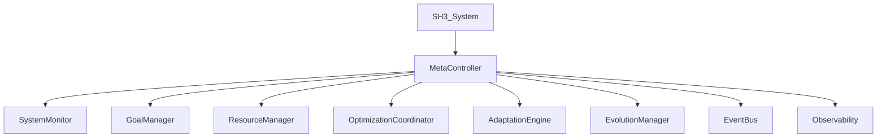
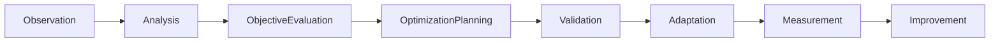

# RFC-0025

**Title:** Meta Controller System

**Document ID:** RFC-0025

**Version:** 1.0

**Status:** Accepted

**Category:** Kernel

**Layer:** Kernel

**Target:**

```text
kernel/meta_controller/
```

---

# Abstract

This RFC defines the SH-3 Meta Controller System.

The Meta Controller System provides the highest-level coordination layer responsible for supervising, optimizing, and evolving the entire SH-3 platform.

It observes system behavior, coordinates subsystems, manages global objectives, controls optimization processes, and enables autonomous system improvement.

The Meta Controller operates above individual modules while preserving subsystem independence.

The system integrates with:

- Kernel System
- Cognitive Architecture System
- Agent System
- Learning System
- Optimizer System
- Observability System
- Configuration System
- Self-Healing System

This document is normative.

---

# Motivation

Complex autonomous AI systems require a supervisory layer capable of managing themselves.

Without a Meta Controller:

- modules optimize locally without global coordination
- system-level goals cannot be maintained
- resource allocation becomes inefficient
- architecture evolution becomes fragmented
- self-improvement cannot be controlled

The Meta Controller provides SH-3 with system-level intelligence.

---

# Goals

The Meta Controller System SHALL provide:

- global system coordination
- objective management
- subsystem supervision
- optimization orchestration
- resource management
- adaptive configuration
- self-improvement control
- architectural monitoring

---

# Non-Goals

The Meta Controller System SHALL NOT:

- replace individual subsystem responsibilities
- directly execute application tasks
- replace Learning algorithms
- replace Planning decisions
- bypass Security policies

The Meta Controller coordinates.

Specialized systems execute.

---

# Architecture



The Meta Controller provides global intelligence coordination.

---

# Design Principles

The Meta Controller follows these principles.

---

## Global Awareness

The controller SHALL maintain system-wide awareness.

---

## Minimal Authority

The controller coordinates without violating subsystem boundaries.

---

## Adaptive

The system SHALL adapt based on observed performance.

---

## Safe Evolution

Changes SHALL require validation.

---

## Observable

All supervisory decisions SHALL be traceable.

---

## Replaceable

Control strategies SHALL remain replaceable.

---

# Meta Controller Components

The Meta Controller consists of:

| Component | Responsibility |
|-----------|----------------|
| MetaController | Main coordination |
| SystemMonitor | System observation |
| GoalManager | Global objectives |
| ResourceManager | Resource allocation |
| OptimizationCoordinator | Optimization control |
| AdaptationEngine | Runtime adaptation |
| EvolutionManager | System evolution |
| PolicyInterface | Safety control |

---

# MetaController

MetaController coordinates all global operations.

Responsibilities include:

- system observation
- objective evaluation
- optimization scheduling
- adaptation decisions
- evolution coordination

MetaController does not replace subsystem logic.

---

# System Awareness Model

SystemMonitor maintains a global system state.

A System State contains:

| Field | Description |
|--------|-------------|
| system_id | Identifier |
| modules | Active modules |
| health | System health |
| resources | Resource state |
| performance | Performance metrics |
| goals | Active objectives |

---

# Global Objective Model

Meta Controller manages system-level objectives.

Objectives may include:

- performance improvement
- reliability improvement
- resource optimization
- learning efficiency
- stability maintenance

---

# Objective Lifecycle

```text
Created

↓

Evaluated

↓

Activated

↓

Tracked

↓

Completed

↓

Archived
```

Objective transitions shall generate events.

---

# Goal Hierarchy

Global goals are organized hierarchically.

```text
System Goal

↓

Subsystem Goal

↓

Task Goal

↓

Execution Goal
```

Higher-level objectives constrain lower-level optimization.

---

# Coordination Model

Meta Controller coordinates through:

- EventBus
- Registry
- Configuration
- Policy
- Observability

Direct module dependency SHALL be minimized.

---

# Subsystem Monitoring

Meta Controller observes:

- Runtime
- Kernel
- Services
- Infrastructure
- Deployment

Monitoring uses Observability interfaces.

---

# Resource Management

ResourceManager manages global resources.

Resources include:

- CPU
- GPU
- Memory
- Storage
- Network
- Execution capacity

Allocation decisions SHALL consider system objectives.

---

# Resource Allocation Model

Resource allocation considers:

```text
Priority

+

Goal Importance

+

Performance Impact

+

Current Load

+

Policy Constraints
```

Allocation decisions SHALL remain observable.

---

# Optimization Coordination

OptimizationCoordinator manages optimization activities.

Optimization targets include:

- performance
- accuracy
- efficiency
- reliability
- resource usage

---

# Adaptation Engine

AdaptationEngine enables runtime adjustment.

Possible adaptations include:

- parameter tuning
- configuration updates
- workload redistribution
- strategy selection

Adaptation SHALL be validated before activation.

---

# Evolution Manager

EvolutionManager controls system evolution.

Evolution includes:

- module improvement
- architecture refinement
- strategy updates
- capability expansion

Evolution SHALL preserve compatibility.

---

# Self Improvement Model

Self-improvement cycle:

```text
Observation

↓

Analysis

↓

Improvement Proposal

↓

Validation

↓

Deployment

↓

Evaluation
```

No improvement SHALL bypass validation.

---

# Event Model

Meta Controller events include:

- SystemObserved
- GoalCreated
- OptimizationStarted
- AdaptationApplied
- EvolutionProposed
- EvolutionCompleted

Events integrate with EventBus.

---

# Cognitive Integration

Meta Controller receives cognitive information for:

- system reasoning
- improvement evaluation
- architecture optimization

Cognitive systems do not directly control infrastructure.

---

# Agent Integration

Agents may request:

- resources
- capabilities
- optimization support

Meta Controller validates requests through Policy.

---

# Learning Integration

LearningSystem improves Meta Controller strategies.

Learning sources include:

- optimization outcomes
- system metrics
- failures
- adaptation results

---

# Security Integration

Meta Controller operations require Security authorization.

Security controls:

- privileged actions
- configuration changes
- evolution deployment
- resource allocation

---

# Persistence Integration

Meta Controller state may be persisted.

Persisted data includes:

- objectives
- optimization history
- evolution records
- system state snapshots

---

# Failure Handling

Meta Controller failures include:

- invalid optimization
- adaptation failure
- coordination failure
- evolution failure

Failures SHALL generate diagnostics.

---

# Meta Controller Execution Model

The Meta Controller System transforms system observations into controlled global improvements.

The execution cycle follows:



Each stage maintains a clear architectural responsibility.

---

# Meta Control Loop

The Meta Controller operates through continuous supervision cycles.

```text
Observe

↓

Understand

↓

Evaluate

↓

Optimize

↓

Validate

↓

Apply

↓

Measure

↓

Improve
```

Each cycle produces system-level state transitions.

---

# Global System State

SystemMonitor maintains a unified system representation.

A GlobalSystemState contains:

| Field | Description |
|--------|-------------|
| state_id | Identifier |
| timestamp | Observation time |
| module_states | Component states |
| resource_state | Resource availability |
| performance_state | Metrics |
| health_state | System health |
| objectives | Active goals |

---

# System Analysis

SystemMonitor analyzes:

- performance trends
- resource utilization
- failures
- bottlenecks
- optimization opportunities

Analysis results become Meta Controller inputs.

---

# Optimization Decision Model

OptimizationCoordinator evaluates possible improvements.

Optimization candidates may include:

- configuration changes
- resource redistribution
- scheduling adjustments
- model optimization
- component replacement

Each candidate SHALL include:

| Field | Description |
|--------|-------------|
| proposal_id | Identifier |
| target | Target component |
| expected_gain | Expected improvement |
| risk | Risk level |
| validation | Verification method |

---

# Optimization Validation

Before applying changes, validation SHALL evaluate:

- compatibility
- security
- performance impact
- stability
- rollback capability

Unvalidated optimization SHALL NOT be applied.

---

# Runtime Adaptation

AdaptationEngine enables controlled runtime changes.

Supported adaptation types:

- parameter adjustment
- workload migration
- resource scaling
- strategy switching
- configuration reload

Adaptation SHALL preserve operational continuity.

---

# Autonomous Optimization Loop

The autonomous optimization loop:

```text
System Observation

↓

Performance Analysis

↓

Optimization Proposal

↓

Simulation

↓

Validation

↓

Deployment

↓

Result Evaluation

↓

Knowledge Update
```

Results are stored for future optimization.

---

# Architecture Evolution

EvolutionManager enables controlled architecture improvement.

Evolution targets:

- modules
- interfaces
- algorithms
- configurations
- deployment structures

Evolution SHALL preserve:

- API compatibility
- dependency rules
- security boundaries

---

# Evolution Lifecycle

```text
Proposal

↓

Review

↓

Simulation

↓

Validation

↓

Deployment

↓

Monitoring

↓

Acceptance
```

---

# Self Improvement Validation

Self-improvement requires:

- measurable objective
- expected benefit
- safety verification
- rollback strategy
- monitoring plan

No autonomous change may bypass validation.

---

# Policy Governance

PolicyInterface controls Meta Controller authority.

Policies define:

- allowed optimizations
- restricted operations
- resource limits
- evolution permissions
- emergency actions

Policy has final authority.

---

# Safety Boundaries

The Meta Controller SHALL NOT:

- disable security controls
- modify protected interfaces without validation
- remove required system components
- bypass audit logging
- exceed resource policies

---

# Recovery Coordination

Meta Controller coordinates recovery with Self-Healing System.

Recovery actions include:

- restart coordination
- resource redistribution
- degraded mode activation
- rollback
- component isolation

---

# Self-Healing Integration

Self-Healing System reports:

- failures
- recovery attempts
- success rates
- unresolved issues

Meta Controller uses this information for optimization.

---

# Learning Integration

Learning System improves Meta Controller decisions.

Learning sources:

- optimization history
- prediction accuracy
- adaptation results
- recovery outcomes
- user feedback

---

# Knowledge Integration

Knowledge System stores:

- optimization patterns
- architecture decisions
- successful strategies
- failure patterns

Knowledge improves future system management.

---

# World Model Integration

World Model supports Meta Controller through:

- future performance prediction
- optimization simulation
- risk estimation
- scenario evaluation

---

# EventBus Integration

Meta Controller publishes events:

- SystemStateUpdated
- OptimizationProposed
- OptimizationValidated
- AdaptationStarted
- AdaptationCompleted
- EvolutionStarted
- EvolutionCompleted

Event ordering SHALL remain deterministic.

---

# Observability Integration

Meta Controller participates in Observability.

Telemetry includes:

- optimization decisions
- adaptation frequency
- resource allocation
- evolution status
- system improvement

---

# Logging

Meta Controller logs:

- decisions
- proposals
- validations
- adaptations
- evolution actions

All privileged actions SHALL be auditable.

---

# Tracing

Meta Controller traces preserve:

- trace_id
- control_cycle_id
- proposal_id
- adaptation_id
- evolution_id

Tracing enables system evolution analysis.

---

# Failure Handling

Meta Controller failures include:

- invalid decision
- failed optimization
- adaptation failure
- evolution rollback
- coordination failure

Failures SHALL enter recovery flow.

---

# Recovery

Recovery strategies include:

- rollback
- safe mode
- alternative optimization
- subsystem isolation
- manual approval

Recovery shall preserve system integrity.

---

# Thread Model

Meta Controller supports concurrent operations:

- monitoring
- analysis
- optimization evaluation
- validation
- reporting

Global decisions SHALL be synchronized.

The reference implementation shall be thread-safe.

---

# Metrics

Meta Controller exposes:

- optimization count
- improvement rate
- resource efficiency
- adaptation success rate
- rollback count
- evolution success rate
- system stability

---

# Performance Objectives

The Meta Controller should optimize for:

- low supervision overhead
- accurate system evaluation
- safe autonomous improvement
- scalable coordination
- predictable adaptation

Performance improvements SHALL preserve stability.

---

# Future Work

Potential future enhancements include:

- autonomous architecture discovery
- AI-driven system design
- evolutionary module generation
- self-optimizing infrastructure
- distributed meta-control
- recursive improvement frameworks

These enhancements extend Meta Controller capabilities while preserving safety principles.

---

# References

- SH-3 Architecture Specification v2.1
- RFC-0000 Documentation Standard
- RFC-0001 Event System
- RFC-0002 Runtime System
- RFC-0003 Kernel System
- RFC-0004 Planner System
- RFC-0005 Memory System
- RFC-0006 Policy System
- RFC-0007 Learning System
- RFC-0008 Optimizer System
- RFC-0009 Self-Healing System
- RFC-0010 Persistence System
- RFC-0011 Plugin System
- RFC-0012 Deployment System
- RFC-0013 Capability System
- RFC-0014 Registry System
- RFC-0015 Scheduler System
- RFC-0016 Pipeline System
- RFC-0017 Configuration System
- RFC-0018 Security System
- RFC-0019 Observability System
- RFC-0020 Distributed Cluster System
- RFC-0021 Agent System
- RFC-0022 Knowledge System
- RFC-0023 World Model System
- RFC-0024 Cognitive Architecture System

---

# End of RFC-0025
