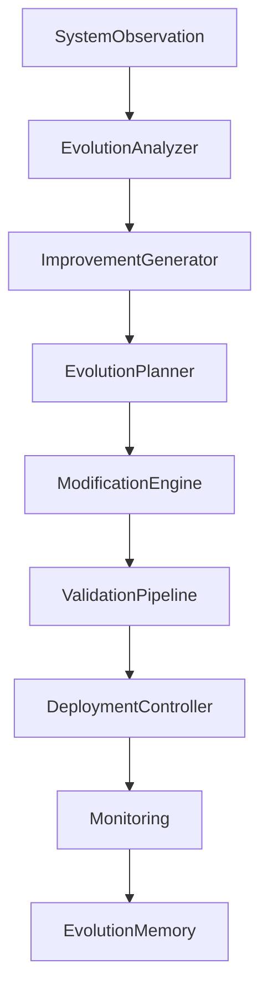

# RFC-0026

**Title:** Self Evolution System

**Document ID:** RFC-0026

**Version:** 1.0

**Status:** Accepted

**Category:** Kernel

**Layer:** Kernel

**Target:**

```text
kernel/self_evolution/
```

---

# Abstract

This RFC defines the SH-3 Self Evolution System.

The Self Evolution System provides controlled mechanisms for analyzing, improving, validating, and deploying changes to SH-3 components.

The system enables SH-3 to continuously improve its capabilities while maintaining architectural integrity, safety boundaries, compatibility, and operational stability.

Self Evolution is a controlled engineering process, not unrestricted modification.

The system integrates with:

- Meta Controller System
- Learning System
- Knowledge System
- Testing System
- Deployment System
- Configuration System
- Self-Healing System
- Security System

This document is normative.

---

# Motivation

Long-running autonomous systems require the ability to improve over time.

Without a Self Evolution System:

- performance improvements remain manual
- discovered weaknesses cannot be systematically corrected
- architecture cannot adapt
- accumulated experience cannot improve implementation quality

However, uncontrolled self-modification introduces significant risks.

The Self Evolution System provides a safe evolution framework.

---

# Goals

The Self Evolution System SHALL provide:

- system analysis
- improvement discovery
- evolution proposal generation
- code modification management
- automated validation
- compatibility verification
- deployment control
- rollback capability
- evolution history

---

# Non-Goals

The Self Evolution System SHALL NOT:

- modify protected systems without authorization
- bypass Security System
- deploy unvalidated changes
- remove architectural constraints
- replace human governance where required

---

# Architecture



The Self Evolution System manages the complete improvement lifecycle.

---

# Design Principles

The Self Evolution System follows these principles.

---

## Controlled Evolution

Every change SHALL follow a defined lifecycle.

---

## Validation First

No modification SHALL become active before validation.

---

## Reversible

Every change SHALL support rollback.

---

## Observable

Every evolution decision SHALL be recorded.

---

## Compatible

Evolution SHALL preserve system contracts.

---

## Modular

Components SHALL evolve independently.

---

# Self Evolution Components

The Self Evolution System consists of:

| Component | Responsibility |
|-----------|----------------|
| EvolutionManager | Coordination |
| EvolutionAnalyzer | Problem discovery |
| ImprovementGenerator | Solution generation |
| EvolutionPlanner | Change planning |
| ModificationEngine | Change execution |
| ValidationPipeline | Verification |
| DeploymentController | Activation |
| RollbackManager | Recovery |
| EvolutionMemory | History management |

---

# EvolutionManager

EvolutionManager coordinates all evolution operations.

Responsibilities include:

- evolution lifecycle control
- proposal management
- validation coordination
- deployment approval
- evolution history

EvolutionManager does not directly modify components.

---

# Evolution Lifecycle

Every evolution follows:

```text
Observation

↓

Analysis

↓

Proposal

↓

Planning

↓

Modification

↓

Validation

↓

Deployment

↓

Evaluation
```

Every transition SHALL generate events.

---

# Evolution Context

Every evolution operation receives an immutable EvolutionContext.

An EvolutionContext contains:

| Field | Description |
|--------|-------------|
| evolution_id | Unique identifier |
| target_component | Target module |
| current_version | Existing version |
| proposed_version | New version |
| objective | Improvement goal |
| metadata | Additional information |

---

# Evolution Analysis

EvolutionAnalyzer identifies improvement opportunities.

Analysis sources include:

- performance metrics
- failure history
- user feedback
- learning results
- code quality metrics
- architecture reports

---

# Improvement Detection

Potential improvements include:

- performance optimization
- bug correction
- resource reduction
- reliability improvement
- capability enhancement
- maintainability improvement

---

# Improvement Proposal

Every improvement SHALL create a proposal.

A proposal contains:

| Field | Description |
|--------|-------------|
| proposal_id | Identifier |
| target | Component |
| problem | Current limitation |
| solution | Proposed change |
| expected_gain | Expected improvement |
| risk | Risk assessment |

---

# Evolution Planning

EvolutionPlanner creates an execution plan.

The plan includes:

- modification steps
- affected components
- dependency analysis
- validation requirements
- rollback strategy

---

# Dependency Analysis

Before modification, dependencies SHALL be analyzed.

Analysis includes:

- API compatibility
- interface contracts
- module dependencies
- configuration impact
- deployment impact

---

# Modification Engine

ModificationEngine applies approved changes.

Supported modification types:

- configuration update
- module replacement
- algorithm improvement
- code update
- dependency update

All modifications SHALL be recorded.

---

# Code Evolution Model

Code evolution requires:

```text
Generate

↓

Review

↓

Test

↓

Validate

↓

Deploy
```

Generated code SHALL pass validation before activation.

---

# Validation Pipeline

ValidationPipeline verifies:

- syntax correctness
- type compatibility
- unit tests
- integration tests
- performance impact
- security constraints

---

# Automated Testing

Evolution changes SHALL execute automated tests.

Testing categories:

- unit tests
- integration tests
- regression tests
- performance tests
- security tests

---

# Compatibility Verification

Validation SHALL confirm:

- public API compatibility
- event compatibility
- data format compatibility
- configuration compatibility

---

# Deployment Control

DeploymentController manages activation.

Deployment strategies include:

- immediate deployment
- staged deployment
- shadow deployment
- canary deployment

---

# Rollback System

RollbackManager restores previous stable states.

Rollback information includes:

- previous version
- configuration snapshot
- dependency state
- deployment history

---

# Evolution Memory

EvolutionMemory stores:

- successful improvements
- failed attempts
- validation results
- performance changes
- architectural decisions

Evolution knowledge improves future changes.

---

# Self Evolution Execution Model

The Self Evolution System transforms system observations into validated improvements through a controlled evolutionary process.

The evolution cycle follows:


Each stage maintains a clear architectural responsibility.

---

# Evolution Control Loop

The Self Evolution System operates through continuous improvement cycles.

```text
Observe

↓

Analyze

↓

Identify Limitation

↓

Design Improvement

↓

Validate

↓

Deploy

↓

Measure

↓

Improve
```

No stage may be skipped.

---

# Autonomous Development Cycle

The Autonomous Development Cycle provides a structured improvement workflow.

```text
System Metrics

↓

Problem Discovery

↓

Solution Generation

↓

Implementation

↓

Automated Testing

↓

Validation

↓

Release

↓

Performance Analysis
```

The cycle resembles a continuous engineering process.

---

# Problem Discovery

EvolutionAnalyzer identifies system limitations from:

- performance degradation
- repeated failures
- resource inefficiency
- user feedback
- learning signals
- architecture analysis

Detected problems SHALL include evidence.

---

# Solution Generation

ImprovementGenerator creates possible solutions.

Solution sources include:

- existing patterns
- Knowledge System
- previous evolution history
- optimization algorithms
- generated alternatives

Each solution SHALL include expected impact.

---

# Evolution Simulation

Before deployment, proposed changes may be simulated.

Simulation evaluates:

- expected performance
- compatibility
- resource impact
- failure probability

Simulation results influence approval decisions.

---

# Evolution Evaluation

Every evolution SHALL be evaluated after deployment.

Evaluation measures:

- objective achievement
- performance change
- stability
- resource efficiency
- unexpected effects

---

# Evolution Score

Each evolution may receive a score.

Example:

```text
EvolutionScore =

Performance Gain

+

Reliability Gain

+

Efficiency Gain

-

Risk Cost
```

Scoring methods remain replaceable.

---

# Learning Integration

LearningSystem improves evolution strategies.

Learning inputs include:

- successful modifications
- failed modifications
- validation results
- deployment outcomes
- rollback history

Learning SHALL NOT directly deploy changes.

---

# Knowledge Integration

KnowledgeSystem stores evolution knowledge.

Stored information includes:

- improvement patterns
- architectural decisions
- failed approaches
- optimization strategies
- compatibility rules

---

# Memory Integration

MemorySystem stores evolution experiences.

Memory provides:

- previous attempts
- environmental context
- historical outcomes

Evolution decisions may reference previous experiences.

---

# Meta Controller Integration

Meta Controller supervises Self Evolution.

Meta Controller provides:

- improvement priorities
- resource allocation
- risk constraints
- approval policies

Self Evolution executes within these boundaries.

---

# Security Boundary

Self Evolution SHALL operate within strict security boundaries.

Protected areas include:

- Security System
- Core Authentication
- Audit System
- Immutable Interfaces

Protected components require explicit authorization.

---

# Safe Self Modification

Self modification requires:

```text
Proposal

↓

Analysis

↓

Testing

↓

Validation

↓

Approval

↓

Activation
```

Direct uncontrolled modification is prohibited.

---

# Change Isolation

Evolution changes should be isolated.

Isolation mechanisms include:

- sandbox execution
- temporary environments
- branch deployment
- version snapshots

---

# Version Management

Every evolved component SHALL maintain:

- version identifier
- change history
- dependency information
- validation result
- rollback information

---

# Evolution Events

Representative events include:

- EvolutionDetected
- ProposalCreated
- ValidationStarted
- ValidationPassed
- DeploymentStarted
- DeploymentCompleted
- RollbackStarted
- EvolutionEvaluated

Events integrate with EventBus.

---

# Observability Integration

Self Evolution participates in Observability.

Telemetry includes:

- evolution frequency
- success rate
- validation duration
- deployment impact
- rollback count

---

# Tracing

Evolution traces preserve:

- trace_id
- evolution_id
- proposal_id
- component_id
- deployment_id

Tracing enables complete evolution analysis.

---

# Failure Handling

Evolution failures include:

- invalid proposal
- failed tests
- compatibility failure
- deployment failure
- performance regression

Failures SHALL stop activation.

---

# Recovery

Recovery strategies include:

- rollback
- failed-change isolation
- alternative solution evaluation
- previous version restoration

Recovery SHALL preserve system availability.

---

# Thread Model

Self Evolution supports concurrent operations:

- analysis
- testing
- simulation
- monitoring

Modification and deployment operations SHALL be synchronized.

The reference implementation shall be thread-safe.

---

# Metrics

Self Evolution exposes:

- improvement proposals
- successful evolutions
- failed evolutions
- rollback count
- average validation time
- performance improvement rate
- stability impact

---

# Logging

Self Evolution logs:

- proposals
- modifications
- tests
- validations
- deployments
- rollbacks

All evolution actions SHALL be auditable.

---

# Performance Objectives

The Self Evolution System should optimize for:

- safe improvement speed
- low validation overhead
- reliable deployment
- minimal service disruption
- continuous optimization

---

# Future Work

Potential future enhancements include:

- autonomous architecture design
- automated algorithm discovery
- AI-generated modules
- evolutionary optimization
- self-testing environments
- recursive improvement systems

These enhancements extend Self Evolution while preserving safety boundaries.

---

# References

- SH-3 Architecture Specification v2.1
- RFC-0000 Documentation Standard
- RFC-0001 Event System
- RFC-0002 Runtime System
- RFC-0003 Kernel System
- RFC-0004 Planner System
- RFC-0005 Memory System
- RFC-0006 Policy System
- RFC-0007 Learning System
- RFC-0008 Optimizer System
- RFC-0009 Self-Healing System
- RFC-0010 Persistence System
- RFC-0011 Plugin System
- RFC-0012 Deployment System
- RFC-0013 Capability System
- RFC-0014 Registry System
- RFC-0015 Scheduler System
- RFC-0016 Pipeline System
- RFC-0017 Configuration System
- RFC-0018 Security System
- RFC-0019 Observability System
- RFC-0020 Distributed Cluster System
- RFC-0021 Agent System
- RFC-0022 Knowledge System
- RFC-0023 World Model System
- RFC-0024 Cognitive Architecture System
- RFC-0025 Meta Controller System

---

# End of RFC-0026
