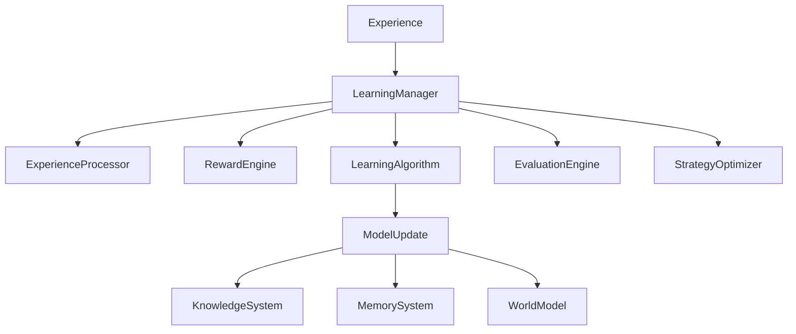
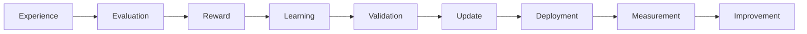

# RFC-0027

**Title:** Autonomous Learning System

**Document ID:** RFC-0027

**Version:** 1.0

**Status:** Accepted

**Category:** Services

**Layer:** Services

**Target:**

```text
services/learning/
```

---

# Abstract

This RFC defines the SH-3 Autonomous Learning System.

The Autonomous Learning System provides the unified learning framework responsible for improving SH-3 capabilities through experience, feedback, evaluation, adaptation, and continuous optimization.

The system enables SH-3 to learn from:

- interactions
- execution results
- environmental changes
- human feedback
- internal evaluation
- prediction errors

The Autonomous Learning System integrates:

- Memory System
- Knowledge System
- World Model System
- Cognitive Architecture System
- Agent System
- Self Evolution System
- Optimizer System

This document is normative.

---

# Motivation

A continuously operating intelligent system requires the ability to improve from experience.

Without an integrated Learning System:

- experiences cannot improve future behavior
- failures cannot produce corrections
- knowledge cannot evolve
- strategies cannot adapt
- optimization remains static

The Autonomous Learning System provides continuous intelligence improvement.

---

# Goals

The Autonomous Learning System SHALL provide:

- experience-based learning
- reinforcement learning
- feedback processing
- reward modeling
- continuous adaptation
- learning evaluation
- knowledge improvement
- strategy optimization
- safe learning control

---

# Non-Goals

The Autonomous Learning System SHALL NOT:

- directly execute actions
- replace Planning System
- replace Memory System
- replace Knowledge System
- bypass Security policies
- modify itself without Self Evolution control

Learning improves behavior.

Other systems apply behavior.

---

# Architecture



The Learning System transforms experience into improvement.

---

# Design Principles

The Autonomous Learning System follows these principles.

---

## Experience Driven

Learning SHALL originate from observed experience.

---

## Continuous

The system SHALL support long-running improvement.

---

## Evaluated

Learning outcomes SHALL be measured.

---

## Safe

Learning SHALL operate within policy constraints.

---

## Modular

Learning algorithms SHALL be replaceable.

---

## Observable

Learning processes SHALL be traceable.

---

# Learning Components

The Autonomous Learning System consists of:

| Component | Responsibility |
|-----------|----------------|
| LearningManager | Coordination |
| ExperienceProcessor | Experience handling |
| ReplayBuffer | Experience storage |
| RewardEngine | Reward calculation |
| RewardModel | Feedback evaluation |
| LearningAlgorithm | Optimization |
| EvaluationEngine | Result analysis |
| StrategyOptimizer | Learning strategy control |
| LearningMemory | Learning history |

---

# LearningManager

LearningManager coordinates learning operations.

Responsibilities include:

- learning cycle management
- experience routing
- algorithm selection
- evaluation coordination
- update control

LearningManager does not implement individual algorithms.

---

# Learning Cycle

The Learning System follows:

```text
Experience

↓

Analysis

↓

Evaluation

↓

Learning

↓

Update

↓

Validation

↓

Retention
```

Each cycle generates learning events.

---

# Learning Context

Every learning operation receives an immutable LearningContext.

A LearningContext contains:

| Field | Description |
|--------|-------------|
| learning_id | Identifier |
| source | Experience source |
| target | Learning target |
| objective | Improvement goal |
| metadata | Additional information |

---

# Experience Model

Experience represents information acquired through operation.

An Experience contains:

| Field | Description |
|--------|-------------|
| experience_id | Identifier |
| state | Previous condition |
| action | Performed action |
| result | Outcome |
| reward | Evaluation |
| timestamp | Occurrence time |

---

# Experience Sources

Experience may originate from:

- Agent execution
- Tool execution
- User interaction
- World Model prediction error
- Planning results
- Reflection process
- Self Evolution results

---

# Experience Processing

ExperienceProcessor transforms raw experiences into learning-ready data.

Processing includes:

- normalization
- filtering
- classification
- importance evaluation
- feature extraction

---

# Experience Replay

ReplayBuffer stores important experiences.

Replay prioritization may consider:

- reward value
- error magnitude
- novelty
- importance
- learning impact

---

# Reward System

RewardEngine evaluates outcomes.

Reward sources include:

- explicit feedback
- task completion
- prediction accuracy
- system metrics
- policy evaluation

---

# Reward Model

RewardModel estimates quality.

A Reward Model contains:

| Field | Description |
|--------|-------------|
| model_id | Identifier |
| version | Version |
| objective | Evaluation target |
| accuracy | Performance |
| metadata | Additional information |

---

# Feedback Processing

Feedback may originate from:

- users
- agents
- evaluators
- environment
- internal reflection

Feedback SHALL be validated before use.

---

# Reinforcement Learning Integration

The Learning System supports reinforcement learning.

Supported concepts:

- state
- action
- reward
- policy
- value estimation
- exploration

RL implementations remain replaceable.

---

# Learning Algorithm Interface

Learning algorithms SHALL provide:

```text
learn()

evaluate()

update()

rollback()
```

The interface allows algorithm replacement.

---

# Learning Safety

Learning SHALL respect:

- Policy constraints
- Security rules
- Resource limits
- Validation requirements

Unsafe learning outcomes SHALL NOT become active.

---

# Memory Integration

Learning uses Memory for:

- experience retrieval
- historical comparison
- context analysis

Memory remains responsible for storage.

---

# Knowledge Integration

Learning updates Knowledge with:

- discovered patterns
- improved concepts
- validated strategies

Knowledge remains responsible for representation.

---

# World Model Integration

Learning improves World Model through:

- prediction errors
- environmental changes
- causal discoveries

---

# Agent Integration

Agents provide:

- experiences
- feedback
- execution results

Learning improves future agent behavior.

---

# Cognitive Integration

Cognitive Architecture provides:

- reasoning traces
- reflection results
- attention information

Learning uses these signals for improvement.

---

# Autonomous Learning Execution Model

The Autonomous Learning System transforms experience into validated improvements through continuous learning cycles.

The learning cycle follows:



Each stage maintains a clear architectural responsibility.

---

# Continuous Learning Loop

The Autonomous Learning System operates continuously.

```text
Observe Experience

↓

Analyze Outcome

↓

Calculate Reward

↓

Update Strategy

↓

Validate Improvement

↓

Apply Learning

↓

Monitor Result
```

Learning SHALL remain controlled and observable.

---

# Reinforcement Learning Model

The Learning System supports reinforcement learning.

The fundamental model:

```text
State

↓

Action

↓

Environment

↓

Reward

↓

Policy Update
```

The RL implementation remains replaceable.

---

# Policy Learning

Policy learning improves action selection.

Learning targets include:

- decision quality
- efficiency
- success probability
- resource usage

Policy updates require validation.

---

# PPO Integration

The Learning System supports Proximal Policy Optimization concepts.

PPO processing includes:

```text
Experience Collection

↓

Advantage Estimation

↓

Policy Optimization

↓

Clipping Constraint

↓

Evaluation
```

PPO implementation remains isolated behind the LearningAlgorithm interface.

---

# RLHF Integration

The Learning System supports Reinforcement Learning from Human Feedback.

RLHF pipeline:

```text
Human Feedback

↓

Preference Data

↓

Reward Model Training

↓

Policy Optimization

↓

Evaluation
```

Human feedback improves alignment and behavior quality.

---

# Reward Model Training

RewardModel may learn from:

- preference comparisons
- task success
- evaluation scores
- user feedback

Reward models SHALL be versioned.

---

# Meta Learning

The Learning System supports learning strategy improvement.

Meta Learning optimizes:

- learning speed
- adaptation ability
- algorithm selection
- parameter configuration

---

# Meta Learning Cycle

```text
Learning Task

↓

Learning Performance Analysis

↓

Strategy Adjustment

↓

New Learning Strategy

↓

Evaluation
```

---

# Causal Learning

The Learning System supports causal analysis.

Causal learning identifies:

- action effects
- environmental changes
- failure causes
- improvement factors

Causal results may update:

- Knowledge System
- World Model System
- Planning System

---

# Causal Experience Model

A causal experience contains:

| Field | Description |
|--------|-------------|
| cause | Trigger |
| action | Intervention |
| effect | Outcome |
| confidence | Reliability |
| evidence | Supporting data |

---

# Learning Optimization Loop

Learning optimization follows:

```text
Learning Result

↓

Performance Evaluation

↓

Optimization Proposal

↓

Validation

↓

Learning Strategy Update
```

Optimization shall not degrade existing capability.

---

# Model Update Control

Model updates require:

- version creation
- validation
- compatibility check
- performance measurement
- rollback availability

---

# Learning Validation

Validation evaluates:

- accuracy improvement
- stability
- generalization
- resource impact
- regression risk

Unsuccessful learning updates SHALL be rejected.

---

# Learning Deployment

Learning changes may be deployed through:

- immediate update
- staged rollout
- shadow evaluation
- controlled activation

Deployment strategy depends on risk.

---

# Learning Rollback

Failed learning updates SHALL support rollback.

Rollback restores:

- previous model
- previous parameters
- previous strategy
- previous configuration

---

# Learning Safety Boundaries

The Learning System SHALL NOT:

- bypass Policy System
- directly modify protected components
- disable safety mechanisms
- deploy unvalidated models

---

# Exploration Control

Learning may explore alternative behaviors.

Exploration SHALL consider:

- risk level
- environment constraints
- policy limits
- resource availability

---

# Knowledge Update Loop

Learning discovers reusable information.

Flow:

```text
Experience

↓

Pattern Discovery

↓

Knowledge Validation

↓

Knowledge Update

↓

Future Retrieval
```

---

# Memory Consolidation

Learning assists Memory optimization.

Processes include:

- important experience selection
- redundant information reduction
- temporal organization
- retrieval improvement

---

# World Model Improvement

Learning improves prediction capability through:

- prediction error analysis
- causal discovery
- environmental adaptation
- simulation feedback

---

# Agent Improvement

Learning improves Agent behavior through:

- strategy optimization
- capability usage improvement
- goal completion analysis
- communication optimization

---

# Self Evolution Integration

Learning identifies possible system improvements.

Self Evolution decides:

- whether change is required
- how change is applied
- validation process

Learning provides knowledge.

Self Evolution performs controlled modification.

---

# EventBus Integration

Learning events include:

- ExperienceReceived
- RewardCalculated
- LearningStarted
- ModelUpdated
- ValidationCompleted
- LearningDeployed

Event ordering SHALL remain deterministic.

---

# Observability Integration

Learning telemetry includes:

- learning cycles
- reward trends
- model versions
- validation results
- improvement rates

---

# Tracing

Learning traces preserve:

- trace_id
- learning_id
- experience_id
- model_version
- update_id

Tracing enables learning process analysis.

---

# Failure Handling

Learning failures include:

- invalid experience
- reward instability
- training failure
- regression
- deployment failure

Failures SHALL prevent activation.

---

# Recovery

Recovery strategies include:

- rollback
- dataset correction
- reward adjustment
- strategy replacement
- retraining

---

# Thread Model

The Learning System supports concurrent operations:

- experience processing
- evaluation
- training
- validation
- monitoring

Model updates SHALL be synchronized.

The reference implementation shall be thread-safe.

---

# Metrics

The Learning System exposes:

- experience count
- reward average
- learning improvement
- model accuracy
- training efficiency
- rollback frequency
- validation success rate

---

# Performance Objectives

The Autonomous Learning System should optimize for:

- efficient learning cycles
- stable improvement
- low resource consumption
- scalable experience processing
- reliable adaptation

---

# Future Work

Potential future enhancements include:

- lifelong learning
- autonomous curriculum generation
- self-supervised learning
- distributed learning
- neural architecture adaptation
- recursive learning optimization

These enhancements extend Autonomous Learning while preserving safety boundaries.

---

# References

- SH-3 Architecture Specification v2.1
- RFC-0000 Documentation Standard
- RFC-0001 Event System
- RFC-0002 Runtime System
- RFC-0003 Kernel System
- RFC-0004 Planner System
- RFC-0005 Memory System
- RFC-0006 Policy System
- RFC-0007 Learning System
- RFC-0008 Optimizer System
- RFC-0009 Self-Healing System
- RFC-0010 Persistence System
- RFC-0011 Plugin System
- RFC-0012 Deployment System
- RFC-0013 Capability System
- RFC-0014 Registry System
- RFC-0015 Scheduler System
- RFC-0016 Pipeline System
- RFC-0017 Configuration System
- RFC-0018 Security System
- RFC-0019 Observability System
- RFC-0020 Distributed Cluster System
- RFC-0021 Agent System
- RFC-0022 Knowledge System
- RFC-0023 World Model System
- RFC-0024 Cognitive Architecture System
- RFC-0025 Meta Controller System
- RFC-0026 Self Evolution System

---

# End of RFC-0027
