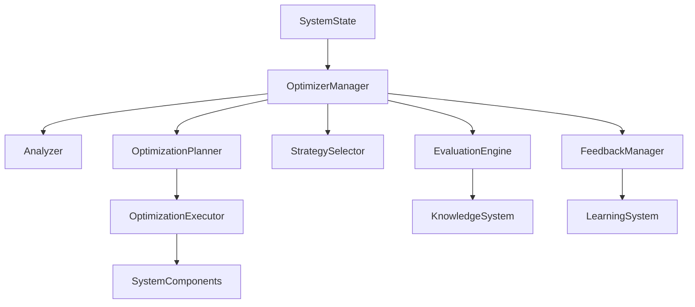

# RFC-0028

**Title:** Optimizer System

**Document ID:** RFC-0028

**Version:** 1.0

**Status:** Accepted

**Category:** Services

**Layer:** Services

**Target:**

```text
services/optimizer/
```

---

# Abstract

This RFC defines the SH-3 Optimizer System.

The Optimizer System provides a unified optimization framework responsible for improving performance, efficiency, resource utilization, learning effectiveness, and system behavior across SH-3.

The Optimizer System analyzes system states, evaluates improvement opportunities, generates optimization strategies, validates expected outcomes, and coordinates optimization execution through controlled interfaces.

The Optimizer System integrates with:

- Meta Controller System
- Learning System
- Self Evolution System
- Runtime System
- Scheduler System
- Resource Manager
- World Model System
- Observability System

This document is normative.

---

# Motivation

Complex AI operating systems contain many components requiring continuous optimization.

Without a unified Optimizer System:

- local optimization becomes inconsistent
- resource usage becomes inefficient
- performance degradation remains undetected
- learning processes cannot improve efficiently
- system evolution lacks objective measurement

The Optimizer System provides centralized optimization intelligence.

---

# Goals

The Optimizer System SHALL provide:

- global optimization management
- performance optimization
- resource optimization
- strategy optimization
- learning optimization
- parameter optimization
- scheduling optimization
- optimization evaluation
- optimization history management

---

# Non-Goals

The Optimizer System SHALL NOT:

- directly execute application actions
- replace Learning System
- replace Self Evolution System
- bypass Policy restrictions
- modify protected modules directly

Optimizer proposes and coordinates improvements.

---

# Architecture



The Optimizer System converts observations into measurable improvements.

---

# Design Principles

The Optimizer System follows these principles.

---

## Objective Driven

Every optimization SHALL have a measurable objective.

---

## Evidence Based

Optimization decisions SHALL use observed data.

---

## Controlled

Optimization SHALL follow validation procedures.

---

## Modular

Optimization algorithms SHALL be replaceable.

---

## Explainable

Optimization decisions SHALL be traceable.

---

## Safe

Optimization SHALL preserve system stability.

---

# Optimizer Components

The Optimizer System consists of:

| Component | Responsibility |
|-----------|----------------|
| OptimizerManager | Coordination |
| Analyzer | Problem detection |
| OptimizationPlanner | Strategy creation |
| StrategySelector | Algorithm selection |
| OptimizationExecutor | Controlled execution |
| EvaluationEngine | Result measurement |
| FeedbackManager | Improvement feedback |
| OptimizationMemory | History management |

---

# OptimizerManager

OptimizerManager coordinates optimization activities.

Responsibilities include:

- optimization lifecycle management
- strategy coordination
- evaluation control
- history management
- integration management

OptimizerManager does not implement optimization algorithms.

---

# Optimization Lifecycle

Every optimization follows:

```text
Observation

↓

Analysis

↓

Objective Definition

↓

Strategy Selection

↓

Simulation

↓

Execution

↓

Evaluation

↓

Retention
```

---

# Optimization Context

Every optimization operation receives an immutable OptimizationContext.

An OptimizationContext contains:

| Field | Description |
|--------|-------------|
| optimization_id | Identifier |
| target | Optimization target |
| objective | Goal |
| constraints | Limitations |
| metadata | Additional information |

---

# Optimization Types

The Optimizer System supports:

| Type | Purpose |
|------|---------|
| Performance Optimization | Speed improvement |
| Resource Optimization | Efficiency |
| Learning Optimization | Training improvement |
| Strategy Optimization | Decision improvement |
| Parameter Optimization | Configuration tuning |
| Scheduling Optimization | Execution improvement |
| Architecture Optimization | Structural improvement |

---

# Performance Optimization

Performance optimization targets:

- latency reduction
- throughput improvement
- computational efficiency
- memory efficiency

Metrics SHALL define success.

---

# Resource Optimization

Resource optimization manages:

- CPU usage
- GPU utilization
- memory consumption
- storage usage
- network bandwidth

Resource changes SHALL respect policies.

---

# Hyperparameter Optimization

Optimizer supports parameter tuning.

Targets include:

- model parameters
- learning rates
- thresholds
- scheduling values
- system configuration

Parameter changes SHALL be validated.

---

# Strategy Optimization

Strategy optimization improves:

- planning methods
- learning strategies
- retrieval strategies
- execution strategies

Strategies are evaluated by measurable outcomes.

---

# Learning Optimization

Optimizer improves Learning System performance.

Optimization targets:

- training efficiency
- reward stability
- convergence speed
- sample efficiency

---

# Neural Optimization

Optimizer may support:

- model compression
- parameter tuning
- architecture evaluation
- inference optimization

Neural changes require validation.

---

# Scheduling Optimization

Optimizer improves execution scheduling.

Targets include:

- task ordering
- resource allocation
- priority management
- parallel execution

---

# World Model Optimization

Optimizer improves prediction systems.

Targets include:

- prediction accuracy
- simulation efficiency
- model complexity
- uncertainty calibration

---

# Planning Optimization

Optimizer improves Planning System.

Targets include:

- search efficiency
- decision quality
- planning latency
- goal completion rate

---

# Agent Optimization

Optimizer improves Agent behavior.

Targets include:

- capability selection
- tool usage efficiency
- communication quality
- task success rate

---

# Optimization Proposal

Every optimization SHALL create a proposal.

A proposal contains:

| Field | Description |
|--------|-------------|
| proposal_id | Identifier |
| target | Component |
| objective | Goal |
| method | Optimization method |
| expected_gain | Expected result |
| risk | Risk level |

---

# Optimization Validation

Before execution, validation SHALL check:

- expected benefit
- compatibility
- safety
- resource impact
- rollback availability

---

# Optimization Execution

OptimizationExecutor applies approved changes.

Execution methods include:

- parameter update
- configuration update
- strategy replacement
- scheduling adjustment

---

# Optimization History

OptimizationMemory stores:

- proposals
- results
- failures
- successful strategies
- evaluation data

Historical optimization improves future decisions.

---

# Optimizer Execution Model

The Optimizer System transforms system observations into validated improvements through measurable optimization cycles.

The optimization cycle follows:


Each stage maintains a clear architectural responsibility.

---

# Global Optimization Loop

The Optimizer System operates through a continuous optimization loop.

```text
Monitor

↓

Detect Inefficiency

↓

Define Objective

↓

Generate Candidates

↓

Evaluate

↓

Apply Improvement

↓

Measure Result

↓

Update Strategy
```

Optimization SHALL remain evidence-based.

---

# Optimization Strategy Selection

StrategySelector selects optimization methods.

Selection factors include:

- objective type
- available resources
- optimization complexity
- historical performance
- risk level

---

# Optimization Algorithms

The Optimizer System supports replaceable optimization algorithms.

Supported categories include:

- Bayesian Optimization
- Evolutionary Optimization
- Reinforcement Optimization
- Gradient Optimization
- Search Optimization
- Heuristic Optimization

Algorithm selection remains configurable.

---

# Bayesian Optimization

Bayesian Optimization may be used for expensive evaluation problems.

Targets include:

- parameter tuning
- configuration optimization
- resource allocation

Process:

```text
Observation

↓

Model Estimation

↓

Candidate Selection

↓

Evaluation

↓

Model Update
```

---

# Evolutionary Optimization

Evolutionary optimization improves solutions through iterative selection.

Process:

```text
Generate Candidates

↓

Evaluate Fitness

↓

Select

↓

Mutate

↓

Repeat
```

Evolutionary optimization SHALL respect system constraints.

---

# Reinforcement Optimization

Reinforcement-based optimization improves strategies through reward signals.

Process:

```text
State

↓

Optimization Action

↓

System Response

↓

Reward

↓

Strategy Update
```

---

# Multi Objective Optimization

The Optimizer System supports multiple objectives.

Examples:

```text
Performance

+

Accuracy

+

Efficiency

+

Reliability
```

Trade-offs SHALL be explicitly evaluated.

---

# Optimization Feedback Loop

Optimization results create feedback.

```text
Optimization Result

↓

Evaluation

↓

Knowledge Update

↓

Strategy Improvement

↓

Future Optimization
```

---

# Knowledge Integration

Knowledge System stores optimization knowledge.

Stored information includes:

- successful strategies
- failed strategies
- parameter patterns
- optimization constraints
- environmental conditions

---

# Learning Integration

Learning System improves optimization behavior.

Learning sources:

- optimization outcomes
- reward signals
- performance changes
- failures

Optimizer learns which optimization strategies are effective.

---

# World Model Integration

World Model supports optimization through simulation.

Capabilities include:

- future impact prediction
- risk estimation
- alternative comparison
- scenario evaluation

---

# Meta Controller Integration

Meta Controller supervises optimization priorities.

Meta Controller provides:

- global objectives
- resource constraints
- optimization permissions
- priority ordering

---

# Self Evolution Integration

Self Evolution uses optimization results for architecture improvement.

Optimizer identifies:

- bottlenecks
- inefficiencies
- improvement opportunities

Self Evolution controls structural changes.

---

# Optimization Safety

Optimization SHALL respect:

- Security policies
- Resource limits
- Compatibility rules
- Validation requirements

Unsafe optimization SHALL be rejected.

---

# Optimization Isolation

Optimization experiments may execute in isolated environments.

Isolation methods:

- simulation
- sandbox
- shadow execution
- staged deployment

---

# Optimization Rollback

Every optimization SHALL support rollback.

Rollback restores:

- previous parameters
- previous configuration
- previous strategy
- previous performance state

---

# Optimization Events

Representative events include:

- OptimizationDetected
- OptimizationProposed
- OptimizationStarted
- OptimizationValidated
- OptimizationApplied
- OptimizationCompleted
- OptimizationRollback

Events integrate with EventBus.

---

# Observability Integration

Optimizer telemetry includes:

- optimization frequency
- improvement percentage
- evaluation duration
- resource impact
- rollback frequency

---

# Tracing

Optimization traces preserve:

- trace_id
- optimization_id
- proposal_id
- strategy_id
- evaluation_id

Tracing enables optimization analysis.

---

# Failure Handling

Optimization failures include:

- invalid objective
- poor strategy selection
- unexpected regression
- execution failure
- validation failure

Failures SHALL stop deployment.

---

# Recovery

Recovery strategies include:

- rollback
- alternative strategy selection
- constraint adjustment
- optimization restart

---

# Thread Model

Optimizer supports concurrent operations:

- monitoring
- analysis
- simulation
- evaluation

Optimization execution SHALL be synchronized.

The reference implementation shall be thread-safe.

---

# Metrics

The Optimizer System exposes:

- optimization count
- success rate
- improvement ratio
- evaluation accuracy
- rollback count
- resource efficiency
- optimization latency

---

# Performance Objectives

The Optimizer System should optimize for:

- accurate improvement detection
- efficient evaluation
- low optimization overhead
- stable system enhancement
- scalable optimization execution

---

# Future Work

Potential future enhancements include:

- autonomous optimization discovery
- neural architecture optimization
- distributed optimization
- self-configuring systems
- recursive optimization strategies
- AI-driven engineering optimization

These enhancements extend Optimizer capabilities while preserving system stability.

---

# References

- SH-3 Architecture Specification v2.1
- RFC-0000 Documentation Standard
- RFC-0001 Event System
- RFC-0002 Runtime System
- RFC-0003 Kernel System
- RFC-0004 Planner System
- RFC-0005 Memory System
- RFC-0006 Policy System
- RFC-0007 Learning System
- RFC-0008 Optimizer System
- RFC-0009 Self-Healing System
- RFC-0010 Persistence System
- RFC-0011 Plugin System
- RFC-0012 Deployment System
- RFC-0013 Capability System
- RFC-0014 Registry System
- RFC-0015 Scheduler System
- RFC-0016 Pipeline System
- RFC-0017 Configuration System
- RFC-0018 Security System
- RFC-0019 Observability System
- RFC-0020 Distributed Cluster System
- RFC-0021 Agent System
- RFC-0022 Knowledge System
- RFC-0023 World Model System
- RFC-0024 Cognitive Architecture System
- RFC-0025 Meta Controller System
- RFC-0026 Self Evolution System
- RFC-0027 Autonomous Learning System

---

# End of RFC-0028
