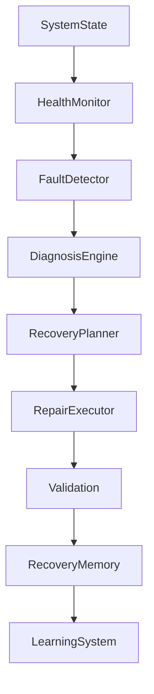

# RFC-0029

**Title:** Self-Healing System

**Document ID:** RFC-0029

**Version:** 1.0

**Status:** Accepted

**Category:** Kernel

**Layer:** Kernel

**Target:**

```text
kernel/self_healing/
```

---

# Abstract

This RFC defines the SH-3 Self-Healing System.

The Self-Healing System provides autonomous reliability mechanisms responsible for detecting failures, diagnosing causes, executing recovery procedures, and improving system resilience.

The system enables SH-3 to maintain stable operation during:

- component failures
- resource degradation
- unexpected behavior
- configuration errors
- performance deterioration

The Self-Healing System integrates with:

- Meta Controller System
- Optimizer System
- Learning System
- Observability System
- Runtime System
- Persistence System
- Security System
- Deployment System

This document is normative.

---

# Motivation

Long-running autonomous systems must maintain reliability without continuous manual intervention.

Without a Self-Healing System:

- failures propagate
- recovery requires human intervention
- system availability decreases
- repeated failures cannot be prevented
- operational knowledge is lost

The Self-Healing System provides autonomous maintenance capability.

---

# Goals

The Self-Healing System SHALL provide:

- health monitoring
- failure detection
- fault diagnosis
- recovery planning
- automated repair
- resilience improvement
- failure learning
- recovery history management

---

# Non-Goals

The Self-Healing System SHALL NOT:

- bypass Security controls
- modify protected components without authorization
- replace Deployment System
- replace Human Governance
- perform uncontrolled system changes

Healing restores and improves reliability.

---

# Architecture



The Self-Healing System transforms failures into recovery actions.

---

# Design Principles

The Self-Healing System follows these principles.

---

## Detect Before Repair

Failures SHALL be identified before corrective action.

---

## Minimize Impact

Recovery SHALL minimize system disruption.

---

## Preserve State

Recovery SHALL preserve valid system information.

---

## Learn From Failure

Failures SHALL improve future reliability.

---

## Observable

Healing processes SHALL be traceable.

---

## Safe Recovery

Recovery SHALL respect security boundaries.

---

# Self-Healing Components

The Self-Healing System consists of:

| Component | Responsibility |
|-----------|----------------|
| HealingManager | Coordination |
| HealthMonitor | Health observation |
| FaultDetector | Failure detection |
| DiagnosisEngine | Root cause analysis |
| RecoveryPlanner | Recovery strategy |
| RepairExecutor | Repair execution |
| ValidationEngine | Recovery verification |
| RecoveryMemory | Healing history |

---

# HealingManager

HealingManager coordinates all recovery operations.

Responsibilities include:

- healing lifecycle management
- failure coordination
- recovery execution control
- validation management
- history recording

HealingManager does not directly implement repairs.

---

# Healing Lifecycle

Every healing operation follows:

```text
Monitoring

↓

Detection

↓

Diagnosis

↓

Planning

↓

Recovery

↓

Validation

↓

Learning
```

---

# Healing Context

Every healing operation receives an immutable HealingContext.

A HealingContext contains:

| Field | Description |
|--------|-------------|
| healing_id | Identifier |
| failure_id | Related failure |
| target | Recovery target |
| severity | Impact level |
| metadata | Additional information |

---

# Health Monitoring

HealthMonitor continuously observes SH-3.

Monitoring targets:

- Runtime
- Kernel
- Services
- Infrastructure
- Resources
- External dependencies

---

# Health State Model

A HealthState contains:

| Field | Description |
|--------|-------------|
| component_id | Component |
| status | Current state |
| availability | Availability |
| performance | Performance |
| errors | Error information |
| timestamp | Observation time |

---

# Health Levels

The system may classify health states:

| Level | Meaning |
|------|---------|
| Healthy | Normal operation |
| Warning | Degradation detected |
| Critical | Failure risk |
| Failed | Component unavailable |
| Recovering | Recovery in progress |

---

# Fault Detection

FaultDetector identifies abnormal behavior.

Detection sources include:

- metrics
- logs
- traces
- exceptions
- performance changes
- prediction models

---

# Fault Types

Supported fault categories include:

| Type | Description |
|------|-------------|
| Runtime Fault | Execution failure |
| Resource Fault | Resource exhaustion |
| Configuration Fault | Invalid settings |
| Dependency Fault | External failure |
| Logic Fault | Incorrect behavior |
| Performance Fault | Degradation |

---

# Fault Model

A Fault contains:

| Field | Description |
|--------|-------------|
| fault_id | Identifier |
| component | Target |
| type | Fault type |
| severity | Impact |
| evidence | Detection data |
| timestamp | Occurrence |

---

# Diagnosis Engine

DiagnosisEngine determines possible causes.

Analysis uses:

- logs
- traces
- system state
- historical failures
- dependency information

---

# Root Cause Analysis

Diagnosis may identify:

- primary cause
- related components
- failure chain
- recovery options

Diagnosis results SHALL include confidence.

---

# Recovery Planner

RecoveryPlanner creates recovery strategies.

Recovery strategies may include:

- restart
- rollback
- configuration repair
- resource redistribution
- component isolation
- degraded mode

---

# Recovery Strategy Model

A RecoveryStrategy contains:

| Field | Description |
|--------|-------------|
| strategy_id | Identifier |
| action | Recovery action |
| risk | Risk level |
| expected_result | Expected outcome |
| rollback | Recovery fallback |

---

# Repair Executor

RepairExecutor executes approved recovery actions.

Supported operations:

- restart service
- restore state
- reload configuration
- replace component
- restore version

---

# Recovery Validation

ValidationEngine confirms:

- system recovery
- performance restoration
- state consistency
- dependency health

Recovery is complete only after validation.

---

# Recovery Memory

RecoveryMemory stores:

- failures
- causes
- solutions
- recovery results
- reliability patterns

Stored experience improves future healing.

---

# Self-Healing Execution Model

The Self-Healing System transforms detected failures into validated recovery and reliability improvements.

The healing cycle follows:


Each stage maintains a clear architectural responsibility.

---

# Autonomous Recovery Loop

The Self-Healing System operates through continuous reliability cycles.

```text
Observe Health

↓

Detect Anomaly

↓

Analyze Cause

↓

Select Recovery

↓

Execute Repair

↓

Verify Result

↓

Learn Pattern

↓

Prevent Recurrence
```

The system SHALL prioritize stability over aggressive repair.

---

# Predictive Failure Detection

The Self-Healing System supports predictive failure detection.

Prediction sources include:

- historical failures
- performance trends
- resource consumption
- anomaly patterns
- World Model predictions
- Learning System analysis

---

# Failure Prediction Model

A FailurePrediction contains:

| Field | Description |
|--------|-------------|
| prediction_id | Identifier |
| component | Target |
| failure_type | Expected failure |
| probability | Likelihood |
| estimated_time | Expected occurrence |
| evidence | Supporting data |

---

# Preventive Healing

Preventive actions may occur before failure.

Examples:

- resource scaling
- configuration adjustment
- cache optimization
- workload redistribution
- component restart

Preventive healing SHALL require validation.

---

# Fault Learning

The Self-Healing System learns from failures.

Learning sources include:

- failure history
- recovery success
- root cause analysis
- system behavior changes

---

# Fault Knowledge Model

Fault knowledge contains:

| Field | Description |
|--------|-------------|
| pattern | Failure pattern |
| cause | Root cause |
| solution | Recovery method |
| confidence | Reliability |
| frequency | Occurrence count |

---

# Recovery Optimization

Recovery strategies are optimized using:

- recovery success rate
- recovery duration
- system impact
- resource usage
- previous outcomes

---

# Recovery Strategy Selection

RecoveryPlanner selects strategies based on:

```text
Failure Severity

+

Historical Success

+

Risk

+

Recovery Cost

+

System Priority
```

---

# Resilience Model

The Self-Healing System improves system resilience.

Resilience characteristics include:

- fault tolerance
- recovery speed
- availability
- graceful degradation
- failure isolation

---

# Fault Isolation

The system may isolate failing components.

Isolation methods:

- service separation
- dependency blocking
- resource restriction
- degraded operation mode

Isolation SHALL preserve overall availability.

---

# Graceful Degradation

When full recovery is impossible, the system may enter degraded mode.

Degraded mode maintains:

- essential functions
- safety controls
- critical services

---

# Self-Healing Feedback Loop

Healing results improve future recovery.

```text
Failure

↓

Recovery

↓

Evaluation

↓

Knowledge Update

↓

Improved Recovery
```

---

# Learning Integration

Learning System improves healing strategies.

Learning inputs include:

- recovery outcomes
- failure patterns
- repair effectiveness
- prediction accuracy

---

# Knowledge Integration

Knowledge System stores:

- fault patterns
- recovery procedures
- dependency relationships
- reliability rules

---

# World Model Integration

World Model supports:

- failure prediction
- recovery simulation
- consequence analysis

---

# Optimizer Integration

Optimizer improves:

- detection thresholds
- recovery strategies
- resource allocation
- monitoring efficiency

---

# Meta Controller Integration

Meta Controller supervises:

- recovery priority
- resource allocation
- system-wide impact

---

# Self Evolution Integration

Self Evolution uses healing information for structural improvement.

Examples:

- replacing unstable modules
- improving interfaces
- redesigning failure-prone components

---

# Security Boundary

Self-Healing SHALL respect:

- authentication rules
- authorization policies
- protected components
- audit requirements

Recovery actions SHALL be authorized.

---

# Recovery Approval

High-impact recovery actions may require:

- policy approval
- validation environment
- additional confirmation

---

# EventBus Integration

Self-Healing events include:

- HealthChecked
- FaultDetected
- DiagnosisCompleted
- RecoveryStarted
- RecoveryCompleted
- HealingFailed
- PreventionTriggered

Event ordering SHALL remain deterministic.

---

# Observability Integration

Healing telemetry includes:

- health status
- failure frequency
- recovery duration
- recovery success rate
- preventive actions

---

# Tracing

Healing traces preserve:

- trace_id
- healing_id
- fault_id
- recovery_id
- validation_id

Tracing enables reliability analysis.

---

# Failure Handling

Self-Healing failures include:

- incorrect diagnosis
- failed recovery
- validation failure
- state inconsistency

Failures SHALL trigger secondary recovery procedures.

---

# Recovery Escalation

If automatic recovery fails:

```text
Automatic Recovery

↓

Alternative Recovery

↓

Safe Mode

↓

Administrative Review
```

Escalation preserves system safety.

---

# Thread Model

Self-Healing supports concurrent operations:

- health monitoring
- fault analysis
- prediction
- recovery preparation

Actual repair execution SHALL be synchronized.

The reference implementation shall be thread-safe.

---

# Metrics

The Self-Healing System exposes:

- detected failures
- recovery success rate
- mean recovery time
- preventive actions
- false detection rate
- system availability

---

# Performance Objectives

The Self-Healing System should optimize for:

- fast detection
- accurate diagnosis
- minimal downtime
- safe recovery
- improved resilience

---

# Future Work

Potential future enhancements include:

- autonomous repair generation
- advanced failure prediction
- distributed self-healing
- AI-based root cause analysis
- adaptive reliability engineering
- autonomous infrastructure maintenance

These enhancements extend Self-Healing capabilities while preserving safety boundaries.

---

# References

- SH-3 Architecture Specification v2.1
- RFC-0000 Documentation Standard
- RFC-0001 Event System
- RFC-0002 Runtime System
- RFC-0003 Kernel System
- RFC-0004 Planner System
- RFC-0005 Memory System
- RFC-0006 Policy System
- RFC-0007 Learning System
- RFC-0008 Optimizer System
- RFC-0009 Self-Healing System
- RFC-0010 Persistence System
- RFC-0011 Plugin System
- RFC-0012 Deployment System
- RFC-0013 Capability System
- RFC-0014 Registry System
- RFC-0015 Scheduler System
- RFC-0016 Pipeline System
- RFC-0017 Configuration System
- RFC-0018 Security System
- RFC-0019 Observability System
- RFC-0020 Distributed Cluster System
- RFC-0021 Agent System
- RFC-0022 Knowledge System
- RFC-0023 World Model System
- RFC-0024 Cognitive Architecture System
- RFC-0025 Meta Controller System
- RFC-0026 Self Evolution System
- RFC-0027 Autonomous Learning System
- RFC-0028 Optimizer System

---

# End of RFC-0029
