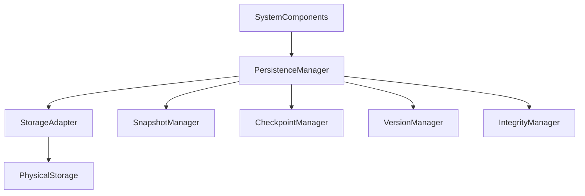

# RFC-0030

**Title:** Persistence System

**Document ID:** RFC-0030

**Version:** 1.0

**Status:** Accepted

**Category:** Infrastructure

**Layer:** Infrastructure

**Target:**

```text
infrastructure/persistence/
```

---

# Abstract

This RFC defines the SH-3 Persistence System.

The Persistence System provides the unified storage and continuity framework responsible for preserving system state, knowledge, experiences, configurations, models, and operational history.

The system enables SH-3 to maintain continuity across:

- process restart
- system restart
- upgrades
- failures
- distributed execution
- long-term operation

The Persistence System integrates with:

- Memory System
- Knowledge System
- Learning System
- World Model System
- Self-Healing System
- Self Evolution System
- Configuration System
- Deployment System
- Observability System

This document is normative.

---

# Motivation

An autonomous intelligence system requires long-term continuity.

Without a Persistence System:

- learned knowledge disappears
- experiences cannot accumulate
- recovery becomes difficult
- system evolution loses history
- model improvements cannot be preserved

The Persistence System provides durable system memory.

---

# Goals

The Persistence System SHALL provide:

- state persistence
- model checkpointing
- snapshot management
- recovery restoration
- version tracking
- storage lifecycle management
- data integrity verification
- distributed persistence support

---

# Non-Goals

The Persistence System SHALL NOT:

- define Memory retrieval algorithms
- replace Knowledge representation
- replace Database implementations
- bypass Security controls
- modify data without authorization

Persistence stores.

Other systems interpret.

---

# Architecture



The Persistence System provides durable state management.

---

# Design Principles

The Persistence System follows these principles.

---

## Durability

Important system information SHALL survive restart.

---

## Integrity

Stored data SHALL remain consistent.

---

## Versioned

Persistent artifacts SHALL support version management.

---

## Recoverable

Stored states SHALL support restoration.

---

## Secure

Access SHALL follow Security policies.

---

## Replaceable

Storage implementations SHALL remain interchangeable.

---

# Persistence Components

The Persistence System consists of:

| Component | Responsibility |
|-----------|----------------|
| PersistenceManager | Coordination |
| StorageAdapter | Storage interface |
| SnapshotManager | State snapshots |
| CheckpointManager | Model checkpoints |
| VersionManager | Version tracking |
| IntegrityManager | Data validation |
| MigrationManager | Schema migration |
| ArchiveManager | Long-term storage |

---

# PersistenceManager

PersistenceManager coordinates all persistence operations.

Responsibilities include:

- save operations
- restore operations
- storage coordination
- lifecycle management
- integrity verification

PersistenceManager does not define storage engines.

---

# Persistence Context

Every persistence operation receives an immutable PersistenceContext.

A PersistenceContext contains:

| Field | Description |
|--------|-------------|
| persistence_id | Identifier |
| target | Stored object |
| version | Version |
| timestamp | Operation time |
| metadata | Additional information |

---

# Persistence Lifecycle

Every persistent object follows:

```text
Created

↓

Stored

↓

Updated

↓

Versioned

↓

Archived

↓

Restored
```

---

# Storage Model

The Persistence System supports multiple storage types.

Examples:

- relational storage
- document storage
- vector storage
- object storage
- file storage
- distributed storage

Storage selection remains replaceable.

---

# Persistent Object Model

A PersistentObject contains:

| Field | Description |
|--------|-------------|
| object_id | Identifier |
| type | Object type |
| version | Version |
| data | Content |
| checksum | Integrity |
| timestamp | Creation time |

---

# State Persistence

The system persists runtime states.

State examples:

- system configuration
- active objectives
- module states
- runtime metadata
- execution context

---

# State Snapshot

SnapshotManager creates consistent system snapshots.

A Snapshot contains:

| Field | Description |
|--------|-------------|
| snapshot_id | Identifier |
| timestamp | Creation time |
| components | Included states |
| version | Snapshot version |
| checksum | Integrity |

---

# Snapshot Creation

Snapshot process:

```text
Freeze State

↓

Collect Components

↓

Serialize

↓

Validate

↓

Store

↓

Register Version
```

Snapshots SHALL remain consistent.

---

# Snapshot Restoration

Restoration process:

```text
Load Snapshot

↓

Verify Integrity

↓

Restore Components

↓

Validate State

↓

Resume Operation
```

---

# Model Checkpoint

CheckpointManager stores learning model states.

Checkpoint contains:

- model parameters
- optimizer state
- training progress
- metadata
- version information

---

# Learning Integration

Persistence supports Learning System through:

- model checkpoints
- training history
- experience archives
- evaluation results

---

# Memory Integration

Persistence stores Memory System data:

- episodic memory
- semantic knowledge
- importance metadata
- retrieval indexes

---

# Knowledge Integration

Persistence stores Knowledge System artifacts:

- entities
- relationships
- knowledge graphs
- validation history

---

# World Model Integration

Persistence stores:

- world states
- causal graphs
- simulation results
- prediction history

---

# Configuration Integration

Persistence stores:

- configuration versions
- runtime settings
- policy configurations

Configuration changes SHALL be versioned.

---

# Version Management

VersionManager tracks:

- component versions
- schema versions
- model versions
- snapshot versions

---

# Data Migration

MigrationManager handles schema changes.

Migration SHALL provide:

- compatibility checking
- transformation rules
- rollback capability
- validation

---

# Integrity Management

IntegrityManager verifies:

- checksums
- consistency
- completeness
- corruption

Invalid data SHALL NOT be restored.

---

# Archive Management

ArchiveManager manages long-term storage.

Archive targets include:

- old models
- historical states
- evolution records
- learning history

---

# Data Lifecycle

Persistent data follows:

```text
Active

↓

Historical

↓

Archived

↓

Expired
```

Lifecycle policies are configurable.

---

# Persistence Execution Model

The Persistence System transforms volatile system states into durable, recoverable, and version-controlled information.

The persistence cycle follows:


Each stage maintains a clear architectural responsibility.

---

# Persistence Control Loop

The Persistence System operates through continuous data lifecycle management.

```text
Create Data

↓

Store

↓

Validate

↓

Update

↓

Version

↓

Archive

↓

Restore When Required
```

Persistence SHALL maintain system continuity.

---

# Distributed Persistence Model

The Persistence System supports distributed operation.

Distributed persistence provides:

- multi-node storage
- replication
- synchronization
- fault tolerance
- regional recovery

---

# Distributed Storage Model

A distributed persistent object contains:

| Field | Description |
|--------|-------------|
| object_id | Identifier |
| node_id | Storage node |
| version | Data version |
| replica_count | Replication state |
| checksum | Integrity |
| timestamp | Update time |

---

# Data Consistency Model

The Persistence System supports configurable consistency.

Consistency levels include:

| Level | Description |
|------|-------------|
| Strong | Immediate consistency |
| Eventual | Delayed synchronization |
| Snapshot | Point-in-time consistency |

Selection depends on data importance.

---

# Replication Strategy

Replication may use:

- synchronous replication
- asynchronous replication
- checkpoint replication
- selective replication

Critical system states require stronger guarantees.

---

# Backup Strategy

BackupManager provides protection against data loss.

Backup types:

- full backup
- incremental backup
- differential backup
- snapshot backup

---

# Backup Lifecycle

```text
Create Backup

↓

Validate

↓

Store

↓

Monitor

↓

Expire
```

Backups SHALL be integrity checked.

---

# Recovery Model

The Persistence System supports recovery from:

- process failure
- hardware failure
- storage corruption
- deployment failure
- evolution rollback

---

# Recovery Process

```text
Failure Detection

↓

Recovery Point Selection

↓

Data Verification

↓

State Restoration

↓

System Validation
```

---

# Recovery Point Objective

Recovery operations SHALL define:

- acceptable data loss
- restoration target
- required consistency

---

# Recovery Time Objective

Recovery operations SHALL track:

- restoration duration
- resource requirement
- recovery success rate

---

# Data Integrity Protection

IntegrityManager protects stored information through:

- checksum verification
- schema validation
- version verification
- corruption detection

---

# Data Corruption Handling

When corruption is detected:

```text
Detect

↓

Isolate

↓

Restore

↓

Validate

↓

Resume
```

Corrupted data SHALL NOT overwrite valid data.

---

# Storage Optimization

The Persistence System optimizes storage through:

- compression
- deduplication
- indexing
- archival
- cleanup policies

---

# Storage Priority Model

Storage priority considers:

```text
Importance

+

Access Frequency

+

Recovery Requirement

+

Historical Value
```

---

# Data Lifecycle Management

Lifecycle policies control:

- retention period
- archival timing
- deletion rules
- migration

Policies SHALL be configurable.

---

# Security Integration

Persistence operations integrate with Security System.

Security controls include:

- authentication
- authorization
- encryption
- access logging
- integrity verification

---

# Protected Data

Protected persistent data includes:

- model checkpoints
- security policies
- system states
- evolution history
- learning records

---

# Encryption Model

Sensitive persistent data may require:

- encryption at rest
- encrypted transport
- key management

Security policies determine requirements.

---

# EventBus Integration

Persistence events include:

- PersistenceStarted
- DataStored
- SnapshotCreated
- CheckpointSaved
- RestoreStarted
- RestoreCompleted
- IntegrityFailureDetected

Event ordering SHALL remain deterministic.

---

# Observability Integration

Persistence telemetry includes:

- storage usage
- save latency
- restore latency
- backup status
- integrity failures
- replication state

---

# Tracing

Persistence traces preserve:

- trace_id
- persistence_id
- object_id
- snapshot_id
- restore_id

Tracing enables data lifecycle analysis.

---

# Failure Handling

Persistence failures include:

- storage unavailable
- corrupted data
- version conflict
- migration failure
- replication failure

Failures SHALL trigger recovery procedures.

---

# Recovery Escalation

When normal recovery fails:

```text
Automatic Restore

↓

Alternative Snapshot

↓

Backup Recovery

↓

Administrative Review
```

---

# Thread Model

Persistence supports concurrent operations:

- saving
- checkpointing
- snapshot creation
- monitoring

Conflicting writes SHALL be synchronized.

The reference implementation shall be thread-safe.

---

# Metrics

The Persistence System exposes:

- storage capacity
- write latency
- read latency
- snapshot count
- restore success rate
- backup completion rate
- integrity failure count

---

# Performance Objectives

The Persistence System should optimize for:

- reliable storage
- fast restoration
- efficient resource usage
- minimal operational overhead
- long-term data continuity

---

# Future Work

Potential future enhancements include:

- intelligent storage optimization
- autonomous data lifecycle management
- distributed knowledge persistence
- adaptive backup scheduling
- self-organizing storage systems
- quantum-resistant persistence security

These enhancements extend Persistence capabilities while preserving durability and integrity.

---

# References

- SH-3 Architecture Specification v2.1
- RFC-0000 Documentation Standard
- RFC-0001 Event System
- RFC-0002 Runtime System
- RFC-0003 Kernel System
- RFC-0004 Planner System
- RFC-0005 Memory System
- RFC-0006 Policy System
- RFC-0007 Learning System
- RFC-0008 Optimizer System
- RFC-0009 Self-Healing System
- RFC-0010 Persistence System
- RFC-0011 Plugin System
- RFC-0012 Deployment System
- RFC-0013 Capability System
- RFC-0014 Registry System
- RFC-0015 Scheduler System
- RFC-0016 Pipeline System
- RFC-0017 Configuration System
- RFC-0018 Security System
- RFC-0019 Observability System
- RFC-0020 Distributed Cluster System
- RFC-0021 Agent System
- RFC-0022 Knowledge System
- RFC-0023 World Model System
- RFC-0024 Cognitive Architecture System
- RFC-0025 Meta Controller System
- RFC-0026 Self Evolution System
- RFC-0027 Autonomous Learning System
- RFC-0028 Optimizer System
- RFC-0029 Self-Healing System

---

# End of RFC-0030
