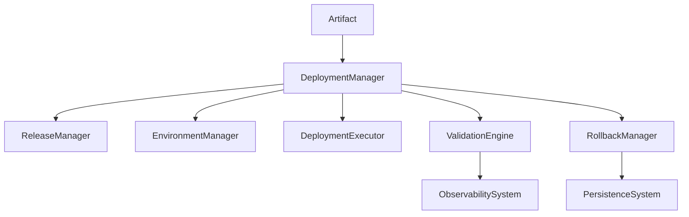

# RFC-0031

**Title:** Deployment System

**Document ID:** RFC-0031

**Version:** 1.0

**Status:** Accepted

**Category:** Infrastructure

**Layer:** Infrastructure

**Target:**

```text
infrastructure/deployment/
```

---

# Abstract

This RFC defines the SH-3 Deployment System.

The Deployment System provides the controlled delivery framework responsible for building, validating, releasing, upgrading, and operating SH-3 components in production environments.

The system enables safe deployment of:

- core modules
- services
- models
- configurations
- plugins
- knowledge updates
- optimization results
- evolution changes

The Deployment System integrates with:

- Persistence System
- Self-Healing System
- Security System
- Configuration System
- Observability System
- Registry System
- Self Evolution System
- Optimizer System

This document is normative.

---

# Motivation

A continuously improving autonomous system requires reliable deployment capabilities.

Without a Deployment System:

- updates cannot be controlled
- failures cannot be rolled back
- version management becomes difficult
- production stability decreases
- evolution cannot safely reach operation

The Deployment System provides controlled system delivery.

---

# Goals

The Deployment System SHALL provide:

- deployment lifecycle management
- release management
- version control
- environment management
- upgrade procedures
- rollback capability
- deployment validation
- production monitoring

---

# Non-Goals

The Deployment System SHALL NOT:

- define application logic
- replace Version Control systems
- bypass Security policies
- deploy unvalidated changes
- directly modify protected resources

Deployment delivers approved changes.

---

# Architecture



The Deployment System transforms validated artifacts into operational components.

---

# Design Principles

The Deployment System follows these principles.

---

## Safety First

Deployment SHALL prioritize system stability.

---

## Immutable Releases

Released artifacts SHALL be immutable.

---

## Versioned

Every deployment SHALL have a unique version.

---

## Reversible

Every deployment SHALL support rollback.

---

## Observable

Deployment status SHALL be visible.

---

## Automated

Routine deployment processes SHOULD be automated.

---

# Deployment Components

The Deployment System consists of:

| Component | Responsibility |
|-----------|----------------|
| DeploymentManager | Coordination |
| ReleaseManager | Release lifecycle |
| ArtifactManager | Artifact handling |
| EnvironmentManager | Environment control |
| DeploymentExecutor | Deployment execution |
| ValidationEngine | Deployment verification |
| RollbackManager | Recovery |
| MigrationManager | Data migration |
| DeploymentMonitor | Runtime observation |

---

# DeploymentManager

DeploymentManager coordinates deployment operations.

Responsibilities:

- deployment lifecycle
- component coordination
- execution control
- validation management
- rollback coordination

DeploymentManager does not build artifacts.

---

# Deployment Context

Every deployment operation receives an immutable DeploymentContext.

A DeploymentContext contains:

| Field | Description |
|--------|-------------|
| deployment_id | Identifier |
| version | Release version |
| target | Deployment target |
| environment | Environment |
| metadata | Additional information |

---

# Deployment Lifecycle

Every deployment follows:

```text
Prepare

↓

Build

↓

Validate

↓

Release

↓

Deploy

↓

Verify

↓

Monitor
```

---

# Deployment States

A DeploymentState contains:

| State | Description |
|------|-------------|
| Created | Deployment initialized |
| Preparing | Preparing resources |
| Validating | Running checks |
| Deploying | Applying changes |
| Active | Running |
| Failed | Failed deployment |
| RolledBack | Restored previous version |

---

# Artifact Management

ArtifactManager manages deployable objects.

Artifacts include:

- source packages
- binaries
- models
- configurations
- plugins
- knowledge packages

---

# Artifact Model

An Artifact contains:

| Field | Description |
|--------|-------------|
| artifact_id | Identifier |
| version | Version |
| checksum | Integrity |
| dependencies | Requirements |
| metadata | Information |

---

# Release Management

ReleaseManager controls release lifecycle.

Release stages:

```text
Development

↓

Testing

↓

Staging

↓

Production
```

---

# Release Model

A Release contains:

| Field | Description |
|--------|-------------|
| release_id | Identifier |
| version | Release version |
| artifacts | Included artifacts |
| validation | Result |
| timestamp | Creation time |

---

# Environment Management

EnvironmentManager manages execution environments.

Supported environments:

- development
- testing
- staging
- production
- recovery

---

# Environment Isolation

Environments SHALL provide:

- configuration isolation
- resource separation
- deployment isolation
- independent validation

---

# Deployment Validation

ValidationEngine checks:

- artifact integrity
- dependency compatibility
- configuration validity
- performance impact
- security requirements

---

# Pre Deployment Checks

Before deployment:

```text
Artifact Verification

↓

Dependency Check

↓

Security Scan

↓

Compatibility Test

↓

Deployment Approval
```

---

# Deployment Execution

DeploymentExecutor applies approved releases.

Supported methods:

- replacement deployment
- incremental update
- rolling update
- staged deployment

---

# Configuration Integration

Deployment integrates with Configuration System.

Deployment manages:

- configuration version
- environment settings
- feature flags
- runtime parameters

---

# Persistence Integration

Deployment uses Persistence System for:

- snapshots
- rollback points
- deployment history
- recovery data

---

# Observability Integration

Deployment uses Observability System for:

- deployment metrics
- logs
- traces
- health checks

---

# Security Integration

Deployment requires:

- authentication
- authorization
- artifact verification
- audit logging

---

# Self Evolution Integration

Self Evolution proposals SHALL pass through Deployment.

Flow:

```text
Evolution Proposal

↓

Validation

↓

Deployment

↓

Monitoring

↓

Evaluation
```

---

# Optimizer Integration

Optimizer may improve:

- deployment speed
- resource usage
- release strategy
- validation efficiency

---

# Self-Healing Integration

Failed deployments trigger:

- automatic rollback
- recovery procedures
- failure analysis

---

# Registry Integration

Registry System provides:

- component discovery
- version lookup
- dependency information

---

# Deployment Execution Model

The Deployment System transforms validated artifacts into stable production capabilities through controlled release processes.

The deployment cycle follows:


Each stage maintains a clear architectural responsibility.

---

# Continuous Deployment Loop

The Deployment System operates through a controlled delivery cycle.

```text
Change Request

↓

Build Artifact

↓

Validation

↓

Deployment

↓

Monitoring

↓

Performance Evaluation

↓

Release Decision
```

Deployment SHALL never bypass validation.

---

# CI/CD Integration

The Deployment System supports automated delivery pipelines.

Pipeline stages:

```text
Commit

↓

Build

↓

Test

↓

Security Validation

↓

Artifact Creation

↓

Deployment

↓

Verification
```

---

# Build Management

BuildManager creates deployment artifacts.

Build processes include:

- dependency resolution
- compilation
- packaging
- metadata generation
- checksum creation

Artifacts SHALL be reproducible.

---

# Automated Testing

Deployment validation may include:

- unit tests
- integration tests
- system tests
- performance tests
- security tests

Failed tests SHALL prevent release.

---

# Release Promotion

Release promotion follows:

```text
Development

↓

Testing

↓

Staging

↓

Production
```

Promotion requires validation success.

---

# Blue/Green Deployment

The Deployment System supports Blue/Green deployment.

Model:

```text
Blue

(Current Version)

        ↓

Green

(New Version)

        ↓

Validation

        ↓

Traffic Switch
```

Benefits:

- minimal downtime
- fast rollback
- safe verification

---

# Canary Deployment

The Deployment System supports Canary deployment.

Process:

```text
Deploy Small Percentage

↓

Observe

↓

Evaluate

↓

Expand Deployment

↓

Complete Release
```

Canary evaluation uses:

- error rate
- performance
- user impact
- system stability

---

# Rolling Update

Rolling updates replace components gradually.

Process:

```text
Instance A

↓

Update

↓

Validate

↓

Instance B

↓

Continue
```

Rolling updates reduce service interruption.

---

# Deployment Strategy Selection

Deployment strategy depends on:

| Factor | Description |
|--------|-------------|
| Risk | Change impact |
| Availability | Required uptime |
| Component type | Target |
| Validation result | Confidence |
| Recovery capability | Rollback readiness |

---

# Upgrade Strategy

The Deployment System supports:

- minor updates
- major upgrades
- model updates
- configuration updates
- architecture evolution

---

# Compatibility Checking

Before upgrade:

```text
Version Check

↓

Dependency Check

↓

Schema Check

↓

Runtime Check

↓

Deployment Approval
```

---

# Migration Management

MigrationManager handles:

- data migration
- schema changes
- state conversion
- compatibility layers

Migration SHALL support rollback.

---

# Rollback Model

Rollback restores previous stable deployment.

Rollback triggers:

- validation failure
- performance regression
- unexpected errors
- health degradation

---

# Rollback Process

```text
Detect Failure

↓

Select Previous Version

↓

Restore Snapshot

↓

Redeploy

↓

Validate Recovery
```

---

# Deployment History

DeploymentHistory stores:

- releases
- versions
- deployment status
- validation results
- rollback records

Historical data improves future deployments.

---

# Autonomous Deployment Evaluation

SH-3 may evaluate deployment quality.

Evaluation metrics:

- stability
- performance
- resource impact
- reliability
- user outcome

---

# Deployment Learning Integration

Learning System improves deployment behavior.

Learning sources:

- deployment results
- failure patterns
- rollback events
- performance changes

---

# Deployment Optimization Integration

Optimizer improves:

- deployment timing
- resource allocation
- validation process
- release strategy

---

# Self-Healing Integration

Self-Healing provides:

- deployment failure detection
- automatic recovery
- rollback triggering
- health restoration

---

# Self Evolution Integration

Self Evolution deployment flow:

```text
Evolution Proposal

↓

Simulation

↓

Validation

↓

Deployment

↓

Monitoring

↓

Acceptance
```

---

# EventBus Integration

Deployment events include:

- BuildStarted
- ArtifactCreated
- ValidationStarted
- ReleaseCreated
- DeploymentStarted
- DeploymentCompleted
- DeploymentFailed
- RollbackStarted
- RollbackCompleted

Event ordering SHALL remain deterministic.

---

# Observability Integration

Deployment telemetry includes:

- deployment duration
- success rate
- failure rate
- rollback count
- validation metrics
- release frequency

---

# Tracing

Deployment traces preserve:

- trace_id
- deployment_id
- release_id
- artifact_id
- rollback_id

Tracing enables delivery analysis.

---

# Security Model

Deployment security includes:

- signed artifacts
- permission validation
- secure transport
- audit records

Unauthorized deployment SHALL be rejected.

---

# Thread Model

Deployment supports concurrent operations:

- artifact preparation
- validation
- monitoring
- environment management

Deployment execution SHALL be synchronized.

The reference implementation shall be thread-safe.

---

# Metrics

The Deployment System exposes:

- deployment frequency
- deployment success rate
- deployment duration
- rollback frequency
- recovery duration
- release stability

---

# Performance Objectives

The Deployment System should optimize for:

- safe releases
- minimal downtime
- fast recovery
- reliable upgrades
- efficient automation

---

# Future Work

Potential future enhancements include:

- autonomous release management
- AI-driven deployment planning
- predictive deployment risk analysis
- self-optimizing CI/CD pipelines
- fully autonomous infrastructure operations

These enhancements extend Deployment capabilities while preserving safety and reliability.

---

# References

- SH-3 Architecture Specification v2.1
- RFC-0013 Capability System
- RFC-0014 Registry System
- RFC-0015 Scheduler System
- RFC-0016 Pipeline System
- RFC-0017 Configuration System
- RFC-0018 Security System
- RFC-0019 Observability System
- RFC-0020 Distributed Cluster System
- RFC-0021 Agent System
- RFC-0022 Knowledge System
- RFC-0023 World Model System
- RFC-0024 Cognitive Architecture System
- RFC-0025 Meta Controller System
- RFC-0026 Self Evolution System
- RFC-0027 Autonomous Learning System
- RFC-0028 Optimizer System
- RFC-0029 Self-Healing System
- RFC-0030 Persistence System

---

# End of RFC-0031
