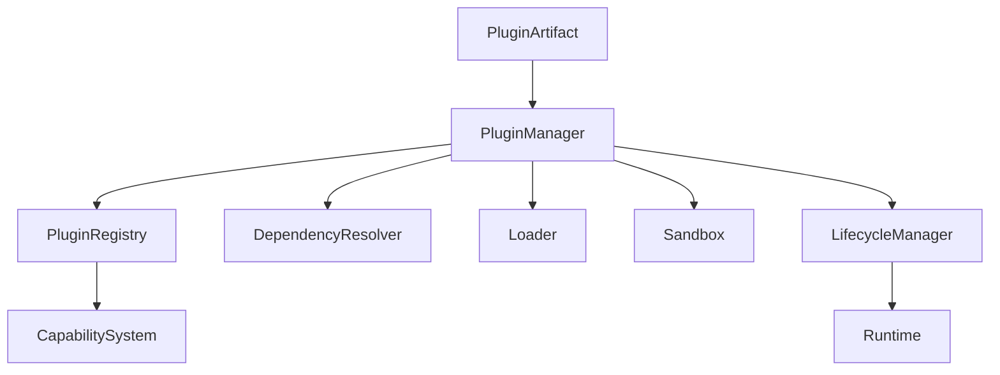

# RFC-0032

**Title:** Plugin System

**Document ID:** RFC-0032

**Version:** 1.0

**Status:** Accepted

**Category:** Platform

**Layer:** Platform

**Target:**

```text
platform/plugin/
```

---

# Abstract

This RFC defines the SH-3 Plugin System.

The Plugin System provides the extensibility framework responsible for adding, managing, isolating, and evolving SH-3 capabilities through modular extensions.

The system enables dynamic extension of:

- cognitive modules
- tools
- models
- storage adapters
- optimization algorithms
- learning strategies
- environment interfaces
- domain capabilities

The Plugin System integrates with:

- Registry System
- Capability System
- Deployment System
- Security System
- Configuration System
- Runtime System
- Self Evolution System
- Optimizer System

This document is normative.

---

# Motivation

An advanced autonomous system must continuously expand capabilities without requiring architectural replacement.

Without a Plugin System:

- extensions become tightly coupled
- upgrades become risky
- experimentation becomes difficult
- external capabilities cannot be integrated safely
- system evolution becomes slower

The Plugin System provides controlled extensibility.

---

# Goals

The Plugin System SHALL provide:

- plugin discovery
- plugin registration
- lifecycle management
- dependency resolution
- version compatibility
- dynamic loading
- isolation
- security validation
- extension monitoring

---

# Non-Goals

The Plugin System SHALL NOT:

- replace core architecture
- bypass security policies
- directly modify protected kernel components
- allow uncontrolled runtime changes
- replace Deployment System

Plugins extend capabilities.

---

# Architecture



The Plugin System transforms external modules into controlled SH-3 capabilities.

---

# Design Principles

The Plugin System follows these principles.

---

## Modular

Plugins SHALL remain independent modules.

---

## Isolated

Plugin failures SHALL not compromise the entire system.

---

## Versioned

Plugin versions SHALL be explicitly managed.

---

## Secure

Plugin execution SHALL follow security rules.

---

## Replaceable

Plugin implementations SHALL remain interchangeable.

---

## Observable

Plugin behavior SHALL be traceable.

---

# Plugin Components

The Plugin System consists of:

| Component | Responsibility |
|-----------|----------------|
| PluginManager | Coordination |
| PluginRegistry | Plugin discovery |
| PluginLoader | Loading |
| DependencyResolver | Dependency management |
| LifecycleManager | Plugin lifecycle |
| SandboxExecutor | Isolation |
| CompatibilityChecker | Version validation |
| PluginMonitor | Observation |

---

# PluginManager

PluginManager coordinates plugin operations.

Responsibilities:

- registration
- loading
- activation
- deactivation
- removal
- lifecycle control

PluginManager does not implement plugin functionality.

---

# Plugin Context

Every plugin operation receives an immutable PluginContext.

A PluginContext contains:

| Field | Description |
|--------|-------------|
| plugin_id | Identifier |
| version | Plugin version |
| permissions | Allowed operations |
| environment | Execution environment |
| metadata | Additional information |

---

# Plugin Lifecycle

Every plugin follows:

```text
Created

↓

Registered

↓

Validated

↓

Loaded

↓

Activated

↓

Running

↓

Updated

↓

Disabled

↓

Removed
```

---

# Plugin State Model

A PluginState contains:

| State | Description |
|------|-------------|
| Installed | Available |
| Validating | Being checked |
| Loaded | Memory loaded |
| Active | Running |
| Disabled | Inactive |
| Failed | Error state |
| Removed | Deleted |

---

# Plugin Definition

A Plugin contains:

| Field | Description |
|--------|-------------|
| plugin_id | Unique identifier |
| name | Plugin name |
| version | Version |
| type | Category |
| dependencies | Requirements |
| permissions | Access rules |
| metadata | Information |

---

# Plugin Types

Supported plugin categories include:

| Type | Purpose |
|------|---------|
| Cognitive Plugin | Reasoning extensions |
| Tool Plugin | External actions |
| Model Plugin | AI models |
| Storage Plugin | Persistence adapters |
| Learning Plugin | Learning algorithms |
| Optimization Plugin | Optimization methods |
| Interface Plugin | External communication |

---

# Plugin Registration

Plugin registration process:

```text
Receive Plugin

↓

Validate Metadata

↓

Check Dependencies

↓

Verify Security

↓

Register
```

Unvalidated plugins SHALL NOT activate.

---

# Plugin Registry

PluginRegistry stores:

- available plugins
- versions
- capabilities
- dependencies
- status

Registry integrates with Capability System.

---

# Capability Integration

Plugins expose capabilities.

Example:

```text
Plugin

↓

Capability Declaration

↓

Registry

↓

Capability Discovery
```

Other systems consume capabilities through standard interfaces.

---

# Dependency Management

DependencyResolver manages:

- required modules
- compatible versions
- conflicts
- loading order

---

# Dependency Resolution

Process:

```text
Plugin Request

↓

Dependency Graph

↓

Compatibility Check

↓

Load Order Generation
```

---

# Version Compatibility

CompatibilityChecker validates:

- API version
- runtime version
- dependency version
- security requirements

---

# Dynamic Loading

PluginLoader supports:

- runtime loading
- initialization
- activation
- unloading

Loading SHALL preserve system stability.

---

# Sandbox Execution

SandboxExecutor isolates plugins.

Isolation controls include:

- resource limits
- permission restrictions
- execution boundaries

---

# Plugin Security

Security validation includes:

- signature verification
- permission analysis
- dependency inspection
- behavior monitoring

---

# Configuration Integration

Plugins receive configuration through Configuration System.

Configuration includes:

- parameters
- feature settings
- resource limits
- execution policies

---

# Deployment Integration

Plugin deployment follows:

```text
Plugin Package

↓

Validation

↓

Deployment

↓

Registration

↓

Activation
```

---

# Plugin Execution Model

The Plugin System transforms external extensions into controlled, secure, and dynamically manageable SH-3 capabilities.

The plugin lifecycle follows:


Each stage maintains a clear architectural responsibility.

---

# Plugin Management Loop

The Plugin System operates through continuous extension management.

```text
Discover Plugin

↓

Validate Capability

↓

Resolve Dependencies

↓

Load Safely

↓

Execute

↓

Monitor Behavior

↓

Improve or Replace
```

Plugins SHALL remain isolated from core stability.

---

# Hot Reload

The Plugin System supports runtime plugin replacement.

Hot reload enables:

- capability updates
- bug fixes
- algorithm replacement
- experimental extensions

---

# Hot Reload Process

```text
Prepare New Plugin

↓

Validate

↓

Pause Old Instance

↓

Transfer State

↓

Activate New Instance

↓

Verify
```

Hot reload SHALL preserve system consistency.

---

# Plugin Update Model

Plugin updates support:

- minor updates
- major upgrades
- compatibility migration
- rollback

---

# Update Validation

Before activation:

```text
Version Check

↓

API Compatibility

↓

Dependency Validation

↓

Security Verification

↓

Performance Test
```

---

# Plugin Communication Model

Plugins communicate through controlled interfaces.

Communication methods:

- EventBus
- Capability Interface
- Message Passing
- Service Interface

Direct internal access SHALL be prohibited.

---

# Plugin Interface Contract

Every plugin SHALL expose:

```text
initialize()

start()

execute()

health()

stop()
```

Optional interfaces:

```text
save_state()

restore_state()

update()

rollback()
```

---

# Plugin Event Model

Plugin events include:

- PluginRegistered
- PluginLoaded
- PluginActivated
- PluginStarted
- PluginStopped
- PluginUpdated
- PluginFailed
- PluginRemoved

Event ordering SHALL remain deterministic.

---

# Plugin Failure Handling

Plugin failures include:

- initialization failure
- execution exception
- dependency failure
- resource exhaustion
- security violation

---

# Failure Recovery

Recovery process:

```text
Detect Failure

↓

Isolate Plugin

↓

Preserve State

↓

Restart or Rollback

↓

Validate Recovery
```

---

# Plugin Isolation

Failed plugins SHALL be isolated.

Isolation methods:

- process separation
- memory restriction
- permission restriction
- execution timeout

---

# Plugin Resource Management

Plugins SHALL operate within assigned limits.

Managed resources:

- CPU
- memory
- storage
- network
- execution time

---

# Plugin Security Boundary

The Plugin System enforces:

- capability permissions
- API restrictions
- resource limits
- audit logging

---

# Permission Model

Plugin permissions define:

| Permission | Purpose |
|------------|---------|
| read | Access information |
| write | Modify data |
| execute | Run operations |
| network | External communication |
| storage | Persistent access |

---

# Plugin Trust Model

Plugins may be classified:

| Level | Description |
|------|-------------|
| Core Trusted | Official modules |
| Verified | Validated external modules |
| Experimental | Limited execution |
| Restricted | Sandbox only |

---

# Plugin Audit

Audit records include:

- plugin identity
- actions
- permissions
- resource usage
- security events

---

# Learning Integration

Learning System may optimize plugin behavior.

Learning targets:

- plugin selection
- capability usage
- execution efficiency
- reliability

---

# Memory Integration

Memory System stores:

- plugin experiences
- usage history
- performance patterns
- compatibility knowledge

---

# Knowledge Integration

Knowledge System stores:

- plugin capabilities
- dependency relationships
- operational knowledge

---

# Optimizer Integration

Optimizer improves:

- plugin scheduling
- resource allocation
- execution strategy
- capability selection

---

# Self-Healing Integration

Self-Healing manages:

- plugin failure detection
- restart
- rollback
- replacement

---

# Self Evolution Integration

Self Evolution may create new plugins.

Evolution flow:

```text
Capability Gap

↓

Plugin Proposal

↓

Simulation

↓

Validation

↓

Deployment

↓

Activation
```

---

# Deployment Integration

Plugin deployment follows:

```text
Package

↓

Verify

↓

Deploy

↓

Register

↓

Activate

↓

Monitor
```

---

# Persistence Integration

Plugin state persistence includes:

- configuration
- runtime state
- learned parameters
- execution history

---

# Observability Integration

Plugin telemetry includes:

- execution count
- latency
- failures
- resource consumption
- capability usage

---

# Tracing

Plugin traces preserve:

- trace_id
- plugin_id
- execution_id
- capability_id
- event_id

Tracing enables extension analysis.

---

# Thread Model

The Plugin System supports concurrent:

- plugin loading
- plugin execution
- monitoring
- updates

Plugin state transitions SHALL be synchronized.

The reference implementation shall be thread-safe.

---

# Metrics

The Plugin System exposes:

- active plugins
- plugin load time
- execution latency
- failure rate
- update success rate
- resource consumption

---

# Performance Objectives

The Plugin System should optimize for:

- safe extensibility
- minimal runtime overhead
- reliable execution
- dynamic evolution
- controlled experimentation

---

# Future Work

Potential future enhancements include:

- autonomous plugin generation
- AI-driven capability discovery
- self-optimizing extensions
- distributed plugin ecosystem
- marketplace-style capability exchange

These enhancements extend SH-3 adaptability while preserving security and stability.

---

# References

- SH-3 Architecture Specification v2.1
- RFC-0013 Capability System
- RFC-0014 Registry System
- RFC-0015 Scheduler System
- RFC-0016 Pipeline System
- RFC-0017 Configuration System
- RFC-0018 Security System
- RFC-0019 Observability System
- RFC-0020 Distributed Cluster System
- RFC-0021 Agent System
- RFC-0022 Knowledge System
- RFC-0023 World Model System
- RFC-0024 Cognitive Architecture System
- RFC-0025 Meta Controller System
- RFC-0026 Self Evolution System
- RFC-0027 Autonomous Learning System
- RFC-0028 Optimizer System
- RFC-0029 Self-Healing System
- RFC-0030 Persistence System
- RFC-0031 Deployment System

---

# End of RFC-0032
