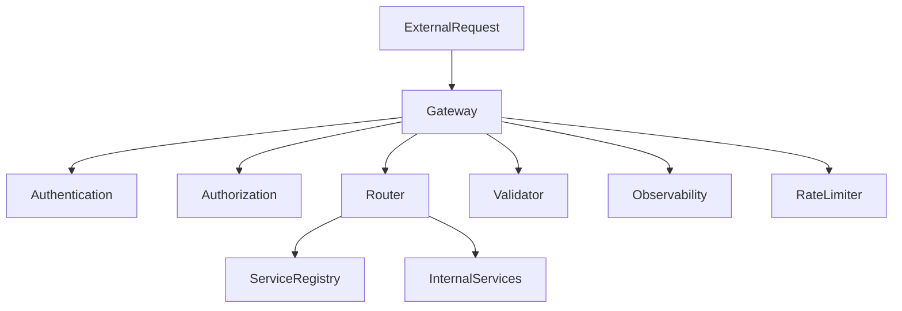
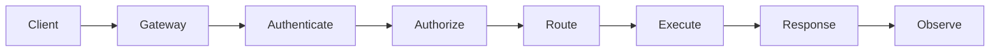

# RFC-0033

**Title:** API Gateway System

**Document ID:** RFC-0033

**Version:** 1.0

**Status:** Accepted

**Category:** Platform

**Layer:** Platform

**Target:**

```text
platform/api_gateway/
```

---

# Abstract

This RFC defines the SH-3 API Gateway System.

The API Gateway System provides the unified communication boundary responsible for connecting SH-3 internal capabilities with external users, applications, agents, tools, and distributed systems.

The system manages:

- request routing
- protocol translation
- authentication
- authorization
- rate control
- API versioning
- service discovery
- external integration
- communication security

The API Gateway System integrates with:

- Security System
- Registry System
- Capability System
- Plugin System
- Runtime System
- Observability System
- Configuration System
- Deployment System

This document is normative.

---

# Motivation

An autonomous intelligence platform requires a stable communication boundary.

Without an API Gateway:

- internal modules become exposed
- security boundaries weaken
- external integration becomes inconsistent
- API evolution becomes difficult
- monitoring becomes fragmented

The API Gateway provides controlled access to SH-3 capabilities.

---

# Goals

The API Gateway System SHALL provide:

- unified API entry point
- request routing
- protocol handling
- authentication
- authorization
- request validation
- API lifecycle management
- observability
- external system integration

---

# Non-Goals

The API Gateway System SHALL NOT:

- implement business logic
- replace internal service interfaces
- bypass Security policies
- directly modify core components
- manage application state

The gateway coordinates communication.

---

# Architecture



The API Gateway transforms external requests into controlled internal operations.

---

# Design Principles

The API Gateway follows these principles.

---

## Secure Boundary

All external communication SHALL pass through controlled interfaces.

---

## Stateless Processing

Request handling SHOULD remain stateless.

---

## Versioned APIs

API changes SHALL support compatibility.

---

## Observable

Requests SHALL be traceable.

---

## Scalable

The gateway SHALL support increasing workloads.

---

## Extensible

New protocols SHALL be addable.

---

# API Gateway Components

The system consists of:

| Component | Responsibility |
|-----------|----------------|
| GatewayManager | Coordination |
| RequestRouter | Routing |
| ProtocolAdapter | Protocol handling |
| AuthenticationManager | Identity verification |
| AuthorizationManager | Permission control |
| RateLimiter | Traffic control |
| RequestValidator | Input validation |
| ResponseFormatter | Output formatting |
| GatewayMonitor | Observation |

---

# GatewayManager

GatewayManager coordinates API operations.

Responsibilities:

- request lifecycle
- component coordination
- policy enforcement
- gateway configuration

GatewayManager does not implement service logic.

---

# Request Context

Every request receives an immutable RequestContext.

A RequestContext contains:

| Field | Description |
|--------|-------------|
| request_id | Identifier |
| client_id | Caller |
| api_version | API version |
| timestamp | Request time |
| metadata | Additional information |

---

# Request Lifecycle

Every API request follows:

```text
Receive

↓

Authenticate

↓

Authorize

↓

Validate

↓

Route

↓

Execute

↓

Format Response

↓

Record
```

---

# API Model

An API Endpoint contains:

| Field | Description |
|--------|-------------|
| endpoint_id | Identifier |
| path | Route |
| method | Operation |
| version | Version |
| permissions | Required access |
| handler | Target service |

---

# Request Routing

RequestRouter determines destination.

Routing factors include:

- endpoint
- API version
- capability
- service availability
- request priority

---

# Service Discovery Integration

The API Gateway uses Registry System.

Discovery provides:

- service location
- capability information
- version information
- health status

---

# Capability Integration

External users access SH-3 abilities through capabilities.

Flow:

```text
API Request

↓

Capability Lookup

↓

Service Resolution

↓

Execution
```

---

# Protocol Support

The API Gateway supports:

- HTTP
- WebSocket
- RPC
- Message Queue
- Internal Event Protocol

Protocol adapters remain replaceable.

---

# Protocol Translation

ProtocolAdapter converts:

- external formats
- internal messages
- response formats

---

# Request Validation

RequestValidator checks:

- schema
- parameters
- data types
- permissions
- constraints

Invalid requests SHALL be rejected.

---

# Response Formatting

ResponseFormatter provides:

- consistent format
- error handling
- metadata
- trace information

---

# Authentication

AuthenticationManager verifies:

- identity
- credentials
- tokens
- certificates

---

# Authorization

AuthorizationManager controls:

- capability access
- resource access
- operation permissions

---

# Security Integration

API Gateway integrates with Security System.

Security features:

- authentication
- authorization
- encryption
- audit logging
- attack prevention

---

# Rate Limiting

RateLimiter protects SH-3 resources.

Controls:

- request frequency
- client quotas
- priority limits
- resource usage

---

# Configuration Integration

Gateway configuration includes:

- endpoint definitions
- security policies
- rate limits
- protocol settings

---

# Deployment Integration

API Gateway deployment supports:

- versioned release
- rolling update
- rollback
- health verification

---

# Observability Integration

Gateway monitoring records:

- requests
- latency
- errors
- traffic
- resource usage

---

# API Gateway Execution Model

The API Gateway System transforms external communication requests into secure, validated, and observable SH-3 operations.

The communication cycle follows:



Each stage maintains a clear architectural responsibility.

---

# Gateway Control Loop

The API Gateway operates through continuous communication management.

```text
Receive Request

↓

Verify Identity

↓

Check Permission

↓

Select Capability

↓

Execute Operation

↓

Return Result

↓

Record Interaction
```

All external interactions SHALL pass through the gateway boundary.

---

# API Version Management

The API Gateway supports version-controlled interfaces.

Versioning methods:

- URL versioning
- header versioning
- schema versioning
- capability versioning

---

# Version Compatibility

CompatibilityChecker validates:

- request format
- response format
- capability availability
- security requirements

---

# API Lifecycle

API lifecycle:

```text
Designed

↓

Registered

↓

Published

↓

Active

↓

Deprecated

↓

Removed
```

Deprecated APIs SHALL provide migration paths.

---

# External Agent Integration

The API Gateway provides controlled access for external agents.

Supported integrations:

- autonomous agents
- enterprise systems
- user applications
- automation tools
- research environments

---

# Agent Request Model

Agent requests contain:

| Field | Description |
|--------|-------------|
| agent_id | Identity |
| capability | Requested ability |
| objective | Task information |
| context | Additional data |
| permissions | Access scope |

---

# Agent Security Boundary

External agents SHALL:

- authenticate
- receive explicit permissions
- operate within capability limits
- generate audit records

---

# Streaming Communication

The API Gateway supports streaming communication.

Streaming targets:

- reasoning updates
- execution status
- long-running tasks
- event notifications

---

# WebSocket Integration

WebSocket communication supports:

- bidirectional messaging
- real-time updates
- session management
- event streaming

---

# Message Routing

MessageRouter manages asynchronous communication.

Routing targets:

- internal services
- agents
- plugins
- external systems

---

# Message Model

A Message contains:

| Field | Description |
|--------|-------------|
| message_id | Identifier |
| source | Sender |
| destination | Target |
| type | Message type |
| payload | Data |
| timestamp | Creation time |

---

# Priority Routing

Requests may receive priority levels:

| Priority | Usage |
|----------|-------|
| Critical | Recovery operations |
| High | User interaction |
| Normal | Standard requests |
| Low | Background processing |

---

# API Security Model

The API Gateway enforces multiple security layers.

Security controls:

- authentication
- authorization
- encryption
- validation
- monitoring
- auditing

---

# Threat Protection

Protection targets:

- unauthorized access
- malformed requests
- excessive traffic
- injection attacks
- resource abuse

---

# Audit Logging

Audit records include:

- caller identity
- request type
- capability used
- execution result
- timestamp

---

# Gateway Failure Recovery

The API Gateway integrates with Self-Healing System.

Recovery actions:

- restart gateway instance
- restore configuration
- switch endpoint
- activate backup gateway

---

# High Availability Model

High availability uses:

- multiple gateway instances
- health monitoring
- failover routing
- load balancing

---

# Load Balancing

Load balancing considers:

- instance health
- resource usage
- request priority
- latency

---

# Persistence Integration

Persistence stores:

- API configuration
- routing tables
- version history
- audit information

---

# Learning Integration

Learning System improves:

- routing decisions
- traffic prediction
- resource allocation
- API optimization

---

# Memory Integration

Memory System stores:

- interaction history
- successful request patterns
- user/system preferences

---

# Knowledge Integration

Knowledge System stores:

- API capabilities
- integration patterns
- compatibility information

---

# Optimizer Integration

Optimizer improves:

- routing efficiency
- latency
- resource utilization
- scaling decisions

---

# Self Evolution Integration

Self Evolution may extend APIs through:

```text
New Capability

↓

API Definition

↓

Validation

↓

Publication

↓

External Availability
```

---

# EventBus Integration

API Gateway events include:

- RequestReceived
- AuthenticationCompleted
- AuthorizationDenied
- RouteSelected
- ExecutionStarted
- ResponseGenerated
- RequestFailed

Event ordering SHALL remain deterministic.

---

# Observability Integration

Gateway telemetry includes:

- request count
- latency
- error rate
- authentication failures
- traffic distribution

---

# Tracing

API traces preserve:

- trace_id
- request_id
- client_id
- capability_id
- execution_id

Tracing enables communication analysis.

---

# Thread Model

The API Gateway supports concurrent:

- request handling
- authentication
- routing
- streaming sessions
- monitoring

Shared state SHALL be synchronized.

The reference implementation shall be thread-safe.

---

# Metrics

The API Gateway System exposes:

- requests per second
- latency
- availability
- error rate
- authentication failures
- active connections

---

# Performance Objectives

The API Gateway System should optimize for:

- low latency communication
- secure access
- scalable routing
- reliable integration
- observable operations

---

# Future Work

Potential future enhancements include:

- AI-driven API optimization
- autonomous interface generation
- semantic API discovery
- adaptive routing
- intelligent traffic management
- self-designing communication protocols

These enhancements extend SH-3 connectivity while preserving security boundaries.

---

# References

- SH-3 Architecture Specification v2.1
- RFC-0013 Capability System
- RFC-0014 Registry System
- RFC-0015 Scheduler System
- RFC-0016 Pipeline System
- RFC-0017 Configuration System
- RFC-0018 Security System
- RFC-0019 Observability System
- RFC-0020 Distributed Cluster System
- RFC-0021 Agent System
- RFC-0022 Knowledge System
- RFC-0023 World Model System
- RFC-0024 Cognitive Architecture System
- RFC-0025 Meta Controller System
- RFC-0026 Self Evolution System
- RFC-0027 Autonomous Learning System
- RFC-0028 Optimizer System
- RFC-0029 Self-Healing System
- RFC-0030 Persistence System
- RFC-0031 Deployment System
- RFC-0032 Plugin System

---

# End of RFC-0033
