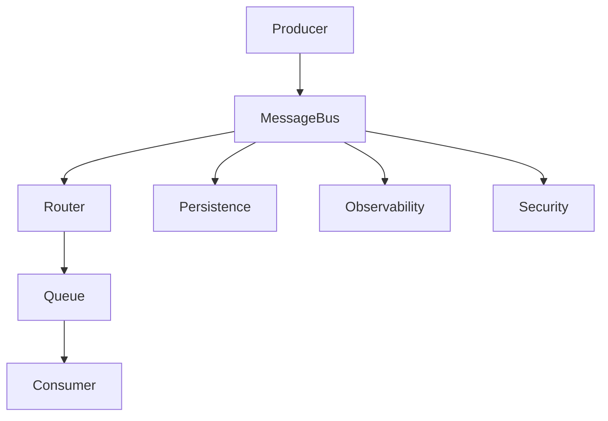

# RFC-0034

**Title:** Message Bus System

**Document ID:** RFC-0034

**Version:** 1.0

**Status:** Accepted

**Category:** Platform

**Layer:** Platform

**Target:**

```text
platform/message_bus/
```

---

# Abstract

This RFC defines the SH-3 Message Bus System.

The Message Bus System provides the asynchronous communication infrastructure responsible for connecting SH-3 internal components, distributed services, agents, plugins, and external integrations through reliable message exchange.

The system enables:

- event-driven architecture
- asynchronous execution
- service decoupling
- distributed communication
- message persistence
- event replay
- fault-tolerant delivery

The Message Bus System integrates with:

- Event System
- API Gateway System
- Runtime System
- Registry System
- Plugin System
- Distributed Cluster System
- Persistence System
- Observability System
- Security System

This document is normative.

---

# Motivation

A complex autonomous system requires scalable internal communication.

Without a Message Bus:

- modules become tightly coupled
- failures propagate
- synchronous dependencies increase
- distributed execution becomes difficult
- event history is lost

The Message Bus provides a reliable communication backbone.

---

# Goals

The Message Bus System SHALL provide:

- asynchronous messaging
- event publishing
- event subscription
- message routing
- delivery guarantees
- message persistence
- distributed communication
- event replay
- monitoring

---

# Non-Goals

The Message Bus System SHALL NOT:

- implement business logic
- replace API Gateway
- replace direct function calls inside modules
- bypass security policies
- modify message contents without authorization

The Message Bus transports information.

---

# Architecture



The Message Bus transforms component communication into reliable asynchronous flows.

---

# Design Principles

The Message Bus follows these principles.

---

## Loose Coupling

Components SHALL communicate through messages.

---

## Reliability

Messages SHALL support guaranteed delivery.

---

## Ordering

Critical message flows SHALL preserve ordering.

---

## Scalability

The system SHALL support distributed message processing.

---

## Observable

All message flows SHALL be traceable.

---

## Secure

Message exchange SHALL follow security policies.

---

# Message Bus Components

The system consists of:

| Component | Responsibility |
|-----------|----------------|
| MessageBusManager | Coordination |
| Publisher | Message creation |
| Subscriber | Message consumption |
| MessageRouter | Routing |
| QueueManager | Queue control |
| DeliveryManager | Delivery handling |
| ReplayManager | Event replay |
| MessageStore | Persistence |
| BusMonitor | Observation |

---

# MessageBusManager

MessageBusManager coordinates message operations.

Responsibilities:

- message lifecycle
- routing coordination
- subscription management
- delivery control

MessageBusManager does not process business logic.

---

# Message Context

Every message operation receives an immutable MessageContext.

A MessageContext contains:

| Field | Description |
|--------|-------------|
| message_id | Identifier |
| trace_id | Trace identifier |
| source | Sender |
| destination | Receiver |
| timestamp | Creation time |

---

# Message Lifecycle

Every message follows:

```text
Created

↓

Published

↓

Queued

↓

Delivered

↓

Processed

↓

Acknowledged

↓

Archived
```

---

# Message Model

A Message contains:

| Field | Description |
|--------|-------------|
| message_id | Identifier |
| type | Message type |
| source | Producer |
| target | Consumer |
| priority | Priority |
| payload | Data |
| timestamp | Creation time |

---

# Event Model

Events represent system state changes.

Examples:

```text
ComponentStarted

TaskCompleted

LearningUpdated

OptimizationApplied

DeploymentFinished

FailureDetected
```

---

# Publisher

Publisher creates and sends messages.

Responsibilities:

- message generation
- metadata assignment
- validation
- publishing

---

# Subscriber

Subscriber receives messages.

Responsibilities:

- subscription
- filtering
- processing
- acknowledgement

---

# Publish / Subscribe Model

The Message Bus supports:

```text
Publisher

↓

Topic

↓

Subscribers
```

Multiple consumers may receive the same event.

---

# Topic Model

A Topic contains:

| Field | Description |
|--------|-------------|
| topic_id | Identifier |
| name | Topic name |
| schema | Message format |
| permissions | Access control |

---

# Message Routing

MessageRouter determines delivery destination.

Routing factors:

- topic
- message type
- priority
- subscriber availability
- policy rules

---

# Queue Management

QueueManager manages:

- message buffering
- ordering
- retry
- overflow control

---

# Queue Types

Supported queues:

| Type | Purpose |
|------|---------|
| Standard | Normal processing |
| Priority | Important events |
| Persistent | Durable messages |
| Temporary | Short-lived messages |

---

# Delivery Management

DeliveryManager controls:

- delivery attempts
- acknowledgements
- retries
- failures

---

# Delivery Guarantee

The Message Bus supports:

| Level | Description |
|------|-------------|
| At Most Once | No duplication |
| At Least Once | Guaranteed delivery |
| Exactly Once | Duplicate prevention |

---

# Message Persistence

MessageStore preserves important messages.

Stored messages include:

- events
- commands
- recovery information
- audit data

---

# Event Replay

ReplayManager restores historical events.

Uses:

- debugging
- recovery
- simulation
- learning

---

# Message Bus Execution Model

The Message Bus System transforms component interactions into reliable, asynchronous, and observable communication flows.

The message processing cycle follows:


Each stage maintains a clear architectural responsibility.

---

# Message Processing Loop

The Message Bus operates through continuous event communication.

```text
Create Event

↓

Publish Message

↓

Route Message

↓

Deliver

↓

Process

↓

Confirm

↓

Store Result
```

---

# Distributed Messaging Model

The Message Bus supports distributed execution across SH-3 nodes.

Distributed messaging provides:

- node communication
- workload distribution
- service coordination
- fault tolerance
- scalable processing

---

# Distributed Message Model

A distributed message contains:

| Field | Description |
|--------|-------------|
| message_id | Identifier |
| node_id | Origin node |
| sequence | Ordering number |
| version | Schema version |
| checksum | Integrity |
| timestamp | Creation time |

---

# Message Ordering

The Message Bus supports ordered delivery.

Ordering strategies:

- global ordering
- topic ordering
- partition ordering
- causal ordering

---

# Causal Message Ordering

For dependent events:

```text
Event A

↓

Event B

↓

Event C
```

The system SHALL preserve causal relationships.

---

# Retry Strategy

Delivery failures trigger retry processing.

Retry policies include:

- immediate retry
- delayed retry
- exponential backoff
- maximum attempt limit

---

# Retry Process

```text
Delivery Failure

↓

Retry Decision

↓

Wait

↓

Retry

↓

Success or Escalation
```

---

# Dead Letter Queue

Failed messages are stored separately.

Dead Letter Queue contains:

- failed messages
- failure reason
- retry history
- processing logs

---

# Dead Letter Processing

Recovery process:

```text
Inspect Failure

↓

Analyze Cause

↓

Repair Condition

↓

Replay Message
```

---

# Event Sourcing Model

The Message Bus supports event sourcing.

Event sourcing stores:

- system changes
- execution history
- state transitions

---

# State Reconstruction

Historical events can reconstruct:

```text
Initial State

+

Event Sequence

=

Current State
```

---

# Persistence Integration

Persistence System stores:

- persistent queues
- event history
- replay data
- delivery records

---

# Recovery Integration

Self-Healing System uses Message Bus information.

Recovery sources:

- failure events
- execution history
- system state changes
- message patterns

---

# Security Model

Message security includes:

- authentication
- authorization
- encryption
- integrity verification
- audit logging

---

# Message Access Control

Access control determines:

- publisher permission
- subscriber permission
- topic visibility
- data access

---

# Message Validation

Messages SHALL be validated for:

- schema correctness
- source identity
- permission
- integrity

Invalid messages SHALL be rejected.

---

# Plugin Integration

Plugins communicate through Message Bus.

Plugin events include:

- PluginLoaded
- PluginUpdated
- PluginFailed
- CapabilityChanged

---

# API Gateway Integration

API Gateway may publish:

- external requests
- responses
- notifications
- streaming events

---

# Learning Integration

Learning System consumes events:

- behavior history
- execution outcomes
- user feedback
- optimization results

---

# Memory Integration

Memory System stores:

- important events
- interaction patterns
- operational experiences

---

# Knowledge Integration

Knowledge System extracts:

- event relationships
- operational rules
- causal patterns

---

# World Model Integration

World Model uses events for:

- state updates
- prediction improvement
- simulation history

---

# Optimizer Integration

Optimizer analyzes:

- message flow
- latency
- throughput
- resource usage

---

# Self Evolution Integration

Self Evolution observes:

- communication patterns
- bottlenecks
- missing events
- new requirements

Possible evolution:

```text
Communication Problem

↓

New Message Pattern

↓

System Improvement
```

---

# Observability Integration

Message telemetry includes:

- message count
- delivery latency
- queue size
- retry count
- failure rate

---

# Tracing

Message traces preserve:

- trace_id
- message_id
- event_id
- producer
- consumer

Tracing enables distributed debugging.

---

# Thread Model

The Message Bus supports concurrent:

- publishing
- routing
- delivery
- subscription
- replay

Shared queues SHALL be synchronized.

The reference implementation shall be thread-safe.

---

# Metrics

The Message Bus System exposes:

- messages per second
- delivery success rate
- average latency
- queue depth
- retry count
- dead letter count

---

# Performance Objectives

The Message Bus System should optimize for:

- reliable delivery
- low latency
- high throughput
- scalable communication
- fault tolerance

---

# Future Work

Potential future enhancements include:

- AI-driven event optimization
- autonomous message schema evolution
- predictive traffic management
- self-organizing event networks
- semantic event understanding

These enhancements extend SH-3 communication capabilities while preserving reliability.

---

# References

- SH-3 Architecture Specification v2.1
- RFC-0013 Capability System
- RFC-0014 Registry System
- RFC-0015 Scheduler System
- RFC-0016 Pipeline System
- RFC-0017 Configuration System
- RFC-0018 Security System
- RFC-0019 Observability System
- RFC-0020 Distributed Cluster System
- RFC-0021 Agent System
- RFC-0022 Knowledge System
- RFC-0023 World Model System
- RFC-0024 Cognitive Architecture System
- RFC-0025 Meta Controller System
- RFC-0026 Self Evolution System
- RFC-0027 Autonomous Learning System
- RFC-0028 Optimizer System
- RFC-0029 Self-Healing System
- RFC-0030 Persistence System
- RFC-0031 Deployment System
- RFC-0032 Plugin System
- RFC-0033 API Gateway System

---

# End of RFC-0034
