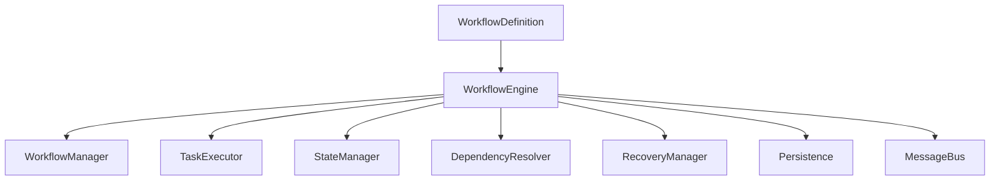
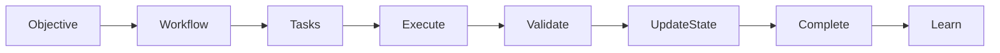

# RFC-0035

**Title:** Workflow Engine System

**Document ID:** RFC-0035

**Version:** 1.0

**Status:** Accepted

**Category:** Platform

**Layer:** Platform

**Target:**

```text
platform/workflow/
```

---

# Abstract

This RFC defines the SH-3 Workflow Engine System.

The Workflow Engine System provides the autonomous process orchestration framework responsible for managing complex multi-step operations, long-running tasks, distributed execution flows, and adaptive workflows.

The system enables:

- workflow definition
- task orchestration
- dependency management
- state tracking
- failure recovery
- retry execution
- compensation processing
- human approval integration
- autonomous workflow generation

The Workflow Engine System integrates with:

- Message Bus System
- Scheduler System
- Persistence System
- Self-Healing System
- Planning System
- Agent System
- Plugin System
- Observability System
- Security System

This document is normative.

---

# Motivation

An autonomous intelligence system must execute complex objectives through coordinated sequences of actions.

Without a Workflow Engine:

- multi-step tasks become fragmented
- execution state is lost
- failures become difficult to recover
- parallel operations become inefficient
- autonomous planning cannot reliably execute

The Workflow Engine provides structured execution control.

---

# Goals

The Workflow Engine System SHALL provide:

- workflow lifecycle management
- task orchestration
- execution state management
- dependency resolution
- parallel execution
- retry handling
- compensation recovery
- persistence
- monitoring

---

# Non-Goals

The Workflow Engine System SHALL NOT:

- replace Planning System
- define business objectives
- directly implement task logic
- bypass Security policies
- replace Scheduler System

Planning decides.

Workflow executes.

---

# Architecture



The Workflow Engine transforms plans into reliable execution processes.

---

# Design Principles

The Workflow Engine follows these principles.

---

## Deterministic Execution

The same workflow state SHALL produce predictable transitions.

---

## Durable Execution

Execution state SHALL survive failures.

---

## Observable

Every workflow step SHALL be traceable.

---

## Recoverable

Failed workflows SHALL support recovery.

---

## Composable

Small workflows SHALL combine into larger workflows.

---

## Adaptive

The system MAY modify execution strategies based on context.

---

# Workflow Components

The system consists of:

| Component | Responsibility |
|-----------|----------------|
| WorkflowEngine | Core execution |
| WorkflowManager | Lifecycle control |
| WorkflowParser | Definition parsing |
| TaskExecutor | Task execution |
| StateManager | State tracking |
| DependencyResolver | Ordering |
| RetryManager | Failure handling |
| CompensationManager | Rollback actions |
| WorkflowMonitor | Observation |

---

# WorkflowEngine

WorkflowEngine coordinates execution.

Responsibilities:

- workflow loading
- execution control
- state transitions
- task scheduling
- recovery coordination

WorkflowEngine does not define task intelligence.

---

# Workflow Context

Every workflow execution receives an immutable WorkflowContext.

A WorkflowContext contains:

| Field | Description |
|--------|-------------|
| workflow_id | Identifier |
| execution_id | Execution instance |
| objective | Goal |
| input | Initial data |
| metadata | Additional information |

---

# Workflow Lifecycle

Every workflow follows:

```text
Created

↓

Validated

↓

Started

↓

Executing

↓

Completed

↓

Archived
```

Failure states:

```text
Failed

↓

Recovering

↓

Completed / Cancelled
```

---

# Workflow Definition

A Workflow contains:

| Field | Description |
|--------|-------------|
| workflow_id | Identifier |
| name | Workflow name |
| version | Version |
| tasks | Task definitions |
| dependencies | Execution graph |
| policies | Execution rules |

---

# Task Model

A Task contains:

| Field | Description |
|--------|-------------|
| task_id | Identifier |
| type | Task category |
| action | Execution target |
| dependencies | Required tasks |
| timeout | Limit |
| retry_policy | Recovery rules |

---

# Workflow DAG Model

Workflows may be represented as DAGs.

Example:

```text
Task A

↓

Task B ──→ Task D

↓

Task C
```

Independent tasks MAY execute in parallel.

---

# Task Orchestration

TaskExecutor manages:

- task execution
- input preparation
- output handling
- result validation

---

# State Management

StateManager maintains:

- workflow state
- task state
- execution history
- recovery information

---

# Workflow States

Supported states:

| State | Meaning |
|------|---------|
| Pending | Waiting |
| Running | Executing |
| Suspended | Paused |
| Completed | Success |
| Failed | Error |
| Cancelled | Stopped |
| Recovering | Recovery |

---

# Dependency Resolution

DependencyResolver determines execution order.

Functions:

- dependency validation
- topological sorting
- parallel opportunity detection

---

# Scheduling Integration

Scheduler System provides:

- execution timing
- resource allocation
- priority management

---

# Message Bus Integration

Workflow events are exchanged through Message Bus.

Events:

- WorkflowStarted
- TaskStarted
- TaskCompleted
- TaskFailed
- WorkflowCompleted

---

# Persistence Integration

Persistence System stores:

- workflow definitions
- execution states
- checkpoints
- history

---

# Workflow Engine Execution Model

The Workflow Engine System transforms high-level objectives into reliable, observable, and recoverable execution processes.

The workflow execution cycle follows:



Each stage maintains a clear architectural responsibility.

---

# Workflow Control Loop

The Workflow Engine operates through continuous execution management.

```text
Receive Objective

↓

Create Workflow

↓

Resolve Dependencies

↓

Execute Tasks

↓

Monitor State

↓

Recover Failures

↓

Complete Workflow

↓

Store Experience
```

---

# State Machine Execution

The Workflow Engine supports state machine based execution.

A workflow transition is defined as:

```text
Current State

+

Event

+

Condition

=

Next State
```

---

# State Transition Model

Example:

```text
Pending

↓

Start Event

↓

Running

↓

Success Event

↓

Completed
```

Failure:

```text
Running

↓

Failure Event

↓

Recovering

↓

Completed / Cancelled
```

---

# Long Running Workflow

The Workflow Engine supports long-running processes.

Examples:

- research tasks
- model training
- deployment operations
- autonomous experiments
- system evolution

---

# Workflow Checkpointing

Long-running workflows create checkpoints.

Checkpoint contains:

| Field | Description |
|--------|-------------|
| workflow_id | Workflow |
| task_state | Current tasks |
| execution_state | Runtime state |
| timestamp | Save time |

---

# Workflow Resume

After interruption:

```text
Load Checkpoint

↓

Restore State

↓

Validate Dependencies

↓

Continue Execution
```

---

# Retry Strategy

Task failures trigger retry management.

Retry policies include:

- immediate retry
- delayed retry
- exponential backoff
- alternative execution path

---

# Retry Model

```text
Task Failure

↓

Analyze Error

↓

Select Retry

↓

Execute Again

↓

Success / Escalation
```

---

# Failure Classification

Failures are classified:

| Type | Description |
|------|-------------|
| Temporary | Retry possible |
| Dependency | External issue |
| Logic | Task error |
| Resource | Capacity issue |
| Security | Permission failure |

---

# Compensation Transaction

The Workflow Engine supports compensation actions.

Compensation reverses partial execution.

Example:

```text
Reserve Resource

↓

Execute Operation

↓

Failure

↓

Release Resource
```

---

# Compensation Model

A CompensationAction contains:

| Field | Description |
|--------|-------------|
| action_id | Identifier |
| target_task | Related task |
| rollback_action | Recovery operation |

---

# Human Approval Flow

Certain workflows require human authorization.

Examples:

- high-risk deployment
- security changes
- external actions
- irreversible operations

---

# Approval Process

```text
Workflow Pause

↓

Approval Request

↓

Human Decision

↓

Resume / Cancel
```

---

# Autonomous Workflow Generation

SH-3 may generate workflows from objectives.

Generation flow:

```text
Goal

↓

Planning System

↓

Workflow Proposal

↓

Validation

↓

Execution
```

---

# Planning Integration

Planning System creates:

- objectives
- strategies
- task sequences

Workflow Engine converts them into executable processes.

---

# Agent Integration

Agents may execute workflow tasks.

Agent responsibilities:

- local reasoning
- tool execution
- result reporting

---

# Plugin Integration

Plugins provide workflow capabilities.

Examples:

- custom tasks
- external tools
- domain operations

---

# Learning Integration

Learning System improves workflows.

Learning targets:

- task ordering
- success probability
- recovery strategy
- execution efficiency

---

# Memory Integration

Memory stores:

- workflow history
- successful patterns
- failure cases
- optimization results

---

# Knowledge Integration

Knowledge System extracts:

- workflow patterns
- dependency relationships
- operational knowledge

---

# Optimizer Integration

Optimizer improves:

- task scheduling
- parallel execution
- resource allocation
- workflow structure

---

# Self-Healing Integration

Self-Healing supports:

- workflow failure detection
- automatic recovery
- state restoration
- execution continuation

---

# Self Evolution Integration

Self Evolution may improve workflow capabilities.

Evolution cycle:

```text
Execution Problem

↓

Workflow Improvement

↓

Validation

↓

Deployment
```

---

# Workflow Event Model

Workflow events include:

- WorkflowCreated
- WorkflowStarted
- TaskScheduled
- TaskStarted
- TaskCompleted
- TaskFailed
- WorkflowPaused
- WorkflowRecovered
- WorkflowCompleted

---

# EventBus Integration

All workflow events are published through Message Bus.

Benefits:

- decoupled monitoring
- distributed execution
- event replay
- audit history

---

# Observability Integration

Workflow telemetry includes:

- execution duration
- task success rate
- failure frequency
- recovery count
- resource usage

---

# Tracing

Workflow traces preserve:

- trace_id
- workflow_id
- execution_id
- task_id
- parent_task_id

Tracing enables full execution analysis.

---

# Thread Model

The Workflow Engine supports concurrent:

- workflow execution
- task execution
- monitoring
- recovery

Shared workflow state SHALL be synchronized.

The reference implementation shall be thread-safe.

---

# Metrics

The Workflow Engine System exposes:

- active workflows
- completed workflows
- failure rate
- average execution time
- retry count
- recovery success rate

---

# Performance Objectives

The Workflow Engine System should optimize for:

- reliable execution
- scalable orchestration
- fast recovery
- efficient parallel processing
- autonomous operation

---

# Future Work

Potential future enhancements include:

- AI-generated workflows
- self-optimizing process graphs
- predictive execution planning
- autonomous business process discovery
- adaptive workflow architectures

These enhancements extend SH-3 autonomous execution capabilities while preserving reliability.

---

# References

- SH-3 Architecture Specification v2.1
- RFC-0013 Capability System
- RFC-0014 Registry System
- RFC-0015 Scheduler System
- RFC-0016 Pipeline System
- RFC-0017 Configuration System
- RFC-0018 Security System
- RFC-0019 Observability System
- RFC-0020 Distributed Cluster System
- RFC-0021 Agent System
- RFC-0022 Knowledge System
- RFC-0023 World Model System
- RFC-0024 Cognitive Architecture System
- RFC-0025 Meta Controller System
- RFC-0026 Self Evolution System
- RFC-0027 Autonomous Learning System
- RFC-0028 Optimizer System
- RFC-0029 Self-Healing System
- RFC-0030 Persistence System
- RFC-0031 Deployment System
- RFC-0032 Plugin System
- RFC-0033 API Gateway System
- RFC-0034 Message Bus System

---

# End of RFC-0035
