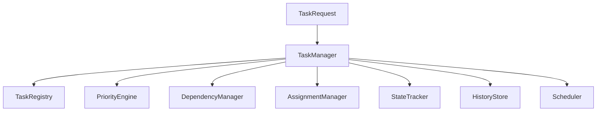

# RFC-0036

**Title:** Task Management System

**Document ID:** RFC-0036

**Version:** 1.0

**Status:** Accepted

**Category:** Platform

**Layer:** Platform

**Target:**

```text
platform/task_manager/
```

---

# Abstract

This RFC defines the SH-3 Task Management System.

The Task Management System provides the execution unit management framework responsible for creating, organizing, prioritizing, assigning, tracking, and completing tasks generated by workflows, agents, planning systems, and autonomous processes.

The system enables:

- task definition
- task lifecycle management
- task prioritization
- dependency handling
- task assignment
- execution tracking
- retry management
- task history preservation
- autonomous task generation

The Task Management System integrates with:

- Workflow Engine System
- Scheduler System
- Agent System
- Message Bus System
- Planning System
- Memory System
- Learning System
- Persistence System
- Observability System

This document is normative.

---

# Motivation

An autonomous intelligence system requires precise management of individual execution units.

Without a Task Management System:

- workflow steps become difficult to control
- execution priorities become unclear
- resources cannot be allocated efficiently
- failures cannot be analyzed
- task experiences cannot improve future behavior

The Task Management System provides structured task execution control.

---

# Goals

The Task Management System SHALL provide:

- task creation
- task classification
- task prioritization
- task assignment
- task state tracking
- dependency management
- execution history
- retry handling
- performance analysis

---

# Non-Goals

The Task Management System SHALL NOT:

- decide system goals
- replace Planning System
- execute complex workflows
- replace Scheduler System
- implement domain-specific actions

Planning creates intent.

Workflow organizes processes.

Task Management controls execution units.

---

# Architecture



The Task Management System transforms objectives into manageable execution units.

---

# Design Principles

The Task Management System follows these principles.

---

## Atomic Execution

Tasks SHALL represent clear execution units.

---

## Observable

Task state SHALL always be measurable.

---

## Recoverable

Failed tasks SHALL support recovery.

---

## Prioritized

Important tasks SHALL receive appropriate resources.

---

## Composable

Tasks SHALL combine into larger workflows.

---

## Adaptive

Task management MAY improve based on experience.

---

# Task Management Components

The system consists of:

| Component | Responsibility |
|-----------|----------------|
| TaskManager | Coordination |
| TaskRegistry | Task storage |
| TaskParser | Definition handling |
| PriorityEngine | Priority calculation |
| DependencyManager | Dependency control |
| AssignmentManager | Worker selection |
| StateTracker | State management |
| RetryManager | Recovery |
| HistoryStore | Task history |

---

# TaskManager

TaskManager coordinates task operations.

Responsibilities:

- task creation
- lifecycle management
- assignment
- state transitions
- completion tracking

TaskManager does not execute task logic.

---

# Task Context

Every task execution receives an immutable TaskContext.

A TaskContext contains:

| Field | Description |
|--------|-------------|
| task_id | Identifier |
| workflow_id | Parent workflow |
| objective | Task goal |
| input | Task data |
| metadata | Additional information |

---

# Task Lifecycle

Every task follows:

```text
Created

↓

Validated

↓

Queued

↓

Assigned

↓

Running

↓

Completed
```

Failure path:

```text
Running

↓

Failed

↓

Retrying

↓

Completed / Cancelled
```

---

# Task Definition

A Task contains:

| Field | Description |
|--------|-------------|
| task_id | Identifier |
| type | Task category |
| priority | Importance |
| action | Execution target |
| dependencies | Required tasks |
| timeout | Execution limit |
| retry_policy | Recovery rules |

---

# Task Types

Supported task categories:

| Type | Purpose |
|------|---------|
| Compute | Processing |
| Analysis | Reasoning |
| Tool | External operation |
| Communication | Messaging |
| Learning | Model improvement |
| Maintenance | System operation |

---

# Task Priority Model

Priority considers:

```text
Importance

+

Urgency

+

Dependency

+

Resource Requirement

+

System Policy
```

---

# Priority Levels

Supported priorities:

| Level | Usage |
|------|-------|
| Critical | Recovery / Safety |
| High | User objectives |
| Normal | Standard execution |
| Low | Background tasks |

---

# Task Queue

TaskManager maintains execution queues.

Queues include:

- waiting tasks
- active tasks
- retry tasks
- completed tasks

---

# Task Dependency Management

DependencyManager controls task relationships.

Functions:

- dependency validation
- execution ordering
- blocking detection

---

# Dependency Model

Example:

```text
Task A

↓

Task B

↓

Task C
```

Task B cannot execute before Task A completion.

---

# Assignment Management

AssignmentManager selects execution targets.

Targets include:

- agents
- plugins
- workers
- services

---

# Assignment Factors

Selection considers:

- capability match
- availability
- workload
- priority
- historical performance

---

# Scheduler Integration

Scheduler System provides:

- execution timing
- resource allocation
- queue control

---

# Workflow Integration

Workflow Engine creates tasks from workflow definitions.

Flow:

```text
Workflow

↓

Task Generation

↓

Task Management

↓

Execution
```

---

# Task Management Execution Model

The Task Management System transforms workflow definitions and objectives into controlled, observable, and recoverable execution units.

The task execution cycle follows:


Each stage maintains a clear architectural responsibility.

---

# Task Control Loop

The Task Management System operates through continuous task lifecycle control.

```text
Receive Task Request

↓

Validate Task

↓

Calculate Priority

↓

Resolve Dependencies

↓

Assign Executor

↓

Execute Task

↓

Evaluate Result

↓

Store History
```

---

# Task State Machine

The Task Management System uses a state machine for deterministic execution.

A transition is defined as:

```text
Current State

+

Event

+

Condition

=

Next State
```

---

# Task States

Supported states:

| State | Description |
|------|-------------|
| Created | Task initialized |
| Validating | Checking requirements |
| Queued | Waiting execution |
| Assigned | Executor selected |
| Running | Executing |
| Paused | Temporarily stopped |
| Completed | Successful |
| Failed | Error |
| Cancelled | Terminated |
| Retrying | Recovery |

---

# State Transition Example

Normal execution:

```text
Created

↓

Validating

↓

Queued

↓

Assigned

↓

Running

↓

Completed
```

Failure execution:

```text
Running

↓

Failed

↓

Retrying

↓

Running

↓

Completed
```

---

# Task Execution Model

Task execution consists of:

```text
Preparation

↓

Execution

↓

Validation

↓

Result Recording
```

---

# Task Executor Interface

Executors SHALL provide:

```text
execute(task_context) -> result
```

Optional interfaces:

```text
estimate()

validate()

cancel()

recover()
```

---

# Task Result Model

A TaskResult contains:

| Field | Description |
|--------|-------------|
| task_id | Task identifier |
| status | Result status |
| output | Execution result |
| metrics | Performance data |
| timestamp | Completion time |

---

# Task Failure Handling

Task failures include:

- timeout
- executor unavailable
- dependency failure
- invalid input
- resource shortage

---

# Failure Classification

Failures are classified:

| Type | Handling |
|------|----------|
| Temporary | Retry |
| Recoverable | Alternative executor |
| Permanent | Cancel |
| Critical | Escalate |

---

# Retry Strategy

RetryManager controls task retries.

Retry methods:

- immediate retry
- delayed retry
- exponential backoff
- executor replacement

---

# Retry Policy

A RetryPolicy contains:

| Field | Description |
|--------|-------------|
| max_attempts | Retry limit |
| delay | Wait time |
| strategy | Retry method |
| fallback | Alternative action |

---

# Task Recovery

Recovery process:

```text
Detect Failure

↓

Analyze Cause

↓

Select Recovery

↓

Retry / Replace

↓

Validate Result
```

---

# Task Cancellation

Tasks may be cancelled when:

- objective changes
- higher priority task interrupts
- resource constraints occur
- security policy blocks execution

---

# Task History

HistoryStore preserves:

- execution records
- failures
- retries
- performance
- outcomes

---

# Task Experience Model

Historical task data improves:

- future assignment
- priority calculation
- execution planning
- failure prediction

---

# Planning Integration

Planning System uses task information for:

- feasibility estimation
- execution cost prediction
- plan refinement

---

# Workflow Integration

Workflow Engine uses task status for:

- dependency resolution
- workflow progression
- recovery decisions

---

# Agent Integration

Agents receive tasks based on:

- capability
- workload
- reliability
- specialization

---

# Plugin Integration

Plugins may provide task executors.

Examples:

- tool execution
- analysis modules
- external interfaces

---

# Learning Integration

Learning System improves task management.

Learning targets:

- priority prediction
- executor selection
- retry strategy
- execution optimization

---

# Memory Integration

Memory System stores:

- successful task patterns
- failure experiences
- execution strategies

---

# Knowledge Integration

Knowledge System extracts:

- task relationships
- execution rules
- operational knowledge

---

# Optimizer Integration

Optimizer improves:

- queue ordering
- resource distribution
- assignment strategy
- execution efficiency

---

# Self-Healing Integration

Self-Healing manages:

- failed executor detection
- task recovery
- alternative execution
- system restoration

---

# Autonomous Task Generation

SH-3 may generate tasks autonomously.

Generation flow:

```text
Goal

↓

Planning

↓

Task Decomposition

↓

Validation

↓

Execution
```

---

# Task Decomposition

Complex objectives may become:

```text
Large Goal

↓

Sub Goal

↓

Task

↓

Action
```

---

# Task Event Model

Task events include:

- TaskCreated
- TaskValidated
- TaskQueued
- TaskAssigned
- TaskStarted
- TaskCompleted
- TaskFailed
- TaskRetried
- TaskCancelled

---

# Message Bus Integration

All task events are distributed through Message Bus.

Benefits:

- asynchronous execution
- distributed processing
- event replay
- monitoring

---

# Persistence Integration

Persistence stores:

- task definitions
- execution states
- task history
- recovery checkpoints

---

# Observability Integration

Task telemetry includes:

- task duration
- success rate
- failure rate
- queue length
- executor performance

---

# Tracing

Task traces preserve:

- trace_id
- task_id
- workflow_id
- executor_id
- parent_task_id

---

# Thread Model

The Task Management System supports concurrent:

- task creation
- queue processing
- assignment
- execution monitoring
- recovery

Task state transitions SHALL be synchronized.

The reference implementation shall be thread-safe.

---

# Metrics

The Task Management System exposes:

- active tasks
- completed tasks
- failure rate
- retry count
- average execution time
- executor utilization

---

# Performance Objectives

The Task Management System should optimize for:

- efficient execution
- accurate prioritization
- reliable recovery
- scalable task processing
- autonomous operation

---

# Future Work

Potential future enhancements include:

- AI-based task decomposition
- predictive task scheduling
- autonomous executor creation
- self-optimizing task graphs
- adaptive workload management

These enhancements extend SH-3 autonomous execution while preserving reliability.

---

# References

- SH-3 Architecture Specification v2.1
- RFC-0013 Capability System
- RFC-0014 Registry System
- RFC-0015 Scheduler System
- RFC-0016 Pipeline System
- RFC-0017 Configuration System
- RFC-0018 Security System
- RFC-0019 Observability System
- RFC-0020 Distributed Cluster System
- RFC-0021 Agent System
- RFC-0022 Knowledge System
- RFC-0023 World Model System
- RFC-0024 Cognitive Architecture System
- RFC-0025 Meta Controller System
- RFC-0026 Self Evolution System
- RFC-0027 Autonomous Learning System
- RFC-0028 Optimizer System
- RFC-0029 Self-Healing System
- RFC-0030 Persistence System
- RFC-0031 Deployment System
- RFC-0032 Plugin System
- RFC-0033 API Gateway System
- RFC-0034 Message Bus System
- RFC-0035 Workflow Engine System

---

# End of RFC-0036
