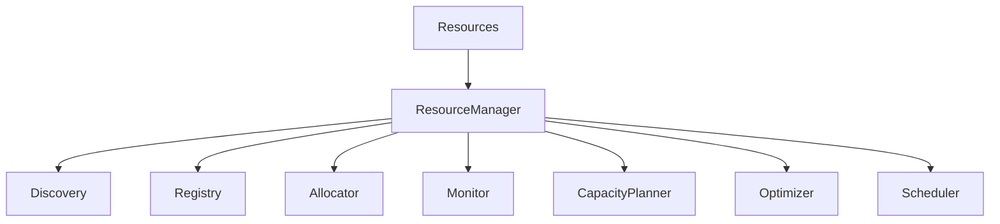

# RFC-0037

**Title:** Resource Management System

**Document ID:** RFC-0037

**Version:** 1.0

**Status:** Accepted

**Category:** Platform

**Layer:** Platform

**Target:**

```text
platform/resource_manager/
```

---

# Abstract

This RFC defines the SH-3 Resource Management System.

The Resource Management System provides the autonomous resource control framework responsible for discovering, allocating, monitoring, optimizing, and adapting system resources required for SH-3 operations.

The system manages:

- CPU resources
- GPU resources
- memory resources
- storage resources
- network resources
- agent capacity
- plugin capacity
- execution quotas

The system enables:

- resource discovery
- dynamic allocation
- workload balancing
- capacity management
- performance optimization
- autonomous scaling

The Resource Management System integrates with:

- Scheduler System
- Task Management System
- Workflow Engine System
- Optimizer System
- Self-Healing System
- Deployment System
- Observability System
- Configuration System
- Distributed Cluster System

This document is normative.

---

# Motivation

An autonomous intelligence system must manage limited computational resources efficiently.

Without a Resource Management System:

- workloads compete uncontrollably
- important tasks may be delayed
- resource exhaustion may occur
- scaling decisions become manual
- optimization becomes impossible

The Resource Management System provides intelligent resource coordination.

---

# Goals

The Resource Management System SHALL provide:

- resource discovery
- resource registration
- allocation control
- utilization monitoring
- quota enforcement
- workload balancing
- scaling support
- optimization feedback

---

# Non-Goals

The Resource Management System SHALL NOT:

- execute tasks directly
- define task priorities
- replace Scheduler System
- replace Optimizer System
- control hardware drivers directly

Resource Management provides availability.

Scheduler decides timing.

Optimizer improves strategy.

---

# Architecture



The Resource Management System transforms raw resources into controlled execution capacity.

---

# Design Principles

The Resource Management System follows these principles.

---

## Efficiency

Resources SHALL be utilized effectively.

---

## Isolation

Resource usage SHALL remain controlled.

---

## Adaptability

Allocation MAY change according to workload.

---

## Predictability

Critical workloads SHALL receive guaranteed resources.

---

## Scalability

The system SHALL support distributed resources.

---

## Observability

All resource states SHALL be measurable.

---

# Resource Management Components

The system consists of:

| Component | Responsibility |
|-----------|----------------|
| ResourceManager | Coordination |
| ResourceDiscovery | Detection |
| ResourceRegistry | Storage |
| ResourceAllocator | Allocation |
| ResourceMonitor | Monitoring |
| CapacityPlanner | Forecasting |
| QuotaManager | Limits |
| LoadBalancer | Distribution |
| ScalingManager | Expansion |

---

# ResourceManager

ResourceManager coordinates all resource operations.

Responsibilities:

- resource lifecycle
- allocation decisions
- policy enforcement
- monitoring integration

ResourceManager does not execute workloads.

---

# Resource Context

Every resource operation receives an immutable ResourceContext.

A ResourceContext contains:

| Field | Description |
|--------|-------------|
| resource_id | Resource identifier |
| resource_type | Resource category |
| owner | Current consumer |
| allocation | Assigned capacity |
| timestamp | Operation time |

---

# Resource Model

A Resource contains:

| Field | Description |
|--------|-------------|
| resource_id | Identifier |
| type | Resource type |
| capacity | Total capacity |
| available | Available capacity |
| status | Current state |

---

# Resource Types

Supported resources:

| Type | Example |
|------|---------|
| CPU | Compute cores |
| GPU | Accelerator |
| Memory | RAM / VRAM |
| Storage | Persistent data |
| Network | Communication |
| Agent | Execution ability |
| Plugin | Capability provider |

---

# Resource Discovery

ResourceDiscovery detects available resources.

Discovery sources:

- local machine
- distributed nodes
- containers
- agents
- plugins

---

# Resource Registration

Discovered resources are registered.

Registration stores:

- identity
- capacity
- capability
- availability
- performance data

---

# Resource Registry

ResourceRegistry provides:

- lookup
- status tracking
- history
- capability matching

---

# Resource Allocation

ResourceAllocator assigns resources.

Allocation considers:

- task requirement
- priority
- availability
- performance
- policy

---

# Allocation Model

Example:

```text
Task Request

↓

Resource Evaluation

↓

Allocation Decision

↓

Resource Reservation

↓

Execution
```

---

# Resource Reservation

Resources may be reserved before execution.

Reservation prevents:

- resource conflicts
- execution failure
- priority inversion

---

# Quota Management

QuotaManager controls resource limits.

Quotas apply to:

- users
- agents
- plugins
- workflows
- tasks

---

# Resource Monitoring

ResourceMonitor tracks:

- utilization
- availability
- performance
- failures

---

# Scheduler Integration

Scheduler System uses resource information for:

- execution planning
- task placement
- workload timing

---

# Task Management Integration

Task Management requests resources based on:

- task requirements
- priority
- expected cost

---

# Resource Management Execution Model

The Resource Management System transforms available infrastructure into dynamically controlled execution capacity for SH-3 autonomous operations.

The resource control cycle follows:


Each stage maintains a clear architectural responsibility.

---

# Resource Control Loop

The Resource Management System operates through continuous resource optimization.

```text
Discover Resources

↓

Analyze Availability

↓

Predict Demand

↓

Allocate Capacity

↓

Monitor Usage

↓

Optimize Distribution

↓

Adapt Allocation
```

---

# Dynamic Resource Allocation

The Resource Management System supports dynamic allocation.

Allocation may change according to:

- workload demand
- task priority
- system health
- execution prediction
- optimization policy

---

# Allocation Strategy

Resource allocation considers:

```text
Task Importance

+

Resource Requirement

+

Current Load

+

Future Demand

+

System Policy
```

---

# Allocation Policies

Supported policies:

| Policy | Purpose |
|------|---------|
| Priority Based | Important tasks first |
| Fair Share | Balanced distribution |
| Performance Based | Fast execution |
| Energy Aware | Efficiency optimization |
| Adaptive | Dynamic decision |

---

# Resource Scheduling Integration

Scheduler System receives:

- resource availability
- allocation limits
- execution cost
- node capability

Scheduler selects execution timing.

Resource Manager selects capacity.

---

# Load Balancing

LoadBalancer distributes workloads.

Balancing targets:

- compute nodes
- agents
- plugins
- execution workers

---

# Load Balancing Factors

Selection considers:

- CPU utilization
- GPU utilization
- memory pressure
- network latency
- task history
- node reliability

---

# Load Distribution Model

```text
Workload Increase

↓

Detect Pressure

↓

Find Available Capacity

↓

Move / Assign Workload

↓

Monitor Result
```

---

# Capacity Planning

CapacityPlanner predicts future resource requirements.

Prediction inputs:

- workload history
- task patterns
- workflow trends
- learning data

---

# Capacity Forecasting

Forecast targets:

- CPU demand
- GPU demand
- memory requirement
- storage growth
- network traffic

---

# Resource Prediction Integration

Learning System improves prediction accuracy.

Learning sources:

- historical usage
- successful allocations
- failed allocations
- performance results

---

# Dynamic Scaling

ScalingManager controls resource expansion.

Scaling actions:

- add resources
- remove idle resources
- activate standby nodes
- redistribute workloads

---

# Scaling Model

```text
Demand Increase

↓

Capacity Evaluation

↓

Scaling Decision

↓

Resource Activation

↓

Load Redistribution
```

---

# Autonomous Scaling Rules

Scaling decisions consider:

- urgency
- performance target
- available capacity
- cost policy
- reliability requirements

---

# Cost Optimization

The Resource Management System optimizes resource cost.

Optimization targets:

- idle resources
- unnecessary allocation
- inefficient execution
- excessive reservation

---

# Cost Optimization Model

```text
Usage Analysis

↓

Identify Waste

↓

Optimize Allocation

↓

Measure Improvement
```

---

# Resource Isolation

Resource isolation prevents conflicts.

Isolation mechanisms:

- quotas
- reservations
- execution boundaries
- priority protection

---

# Priority Protection

Critical workloads receive protected resources.

Examples:

- recovery operations
- security processes
- user requests
- core intelligence operations

---

# Resource Failure Handling

Resource failures include:

- unavailable node
- hardware failure
- capacity exhaustion
- communication loss

---

# Failure Recovery

Recovery process:

```text
Detect Failure

↓

Remove Resource

↓

Find Replacement

↓

Migrate Workload

↓

Restore Operation
```

---

# Self-Healing Integration

Self-Healing System uses resource information for:

- failed resource detection
- replacement selection
- workload migration
- capacity restoration

---

# Deployment Integration

Deployment System uses resource information for:

- deployment placement
- scaling
- environment validation

---

# Distributed Cluster Integration

Distributed Cluster System provides:

- remote resources
- node information
- network topology
- availability state

---

# Plugin Integration

Plugins may expose resource capabilities.

Examples:

- external API capacity
- specialized processors
- domain services

---

# Agent Integration

Agents are managed as execution resources.

Agent resource information:

- capability
- availability
- reliability
- specialization

---

# Memory Integration

Memory stores:

- allocation history
- optimization patterns
- resource behavior

---

# Knowledge Integration

Knowledge System extracts:

- resource rules
- infrastructure patterns
- optimization knowledge

---

# Optimizer Integration

Optimizer improves:

- allocation strategy
- scaling decisions
- workload placement
- efficiency

---

# Self Evolution Integration

Self Evolution may improve resource policies.

Evolution cycle:

```text
Resource Problem

↓

New Policy

↓

Simulation

↓

Validation

↓

Deployment
```

---

# Event Model

Resource events include:

- ResourceDiscovered
- ResourceRegistered
- ResourceAllocated
- ResourceReleased
- ResourceOverloaded
- ResourceFailed
- ResourceRecovered

---

# Message Bus Integration

Resource events are published through Message Bus.

Benefits:

- distributed awareness
- automatic reactions
- monitoring
- recovery triggering

---

# Persistence Integration

Persistence stores:

- resource registry
- allocation history
- capacity models
- scaling decisions

---

# Observability Integration

Resource telemetry includes:

- utilization
- allocation
- latency
- failures
- scaling events

---

# Tracing

Resource traces preserve:

- trace_id
- resource_id
- task_id
- workflow_id
- allocation_id

---

# Thread Model

The Resource Management System supports concurrent:

- discovery
- monitoring
- allocation
- scaling
- recovery

Resource state updates SHALL be synchronized.

The reference implementation shall be thread-safe.

---

# Metrics

The Resource Management System exposes:

- CPU utilization
- GPU utilization
- memory usage
- allocation efficiency
- scaling frequency
- resource failure rate

---

# Performance Objectives

The Resource Management System should optimize for:

- efficient utilization
- reliable allocation
- adaptive scaling
- predictable performance
- autonomous operation

---

# Future Work

Potential future enhancements include:

- AI-based resource prediction
- autonomous infrastructure planning
- self-optimizing clusters
- energy-aware resource intelligence
- fully autonomous capacity evolution

These enhancements extend SH-3 infrastructure autonomy while preserving stability.

---

# References

- SH-3 Architecture Specification v2.1
- RFC-0013 Capability System
- RFC-0014 Registry System
- RFC-0015 Scheduler System
- RFC-0016 Pipeline System
- RFC-0017 Configuration System
- RFC-0018 Security System
- RFC-0019 Observability System
- RFC-0020 Distributed Cluster System
- RFC-0021 Agent System
- RFC-0022 Knowledge System
- RFC-0023 World Model System
- RFC-0024 Cognitive Architecture System
- RFC-0025 Meta Controller System
- RFC-0026 Self Evolution System
- RFC-0027 Autonomous Learning System
- RFC-0028 Optimizer System
- RFC-0029 Self-Healing System
- RFC-0030 Persistence System
- RFC-0031 Deployment System
- RFC-0032 Plugin System
- RFC-0033 API Gateway System
- RFC-0034 Message Bus System
- RFC-0035 Workflow Engine System
- RFC-0036 Task Management System

---

# End of RFC-0037
