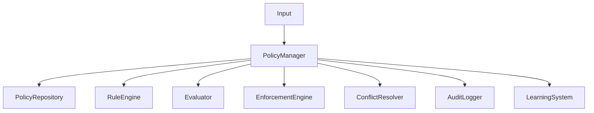

# RFC-0038

**Title:** Policy Management System

**Document ID:** RFC-0038

**Version:** 1.0

**Status:** Accepted

**Category:** Platform

**Layer:** Governance

**Target:**

```text
governance/policy_manager/
```

---

# Abstract

This RFC defines the SH-3 Policy Management System.

The Policy Management System provides the governance framework responsible for defining, storing, evaluating, enforcing, and evolving policies that control SH-3 behavior.

The system manages:

- operational policies
- security policies
- execution policies
- resource policies
- priority policies
- safety policies
- adaptation policies

The system enables:

- policy definition
- policy evaluation
- rule execution
- policy enforcement
- conflict resolution
- policy auditing
- adaptive policy improvement

The Policy Management System integrates with:

- Security System
- Resource Management System
- Task Management System
- Workflow Engine System
- Scheduler System
- Agent System
- Learning System
- Memory System
- Self Evolution System
- Observability System

This document is normative.

---

# Motivation

An autonomous intelligence system requires consistent behavioral control.

Without centralized policy management:

- different modules may make conflicting decisions
- safety constraints become fragmented
- resource usage becomes uncontrolled
- execution behavior becomes unpredictable
- system evolution becomes risky

The Policy Management System provides a unified governance layer.

---

# Goals

The Policy Management System SHALL provide:

- centralized policy control
- rule evaluation
- policy enforcement
- priority resolution
- conflict handling
- auditability
- adaptive improvement

---

# Non-Goals

The Policy Management System SHALL NOT:

- replace reasoning systems
- generate primary goals
- execute tasks directly
- override security boundaries
- replace Learning System

Policy controls behavior.

Planning determines objectives.

Execution performs actions.

---

# Architecture



The Policy Management System transforms abstract rules into executable governance decisions.

---

# Design Principles

The Policy Management System follows these principles.

---

## Consistency

Policies SHALL provide uniform system behavior.

---

## Priority

Higher-priority policies SHALL override lower-priority policies.

---

## Transparency

Policy decisions SHALL be explainable.

---

## Safety

Critical restrictions SHALL always be enforced.

---

## Adaptability

Policies MAY evolve through validated learning.

---

## Separation

Policy definition and execution logic SHALL remain independent.

---

# Policy Management Components

The system consists of:

| Component | Responsibility |
|-----------|----------------|
| PolicyManager | Coordination |
| PolicyRepository | Storage |
| PolicyParser | Definition handling |
| RuleEngine | Rule execution |
| PolicyEvaluator | Decision calculation |
| EnforcementEngine | Application |
| ConflictResolver | Conflict handling |
| PolicyMonitor | Observation |
| AuditLogger | History |

---

# PolicyManager

PolicyManager coordinates policy operations.

Responsibilities:

- policy lifecycle
- evaluation requests
- enforcement decisions
- policy synchronization

PolicyManager does not implement domain behavior.

---

# Policy Context

Every policy evaluation receives an immutable PolicyContext.

A PolicyContext contains:

| Field | Description |
|--------|-------------|
| context_id | Evaluation identifier |
| actor | Request origin |
| action | Requested operation |
| resource | Target resource |
| state | Current system state |
| timestamp | Evaluation time |

---

# Policy Model

A Policy contains:

| Field | Description |
|--------|-------------|
| policy_id | Identifier |
| name | Policy name |
| type | Policy category |
| priority | Importance |
| rules | Conditions |
| actions | Responses |
| version | Revision |

---

# Policy Types

Supported policy categories:

| Type | Purpose |
|------|---------|
| Security | Access control |
| Safety | Risk prevention |
| Execution | Operation rules |
| Resource | Capacity control |
| Priority | Scheduling |
| Learning | Adaptation rules |
| Evolution | Self modification |

---

# Policy Lifecycle

Every policy follows:

```text
Created

↓

Validated

↓

Approved

↓

Active

↓

Updated

↓

Deprecated
```

---

# Policy Repository

PolicyRepository stores:

- active policies
- policy versions
- approval history
- evaluation records

---

# Policy Definition

Policies consist of:

```text
Condition

+

Rule

+

Action

+

Priority
```

Example:

```text
IF resource_usage > limit

THEN reduce allocation
```

---

# Rule Engine

RuleEngine evaluates policy conditions.

Responsibilities:

- condition checking
- rule matching
- action generation

---

# Policy Evaluation

Evaluation process:

```text
Receive Request

↓

Load Applicable Policies

↓

Evaluate Rules

↓

Resolve Conflicts

↓

Generate Decision
```

---

# Policy Decision Model

A decision contains:

| Field | Description |
|--------|-------------|
| decision_id | Identifier |
| result | Allow / Deny / Modify |
| reason | Explanation |
| applied_policy | Policy source |

---

# Enforcement Engine

EnforcementEngine applies decisions.

Actions include:

- allow operation
- deny operation
- modify parameters
- request approval
- trigger recovery

---

# Priority Management

Policies have priority levels.

Example:

| Priority | Purpose |
|----------|---------|
| Critical | Safety / Security |
| High | System integrity |
| Normal | Standard operation |
| Low | Optimization |

---

# Conflict Resolution

ConflictResolver handles:

- contradictory rules
- overlapping policies
- priority differences

Resolution order:

```text
Safety

>

Security

>

System Integrity

>

Optimization

```

---

# Security Integration

Security System provides:

- identity information
- permissions
- access context

Policy System decides:

- allowed action
- restricted action
- required approval

---

# Task Integration

Task Management uses policies for:

- execution permission
- priority adjustment
- resource limits

---

# Workflow Integration

Workflow Engine uses policies for:

- process validation
- execution constraints
- approval requirements

---

# Policy Management Execution Model

The Policy Management System transforms governance rules into consistent, safe, and adaptive behavioral control for SH-3 operations.

The policy decision cycle follows:


Each stage maintains a clear architectural responsibility.

---

# Policy Control Loop

The Policy Management System operates through continuous governance control.

```text
Receive Action Request

↓

Collect Context

↓

Evaluate Policies

↓

Resolve Conflicts

↓

Generate Decision

↓

Apply Enforcement

↓

Record Result

↓

Improve Policy
```

---

# Safety Policy Model

Safety policies define operational boundaries.

Safety targets:

- dangerous operations
- system integrity
- irreversible actions
- resource protection
- autonomous modification limits

---

# Safety Evaluation

Safety evaluation process:

```text
Action Request

↓

Risk Analysis

↓

Safety Policy Check

↓

Allow / Restrict / Block
```

---

# Safety Levels

Supported safety classifications:

| Level | Description |
|------|-------------|
| Critical | Immediate protection |
| High | Restricted execution |
| Medium | Additional validation |
| Low | Normal operation |

---

# Permission Policy Model

Permission policies control access.

Controlled objects:

- users
- agents
- plugins
- services
- resources
- APIs

---

# Permission Decision

Permission evaluation considers:

```text
Identity

+

Capability

+

Requested Action

+

Current Context

+

Policy Rules
```

---

# Execution Policy Model

Execution policies control operational behavior.

Examples:

- task timeout
- retry limit
- resource allocation
- execution environment
- priority adjustment

---

# Resource Policy Model

Resource policies define:

- quota
- reservation
- allocation limits
- scaling rules

Example:

```text
IF GPU usage > threshold

THEN redistribute workload
```

---

# Adaptive Policy System

The Policy Management System supports adaptive policies.

Adaptive policies may use:

- execution history
- performance metrics
- learning results
- system conditions

---

# Adaptive Policy Cycle

```text
Observe Behavior

↓

Analyze Outcome

↓

Generate Improvement

↓

Validate Change

↓

Activate Policy
```

---

# Policy Simulation

Before activation, policies MAY be simulated.

Simulation evaluates:

- expected impact
- conflicts
- safety risks
- performance changes

---

# Policy Validation

Validation checks:

- syntax
- logical consistency
- security requirements
- compatibility

---

# Policy Learning Integration

Learning System improves policies.

Learning sources:

- execution results
- failures
- human feedback
- optimization outcomes

---

# Policy Learning Targets

Targets include:

- better decisions
- reduced conflicts
- improved efficiency
- improved safety

---

# Memory Integration

Memory System stores:

- policy history
- successful decisions
- failed decisions
- behavioral patterns

---

# Knowledge Integration

Knowledge System extracts:

- governance patterns
- operational rules
- causal relationships

---

# Optimizer Integration

Optimizer improves:

- policy priority
- rule efficiency
- conflict resolution
- execution impact

---

# Self-Healing Integration

Self-Healing uses policies for:

- recovery authorization
- emergency actions
- resource protection

---

# Self Evolution Integration

Self Evolution may modify policies.

Evolution process:

```text
Identify Limitation

↓

Create Policy Proposal

↓

Simulation

↓

Validation

↓

Approval

↓

Deployment
```

---

# Autonomous Policy Generation

SH-3 may generate policies from observations.

Generation sources:

- repeated failures
- optimization discoveries
- security analysis
- operational patterns

---

# Policy Governance

Policy changes require governance control.

Governance stages:

```text
Proposal

↓

Evaluation

↓

Simulation

↓

Approval

↓

Activation
```

---

# Policy Versioning

Policies maintain versions.

Version history includes:

- previous rules
- modification reason
- evaluation results
- approval information

---

# Policy Rollback

Failed policy updates support rollback.

Rollback restores:

- previous version
- previous behavior
- previous constraints

---

# Event Model

Policy events include:

- PolicyCreated
- PolicyValidated
- PolicyActivated
- PolicyUpdated
- PolicyRejected
- PolicyRolledBack

---

# Message Bus Integration

Policy events are distributed through Message Bus.

Benefits:

- system awareness
- audit
- synchronization
- automated reaction

---

# Persistence Integration

Persistence stores:

- policies
- versions
- evaluation results
- decisions
- audit records

---

# Observability Integration

Policy telemetry includes:

- evaluation count
- allow rate
- deny rate
- conflict frequency
- policy effectiveness

---

# Tracing

Policy traces preserve:

- trace_id
- decision_id
- policy_id
- actor_id
- action_id

---

# Thread Model

The Policy Management System supports concurrent:

- policy evaluation
- rule execution
- decision generation
- monitoring
- updates

Policy updates SHALL be synchronized.

The reference implementation shall be thread-safe.

---

# Metrics

The Policy Management System exposes:

- active policies
- evaluation requests
- decision latency
- policy conflicts
- blocked actions
- adaptation frequency

---

# Performance Objectives

The Policy Management System should optimize for:

- fast decisions
- consistent behavior
- safety preservation
- explainability
- adaptive governance

---

# Future Work

Potential future enhancements include:

- AI-generated governance rules
- predictive policy evaluation
- autonomous compliance management
- formal policy verification
- self-evolving governance frameworks

These enhancements extend SH-3 autonomous governance while preserving safety and control.

---

# References

- SH-3 Architecture Specification v2.1
- RFC-0013 Capability System
- RFC-0014 Registry System
- RFC-0015 Scheduler System
- RFC-0016 Pipeline System
- RFC-0017 Configuration System
- RFC-0018 Security System
- RFC-0019 Observability System
- RFC-0020 Distributed Cluster System
- RFC-0021 Agent System
- RFC-0022 Knowledge System
- RFC-0023 World Model System
- RFC-0024 Cognitive Architecture System
- RFC-0025 Meta Controller System
- RFC-0026 Self Evolution System
- RFC-0027 Autonomous Learning System
- RFC-0028 Optimizer System
- RFC-0029 Self-Healing System
- RFC-0030 Persistence System
- RFC-0031 Deployment System
- RFC-0032 Plugin System
- RFC-0033 API Gateway System
- RFC-0034 Message Bus System
- RFC-0035 Workflow Engine System
- RFC-0036 Task Management System
- RFC-0037 Resource Management System

---

# End of RFC-0038
