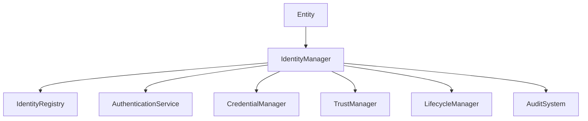

# RFC-0039

**Title:** Identity Management System

**Document ID:** RFC-0039

**Version:** 1.0

**Status:** Accepted

**Category:** Platform

**Layer:** Security / Governance

**Target:**

```text
security/identity_manager/
```

---

# Abstract

This RFC defines the SH-3 Identity Management System.

The Identity Management System provides the identity foundation responsible for identifying, registering, authenticating, tracking, and managing trust relationships among all entities participating in the SH-3 ecosystem.

The system manages identities for:

- users
- agents
- services
- plugins
- nodes
- external systems
- autonomous components

The system enables:

- identity registration
- authentication
- authorization integration
- credential management
- trust evaluation
- identity lifecycle management
- identity auditing

The Identity Management System integrates with:

- Security System
- Policy Management System
- Agent System
- Plugin System
- API Gateway System
- Distributed Cluster System
- Message Bus System
- Persistence System
- Learning System
- Self Evolution System

This document is normative.

---

# Motivation

An autonomous system requires reliable identification of all participating entities.

Without Identity Management:

- components cannot be trusted
- permissions cannot be controlled
- malicious behavior cannot be isolated
- audit trails become unreliable
- autonomous agents cannot establish relationships

The Identity Management System provides the foundation of trust.

---

# Goals

The Identity Management System SHALL provide:

- unique identity representation
- authentication mechanisms
- identity lifecycle management
- trust tracking
- credential handling
- security integration
- audit support

---

# Non-Goals

The Identity Management System SHALL NOT:

- execute authorization decisions alone
- replace Policy Management System
- implement business logic
- perform task execution
- replace Security System

Identity answers:

"Who is this entity?"

Policy answers:

"What may this entity do?"

---

# Architecture



The Identity Management System transforms unknown entities into verified participants.

---

# Design Principles

The Identity Management System follows these principles.

---

## Uniqueness

Every entity SHALL have a unique identity.

---

## Verifiability

Identity claims SHALL be verifiable.

---

## Least Privilege

Identities SHALL receive minimum required access.

---

## Traceability

Identity activities SHALL be auditable.

---

## Adaptability

Trust MAY evolve based on behavior.

---

## Isolation

Compromised identities SHALL be containable.

---

# Identity Management Components

The system consists of:

| Component | Responsibility |
|-----------|----------------|
| IdentityManager | Coordination |
| IdentityRegistry | Storage |
| AuthenticationService | Verification |
| CredentialManager | Credential control |
| TrustManager | Trust evaluation |
| LifecycleManager | Identity lifecycle |
| IdentityMonitor | Observation |
| AuditLogger | History |

---

# IdentityManager

IdentityManager coordinates identity operations.

Responsibilities:

- registration
- lookup
- verification
- lifecycle control
- trust synchronization

IdentityManager does not decide permissions.

---

# Identity Context

Every identity operation receives an immutable IdentityContext.

An IdentityContext contains:

| Field | Description |
|--------|-------------|
| identity_id | Identifier |
| entity_type | Entity category |
| source | Origin |
| timestamp | Operation time |
| trust_state | Current trust |

---

# Identity Model

An Identity contains:

| Field | Description |
|--------|-------------|
| identity_id | Unique identifier |
| name | Entity name |
| type | Entity category |
| owner | Controlling entity |
| credentials | Verification data |
| status | Lifecycle state |

---

# Identity Types

Supported identity categories:

| Type | Example |
|------|---------|
| User | Human operator |
| Agent | Autonomous agent |
| Service | Internal service |
| Plugin | Extension module |
| Node | Distributed machine |
| External | External system |

---

# Identity Lifecycle

Every identity follows:

```text
Created

↓

Registered

↓

Verified

↓

Active

↓

Suspended

↓

Revoked
```

---

# Identity Registration

Registration creates a new identity.

Required information:

- identity type
- metadata
- origin
- credentials
- ownership information

---

# Identity Registry

IdentityRegistry stores:

- identities
- status
- credentials reference
- history
- relationships

---

# Authentication Model

Authentication verifies identity claims.

Methods MAY include:

- credential verification
- cryptographic verification
- token validation
- certificate validation

---

# Authentication Flow

```text
Entity Request

↓

Identity Lookup

↓

Credential Verification

↓

Authentication Result

↓

Session Creation
```

---

# Credential Management

CredentialManager handles:

- creation
- storage reference
- rotation
- expiration
- revocation

---

# Credential Security

Credentials SHALL:

- avoid plaintext storage
- support expiration
- support rotation
- support revocation

---

# Trust Management

TrustManager evaluates entity reliability.

Trust factors:

- history
- behavior
- security events
- task success
- policy compliance

---

# Trust Model

Trust score considers:

```text
Past Behavior

+

Security History

+

Execution Reliability

+

Policy Compliance
```

---

# Agent Identity

Autonomous agents require persistent identity.

Agent identity tracks:

- capabilities
- origin
- behavior history
- trust level

---

# Service Identity

Internal services require identity for:

- communication
- authorization
- auditing

---

# Plugin Identity

Plugins receive identities for:

- capability control
- isolation
- security monitoring

---

# Security Integration

Security System provides:

- cryptographic mechanisms
- threat detection
- security policies

Identity System provides:

- entity verification
- trust information

---

# Policy Integration

Policy Management System uses identity information for:

- access decisions
- trust evaluation
- action restrictions

---

# API Gateway Integration

API Gateway uses identity for:

- external authentication
- request attribution
- audit tracking

---

# Identity Management Execution Model

The Identity Management System transforms entities into trusted participants through continuous verification, monitoring, and trust adaptation.

The identity lifecycle cycle follows:


Each stage maintains a clear architectural responsibility.

---

# Identity Control Loop

The Identity Management System operates through continuous trust management.

```text
Identity Created

↓

Registration

↓

Authentication

↓

Trust Evaluation

↓

Access Usage

↓

Behavior Monitoring

↓

Trust Update
```

---

# Authorization Integration

Identity Management provides identity information to authorization systems.

Authorization considers:

- identity
- role
- capability
- trust level
- current context

---

# Authorization Flow

```text
Request Action

↓

Identify Entity

↓

Collect Attributes

↓

Evaluate Policy

↓

Allow / Deny / Restrict
```

---

# Role Management

Identities MAY have assigned roles.

Examples:

| Role | Purpose |
|------|---------|
| Administrator | System management |
| Operator | Human operation |
| Agent | Autonomous execution |
| Service | Internal processing |
| Plugin | Extension capability |

---

# Attribute-Based Identity

SH-3 supports attribute-based identity evaluation.

Attributes include:

- capability
- ownership
- trust score
- execution history
- security status

---

# Identity Federation

Identity Federation allows trusted external identities.

Federation supports:

- external services
- distributed SH-3 nodes
- partner systems

---

# Federation Model

```text
External Identity

↓

Verification

↓

Trust Mapping

↓

Local Identity Association
```

---

# Identity Relationship Graph

The system maintains relationships:

```text
User

↓

Agent

↓

Service

↓

Plugin

↓

Resource
```

Relationships enable:

- ownership tracking
- trust propagation
- dependency analysis

---

# Trust Evolution

TrustManager continuously updates trust.

Trust changes based on:

- successful execution
- policy compliance
- failures
- security events

---

# Trust Update Model

```text
Observe Behavior

↓

Analyze Result

↓

Calculate Trust Change

↓

Update Identity State
```

---

# Trust Levels

Supported trust states:

| Level | Description |
|------|-------------|
| Verified | Fully trusted |
| Trusted | Normal operation |
| Limited | Restricted access |
| Suspicious | Additional verification |
| Revoked | Disabled |

---

# Agent Reputation System

Autonomous agents maintain reputation.

Reputation factors:

- task success rate
- reliability
- policy compliance
- resource usage
- collaboration history

---

# Agent Trust Model

Example:

```text
Successful Tasks

+

Reliable Behavior

+

Policy Compliance

-

Security Violations

=

Agent Reputation
```

---

# Credential Rotation

CredentialManager supports automatic rotation.

Rotation triggers:

- expiration
- security event
- policy requirement
- periodic maintenance

---

# Credential Recovery

Recovery process:

```text
Credential Failure

↓

Identity Verification

↓

Credential Reset

↓

Reauthentication
```

---

# Identity Suspension

Identities may be suspended when:

- compromise detected
- abnormal behavior observed
- policy violation occurs

---

# Identity Recovery

Recovery process:

```text
Suspicious Identity

↓

Investigation

↓

Validation

↓

Restore / Revoke
```

---

# Identity Learning Integration

Learning System improves identity decisions.

Learning targets:

- trust prediction
- anomaly detection
- relationship analysis
- reputation estimation

---

# Memory Integration

Memory stores:

- identity history
- trust changes
- authentication patterns
- relationship data

---

# Knowledge Integration

Knowledge System extracts:

- identity patterns
- trust rules
- security knowledge

---

# Self-Healing Integration

Self-Healing uses identity information for:

- compromised component isolation
- recovery authorization
- safe restoration

---

# Self Evolution Integration

Self Evolution may improve identity mechanisms.

Evolution cycle:

```text
Identity Problem

↓

New Verification Method

↓

Simulation

↓

Validation

↓

Deployment
```

---

# Message Bus Integration

Identity events are distributed through Message Bus.

Events include:

- IdentityCreated
- IdentityVerified
- AuthenticationSuccess
- AuthenticationFailure
- TrustUpdated
- IdentitySuspended
- IdentityRevoked

---

# Persistence Integration

Persistence stores:

- identity records
- trust history
- credentials metadata
- authentication logs

---

# Observability Integration

Identity telemetry includes:

- authentication attempts
- verification latency
- trust changes
- failed authentications
- suspicious activity

---

# Tracing

Identity traces preserve:

- trace_id
- identity_id
- request_id
- action_id
- policy_id

---

# Security Monitoring

Security monitoring analyzes:

- unusual access patterns
- identity misuse
- credential anomalies
- trust degradation

---

# Thread Model

The Identity Management System supports concurrent:

- registration
- authentication
- verification
- trust updates
- monitoring

Identity state changes SHALL be synchronized.

The reference implementation shall be thread-safe.

---

# Metrics

The Identity Management System exposes:

- active identities
- authentication success rate
- failed authentication count
- trust distribution
- revoked identities
- credential rotation count

---

# Performance Objectives

The Identity Management System should optimize for:

- fast verification
- reliable authentication
- accurate trust evaluation
- secure identity lifecycle
- scalable identity management

---

# Future Work

Potential future enhancements include:

- AI-based identity verification
- predictive trust management
- autonomous security reputation
- decentralized identity networks
- self-evolving authentication systems

These enhancements extend SH-3 trust infrastructure while preserving security and control.

---

# References

- SH-3 Architecture Specification v2.1
- RFC-0013 Capability System
- RFC-0014 Registry System
- RFC-0015 Scheduler System
- RFC-0016 Pipeline System
- RFC-0017 Configuration System
- RFC-0018 Security System
- RFC-0019 Observability System
- RFC-0020 Distributed Cluster System
- RFC-0021 Agent System
- RFC-0022 Knowledge System
- RFC-0023 World Model System
- RFC-0024 Cognitive Architecture System
- RFC-0025 Meta Controller System
- RFC-0026 Self Evolution System
- RFC-0027 Autonomous Learning System
- RFC-0028 Optimizer System
- RFC-0029 Self-Healing System
- RFC-0030 Persistence System
- RFC-0031 Deployment System
- RFC-0032 Plugin System
- RFC-0033 API Gateway System
- RFC-0034 Message Bus System
- RFC-0035 Workflow Engine System
- RFC-0036 Task Management System
- RFC-0037 Resource Management System
- RFC-0038 Policy Management System

---

# End of RFC-0039
