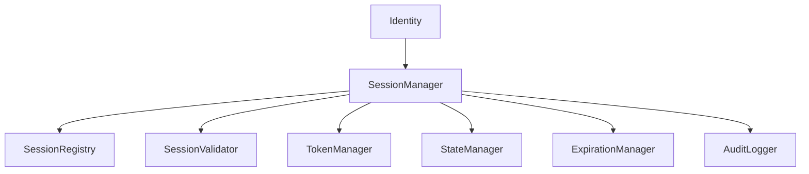
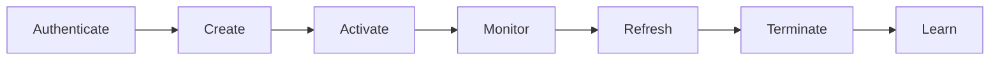

# RFC-0040

**Title:** Session Management System

**Document ID:** RFC-0040

**Version:** 1.0

**Status:** Accepted

**Category:** Platform

**Layer:** Security / Runtime

**Target:**

```text
security/session_manager/
```

---

# Abstract

This RFC defines the SH-3 Session Management System.

The Session Management System provides the runtime interaction control layer responsible for managing authenticated activity contexts between identities and SH-3 components.

The system manages:

- user sessions
- agent sessions
- service sessions
- plugin sessions
- distributed execution sessions
- temporary operation contexts

The system enables:

- session creation
- session validation
- session lifecycle control
- authentication binding
- session security
- timeout handling
- distributed session synchronization
- session auditing

The Session Management System integrates with:

- Identity Management System
- Security System
- Policy Management System
- API Gateway System
- Message Bus System
- Agent System
- Workflow Engine System
- Persistence System
- Observability System
- Learning System

This document is normative.

---

# Motivation

Identity verification alone is insufficient for autonomous system operation.

After an entity is authenticated, SH-3 requires controlled management of active interactions.

Without Session Management:

- authentication state cannot be maintained
- expired access may continue
- distributed operations become inconsistent
- activity tracking becomes difficult
- security response becomes slower

The Session Management System provides controlled runtime identity context.

---

# Goals

The Session Management System SHALL provide:

- session lifecycle management
- identity-session binding
- secure session tracking
- session expiration
- distributed synchronization
- activity auditing
- recovery support

---

# Non-Goals

The Session Management System SHALL NOT:

- authenticate identities directly
- define access policies
- execute tasks
- replace Identity Management System
- replace Security System

Identity answers:

"Who is this?"

Session answers:

"What active interaction is this entity performing?"

---

# Architecture



The Session Management System transforms verified identities into controlled runtime contexts.

---

# Design Principles

The Session Management System follows these principles.

---

## Security First

Sessions SHALL be protected against unauthorized use.

---

## Temporary Authority

Sessions SHALL have limited lifetime.

---

## Traceability

Session activity SHALL be observable.

---

## Isolation

Sessions SHALL remain independent.

---

## Recovery

Sessions SHALL support restoration after failure.

---

## Scalability

The system SHALL support distributed sessions.

---

# Session Management Components

The system consists of:

| Component | Responsibility |
|-----------|----------------|
| SessionManager | Coordination |
| SessionRegistry | Storage |
| SessionValidator | Verification |
| TokenManager | Token handling |
| StateManager | State control |
| ExpirationManager | Timeout control |
| SessionMonitor | Observation |
| AuditLogger | History |

---

# SessionManager

SessionManager coordinates session operations.

Responsibilities:

- creation
- validation
- update
- termination
- synchronization

SessionManager does not authenticate identities.

---

# Session Context

Every session operation receives an immutable SessionContext.

A SessionContext contains:

| Field | Description |
|--------|-------------|
| session_id | Session identifier |
| identity_id | Owner identity |
| source | Origin |
| created_at | Creation time |
| expires_at | Expiration time |
| state | Current state |

---

# Session Model

A Session contains:

| Field | Description |
|--------|-------------|
| session_id | Unique identifier |
| identity_id | Associated identity |
| token | Session credential |
| status | Lifecycle state |
| created_at | Creation time |
| expires_at | Expiration time |
| metadata | Additional information |

---

# Session Types

Supported session categories:

| Type | Purpose |
|------|---------|
| User Session | Human interaction |
| Agent Session | Autonomous execution |
| Service Session | Internal communication |
| Plugin Session | Extension operation |
| Workflow Session | Long-running process |
| Distributed Session | Multi-node operation |

---

# Session Lifecycle

Every session follows:

```text
Created

↓

Authenticated

↓

Active

↓

Idle

↓

Expired

↓

Closed
```

Failure path:

```text
Active

↓

Suspicious

↓

Restricted

↓

Terminated
```

---

# Session Creation

Session creation requires:

- verified identity
- authentication result
- policy evaluation
- session parameters

---

# Session Creation Flow

```text
Identity Verified

↓

Request Session

↓

Policy Check

↓

Create Session

↓

Issue Token

↓

Activate
```

---

# Session Registry

SessionRegistry stores:

- active sessions
- session states
- expiration data
- ownership
- history

---

# Session Validation

SessionValidator checks:

- token validity
- session state
- expiration
- identity relationship
- security status

---

# Token Management

TokenManager handles:

- generation
- validation
- renewal
- revocation

---

# Token Security

Tokens SHALL:

- expire
- be verifiable
- avoid unauthorized reuse
- support revocation

---

# Session State Model

Supported states:

| State | Description |
|------|-------------|
| Created | Initial state |
| Active | Normal operation |
| Idle | No recent activity |
| Suspended | Temporarily blocked |
| Expired | Lifetime ended |
| Closed | Terminated |

---

# Timeout Management

ExpirationManager controls:

- idle timeout
- maximum lifetime
- renewal rules
- emergency termination

---

# Identity Integration

Identity Management provides:

- identity verification
- trust level
- ownership information

Session Management provides:

- active interaction state

---

# Policy Integration

Policy Management controls:

- session permissions
- lifetime rules
- restrictions
- approval requirements

---

# API Gateway Integration

API Gateway uses sessions for:

- request association
- client tracking
- authentication continuity

---

# Session Management Execution Model

The Session Management System transforms authenticated identities into controlled, secure, and observable runtime interaction contexts.

The session lifecycle follows:



Each stage maintains a clear architectural responsibility.

---

# Session Control Loop

The Session Management System operates through continuous runtime context management.

```text
Identity Verified

↓

Session Created

↓

Session Activity

↓

Security Monitoring

↓

State Update

↓

Expiration / Renewal

↓

History Storage
```

---

# Distributed Session Management

SH-3 supports sessions distributed across multiple nodes.

Distributed sessions provide:

- node migration
- high availability
- execution continuity
- failure recovery

---

# Distributed Session Model

```text
Node A

↓

Session State Sync

↓

Node B

↓

Continue Execution
```

---

# Session Synchronization

Session synchronization maintains:

- session state
- expiration status
- security state
- activity information

Synchronization methods:

- event propagation
- persistence replication
- state reconciliation

---

# Session Recovery

Session recovery restores interrupted sessions.

Recovery triggers:

- node failure
- communication loss
- temporary shutdown
- runtime restart

---

# Recovery Process

```text
Session Failure

↓

Locate Stored State

↓

Validate Identity

↓

Restore Context

↓

Resume Operation
```

---

# Session Migration

Sessions MAY migrate between execution environments.

Migration supports:

- load balancing
- maintenance
- failure avoidance

---

# Migration Process

```text
Current Node

↓

Serialize Session State

↓

Transfer Context

↓

Validate Destination

↓

Resume Session
```

---

# Session Security Model

Session security protects active runtime contexts.

Security controls:

- token validation
- expiration
- anomaly detection
- activity monitoring
- forced termination

---

# Session Attack Protection

Protection targets:

- token reuse
- session hijacking
- unauthorized continuation
- abnormal behavior

---

# Session Risk Evaluation

Risk analysis considers:

```text
Identity Trust

+

Session Behavior

+

Request Pattern

+

Security Events
```

---

# Session Monitoring

SessionMonitor observes:

- activity frequency
- request patterns
- resource usage
- security state

---

# Suspicious Session Handling

Process:

```text
Detect Anomaly

↓

Increase Risk Level

↓

Restrict Session

↓

Verify Identity

↓

Restore / Terminate
```

---

# Session Termination

Sessions terminate when:

- expiration reached
- identity revoked
- security violation occurs
- operation completed

---

# Graceful Termination

Before closing:

- save state
- publish events
- release resources
- store history

---

# Workflow Integration

Workflow Engine uses sessions for:

- long-running execution context
- state continuity
- recovery information

---

# Task Integration

Task Management uses sessions for:

- task ownership
- execution context
- result attribution

---

# Agent Integration

Agent sessions maintain:

- agent identity
- execution history
- trust context
- communication state

---

# Plugin Integration

Plugin sessions provide:

- isolated execution context
- capability tracking
- lifecycle control

---

# Message Bus Integration

Session events include:

- SessionCreated
- SessionActivated
- SessionRenewed
- SessionSuspended
- SessionRecovered
- SessionExpired
- SessionClosed

---

# Persistence Integration

Persistence stores:

- session metadata
- state checkpoints
- activity history
- recovery information

---

# Observability Integration

Session telemetry includes:

- active session count
- duration
- failures
- renewals
- security events

---

# Tracing

Session traces preserve:

- trace_id
- session_id
- identity_id
- workflow_id
- task_id

---

# Learning Integration

Learning System improves session management.

Learning targets:

- timeout prediction
- anomaly detection
- session lifetime optimization
- recovery strategies

---

# Memory Integration

Memory stores:

- session behavior patterns
- successful recovery methods
- interaction history

---

# Knowledge Integration

Knowledge System extracts:

- session management rules
- operational patterns
- security knowledge

---

# Optimizer Integration

Optimizer improves:

- session distribution
- synchronization strategy
- storage efficiency
- resource usage

---

# Self-Healing Integration

Self-Healing uses sessions for:

- runtime restoration
- context recovery
- safe continuation

---

# Self Evolution Integration

Self Evolution may improve session architecture.

Evolution cycle:

```text
Session Problem

↓

New Session Strategy

↓

Simulation

↓

Validation

↓

Deployment
```

---

# Autonomous Session Optimization

SH-3 may optimize sessions automatically.

Optimization targets:

- lifetime selection
- synchronization frequency
- storage strategy
- migration timing

---

# Thread Model

The Session Management System supports concurrent:

- session creation
- validation
- synchronization
- monitoring
- recovery

Session state transitions SHALL be synchronized.

The reference implementation shall be thread-safe.

---

# Metrics

The Session Management System exposes:

- active sessions
- session duration
- authentication failures
- expiration count
- recovery success rate
- migration frequency

---

# Performance Objectives

The Session Management System should optimize for:

- low latency
- secure operation
- reliable continuity
- scalable session handling
- autonomous adaptation

---

# Future Work

Potential future enhancements include:

- AI-based session prediction
- autonomous context management
- adaptive session security
- decentralized session control
- self-evolving runtime identity contexts

These enhancements extend SH-3 runtime intelligence while preserving security and reliability.

---

# References

- SH-3 Architecture Specification v2.1
- RFC-0013 Capability System
- RFC-0014 Registry System
- RFC-0015 Scheduler System
- RFC-0016 Pipeline System
- RFC-0017 Configuration System
- RFC-0018 Security System
- RFC-0019 Observability System
- RFC-0020 Distributed Cluster System
- RFC-0021 Agent System
- RFC-0022 Knowledge System
- RFC-0023 World Model System
- RFC-0024 Cognitive Architecture System
- RFC-0025 Meta Controller System
- RFC-0026 Self Evolution System
- RFC-0027 Autonomous Learning System
- RFC-0028 Optimizer System
- RFC-0029 Self-Healing System
- RFC-0030 Persistence System
- RFC-0031 Deployment System
- RFC-0032 Plugin System
- RFC-0033 API Gateway System
- RFC-0034 Message Bus System
- RFC-0035 Workflow Engine System
- RFC-0036 Task Management System
- RFC-0037 Resource Management System
- RFC-0038 Policy Management System
- RFC-0039 Identity Management System

---

# End of RFC-0040
