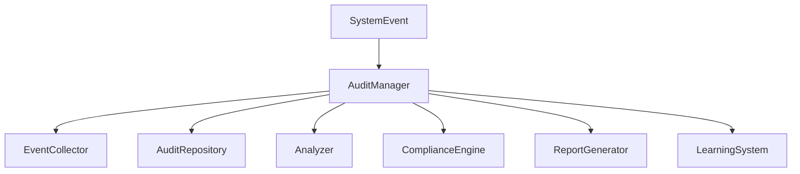

# RFC-0041

**Title:** Audit Management System

**Document ID:** RFC-0041

**Version:** 1.0

**Status:** Accepted

**Category:** Platform

**Layer:** Governance / Observability

**Target:**

```text
governance/audit_manager/
```

---

# Abstract

This RFC defines the SH-3 Audit Management System.

The Audit Management System provides the system-wide traceability framework responsible for recording, analyzing, preserving, and learning from operational activities across SH-3.

The system manages:

- execution records
- decision records
- security events
- policy decisions
- identity activities
- session activities
- resource operations
- autonomous modifications

The system enables:

- event recording
- audit trail generation
- compliance verification
- incident investigation
- behavioral analysis
- autonomous improvement

The Audit Management System integrates with:

- Identity Management System
- Session Management System
- Policy Management System
- Security System
- Observability System
- Message Bus System
- Persistence System
- Learning System
- Self-Healing System
- Self Evolution System

This document is normative.

---

# Motivation

An autonomous intelligence system requires complete operational transparency.

Without audit capabilities:

- decisions cannot be explained
- failures cannot be analyzed
- security incidents cannot be investigated
- autonomous evolution cannot be validated
- system behavior cannot be improved reliably

The Audit Management System provides historical understanding of SH-3 behavior.

---

# Goals

The Audit Management System SHALL provide:

- complete activity recording
- immutable audit history
- decision traceability
- security investigation support
- compliance analysis
- learning data generation

---

# Non-Goals

The Audit Management System SHALL NOT:

- execute operations
- make authorization decisions
- replace Observability System
- replace Logging System
- modify system behavior directly

Audit observes and records.

---

# Architecture



The Audit Management System transforms system activity into persistent operational knowledge.

---

# Design Principles

The Audit Management System follows these principles.

---

## Completeness

Important system activities SHALL be recorded.

---

## Integrity

Audit records SHALL be protected from unauthorized modification.

---

## Traceability

Every important action SHALL be attributable.

---

## Explainability

Decisions SHALL have understandable history.

---

## Persistence

Audit information SHALL survive system restarts.

---

## Learning

Historical records SHOULD improve future behavior.

---

# Audit Management Components

The system consists of:

| Component | Responsibility |
|-----------|----------------|
| AuditManager | Coordination |
| EventCollector | Collection |
| AuditRepository | Storage |
| AuditAnalyzer | Analysis |
| ComplianceEngine | Verification |
| ReportGenerator | Reporting |
| AuditMonitor | Observation |
| LearningAdapter | Knowledge extraction |

---

# AuditManager

AuditManager coordinates audit operations.

Responsibilities:

- event collection
- record creation
- storage coordination
- analysis requests
- report generation

AuditManager does not control execution.

---

# Audit Context

Every audit record receives an immutable AuditContext.

An AuditContext contains:

| Field | Description |
|--------|-------------|
| audit_id | Audit identifier |
| event_id | Related event |
| actor_id | Performing entity |
| timestamp | Event time |
| source | Origin |
| severity | Importance |

---

# Audit Record Model

An AuditRecord contains:

| Field | Description |
|--------|-------------|
| audit_id | Unique identifier |
| event_type | Activity category |
| actor | Responsible entity |
| target | Affected object |
| action | Operation |
| result | Outcome |
| timestamp | Occurrence time |
| metadata | Additional data |

---

# Audit Event Types

Supported categories:

| Type | Purpose |
|------|---------|
| Security | Security activity |
| Authentication | Identity verification |
| Authorization | Policy decision |
| Execution | Task operation |
| Resource | Resource usage |
| Configuration | System changes |
| Learning | Model updates |
| Evolution | Self modification |

---

# Audit Lifecycle

Every audit record follows:

```text
Generated

↓

Collected

↓

Validated

↓

Stored

↓

Analyzed

↓

Archived
```

---

# Event Collection

EventCollector gathers events from:

- Message Bus
- Security System
- Policy System
- Task System
- Workflow System
- Resource System

---

# Event Normalization

All audit events SHALL be normalized.

Standard format:

```json
{
  "event_id": "",
  "type": "",
  "actor": "",
  "action": "",
  "target": "",
  "result": "",
  "timestamp": ""
}
```

---

# Audit Repository

AuditRepository stores:

- audit records
- event history
- investigation data
- analysis results

---

# Audit Integrity

Audit records SHALL support:

- append-only storage
- integrity verification
- timestamp validation
- access control

---

# Decision Audit

The system records:

- planning decisions
- policy decisions
- resource decisions
- autonomous decisions

---

# Decision Trace Model

```text
Decision

↓

Context

↓

Rules Applied

↓

Reason

↓

Result
```

---

# Execution Audit

Execution audits record:

- task execution
- workflow progress
- tool usage
- agent behavior

---

# Security Audit

Security audits record:

- authentication
- authorization
- violations
- recovery actions

---

# Identity Integration

Identity Management provides:

- actor identification
- trust information
- ownership data

---

# Session Integration

Session Management provides:

- active context
- interaction history
- session attribution

---

# Policy Integration

Policy Management provides:

- applied policies
- decision reasons
- enforcement results

---

# Audit Management Execution Model

The Audit Management System transforms raw system activities into persistent, explainable, and actionable operational intelligence.

The audit lifecycle follows:


Each stage maintains a clear architectural responsibility.

---

# Audit Control Loop

The Audit Management System operates through continuous observation and improvement.

```text
System Activity

↓

Event Capture

↓

Audit Record Creation

↓

Historical Storage

↓

Behavior Analysis

↓

Knowledge Extraction

↓

System Improvement
```

---

# Audit Analysis Engine

AuditAnalyzer analyzes accumulated audit records.

Analysis targets:

- operational behavior
- security events
- decision patterns
- execution efficiency
- abnormal activity

---

# Analysis Functions

Supported functions:

| Function | Purpose |
|----------|---------|
| Pattern Analysis | Detect recurring behavior |
| Root Cause Analysis | Identify failures |
| Correlation Analysis | Connect events |
| Trend Analysis | Predict changes |
| Risk Analysis | Evaluate threats |

---

# Event Correlation

Audit events are correlated by:

- identity
- session
- task
- workflow
- resource
- timestamp

Example:

```text
Identity

↓

Session

↓

Task

↓

Resource Usage

↓

Result
```

---

# Incident Investigation

Audit System supports incident analysis.

Investigation flow:

```text
Incident Detection

↓

Collect Related Events

↓

Build Timeline

↓

Analyze Cause

↓

Generate Report
```

---

# Incident Timeline

A timeline contains:

| Field | Description |
|------|-------------|
| timestamp | Event time |
| actor | Responsible entity |
| action | Operation |
| result | Outcome |
| relation | Connected event |

---

# Compliance Tracking

ComplianceEngine verifies system behavior.

Compliance targets:

- security requirements
- operational rules
- policy requirements
- execution constraints

---

# Compliance Evaluation

Process:

```text
Requirement

↓

Audit Evidence

↓

Rule Evaluation

↓

Compliance Result
```

---

# Compliance Status

Supported states:

| Status | Meaning |
|--------|---------|
| Compliant | Requirements satisfied |
| Warning | Potential issue |
| Violation | Requirement failed |
| Unknown | Insufficient data |

---

# Report Generation

ReportGenerator creates:

- operational reports
- security reports
- decision reports
- evolution reports

---

# Explainability Model

Audit provides explanations for important decisions.

Explanation structure:

```text
Decision

↓

Context

↓

Input Data

↓

Applied Policy

↓

Reasoning Trace

↓

Result
```

---

# Decision Audit Integration

The Audit System records:

- Planning decisions
- World Model predictions
- Policy decisions
- Resource allocation decisions
- Agent actions

---

# Reasoning Trace Integration

ReasoningTrace connects:

- internal reasoning
- external action
- final result

This enables:

- debugging
- improvement
- trust evaluation

---

# Learning Integration

Learning System uses audit data for:

- failure analysis
- behavior improvement
- decision optimization
- anomaly detection

---

# Audit Learning Pipeline

```text
Audit Records

↓

Feature Extraction

↓

Pattern Learning

↓

Model Improvement

↓

Policy / Strategy Update
```

---

# Memory Integration

Memory System stores:

- important audit events
- successful behaviors
- failure patterns
- causal relationships

---

# Knowledge Integration

Knowledge System extracts:

- operational knowledge
- security knowledge
- system rules

---

# Optimizer Integration

Optimizer improves audit operations.

Optimization targets:

- storage efficiency
- event filtering
- analysis speed
- correlation accuracy

---

# Self-Healing Integration

Self-Healing uses audit information for:

- failure diagnosis
- recovery validation
- prevention strategy

---

# Self Evolution Integration

Self Evolution uses audit history to improve SH-3.

Evolution cycle:

```text
Audit Observation

↓

Identify Limitation

↓

Generate Improvement

↓

Validate Change

↓

Deploy Evolution
```

---

# Autonomous Audit Generation

SH-3 may create new audit rules automatically.

Sources:

- repeated failures
- emerging risks
- new capabilities
- system evolution

---

# Audit Policy Adaptation

Audit policies MAY evolve.

Adaptation considers:

- importance
- risk
- resource cost
- historical value

---

# Message Bus Integration

Audit events are distributed through Message Bus.

Events include:

- AuditCreated
- AuditStored
- AuditAnalyzed
- IncidentDetected
- ComplianceUpdated
- ReportGenerated

---

# Persistence Integration

Persistence stores:

- audit database
- investigation records
- reports
- analysis results

---

# Observability Integration

Audit complements Observability.

Observability answers:

"What is happening?"

Audit answers:

"What happened and why?"

---

# Security Integration

Security System uses audit information for:

- threat investigation
- access analysis
- incident response

---

# Thread Model

The Audit Management System supports concurrent:

- event collection
- storage
- analysis
- reporting
- monitoring

Audit writes SHALL be synchronized.

The reference implementation shall be thread-safe.

---

# Metrics

The Audit Management System exposes:

- audit events per second
- storage size
- analysis latency
- incident detection count
- compliance status
- report generation time

---

# Performance Objectives

The Audit Management System should optimize for:

- reliable recording
- low overhead
- explainable analysis
- scalable storage
- autonomous improvement

---

# Future Work

Potential future enhancements include:

- AI-based incident prediction
- autonomous compliance management
- predictive audit sampling
- self-generating audit policies
- fully autonomous system accountability

These enhancements extend SH-3 self-governance while preserving transparency and reliability.

---

# References

- SH-3 Architecture Specification v2.1
- RFC-0013 Capability System
- RFC-0014 Registry System
- RFC-0015 Scheduler System
- RFC-0016 Pipeline System
- RFC-0017 Configuration System
- RFC-0018 Security System
- RFC-0019 Observability System
- RFC-0020 Distributed Cluster System
- RFC-0021 Agent System
- RFC-0022 Knowledge System
- RFC-0023 World Model System
- RFC-0024 Cognitive Architecture System
- RFC-0025 Meta Controller System
- RFC-0026 Self Evolution System
- RFC-0027 Autonomous Learning System
- RFC-0028 Optimizer System
- RFC-0029 Self-Healing System
- RFC-0030 Persistence System
- RFC-0031 Deployment System
- RFC-0032 Plugin System
- RFC-0033 API Gateway System
- RFC-0034 Message Bus System
- RFC-0035 Workflow Engine System
- RFC-0036 Task Management System
- RFC-0037 Resource Management System
- RFC-0038 Policy Management System
- RFC-0039 Identity Management System
- RFC-0040 Session Management System

---

# End of RFC-0041
