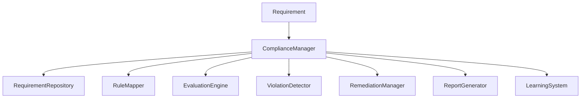

# RFC-0042

**Title:** Compliance Management System

**Document ID:** RFC-0042

**Version:** 1.0

**Status:** Accepted

**Category:** Platform

**Layer:** Governance / Assurance

**Target:**

```text
governance/compliance_manager/
```

---

# Abstract

This RFC defines the SH-3 Compliance Management System.

The Compliance Management System provides the assurance framework responsible for continuously evaluating whether SH-3 operations, decisions, modifications, and autonomous evolution processes conform to defined requirements, policies, and internal governance standards.

The system manages:

- compliance requirements
- governance rules
- operational constraints
- security requirements
- evolution restrictions
- validation evidence

The system enables:

- requirement definition
- rule mapping
- compliance evaluation
- violation detection
- remediation management
- continuous compliance monitoring
- compliance improvement

The Compliance Management System integrates with:

- Audit Management System
- Policy Management System
- Security System
- Identity Management System
- Session Management System
- Observability System
- Persistence System
- Learning System
- Self-Healing System
- Self Evolution System

This document is normative.

---

# Motivation

An autonomous intelligence system requires continuous assurance that its behavior remains within acceptable boundaries.

Without Compliance Management:

- policy violations may remain unnoticed
- autonomous modifications may become unsafe
- operational standards may degrade
- system evolution cannot be verified
- governance becomes reactive

The Compliance Management System provides continuous validation of SH-3 behavior.

---

# Goals

The Compliance Management System SHALL provide:

- requirement management
- compliance checking
- evidence collection
- violation detection
- remediation coordination
- continuous assurance

---

# Non-Goals

The Compliance Management System SHALL NOT:

- define all policies
- execute remediation directly
- replace Audit Management System
- replace Security System
- prevent all operations independently

Compliance evaluates.

Policy governs.

Security protects.

---

# Architecture



The Compliance Management System transforms requirements into measurable assurance states.

---

# Design Principles

The Compliance Management System follows these principles.

---

## Continuous Validation

Compliance SHALL be evaluated continuously.

---

## Evidence Based

Decisions SHALL rely on recorded evidence.

---

## Transparency

Compliance results SHALL be explainable.

---

## Prevention

Potential violations SHOULD be detected before impact.

---

## Adaptability

Compliance rules MAY evolve with system changes.

---

## Independence

Compliance evaluation SHALL remain independent from execution.

---

# Compliance Management Components

The system consists of:

| Component | Responsibility |
|-----------|----------------|
| ComplianceManager | Coordination |
| RequirementRepository | Requirement storage |
| RuleMapper | Requirement mapping |
| EvaluationEngine | Compliance calculation |
| EvidenceCollector | Evidence gathering |
| ViolationDetector | Issue detection |
| RemediationManager | Correction handling |
| ReportGenerator | Reporting |
| LearningAdapter | Improvement |

---

# ComplianceManager

ComplianceManager coordinates compliance operations.

Responsibilities:

- requirement lifecycle
- evaluation scheduling
- result management
- remediation coordination

ComplianceManager does not modify system behavior directly.

---

# Compliance Context

Every compliance evaluation receives an immutable ComplianceContext.

A ComplianceContext contains:

| Field | Description |
|--------|-------------|
| compliance_id | Evaluation identifier |
| target | Evaluated object |
| requirement | Applied requirement |
| evidence | Validation data |
| timestamp | Evaluation time |

---

# Compliance Requirement Model

A ComplianceRequirement contains:

| Field | Description |
|--------|-------------|
| requirement_id | Identifier |
| name | Requirement name |
| category | Requirement type |
| priority | Importance |
| rules | Evaluation criteria |
| version | Revision |

---

# Requirement Types

Supported categories:

| Type | Purpose |
|------|---------|
| Security | Protection requirements |
| Safety | Operational limits |
| Operational | System behavior |
| Resource | Usage constraints |
| Evolution | Modification rules |
| Data | Information handling |

---

# Requirement Lifecycle

Every requirement follows:

```text
Created

↓

Defined

↓

Validated

↓

Active

↓

Updated

↓

Retired
```

---

# Requirement Repository

RequirementRepository stores:

- requirements
- versions
- mappings
- evaluation history

---

# Rule Mapping

RuleMapper connects requirements with system behavior.

Mapping targets:

- policies
- audit records
- metrics
- configurations
- execution results

---

# Compliance Rule Model

A rule contains:

```text
Condition

+

Evidence Source

+

Expected State

+

Evaluation Result
```

---

# Evaluation Engine

EvaluationEngine performs compliance checks.

Responsibilities:

- collect evidence
- execute rules
- calculate status
- generate explanations

---

# Compliance Evaluation Flow

```text
Requirement

↓

Collect Evidence

↓

Execute Rules

↓

Compare Expected State

↓

Generate Result
```

---

# Evidence Collection

Evidence sources:

- Audit System
- Logs
- Metrics
- Policies
- Configurations
- Execution History

---

# Compliance Result Model

A ComplianceResult contains:

| Field | Description |
|--------|-------------|
| result_id | Identifier |
| requirement_id | Target requirement |
| status | Compliance state |
| evidence | Supporting data |
| timestamp | Evaluation time |

---

# Compliance States

Supported states:

| State | Meaning |
|------|---------|
| Compliant | Requirement satisfied |
| Warning | Potential issue |
| Violation | Requirement failed |
| Unknown | Insufficient evidence |

---

# Violation Detection

ViolationDetector identifies:

- policy violations
- security failures
- unsafe changes
- operational drift

---

# Violation Classification

Violations are classified:

| Level | Meaning |
|------|---------|
| Critical | Immediate action |
| High | Priority correction |
| Medium | Planned correction |
| Low | Monitoring |

---

# Audit Integration

Audit Management provides:

- historical evidence
- activity records
- decision history

---

# Policy Integration

Policy Management provides:

- governance rules
- enforcement definitions
- expected behavior

---

# Security Integration

Security System provides:

- security requirements
- threat information
- protection status

---

# Compliance Management Execution Model

The Compliance Management System transforms requirements and operational evidence into continuous assurance intelligence for SH-3.

The compliance lifecycle follows:


Each stage maintains a clear architectural responsibility.

---

# Compliance Control Loop

The Compliance Management System operates through continuous assurance.

```text
Define Requirement

↓

Collect Evidence

↓

Evaluate State

↓

Detect Deviation

↓

Correct Behavior

↓

Verify Compliance

↓

Improve Rules
```

---

# Continuous Compliance

SH-3 performs continuous compliance evaluation.

Continuous checks include:

- security posture
- policy adherence
- configuration state
- resource usage
- autonomous changes

---

# Compliance Monitoring

ComplianceMonitor observes:

- active requirements
- compliance status
- violation trends
- system changes

---

# Monitoring Sources

Sources include:

- Audit Management System
- Observability System
- Policy System
- Configuration System
- Identity System
- Execution History

---

# Compliance Drift Detection

The system detects deviations between:

```text
Expected State

vs

Actual State
```

Examples:

- configuration drift
- policy drift
- security drift
- behavioral drift

---

# Drift Analysis

Process:

```text
Detect Difference

↓

Classify Impact

↓

Evaluate Risk

↓

Generate Correction
```

---

# Remediation Management

RemediationManager coordinates correction processes.

Responsibilities:

- remediation planning
- action tracking
- verification
- recovery coordination

---

# Remediation Types

Supported remediation:

| Type | Purpose |
|------|---------|
| Automatic | Immediate correction |
| Assisted | Human approval |
| Scheduled | Planned correction |
| Preventive | Future avoidance |

---

# Remediation Flow

```text
Violation Detected

↓

Analyze Cause

↓

Select Remedy

↓

Apply Correction

↓

Verify Result
```

---

# Self-Healing Integration

Self-Healing System uses compliance results for:

- automatic recovery
- unsafe state correction
- policy restoration
- configuration repair

---

# Violation Recovery

Recovery priority:

```text
Safety

>

Security

>

Integrity

>

Performance

>

Optimization
```

---

# Compliance Exception Management

Some situations may require exceptions.

Exceptions contain:

- reason
- scope
- duration
- approval
- expiration

---

# Exception Lifecycle

```text
Requested

↓

Evaluated

↓

Approved

↓

Active

↓

Expired
```

---

# Compliance Reporting

ReportGenerator produces:

- compliance reports
- violation reports
- remediation reports
- evolution reports

---

# Compliance Dashboard Data

Provides:

- compliance score
- open violations
- remediation progress
- risk level

---

# Compliance Score Model

Example:

```text
Satisfied Requirements

/

Total Requirements

=

Compliance Score
```

---

# Learning Integration

Learning System improves compliance intelligence.

Learning targets:

- violation prediction
- rule optimization
- remediation selection
- risk estimation

---

# Compliance Learning Pipeline

```text
Compliance History

↓

Pattern Analysis

↓

Risk Prediction

↓

Rule Improvement

↓

Policy Update
```

---

# Memory Integration

Memory stores:

- compliance history
- violation patterns
- successful remediation
- causal relationships

---

# Knowledge Integration

Knowledge System extracts:

- compliance rules
- operational standards
- risk knowledge

---

# Optimizer Integration

Optimizer improves:

- evaluation efficiency
- rule execution order
- evidence collection
- remediation strategy

---

# Self Evolution Integration

Self Evolution uses compliance information to constrain autonomous modification.

Evolution validation:

```text
Proposed Change

↓

Compliance Evaluation

↓

Risk Assessment

↓

Approval

↓

Deployment
```

---

# Autonomous Compliance Evolution

SH-3 may improve compliance mechanisms.

Evolution targets:

- new validation rules
- improved detection
- better evidence collection
- automated assurance methods

---

# Governance Integration

Compliance provides feedback to:

- Policy Management
- Security Management
- Identity Management
- Session Management
- Audit Management

---

# Message Bus Integration

Compliance events include:

- RequirementCreated
- ComplianceEvaluated
- ViolationDetected
- RemediationStarted
- RemediationCompleted
- ComplianceRestored

---

# Persistence Integration

Persistence stores:

- requirements
- evaluation results
- violations
- remediation history
- compliance models

---

# Observability Integration

Compliance telemetry includes:

- evaluation latency
- violation frequency
- remediation success rate
- compliance score

---

# Tracing

Compliance traces preserve:

- trace_id
- compliance_id
- requirement_id
- violation_id
- remediation_id

---

# Thread Model

The Compliance Management System supports concurrent:

- evaluations
- evidence collection
- monitoring
- remediation tracking
- reporting

Compliance state updates SHALL be synchronized.

The reference implementation shall be thread-safe.

---

# Metrics

The Compliance Management System exposes:

- total requirements
- compliance score
- active violations
- remediation success rate
- evaluation count
- compliance recovery time

---

# Performance Objectives

The Compliance Management System should optimize for:

- continuous assurance
- low evaluation overhead
- accurate detection
- effective remediation
- autonomous governance

---

# Future Work

Potential future enhancements include:

- AI-based compliance prediction
- autonomous requirement generation
- formal verification integration
- predictive governance analysis
- self-evolving assurance frameworks

These enhancements extend SH-3 autonomous governance while maintaining reliability and control.

---

# References

- SH-3 Architecture Specification v2.1
- RFC-0013 Capability System
- RFC-0014 Registry System
- RFC-0015 Scheduler System
- RFC-0016 Pipeline System
- RFC-0017 Configuration System
- RFC-0018 Security System
- RFC-0019 Observability System
- RFC-0020 Distributed Cluster System
- RFC-0021 Agent System
- RFC-0022 Knowledge System
- RFC-0023 World Model System
- RFC-0024 Cognitive Architecture System
- RFC-0025 Meta Controller System
- RFC-0026 Self Evolution System
- RFC-0027 Autonomous Learning System
- RFC-0028 Optimizer System
- RFC-0029 Self-Healing System
- RFC-0030 Persistence System
- RFC-0031 Deployment System
- RFC-0032 Plugin System
- RFC-0033 API Gateway System
- RFC-0034 Message Bus System
- RFC-0035 Workflow Engine System
- RFC-0036 Task Management System
- RFC-0037 Resource Management System
- RFC-0038 Policy Management System
- RFC-0039 Identity Management System
- RFC-0040 Session Management System
- RFC-0041 Audit Management System

---

# End of RFC-0042
