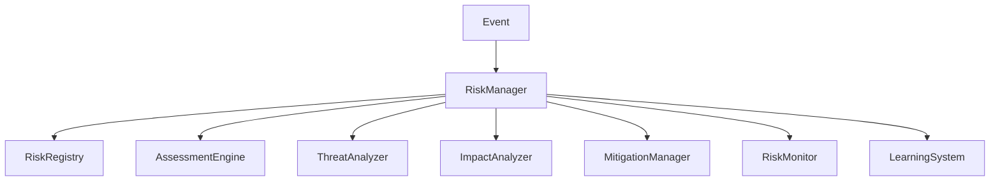
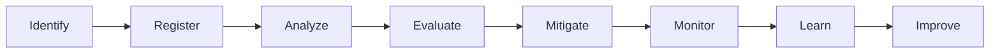

# RFC-0043

**Title:** Risk Management System

**Document ID:** RFC-0043

**Version:** 1.0

**Status:** Accepted

**Category:** Platform

**Layer:** Governance / Security / Assurance

**Target:**

```text
governance/risk_manager/
```

---

# Abstract

This RFC defines the SH-3 Risk Management System.

The Risk Management System provides the predictive governance framework responsible for identifying, analyzing, evaluating, mitigating, and continuously learning from risks affecting SH-3 operations.

The system manages:

- operational risks
- security risks
- resource risks
- execution risks
- learning risks
- evolution risks
- autonomous decision risks

The system enables:

- risk identification
- risk registration
- threat analysis
- impact evaluation
- mitigation planning
- continuous monitoring
- predictive risk management

The Risk Management System integrates with:

- Compliance Management System
- Audit Management System
- Policy Management System
- Security System
- Identity Management System
- Session Management System
- Self-Healing System
- Learning System
- World Model System
- Self Evolution System

This document is normative.

---

# Motivation

An autonomous intelligence system must understand not only what is allowed, but also what may go wrong.

Without Risk Management:

- failures are discovered too late
- unsafe evolution may occur
- security threats may spread
- resource exhaustion may impact operation
- decisions may lack uncertainty awareness

The Risk Management System provides proactive protection.

---

# Goals

The Risk Management System SHALL provide:

- risk identification
- risk classification
- impact analysis
- probability estimation
- mitigation management
- continuous risk monitoring
- predictive improvement

---

# Non-Goals

The Risk Management System SHALL NOT:

- replace Security System
- replace Compliance System
- directly execute recovery actions
- define business objectives
- block all uncertain operations

Risk Management evaluates uncertainty.

Security protects assets.

Compliance verifies requirements.

---

# Architecture



The Risk Management System transforms uncertainty into actionable governance information.

---

# Design Principles

The Risk Management System follows these principles.

---

## Proactive Detection

Risks SHOULD be identified before failure occurs.

---

## Evidence Based

Risk evaluation SHALL use measurable information.

---

## Continuous Assessment

Risk state SHALL be updated continuously.

---

## Explainability

Risk decisions SHALL provide reasons.

---

## Adaptability

Risk models MAY evolve through learning.

---

## Safety Preservation

Critical risks SHALL receive priority.

---

# Risk Management Components

The system consists of:

| Component | Responsibility |
|-----------|----------------|
| RiskManager | Coordination |
| RiskRegistry | Risk storage |
| AssessmentEngine | Evaluation |
| ThreatAnalyzer | Threat analysis |
| ImpactAnalyzer | Impact calculation |
| PredictionEngine | Forecasting |
| MitigationManager | Response planning |
| RiskMonitor | Observation |
| LearningAdapter | Improvement |

---

# RiskManager

RiskManager coordinates risk operations.

Responsibilities:

- risk lifecycle
- assessment requests
- mitigation tracking
- risk synchronization

RiskManager does not directly repair systems.

---

# Risk Context

Every risk evaluation receives an immutable RiskContext.

A RiskContext contains:

| Field | Description |
|--------|-------------|
| risk_id | Risk identifier |
| target | Evaluated object |
| source | Origin |
| evidence | Supporting data |
| timestamp | Evaluation time |

---

# Risk Model

A Risk contains:

| Field | Description |
|--------|-------------|
| risk_id | Identifier |
| name | Risk name |
| category | Risk type |
| probability | Likelihood |
| impact | Severity |
| priority | Importance |
| status | Current state |

---

# Risk Categories

Supported categories:

| Type | Purpose |
|------|---------|
| Security | Threats and attacks |
| Operational | Runtime failures |
| Resource | Capacity problems |
| Data | Information issues |
| Learning | Model degradation |
| Evolution | Unsafe changes |
| Decision | Incorrect actions |

---

# Risk Lifecycle

Every risk follows:

```text
Detected

↓

Registered

↓

Analyzed

↓

Evaluated

↓

Mitigated

↓

Monitored

↓

Resolved
```

---

# Risk Registry

RiskRegistry stores:

- identified risks
- assessment history
- mitigation plans
- risk trends

---

# Risk Identification

Risks are identified from:

- audit events
- compliance results
- security alerts
- performance data
- learning feedback
- world model predictions

---

# Threat Modeling

ThreatAnalyzer evaluates:

- possible causes
- attack paths
- failure paths
- dependency risks

---

# Threat Model

```text
Source

↓

Threat

↓

Vulnerability

↓

Impact

↓

Risk
```

---

# Risk Assessment

AssessmentEngine calculates:

- probability
- impact
- severity
- priority

---

# Risk Score Model

Example:

```text
Risk Score

=

Probability

×

Impact
```

---

# Impact Analysis

ImpactAnalyzer evaluates effects on:

- system availability
- security
- performance
- knowledge integrity
- autonomous behavior

---

# Risk Priority

Risk priority considers:

| Factor | Description |
|--------|-------------|
| Severity | Damage level |
| Probability | Occurrence chance |
| Detectability | Detection difficulty |
| Recovery Cost | Repair effort |

---

# Prediction Engine

PredictionEngine forecasts future risks.

Prediction inputs:

- historical events
- trends
- system state
- learning models

---

# World Model Integration

World Model provides:

- future state prediction
- environmental changes
- consequence estimation

---

# Compliance Integration

Compliance provides:

- requirement violations
- assurance state
- governance information

---

# Audit Integration

Audit provides:

- historical evidence
- incident records
- behavioral patterns

---

# Risk Management Execution Model

The Risk Management System transforms uncertainty into predictive governance intelligence, enabling SH-3 to anticipate, control, and learn from potential failures.

The risk lifecycle follows:



Each stage maintains a clear architectural responsibility.

---

# Risk Control Loop

The Risk Management System operates through continuous risk awareness.

```text
System State

↓

Risk Detection

↓

Risk Evaluation

↓

Mitigation Decision

↓

Result Observation

↓

Risk Model Update

↓

Future Prediction Improvement
```

---

# Risk Monitoring

RiskMonitor continuously observes:

- system behavior
- security state
- resource usage
- execution patterns
- learning behavior
- evolution activity

---

# Monitoring Sources

Risk information is collected from:

- Audit Management System
- Compliance Management System
- Security System
- Observability System
- World Model System
- Learning System

---

# Risk State Model

Supported risk states:

| State | Description |
|------|-------------|
| Unknown | Not evaluated |
| Identified | Detected risk |
| Analyzed | Impact understood |
| Active | Currently present |
| Mitigated | Controlled |
| Resolved | Removed |

---

# Risk Response Management

MitigationManager coordinates risk responses.

Responsibilities:

- response selection
- priority management
- mitigation tracking
- result verification

---

# Risk Response Types

Supported responses:

| Type | Purpose |
|------|---------|
| Prevent | Avoid occurrence |
| Reduce | Lower impact |
| Transfer | Move responsibility |
| Accept | Controlled tolerance |
| Recover | Restore operation |

---

# Risk Mitigation Flow

```text
Risk Detected

↓

Analyze Cause

↓

Select Response

↓

Execute Mitigation

↓

Verify Result

↓

Update Risk State
```

---

# Automated Risk Mitigation

SH-3 MAY perform automated mitigation.

Examples:

- isolate unsafe component
- reduce resource usage
- suspend risky execution
- increase monitoring level
- request additional verification

---

# Self-Healing Integration

Self-Healing System uses risk information for:

- recovery prioritization
- failure prevention
- safe restoration
- damage limitation

---

# Risk-Based Recovery Priority

Recovery order:

```text
Critical Safety Risk

>

Security Risk

>

Integrity Risk

>

Operational Risk

>

Performance Risk
```

---

# Security Integration

Security System uses risk analysis for:

- threat prioritization
- protection strategy
- incident response

---

# Policy Integration

Policy Management uses risk information for:

- policy refinement
- restriction adjustment
- governance improvement

---

# Compliance Integration

Compliance Management uses risks for:

- requirement prioritization
- compliance prediction
- assurance improvement

---

# Risk Prediction Engine

PredictionEngine estimates future risks.

Prediction factors:

- historical failures
- system trends
- environmental changes
- behavior patterns

---

# Predictive Risk Model

```text
Historical Data

+

Current State

+

Future Prediction

=

Risk Forecast
```

---

# World Model Integration

World Model provides consequence simulation.

Risk evaluation may include:

```text
Possible Future State

↓

Impact Simulation

↓

Risk Estimation
```

---

# Learning Integration

Learning System improves risk intelligence.

Learning targets:

- probability estimation
- impact prediction
- mitigation effectiveness
- anomaly recognition

---

# Risk Learning Pipeline

```text
Risk History

↓

Feature Extraction

↓

Pattern Learning

↓

Prediction Improvement

↓

Risk Model Update
```

---

# Memory Integration

Memory stores:

- risk history
- successful mitigation strategies
- failure causes
- causal relationships

---

# Knowledge Integration

Knowledge System extracts:

- threat knowledge
- operational risk patterns
- mitigation knowledge

---

# Optimizer Integration

Optimizer improves:

- assessment efficiency
- prediction accuracy
- mitigation cost
- monitoring allocation

---

# Self Evolution Integration

Risk Management constrains autonomous evolution.

Evolution validation:

```text
Proposed Change

↓

Risk Assessment

↓

Impact Simulation

↓

Approval

↓

Deployment
```

---

# Autonomous Risk Evolution

SH-3 may improve risk models autonomously.

Evolution targets:

- new risk patterns
- improved prediction models
- better mitigation strategies
- adaptive monitoring rules

---

# Risk Knowledge Graph

SH-3 maintains relationships:

```text
Cause

↓

Risk

↓

Impact

↓

Mitigation

↓

Result
```

This enables causal risk reasoning.

---

# Message Bus Integration

Risk events include:

- RiskDetected
- RiskEvaluated
- RiskEscalated
- MitigationStarted
- MitigationCompleted
- RiskResolved

---

# Persistence Integration

Persistence stores:

- risk registry
- assessment history
- mitigation records
- prediction models

---

# Observability Integration

Risk telemetry includes:

- active risk count
- risk score distribution
- prediction accuracy
- mitigation success rate

---

# Tracing

Risk traces preserve:

- trace_id
- risk_id
- source_event
- assessment_id
- mitigation_id

---

# Thread Model

The Risk Management System supports concurrent:

- risk detection
- assessment
- monitoring
- prediction
- mitigation tracking

Risk state transitions SHALL be synchronized.

The reference implementation shall be thread-safe.

---

# Metrics

The Risk Management System exposes:

- detected risks
- active risks
- critical risks
- mitigation success rate
- prediction accuracy
- recovery time
- unresolved risk duration

---

# Performance Objectives

The Risk Management System should optimize for:

- early detection
- accurate prediction
- low evaluation overhead
- effective mitigation
- continuous improvement

---

# Future Work

Potential future enhancements include:

- AI-driven risk prediction
- autonomous threat modeling
- causal risk reasoning
- probabilistic safety verification
- self-evolving governance intelligence

These enhancements extend SH-3 predictive governance while preserving safety and control.

---

# References

- SH-3 Architecture Specification v2.1
- RFC-0013 Capability System
- RFC-0014 Registry System
- RFC-0015 Scheduler System
- RFC-0016 Pipeline System
- RFC-0017 Configuration System
- RFC-0018 Security System
- RFC-0019 Observability System
- RFC-0020 Distributed Cluster System
- RFC-0021 Agent System
- RFC-0022 Knowledge System
- RFC-0023 World Model System
- RFC-0024 Cognitive Architecture System
- RFC-0025 Meta Controller System
- RFC-0026 Self Evolution System
- RFC-0027 Autonomous Learning System
- RFC-0028 Optimizer System
- RFC-0029 Self-Healing System
- RFC-0030 Persistence System
- RFC-0031 Deployment System
- RFC-0032 Plugin System
- RFC-0033 API Gateway System
- RFC-0034 Message Bus System
- RFC-0035 Workflow Engine System
- RFC-0036 Task Management System
- RFC-0037 Resource Management System
- RFC-0038 Policy Management System
- RFC-0039 Identity Management System
- RFC-0040 Session Management System
- RFC-0041 Audit Management System
- RFC-0042 Compliance Management System

---

# End of RFC-0043
