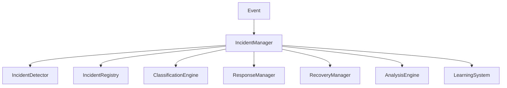
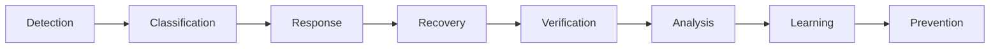

# RFC-0044

**Title:** Incident Management System

**Document ID:** RFC-0044

**Version:** 1.0

**Status:** Accepted

**Category:** Platform

**Layer:** Operations / Reliability / Security

**Target:**

```text
operations/incident_manager/
```

---

# Abstract

This RFC defines the SH-3 Incident Management System.

The Incident Management System provides the operational response framework responsible for detecting, classifying, managing, recovering from, and learning from incidents affecting SH-3.

The system manages:

- system failures
- security incidents
- operational disruptions
- resource failures
- learning failures
- autonomous evolution incidents
- unexpected behavioral deviations

The system enables:

- incident detection
- incident classification
- response coordination
- escalation management
- recovery execution
- root cause analysis
- incident learning

The Incident Management System integrates with:

- Risk Management System
- Audit Management System
- Compliance Management System
- Security System
- Self-Healing System
- Observability System
- Workflow Engine System
- Task Management System
- Learning System
- Self Evolution System

This document is normative.

---

# Motivation

An autonomous system must not only predict risks but also respond effectively when incidents occur.

Without Incident Management:

- failures may spread
- recovery actions become inconsistent
- root causes remain unknown
- repeated failures continue
- autonomous evolution may repeat mistakes

The Incident Management System provides structured operational recovery.

---

# Goals

The Incident Management System SHALL provide:

- incident lifecycle management
- automatic detection support
- response coordination
- recovery tracking
- root cause analysis
- continuous improvement

---

# Non-Goals

The Incident Management System SHALL NOT:

- replace Risk Management System
- replace Security System
- execute all recovery actions itself
- define operational policies
- replace Self-Healing System

Incident Management coordinates response.

---

# Architecture



The Incident Management System transforms abnormal events into controlled recovery processes.

---

# Design Principles

The Incident Management System follows these principles.

---

## Fast Detection

Incidents SHOULD be detected early.

---

## Controlled Response

Responses SHALL follow defined procedures.

---

## Traceability

All incident actions SHALL be recorded.

---

## Recovery First

System stability SHALL be prioritized.

---

## Learning Oriented

Every incident SHOULD improve future behavior.

---

## Autonomous Capability

SH-3 MAY automate incident handling where confidence is sufficient.

---

# Incident Management Components

The system consists of:

| Component | Responsibility |
|-----------|----------------|
| IncidentManager | Coordination |
| IncidentDetector | Detection |
| IncidentRegistry | Storage |
| ClassificationEngine | Categorization |
| ResponseManager | Response control |
| EscalationManager | Priority handling |
| RecoveryManager | Recovery coordination |
| AnalysisEngine | Root cause analysis |
| LearningAdapter | Improvement |

---

# IncidentManager

IncidentManager coordinates the incident lifecycle.

Responsibilities:

- incident creation
- state management
- response coordination
- recovery tracking
- closure management

IncidentManager does not replace execution systems.

---

# Incident Context

Every incident operation receives an immutable IncidentContext.

An IncidentContext contains:

| Field | Description |
|--------|-------------|
| incident_id | Incident identifier |
| source | Origin event |
| severity | Impact level |
| timestamp | Detection time |
| affected_component | Target |

---

# Incident Model

An Incident contains:

| Field | Description |
|--------|-------------|
| incident_id | Identifier |
| type | Incident category |
| source | Origin |
| impact | Effect |
| severity | Priority |
| status | Lifecycle state |
| resolution | Result |

---

# Incident Categories

Supported categories:

| Type | Purpose |
|------|---------|
| System | Runtime failures |
| Security | Security events |
| Resource | Resource problems |
| Data | Data integrity issues |
| Learning | Model failures |
| Evolution | Unsafe modifications |
| External | Environment changes |

---

# Incident Lifecycle

Every incident follows:

```text
Detected

↓

Registered

↓

Classified

↓

Responding

↓

Recovering

↓

Resolved

↓

Analyzed

↓

Learned
```

---

# Incident Detection

IncidentDetector receives signals from:

- Observability System
- Risk Management System
- Compliance System
- Audit System
- Security System

---

# Detection Sources

Detection methods:

- threshold monitoring
- anomaly detection
- rule evaluation
- prediction failure
- component failure

---

# Incident Registration

IncidentRegistry stores:

- incident information
- timeline
- actions
- recovery results
- analysis data

---

# Incident Classification

ClassificationEngine determines:

- category
- severity
- urgency
- affected scope

---

# Severity Levels

Supported levels:

| Level | Meaning |
|------|---------|
| Critical | Immediate impact |
| High | Major disruption |
| Medium | Limited impact |
| Low | Minor issue |

---

# Impact Analysis

Impact evaluation considers:

- affected services
- user impact
- security impact
- data impact
- recovery cost

---

# Response Management

ResponseManager coordinates:

- response selection
- action ordering
- resource allocation
- escalation

---

# Incident Response Flow

```text
Incident Detected

↓

Classify

↓

Assess Impact

↓

Select Response

↓

Execute Recovery

↓

Verify Restoration
```

---

# Risk Integration

Risk Management provides:

- predicted incidents
- severity estimation
- mitigation knowledge

---

# Audit Integration

Audit Management records:

- incident timeline
- response actions
- decisions
- results

---

# Compliance Integration

Compliance Management verifies:

- response conformity
- required procedures
- recovery validity

---

# Incident Management Execution Model

The Incident Management System transforms abnormal conditions into controlled response, recovery, and learning processes.

The incident lifecycle follows:



Each stage maintains a clear architectural responsibility.

---

# Incident Control Loop

The Incident Management System operates through continuous operational recovery.

```text
Abnormal Event

↓

Incident Detection

↓

Impact Evaluation

↓

Response Selection

↓

Recovery Execution

↓

Result Verification

↓

Root Cause Analysis

↓

Knowledge Update
```

---

# Incident Response Automation

SH-3 supports automated incident response.

Automation decisions consider:

- incident severity
- confidence level
- recovery risk
- historical success rate

---

# Automated Response Levels

| Level | Description |
|------|-------------|
| L0 | Observation only |
| L1 | Notification |
| L2 | Assisted recovery |
| L3 | Automatic recovery |
| L4 | Autonomous resolution |

---

# Response Decision Model

```text
Incident Data

+

Risk Assessment

+

Historical Recovery

+

Current System State

=

Response Strategy
```

---

# Escalation Management

EscalationManager controls incident priority changes.

Escalation triggers:

- severity increase
- recovery failure
- security impact
- prolonged downtime
- repeated occurrence

---

# Escalation Flow

```text
Incident Detected

↓

Initial Priority

↓

Monitor Progress

↓

Increase Severity if Needed

↓

Escalate Response
```

---

# Escalation Targets

Possible targets:

- Self-Healing System
- Security System
- Policy System
- Human Operator
- Autonomous Controller

---

# Recovery Management

RecoveryManager coordinates restoration.

Responsibilities:

- recovery planning
- execution tracking
- validation
- rollback coordination

---

# Recovery Strategies

Supported strategies:

| Strategy | Purpose |
|---------|---------|
| Restart | Restore component |
| Rollback | Return previous state |
| Isolation | Limit damage |
| Migration | Move execution |
| Reconstruction | Rebuild state |

---

# Recovery Flow

```text
Incident Analysis

↓

Select Recovery Plan

↓

Execute Recovery

↓

Validate State

↓

Close Incident
```

---

# Self-Healing Integration

Self-Healing System provides:

- automatic repair
- component restoration
- configuration correction
- dependency recovery

---

# Recovery Safety

Before recovery execution:

- verify target
- preserve state
- create checkpoint
- evaluate risk

---

# Root Cause Analysis

AnalysisEngine identifies underlying causes.

Analysis methods:

- event correlation
- dependency analysis
- causal analysis
- behavioral analysis

---

# Root Cause Model

```text
Symptom

↓

Event Chain

↓

Cause

↓

System Weakness

↓

Prevention Strategy
```

---

# Causal Analysis Integration

Learning System uses incident chains:

```text
Cause

↓

Failure

↓

Impact

↓

Recovery

↓

Result
```

to improve future decisions.

---

# Post Incident Review

After resolution, SH-3 performs:

- response evaluation
- recovery evaluation
- prevention analysis
- knowledge extraction

---

# Incident Report

An IncidentReport contains:

| Field | Description |
|------|-------------|
| incident_id | Incident reference |
| timeline | Event sequence |
| cause | Root cause |
| response | Actions taken |
| recovery | Restoration result |
| prevention | Future strategy |

---

# Incident Learning

Learning System receives:

- failure patterns
- successful recovery methods
- incorrect decisions
- environmental factors

---

# Incident Learning Pipeline

```text
Incident History

↓

Feature Extraction

↓

Cause Analysis

↓

Strategy Update

↓

Future Prevention
```

---

# Memory Integration

Memory stores:

- incident episodes
- recovery experiences
- causal relationships
- successful responses

---

# Knowledge Integration

Knowledge System extracts:

- failure knowledge
- recovery procedures
- operational rules

---

# Risk Integration

Risk Management receives:

- newly discovered risks
- probability updates
- mitigation effectiveness

---

# Compliance Integration

Compliance receives:

- incident evidence
- control effectiveness
- requirement impact

---

# Audit Integration

Audit receives:

- complete incident timeline
- decisions
- response actions
- recovery results

---

# Autonomous Incident Handling

SH-3 may autonomously handle incidents.

Autonomous handling requires:

- sufficient confidence
- known recovery strategy
- acceptable risk level
- validated procedure

---

# Autonomous Decision Boundary

```text
Low Risk

↓

Automatic Response


High Risk

↓

Approval Required
```

---

# Incident Evolution

Incident Management improves through evolution.

Evolution targets:

- detection models
- response strategies
- recovery methods
- analysis algorithms

---

# Evolution Validation

Before deployment:

```text
New Strategy

↓

Simulation

↓

Risk Evaluation

↓

Compliance Check

↓

Deployment
```

---

# Message Bus Integration

Incident events include:

- IncidentDetected
- IncidentClassified
- IncidentEscalated
- ResponseStarted
- RecoveryStarted
- IncidentResolved
- IncidentLearned

---

# Persistence Integration

Persistence stores:

- incidents
- timelines
- recovery checkpoints
- analysis results

---

# Observability Integration

Incident telemetry includes:

- detection latency
- recovery duration
- incident frequency
- resolution success rate

---

# Tracing

Incident traces preserve:

- trace_id
- incident_id
- source_event
- response_id
- recovery_id

---

# Thread Model

The Incident Management System supports concurrent:

- detection
- classification
- response coordination
- recovery tracking
- analysis

Incident state transitions SHALL be synchronized.

The reference implementation shall be thread-safe.

---

# Metrics

The Incident Management System exposes:

- incident count
- critical incident count
- detection time
- response time
- recovery time
- recovery success rate
- repeated incident rate

---

# Performance Objectives

The Incident Management System should optimize for:

- rapid detection
- reliable recovery
- minimal disruption
- accurate diagnosis
- continuous prevention

---

# Future Work

Potential future enhancements include:

- AI-based incident prediction
- autonomous root cause reasoning
- self-generating recovery plans
- multi-agent incident resolution
- fully autonomous operational resilience

These enhancements extend SH-3 autonomous operations while maintaining safety and explainability.

---

# References

- SH-3 Architecture Specification v2.1
- RFC-0013 Capability System
- RFC-0014 Registry System
- RFC-0015 Scheduler System
- RFC-0016 Pipeline System
- RFC-0017 Configuration System
- RFC-0018 Security System
- RFC-0019 Observability System
- RFC-0020 Distributed Cluster System
- RFC-0021 Agent System
- RFC-0022 Knowledge System
- RFC-0023 World Model System
- RFC-0024 Cognitive Architecture System
- RFC-0025 Meta Controller System
- RFC-0026 Self Evolution System
- RFC-0027 Autonomous Learning System
- RFC-0028 Optimizer System
- RFC-0029 Self-Healing System
- RFC-0030 Persistence System
- RFC-0031 Deployment System
- RFC-0032 Plugin System
- RFC-0033 API Gateway System
- RFC-0034 Message Bus System
- RFC-0035 Workflow Engine System
- RFC-0036 Task Management System
- RFC-0037 Resource Management System
- RFC-0038 Policy Management System
- RFC-0039 Identity Management System
- RFC-0040 Session Management System
- RFC-0041 Audit Management System
- RFC-0042 Compliance Management System
- RFC-0043 Risk Management System

---

# End of RFC-0044
