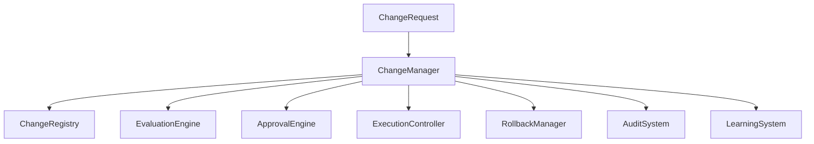
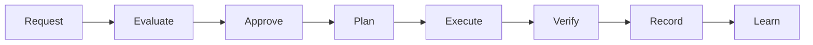

# RFC-0045

**Title:** Change Management System

**Document ID:** RFC-0045

**Version:** 1.0

**Status:** Accepted

**Category:** Platform

**Layer:** Governance / Evolution / Operations

**Target:**

```text
governance/change_manager/
```

---

# Abstract

This RFC defines the SH-3 Change Management System.

The Change Management System provides the controlled modification framework responsible for managing all changes applied to SH-3 components, configurations, models, policies, capabilities, and autonomous evolution processes.

The system manages:

- configuration changes
- architecture changes
- module updates
- model updates
- policy changes
- capability expansion
- autonomous evolution changes

The system enables:

- change registration
- impact analysis
- approval control
- controlled execution
- rollback
- verification
- change learning

The Change Management System integrates with:

- Self Evolution System
- Risk Management System
- Incident Management System
- Compliance Management System
- Audit Management System
- Policy Management System
- Deployment System
- Persistence System
- Learning System
- Optimizer System

This document is normative.

---

# Motivation

An autonomous intelligence system must evolve while maintaining stability and safety.

Without Change Management:

- unsafe modifications may propagate
- evolution cannot be controlled
- failures cannot be reversed
- system history becomes unclear
- governance boundaries become undefined

The Change Management System provides safe and traceable evolution.

---

# Goals

The Change Management System SHALL provide:

- controlled modification lifecycle
- impact evaluation
- approval workflow
- execution tracking
- rollback capability
- change history
- evolution feedback

---

# Non-Goals

The Change Management System SHALL NOT:

- create all changes automatically
- replace Deployment System
- replace Self Evolution System
- execute unrestricted modifications
- bypass security controls

Change Management controls changes.

---

# Architecture



The Change Management System transforms proposed modifications into controlled system evolution.

---

# Design Principles

The Change Management System follows these principles.

---

## Controlled Evolution

All important changes SHALL follow a lifecycle.

---

## Traceability

Every modification SHALL have history.

---

## Safety First

Changes SHALL be evaluated before execution.

---

## Reversibility

Critical changes SHOULD support rollback.

---

## Evidence Based

Approval SHALL use measurable evidence.

---

## Autonomous but Governed

SH-3 MAY evolve autonomously within defined boundaries.

---

# Change Management Components

The system consists of:

| Component | Responsibility |
|-----------|----------------|
| ChangeManager | Coordination |
| ChangeRegistry | Change storage |
| EvaluationEngine | Impact analysis |
| ApprovalEngine | Authorization |
| ExecutionController | Change execution |
| RollbackManager | Recovery |
| VerificationEngine | Validation |
| LearningAdapter | Improvement |

---

# ChangeManager

ChangeManager coordinates the change lifecycle.

Responsibilities:

- change registration
- evaluation coordination
- approval management
- execution tracking
- completion verification

ChangeManager does not directly modify components.

---

# Change Context

Every change operation receives an immutable ChangeContext.

A ChangeContext contains:

| Field | Description |
|--------|-------------|
| change_id | Change identifier |
| source | Request origin |
| target | Modified component |
| timestamp | Request time |
| risk_level | Change risk |

---

# Change Model

A Change contains:

| Field | Description |
|--------|-------------|
| change_id | Identifier |
| type | Change category |
| target | Affected object |
| description | Modification content |
| requester | Source |
| status | Lifecycle state |
| result | Outcome |

---

# Change Categories

Supported categories:

| Type | Purpose |
|------|---------|
| Configuration | Settings |
| Code | Implementation |
| Model | AI model |
| Policy | Governance rules |
| Capability | New function |
| Architecture | Structure |
| Evolution | Self improvement |

---

# Change Lifecycle

Every change follows:

```text
Requested

↓

Analyzed

↓

Approved

↓

Scheduled

↓

Executed

↓

Verified

↓

Completed
```

---

# Change States

Supported states:

| State | Meaning |
|------|---------|
| Draft | Proposed |
| Pending | Waiting evaluation |
| Approved | Accepted |
| Executing | Running |
| Completed | Finished |
| Failed | Error |
| RolledBack | Reverted |
| Rejected | Denied |

---

# Change Registry

ChangeRegistry stores:

- change requests
- evaluations
- approvals
- execution history
- rollback information

---

# Change Request

A ChangeRequest contains:

```text
Target

+

Modification

+

Reason

+

Expected Result

+

Risk Information
```

---

# Impact Analysis

EvaluationEngine analyzes:

- affected components
- dependencies
- resource impact
- security impact
- compliance impact

---

# Impact Model

```text
Change

↓

Affected Components

↓

Possible Effects

↓

Risk

↓

Decision
```

---

# Risk Integration

Risk Management provides:

- change risk score
- predicted consequences
- mitigation strategy

---

# Compliance Integration

Compliance Management verifies:

- requirement compliance
- governance constraints
- approval conditions

---

# Incident Integration

Incident Management provides:

- previous failures
- unsafe change history
- rollback information

---

# Self Evolution Integration

Self Evolution System provides:

- improvement proposals
- model changes
- capability changes

---

# Audit Integration

Audit System records:

- request history
- decisions
- execution
- results

---

# Change Management Execution Model

The Change Management System transforms proposed modifications into controlled, reversible, and traceable system evolution.

The change lifecycle follows:



Each stage maintains a clear architectural responsibility.

---

# Change Control Loop

The Change Management System operates through continuous controlled evolution.

```text
Change Proposal

↓

Impact Analysis

↓

Risk Evaluation

↓

Approval Decision

↓

Controlled Execution

↓

Verification

↓

Knowledge Update

↓

Future Improvement
```

---

# Change Approval Model

ApprovalEngine evaluates whether a change may proceed.

Evaluation factors:

- risk level
- affected components
- compliance status
- previous change history
- expected benefit

---

# Approval Levels

Supported approval modes:

| Level | Description |
|------|-------------|
| Automatic | Low-risk validated change |
| Supervised | Requires confirmation |
| Restricted | Requires governance approval |
| Blocked | Unsafe change |

---

# Approval Decision Model

```text
Change Information

+

Risk Assessment

+

Compliance Result

+

Historical Evidence

=

Approval Decision
```

---

# Change Execution Control

ExecutionController manages controlled application of changes.

Responsibilities:

- execution preparation
- dependency validation
- environment verification
- execution tracking

---

# Execution Safety Checks

Before execution:

- validate target
- create checkpoint
- verify dependencies
- evaluate rollback possibility
- confirm permissions

---

# Change Execution Flow

```text
Prepare

↓

Checkpoint

↓

Apply Change

↓

Validate

↓

Commit

or

Rollback
```

---

# Deployment Integration

Deployment System provides:

- deployment procedures
- environment management
- version control
- release tracking

---

# Rollback Management

RollbackManager restores previous stable states.

Responsibilities:

- checkpoint management
- rollback execution
- state validation
- recovery reporting

---

# Rollback Conditions

Rollback MAY occur when:

- execution failure
- validation failure
- unexpected behavior
- security issue
- compliance violation

---

# Rollback Flow

```text
Failure Detected

↓

Select Checkpoint

↓

Restore Previous State

↓

Validate Recovery

↓

Update Change Status
```

---

# Verification Engine

VerificationEngine confirms change success.

Validation targets:

- functionality
- performance
- security
- compliance
- stability

---

# Verification Model

```text
Expected State

vs

Actual State
```

---

# Post Change Validation

After completion:

- monitor behavior
- collect metrics
- compare expected outcome
- record results

---

# Change Audit

Audit records:

- requester
- reason
- evaluation
- approval
- execution
- result
- rollback history

---

# Change Timeline

```text
Requested

↓

Evaluated

↓

Approved

↓

Executed

↓

Verified

↓

Completed
```

---

# Learning Integration

Learning System uses change history for:

- improvement evaluation
- risk prediction
- strategy optimization

---

# Change Learning Pipeline

```text
Change History

↓

Outcome Analysis

↓

Success / Failure Pattern

↓

Model Update

↓

Future Change Improvement
```

---

# Memory Integration

Memory stores:

- successful changes
- failed changes
- causal relationships
- evolution experiences

---

# Knowledge Integration

Knowledge System extracts:

- safe modification patterns
- operational procedures
- dependency knowledge

---

# Optimizer Integration

Optimizer improves:

- change scheduling
- evaluation efficiency
- execution strategy

---

# Self Evolution Integration

Change Management provides governance for self-modification.

Self evolution flow:

```text
Improvement Idea

↓

Change Proposal

↓

Risk Evaluation

↓

Compliance Validation

↓

Controlled Execution

↓

Verification
```

---

# Autonomous Change Governance

SH-3 MAY generate and execute changes autonomously.

Autonomous execution requires:

- validated change pattern
- acceptable risk
- successful simulation
- rollback availability

---

# Evolution Safety Boundary

```text
Low Risk Change

↓

Autonomous Execution


High Risk Change

↓

Additional Validation
```

---

# Simulation Before Change

High-impact changes SHOULD support:

- sandbox execution
- world model prediction
- dependency analysis
- failure simulation

---

# Message Bus Integration

Change events include:

- ChangeRequested
- ChangeEvaluated
- ChangeApproved
- ChangeStarted
- ChangeCompleted
- ChangeFailed
- ChangeRolledBack

---

# Persistence Integration

Persistence stores:

- change registry
- checkpoints
- execution history
- verification results

---

# Observability Integration

Change telemetry includes:

- change frequency
- success rate
- rollback rate
- execution duration
- failure patterns

---

# Tracing

Change traces preserve:

- trace_id
- change_id
- evaluation_id
- execution_id
- rollback_id

---

# Thread Model

The Change Management System supports concurrent:

- change evaluation
- approval processing
- execution tracking
- verification

Change state transitions SHALL be synchronized.

The reference implementation shall be thread-safe.

---

# Metrics

The Change Management System exposes:

- total changes
- successful changes
- failed changes
- rollback count
- approval latency
- execution duration
- verification success rate

---

# Performance Objectives

The Change Management System should optimize for:

- safe evolution
- rapid validation
- reliable rollback
- transparent governance
- continuous improvement

---

# Future Work

Potential future enhancements include:

- autonomous change planning
- AI-driven impact prediction
- formal change verification
- self-optimizing evolution policies
- fully autonomous safe self-modification

These enhancements extend SH-3 adaptive evolution while maintaining stability and governance.

---

# References

- SH-3 Architecture Specification v2.1
- RFC-0013 Capability System
- RFC-0014 Registry System
- RFC-0015 Scheduler System
- RFC-0016 Pipeline System
- RFC-0017 Configuration System
- RFC-0018 Security System
- RFC-0019 Observability System
- RFC-0020 Distributed Cluster System
- RFC-0021 Agent System
- RFC-0022 Knowledge System
- RFC-0023 World Model System
- RFC-0024 Cognitive Architecture System
- RFC-0025 Meta Controller System
- RFC-0026 Self Evolution System
- RFC-0027 Autonomous Learning System
- RFC-0028 Optimizer System
- RFC-0029 Self-Healing System
- RFC-0030 Persistence System
- RFC-0031 Deployment System
- RFC-0032 Plugin System
- RFC-0033 API Gateway System
- RFC-0034 Message Bus System
- RFC-0035 Workflow Engine System
- RFC-0036 Task Management System
- RFC-0037 Resource Management System
- RFC-0038 Policy Management System
- RFC-0039 Identity Management System
- RFC-0040 Session Management System
- RFC-0041 Audit Management System
- RFC-0042 Compliance Management System
- RFC-0043 Risk Management System
- RFC-0044 Incident Management System

---

# End of RFC-0045
