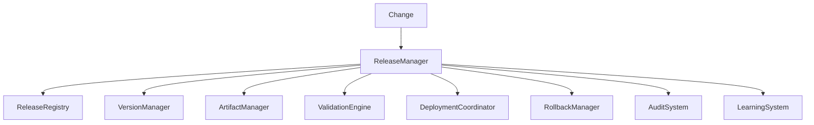

# RFC-0046

**Title:** Release Management System

**Document ID:** RFC-0046

**Version:** 1.0

**Status:** Accepted

**Category:** Platform

**Layer:** Deployment / Governance / Evolution

**Target:**

```text
deployment/release_manager/
```

---

# Abstract

This RFC defines the SH-3 Release Management System.

The Release Management System provides the controlled delivery framework responsible for packaging, validating, approving, deploying, and maintaining released versions of SH-3 components, models, configurations, and capabilities.

The system manages:

- software releases
- model releases
- configuration releases
- capability releases
- policy releases
- autonomous evolution releases

The system enables:

- release planning
- version management
- artifact management
- validation control
- deployment coordination
- rollback support
- release learning

The Release Management System integrates with:

- Change Management System
- Deployment System
- Configuration System
- Plugin System
- Self Evolution System
- Risk Management System
- Compliance Management System
- Audit Management System
- Persistence System
- Learning System

This document is normative.

---

# Motivation

A continuously evolving autonomous system requires reliable release control.

Without Release Management:

- unverified changes may enter production
- version history becomes unclear
- rollback becomes difficult
- evolution cannot be controlled
- system stability decreases

The Release Management System provides a stable bridge between development and operation.

---

# Goals

The Release Management System SHALL provide:

- release lifecycle management
- artifact versioning
- validation workflow
- deployment coordination
- release traceability
- rollback capability

---

# Non-Goals

The Release Management System SHALL NOT:

- create arbitrary changes
- replace Change Management System
- replace Deployment System
- bypass compliance checks
- execute unsafe releases

Release Management delivers approved changes.

---

# Architecture



The Release Management System transforms validated changes into controlled releases.

---

# Design Principles

The Release Management System follows these principles.

---

## Stability First

Only validated releases SHALL proceed.

---

## Traceability

Every release SHALL have complete history.

---

## Reproducibility

A release SHALL be reproducible from stored artifacts.

---

## Verification Before Deployment

Releases SHALL be validated before activation.

---

## Controlled Evolution

Autonomous releases SHALL follow governance rules.

---

## Recovery Capability

Critical releases SHALL support rollback.

---

# Release Management Components

The system consists of:

| Component | Responsibility |
|-----------|----------------|
| ReleaseManager | Coordination |
| ReleaseRegistry | Release storage |
| VersionManager | Version control |
| ArtifactManager | Package management |
| ValidationEngine | Quality verification |
| DeploymentCoordinator | Deployment control |
| RollbackManager | Release recovery |
| ReleaseMonitor | Observation |
| LearningAdapter | Improvement |

---

# ReleaseManager

ReleaseManager coordinates the release lifecycle.

Responsibilities:

- release creation
- validation scheduling
- deployment coordination
- release state management

ReleaseManager does not directly modify running components.

---

# Release Context

Every release operation receives an immutable ReleaseContext.

A ReleaseContext contains:

| Field | Description |
|--------|-------------|
| release_id | Release identifier |
| source_change | Origin change |
| version | Release version |
| target | Deployment target |
| timestamp | Creation time |

---

# Release Model

A Release contains:

| Field | Description |
|--------|-------------|
| release_id | Identifier |
| version | Version number |
| artifacts | Included components |
| source | Origin |
| status | Lifecycle state |
| result | Outcome |

---

# Release Types

Supported categories:

| Type | Purpose |
|------|---------|
| Patch | Small correction |
| Minor | Feature addition |
| Major | Structural change |
| Model | AI model update |
| Configuration | Environment update |
| Evolution | Autonomous improvement |

---

# Release Lifecycle

Every release follows:

```text
Created

↓

Prepared

↓

Validated

↓

Approved

↓

Deployed

↓

Monitored

↓

Completed
```

---

# Release States

Supported states:

| State | Meaning |
|------|---------|
| Draft | Created |
| Building | Preparing artifacts |
| Testing | Validation |
| Approved | Ready |
| Deploying | Active deployment |
| Released | Completed |
| Failed | Error |
| RolledBack | Reverted |

---

# Release Registry

ReleaseRegistry stores:

- release metadata
- version history
- artifacts
- validation results
- deployment history

---

# Version Management

VersionManager controls:

- semantic versions
- model versions
- configuration versions
- compatibility information

---

# Version Model

```text
Major.Minor.Patch

Example:

3.2.1
```

---

# Artifact Management

ArtifactManager manages:

- packages
- models
- configurations
- plugins
- metadata

---

# Artifact Integrity

Artifacts SHALL support:

- checksum validation
- version identification
- dependency verification
- provenance tracking

---

# Release Validation

ValidationEngine verifies:

- functionality
- compatibility
- security
- performance
- compliance

---

# Validation Flow

```text
Release Artifact

↓

Integrity Check

↓

Test Execution

↓

Risk Evaluation

↓

Compliance Verification

↓

Release Decision
```

---

# Change Integration

Change Management provides:

- approved modifications
- change history
- impact analysis

---

# Deployment Integration

Deployment System provides:

- environment control
- rollout procedure
- execution management

---

# Risk Integration

Risk Management provides:

- release risk score
- predicted impact
- mitigation strategy

---

# Compliance Integration

Compliance Management verifies:

- governance requirements
- release rules
- approval conditions

---

# Audit Integration

Audit Management records:

- release creation
- validation
- approval
- deployment
- result

---

# Release Management Execution Model

The Release Management System transforms validated changes into controlled, reproducible, and observable releases.

The release lifecycle follows:


Each stage maintains a clear architectural responsibility.

---

# Release Control Loop

The Release Management System operates through continuous delivery governance.

```text
Change Approved

↓

Release Created

↓

Artifacts Prepared

↓

Validation Executed

↓

Deployment Started

↓

System Observed

↓

Release Confirmed

↓

Knowledge Updated
```

---

# Release Planning

ReleaseManager creates release plans.

A ReleasePlan contains:

| Field | Description |
|------|-------------|
| release_id | Target release |
| scope | Included changes |
| artifacts | Release contents |
| dependencies | Required components |
| schedule | Deployment timing |
| rollback_plan | Recovery strategy |

---

# Release Planning Factors

Planning considers:

- change priority
- system stability
- dependency status
- resource availability
- risk level
- compliance requirements

---

# Build Management

BuildManager prepares release artifacts.

Responsibilities:

- source collection
- artifact generation
- dependency resolution
- metadata creation

---

# Build Flow

```text
Source

↓

Compile / Package

↓

Dependency Check

↓

Artifact Creation

↓

Integrity Validation
```

---

# Artifact Provenance

Every artifact SHALL maintain:

- source reference
- build information
- version
- creator
- timestamp
- validation result

---

# Dependency Management

Release validation checks:

- required modules
- compatibility
- interface changes
- resource requirements

---

# Deployment Coordination

DeploymentCoordinator manages release activation.

Responsibilities:

- deployment scheduling
- rollout control
- environment validation
- deployment tracking

---

# Deployment Strategies

Supported strategies:

| Strategy | Description |
|---------|-------------|
| Immediate | Full deployment |
| Rolling | Gradual replacement |
| Canary | Limited release |
| Shadow | Parallel validation |

---

# Release Rollout Flow

```text
Deploy Initial Instance

↓

Observe

↓

Expand Deployment

↓

Verify

↓

Complete Rollout
```

---

# Release Validation Advanced Model

ValidationEngine performs multi-layer verification.

Validation layers:

```text
Artifact Validation

↓

Functional Validation

↓

Performance Validation

↓

Security Validation

↓

Compliance Validation

↓

Operational Validation
```

---

# Functional Validation

Checks:

- expected behavior
- interface compatibility
- capability availability

---

# Performance Validation

Checks:

- latency
- throughput
- resource usage
- stability

---

# Security Validation

Checks:

- permissions
- vulnerabilities
- integrity
- policy compliance

---

# Autonomous Release Validation

For self-generated releases:

Additional validation:

- simulation
- world model prediction
- risk evaluation
- rollback verification

---

# Rollback Strategy

RollbackManager provides release recovery.

Rollback requirements:

- previous stable version
- stored artifacts
- state compatibility
- recovery procedure

---

# Rollback Flow

```text
Release Failure

↓

Detect Impact

↓

Stop Rollout

↓

Restore Previous Version

↓

Verify Stability

↓

Record Result
```

---

# Release Monitoring

ReleaseMonitor observes active releases.

Monitoring targets:

- system health
- error rate
- performance
- behavior changes
- user impact

---

# Release Stabilization

After deployment:

```text
Observe

↓

Evaluate

↓

Confirm Stability

↓

Mark Released
```

---

# Release Audit

Audit records:

- release request
- artifacts
- validation results
- approval decisions
- deployment actions
- final outcome

---

# Release History

Release history provides:

- version lineage
- evolution tracking
- regression analysis
- improvement feedback

---

# Learning Integration

Learning System uses release data for:

- release risk prediction
- validation improvement
- deployment optimization

---

# Release Learning Pipeline

```text
Release History

↓

Outcome Analysis

↓

Success Pattern Extraction

↓

Model Update

↓

Future Release Improvement
```

---

# Memory Integration

Memory stores:

- successful releases
- failed deployments
- recovery patterns
- dependency knowledge

---

# Knowledge Integration

Knowledge System extracts:

- release procedures
- compatibility rules
- operational knowledge

---

# Optimizer Integration

Optimizer improves:

- release scheduling
- rollout strategy
- validation efficiency

---

# Self Evolution Integration

Self Evolution uses Release Management as the final safety gate.

Evolution release flow:

```text
Generated Improvement

↓

Change Management

↓

Risk Evaluation

↓

Compliance Validation

↓

Release Management

↓

Deployment

↓

Observation
```

---

# Autonomous Release Governance

SH-3 MAY create autonomous releases.

Requirements:

- validated change
- acceptable risk
- successful simulation
- verified rollback
- compliance approval

---

# Autonomous Release Levels

| Level | Capability |
|------|------------|
| L0 | Manual release |
| L1 | Automated preparation |
| L2 | Automated validation |
| L3 | Automated deployment |
| L4 | Autonomous release |

---

# Message Bus Integration

Release events include:

- ReleaseCreated
- ReleaseBuilt
- ReleaseValidated
- ReleaseApproved
- ReleaseDeployed
- ReleaseRolledBack
- ReleaseCompleted

---

# Persistence Integration

Persistence stores:

- release registry
- artifacts metadata
- validation results
- deployment history

---

# Observability Integration

Release telemetry includes:

- deployment duration
- validation latency
- rollback frequency
- release success rate

---

# Tracing

Release traces preserve:

- trace_id
- release_id
- artifact_id
- deployment_id
- validation_id

---

# Thread Model

The Release Management System supports concurrent:

- artifact processing
- validation
- deployment tracking
- monitoring

Release state transitions SHALL be synchronized.

The reference implementation shall be thread-safe.

---

# Metrics

The Release Management System exposes:

- release count
- successful releases
- failed releases
- rollback count
- deployment duration
- validation success rate
- autonomous release rate

---

# Performance Objectives

The Release Management System should optimize for:

- safe delivery
- reproducibility
- rapid validation
- reliable rollback
- autonomous evolution support

---

# Future Work

Potential future enhancements include:

- AI-driven release planning
- predictive deployment analysis
- autonomous rollout optimization
- self-validating artifacts
- fully autonomous continuous evolution delivery

These enhancements extend SH-3 continuous evolution while preserving operational stability.

---

# References

- SH-3 Architecture Specification v2.1
- RFC-0013 Capability System
- RFC-0014 Registry System
- RFC-0015 Scheduler System
- RFC-0016 Pipeline System
- RFC-0017 Configuration System
- RFC-0018 Security System
- RFC-0019 Observability System
- RFC-0020 Distributed Cluster System
- RFC-0021 Agent System
- RFC-0022 Knowledge System
- RFC-0023 World Model System
- RFC-0024 Cognitive Architecture System
- RFC-0025 Meta Controller System
- RFC-0026 Self Evolution System
- RFC-0027 Autonomous Learning System
- RFC-0028 Optimizer System
- RFC-0029 Self-Healing System
- RFC-0030 Persistence System
- RFC-0031 Deployment System
- RFC-0032 Plugin System
- RFC-0033 API Gateway System
- RFC-0034 Message Bus System
- RFC-0035 Workflow Engine System
- RFC-0036 Task Management System
- RFC-0037 Resource Management System
- RFC-0038 Policy Management System
- RFC-0039 Identity Management System
- RFC-0040 Session Management System
- RFC-0041 Audit Management System
- RFC-0042 Compliance Management System
- RFC-0043 Risk Management System
- RFC-0044 Incident Management System
- RFC-0045 Change Management System

---

# End of RFC-0046
