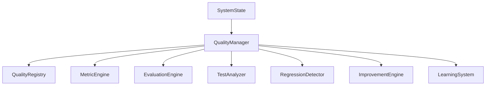
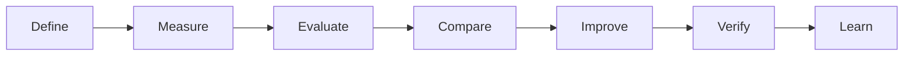

# RFC-0047

**Title:** Quality Management System

**Document ID:** RFC-0047

**Version:** 1.0

**Status:** Accepted

**Category:** Platform

**Layer:** Assurance / Optimization / Evolution

**Target:**

```text
assurance/quality_manager/
```

---

# Abstract

This RFC defines the SH-3 Quality Management System.

The Quality Management System provides the continuous assurance framework responsible for measuring, evaluating, maintaining, and improving the quality of SH-3 components, models, reasoning processes, operational behavior, and autonomous evolution results.

The system manages:

- software quality
- model quality
- reasoning quality
- decision quality
- operational quality
- evolution quality
- knowledge quality

The system enables:

- quality definition
- quality measurement
- quality evaluation
- regression detection
- improvement planning
- quality learning

The Quality Management System integrates with:

- Release Management System
- Change Management System
- Observability System
- Testing System
- Learning System
- Optimizer System
- Self Evolution System
- Audit Management System
- Compliance Management System
- Risk Management System

This document is normative.

---

# Motivation

An autonomous intelligence system must continuously maintain and improve its own quality.

Without Quality Management:

- degraded behavior may remain unnoticed
- model improvements cannot be verified
- regressions may accumulate
- evolution may reduce capability
- system reliability decreases over time

The Quality Management System provides continuous quality assurance.

---

# Goals

The Quality Management System SHALL provide:

- measurable quality standards
- continuous evaluation
- regression prevention
- improvement guidance
- quality history management
- autonomous quality optimization

---

# Non-Goals

The Quality Management System SHALL NOT:

- replace Testing System
- replace Observability System
- directly modify components
- define business objectives
- guarantee perfect behavior

Quality Management evaluates and improves quality.

---

# Architecture



The Quality Management System transforms system behavior into measurable quality intelligence.

---

# Design Principles

The Quality Management System follows these principles.

---

## Continuous Evaluation

Quality SHALL be measured continuously.

---

## Objective Measurement

Evaluation SHALL use measurable indicators.

---

## Improvement Oriented

Quality results SHOULD generate improvements.

---

## Regression Prevention

Previous capabilities SHALL be preserved.

---

## Explainability

Quality decisions SHALL provide reasons.

---

## Evolution Compatibility

Quality control SHALL support autonomous improvement.

---

# Quality Management Components

The system consists of:

| Component | Responsibility |
|-----------|----------------|
| QualityManager | Coordination |
| QualityRegistry | Quality data storage |
| MetricEngine | Measurement |
| EvaluationEngine | Assessment |
| TestAnalyzer | Test analysis |
| RegressionDetector | Regression detection |
| ImprovementEngine | Optimization |
| QualityMonitor | Observation |
| LearningAdapter | Improvement |

---

# QualityManager

QualityManager coordinates quality operations.

Responsibilities:

- quality evaluation
- metric management
- quality reporting
- improvement coordination

QualityManager does not directly change system behavior.

---

# Quality Context

Every quality evaluation receives an immutable QualityContext.

A QualityContext contains:

| Field | Description |
|--------|-------------|
| quality_id | Evaluation identifier |
| target | Evaluated object |
| metric_set | Applied metrics |
| timestamp | Evaluation time |
| version | Target version |

---

# Quality Model

A Quality record contains:

| Field | Description |
|--------|-------------|
| quality_id | Identifier |
| category | Quality type |
| score | Evaluation value |
| metrics | Measurement data |
| status | Quality state |

---

# Quality Categories

Supported categories:

| Type | Purpose |
|------|---------|
| Code | Implementation quality |
| Runtime | Operational quality |
| Model | AI model quality |
| Cognitive | Reasoning quality |
| Knowledge | Information quality |
| Decision | Planning quality |
| Evolution | Improvement quality |

---

# Quality Lifecycle

Every quality evaluation follows:

```text
Defined

↓

Measured

↓

Evaluated

↓

Compared

↓

Improved

↓

Verified
```

---

# Quality Registry

QualityRegistry stores:

- quality definitions
- evaluation history
- metric results
- improvement records

---

# Quality Metrics

Quality metrics measure:

- correctness
- reliability
- efficiency
- consistency
- adaptability

---

# Metric Model

A metric contains:

| Field | Description |
|--------|-------------|
| metric_id | Identifier |
| name | Metric name |
| target | Evaluation target |
| value | Measured value |
| threshold | Expected range |

---

# Quality Score Model

Example:

```text
Quality Score

=

Weighted Metric Result
```

---

# Software Quality

Software quality evaluates:

- maintainability
- reliability
- correctness
- performance
- stability

---

# Model Quality

Model quality evaluates:

- accuracy
- generalization
- confidence
- consistency
- hallucination rate

---

# Cognitive Quality

Cognitive quality evaluates:

- reasoning accuracy
- planning effectiveness
- decision consistency
- explanation quality

---

# Knowledge Quality

Knowledge quality evaluates:

- accuracy
- freshness
- relevance
- consistency

---

# Evolution Quality

Evolution quality evaluates:

- improvement gain
- regression impact
- stability
- safety

---

# Regression Detection

RegressionDetector identifies:

- capability loss
- performance degradation
- reasoning deterioration
- behavior changes

---

# Regression Model

```text
Previous Version

vs

Current Version

↓

Difference Analysis

↓

Regression Decision
```

---

# Release Integration

Release Management provides:

- version information
- deployment history
- release comparison

---

# Change Integration

Change Management provides:

- modification history
- expected impact
- change rationale

---

# Risk Integration

Risk Management provides:

- quality risks
- degradation prediction
- mitigation strategies

---

# Compliance Integration

Compliance Management verifies:

- quality requirements
- assurance standards
- governance rules

---

# Quality Management Execution Model

The Quality Management System transforms measurements, evaluations, and operational feedback into continuous quality improvement.

The quality lifecycle follows:



Each stage maintains a clear architectural responsibility.

---

# Quality Control Loop

The Quality Management System operates through continuous assurance.

```text
System Behavior

↓

Quality Measurement

↓

Quality Evaluation

↓

Deviation Detection

↓

Improvement Planning

↓

Change / Learning

↓

Quality Verification
```

---

# Quality Testing Framework

Quality testing validates SH-3 capabilities across multiple dimensions.

Testing targets:

- functionality
- reliability
- performance
- reasoning
- learning
- evolution

---

# Test Categories

| Category | Purpose |
|---------|---------|
| Unit Quality | Component correctness |
| Integration Quality | Interface consistency |
| System Quality | Overall behavior |
| Cognitive Quality | Reasoning evaluation |
| Evolution Quality | Improvement validation |

---

# Quality Evaluation Pipeline

```text
Target Component

↓

Test Execution

↓

Metric Collection

↓

Score Calculation

↓

Quality Decision
```

---

# Regression Management

RegressionDetector prevents capability degradation.

Regression targets:

- previous capabilities
- model performance
- reasoning ability
- operational stability

---

# Regression Detection Flow

```text
Previous State

+

Current State

↓

Comparison

↓

Difference Analysis

↓

Regression Classification
```

---

# Regression Types

| Type | Description |
|------|-------------|
| Functional | Feature loss |
| Performance | Speed reduction |
| Cognitive | Reasoning degradation |
| Knowledge | Information loss |
| Evolution | Improvement failure |

---

# Regression Response

When regression is detected:

```text
Detect Regression

↓

Analyze Cause

↓

Evaluate Impact

↓

Generate Improvement

or

Rollback
```

---

# Performance Quality

PerformanceQuality evaluates:

- latency
- throughput
- resource efficiency
- scalability

---

# Performance Metrics

Examples:

```text
Response Time

+

Processing Capacity

+

Resource Usage

=

Performance Quality
```

---

# Runtime Quality

Runtime quality evaluates:

- uptime
- stability
- error frequency
- recovery ability

---

# Model Quality Evaluation

ModelEvaluator analyzes:

- prediction accuracy
- confidence calibration
- output consistency
- safety behavior

---

# Model Evaluation Flow

```text
Input

↓

Model Output

↓

Reference Evaluation

↓

Quality Score

↓

Learning Feedback
```

---

# Cognitive Quality Evaluation

CognitiveEvaluator evaluates:

- planning quality
- reasoning quality
- decision quality
- explanation quality

---

# Reasoning Quality Model

```text
Problem

↓

Reasoning Process

↓

Decision

↓

Result

↓

Evaluation
```

---

# Decision Quality

DecisionQuality measures:

- goal achievement
- efficiency
- risk awareness
- consistency

---

# Knowledge Quality Improvement

Knowledge quality improves through:

- validation
- conflict detection
- freshness evaluation
- relevance ranking

---

# Quality Improvement Engine

ImprovementEngine generates optimization recommendations.

Responsibilities:

- identify weakness
- propose improvement
- estimate benefit
- verify result

---

# Improvement Loop

```text
Quality Issue

↓

Cause Analysis

↓

Improvement Proposal

↓

Change Management

↓

Release Management

↓

Quality Verification
```

---

# Autonomous Quality Optimization

SH-3 MAY optimize quality automatically.

Allowed actions:

- metric adjustment
- evaluation improvement
- optimization suggestion
- learning prioritization

---

# Autonomous Quality Boundary

```text
Low Risk Improvement

↓

Automatic Application


High Impact Improvement

↓

Governed Change Process
```

---

# Learning Integration

Learning System uses quality information for:

- reward improvement
- model refinement
- decision optimization

---

# Quality Learning Pipeline

```text
Quality History

↓

Pattern Analysis

↓

Improvement Discovery

↓

Model Update

↓

Future Quality Enhancement
```

---

# Memory Integration

Memory stores:

- quality history
- improvement results
- successful optimization patterns
- regression cases

---

# Knowledge Integration

Knowledge System extracts:

- quality rules
- evaluation methods
- improvement strategies

---

# Optimizer Integration

Optimizer improves:

- metric weighting
- evaluation efficiency
- optimization priority

---

# Self Evolution Integration

Quality Management acts as evolution evaluation.

Evolution validation:

```text
New Capability

↓

Quality Evaluation

↓

Regression Check

↓

Risk Assessment

↓

Release Approval
```

---

# Quality Governance

Quality governance ensures:

- measurable improvement
- regression prevention
- stable evolution
- explainable decisions

---

# Message Bus Integration

Quality events include:

- QualityEvaluationStarted
- QualityMeasured
- RegressionDetected
- ImprovementSuggested
- QualityImproved
- QualityVerified

---

# Persistence Integration

Persistence stores:

- metrics
- evaluation results
- regression history
- improvement records

---

# Observability Integration

Quality telemetry includes:

- quality scores
- metric trends
- regression frequency
- improvement success rate

---

# Tracing

Quality traces preserve:

- trace_id
- quality_id
- metric_id
- evaluation_id
- improvement_id

---

# Thread Model

The Quality Management System supports concurrent:

- metric collection
- evaluation
- regression detection
- improvement analysis

Quality state updates SHALL be synchronized.

The reference implementation shall be thread-safe.

---

# Metrics

The Quality Management System exposes:

- quality score
- regression count
- test success rate
- improvement rate
- evaluation latency
- model quality score
- cognitive quality score

---

# Performance Objectives

The Quality Management System should optimize for:

- accurate evaluation
- low evaluation overhead
- continuous improvement
- regression prevention
- autonomous quality growth

---

# Future Work

Potential future enhancements include:

- AI-based quality prediction
- autonomous test generation
- formal quality verification
- self-improving evaluation systems
- fully autonomous quality governance

These enhancements extend SH-3 self-improvement capabilities while maintaining reliability and safety.

---

# References

- SH-3 Architecture Specification v2.1
- RFC-0013 Capability System
- RFC-0014 Registry System
- RFC-0015 Scheduler System
- RFC-0016 Pipeline System
- RFC-0017 Configuration System
- RFC-0018 Security System
- RFC-0019 Observability System
- RFC-0020 Distributed Cluster System
- RFC-0021 Agent System
- RFC-0022 Knowledge System
- RFC-0023 World Model System
- RFC-0024 Cognitive Architecture System
- RFC-0025 Meta Controller System
- RFC-0026 Self Evolution System
- RFC-0027 Autonomous Learning System
- RFC-0028 Optimizer System
- RFC-0029 Self-Healing System
- RFC-0030 Persistence System
- RFC-0031 Deployment System
- RFC-0032 Plugin System
- RFC-0033 API Gateway System
- RFC-0034 Message Bus System
- RFC-0035 Workflow Engine System
- RFC-0036 Task Management System
- RFC-0037 Resource Management System
- RFC-0038 Policy Management System
- RFC-0039 Identity Management System
- RFC-0040 Session Management System
- RFC-0041 Audit Management System
- RFC-0042 Compliance Management System
- RFC-0043 Risk Management System
- RFC-0044 Incident Management System
- RFC-0045 Change Management System
- RFC-0046 Release Management System

---

# End of RFC-0047
