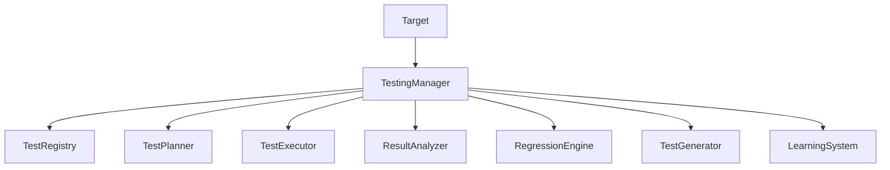
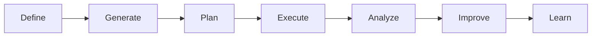

# RFC-0048

**Title:** Testing Management System

**Document ID:** RFC-0048

**Version:** 1.0

**Status:** Accepted

**Category:** Platform

**Layer:** Validation / Assurance / Evolution

**Target:**

```text
assurance/testing_manager/
```

---

# Abstract

This RFC defines the SH-3 Testing Management System.

The Testing Management System provides the unified validation framework responsible for designing, executing, analyzing, and improving tests across SH-3 components, models, reasoning systems, autonomous behaviors, and evolutionary processes.

The system manages:

- software tests
- integration tests
- system tests
- model tests
- cognitive tests
- safety tests
- evolution tests
- regression tests

The system enables:

- test definition
- test planning
- automated execution
- result analysis
- regression detection
- test generation
- validation learning

The Testing Management System integrates with:

- Quality Management System
- Release Management System
- Change Management System
- Deployment System
- Observability System
- Learning System
- Self Evolution System
- Risk Management System
- Compliance Management System
- Audit Management System

This document is normative.

---

# Motivation

An autonomous intelligence system requires continuous validation.

Traditional testing assumes fixed software behavior.

SH-3 requires validation of:

- changing code
- evolving models
- adaptive reasoning
- autonomous modifications
- generated capabilities

Without Testing Management:

- regressions may remain hidden
- unsafe evolution may occur
- quality cannot be measured
- autonomous improvement becomes unstable

The Testing Management System provides continuous verification.

---

# Goals

The Testing Management System SHALL provide:

- unified testing architecture
- automated test execution
- multi-layer validation
- regression prevention
- evolutionary verification
- test intelligence improvement

---

# Non-Goals

The Testing Management System SHALL NOT:

- replace Quality Management System
- replace Release Management System
- directly modify production components
- approve unsafe changes
- define system goals

Testing provides evidence.

---

# Architecture



The Testing Management System transforms system states into validation evidence.

---

# Design Principles

The Testing Management System follows these principles.

---

## Comprehensive Validation

All important changes SHOULD be testable.

---

## Automation First

Repeated validation SHOULD be automated.

---

## Evidence Based

Decisions SHALL use test results.

---

## Regression Prevention

Previous capabilities SHALL be protected.

---

## Evolution Compatibility

Tests SHALL adapt to system evolution.

---

## Continuous Improvement

Testing quality SHALL improve over time.

---

# Testing Management Components

The system consists of:

| Component | Responsibility |
|-----------|----------------|
| TestingManager | Coordination |
| TestRegistry | Test storage |
| TestPlanner | Planning |
| TestExecutor | Execution |
| EnvironmentManager | Test environment |
| ResultAnalyzer | Result evaluation |
| RegressionEngine | Regression detection |
| TestGenerator | Automatic generation |
| LearningAdapter | Improvement |

---

# TestingManager

TestingManager coordinates validation operations.

Responsibilities:

- test lifecycle
- execution scheduling
- result collection
- validation reporting

TestingManager does not modify tested targets.

---

# Test Context

Every test operation receives an immutable TestContext.

A TestContext contains:

| Field | Description |
|--------|-------------|
| test_id | Test identifier |
| target | Tested object |
| version | Target version |
| environment | Execution environment |
| timestamp | Execution time |

---

# Test Model

A Test contains:

| Field | Description |
|--------|-------------|
| test_id | Identifier |
| name | Test name |
| category | Test type |
| target | Tested component |
| expected | Expected result |
| status | Current state |

---

# Test Categories

Supported categories:

| Type | Purpose |
|------|---------|
| Unit | Component validation |
| Integration | Interface validation |
| System | Full system validation |
| Performance | Efficiency validation |
| Security | Protection validation |
| Model | AI model validation |
| Cognitive | Reasoning validation |
| Evolution | Self-change validation |

---

# Test Lifecycle

Every test follows:

```text
Defined

↓

Planned

↓

Prepared

↓

Executed

↓

Analyzed

↓

Stored

↓

Improved
```

---

# Test States

Supported states:

| State | Meaning |
|------|---------|
| Created | Test defined |
| Scheduled | Waiting execution |
| Running | Executing |
| Passed | Success |
| Failed | Failure |
| Blocked | Cannot execute |
| Archived | Historical |

---

# Test Registry

TestRegistry stores:

- test definitions
- execution history
- results
- coverage information

---

# Test Planning

TestPlanner determines:

- required tests
- execution order
- priority
- dependencies

---

# Test Planning Factors

Planning considers:

- change scope
- risk level
- affected components
- previous failures
- quality requirements

---

# Test Execution

TestExecutor performs:

- test preparation
- execution
- result collection
- cleanup

---

# Test Execution Flow

```text
Test Plan

↓

Environment Setup

↓

Execute Test

↓

Collect Result

↓

Analyze Outcome
```

---

# Environment Management

EnvironmentManager provides:

- isolated testing
- reproducible conditions
- simulation environment
- rollback support

---

# Unit Testing

Unit tests validate:

- functions
- classes
- modules
- internal logic

---

# Integration Testing

Integration tests validate:

- core interfaces
- data exchange
- dependency behavior

---

# System Testing

System tests validate:

- complete workflows
- autonomous behavior
- operational stability

---

# Model Testing

Model tests validate:

- output quality
- consistency
- safety
- performance

---

# Cognitive Testing

Cognitive tests validate:

- reasoning chains
- planning accuracy
- decision quality
- explanation capability

---

# Evolution Testing

Evolution tests validate:

- self-improvement changes
- generated capabilities
- adaptation safety

---

# Quality Integration

Quality Management receives:

- test results
- coverage data
- regression information

---

# Release Integration

Release Management uses:

- validation results
- approval evidence
- deployment confidence

---

# Change Integration

Change Management receives:

- test requirements
- validation status
- failure information

---

# Risk Integration

Risk Management receives:

- test failures
- uncertainty information
- regression indicators

---

# Testing Management Execution Model

The Testing Management System transforms system requirements, changes, and evolutionary processes into continuous validation intelligence.

The testing lifecycle follows:



Each stage maintains a clear architectural responsibility.

---

# Testing Control Loop

The Testing Management System operates through continuous verification.

```text
System Change

↓

Test Selection

↓

Test Execution

↓

Result Analysis

↓

Failure Detection

↓

Improvement

↓

Future Validation
```

---

# Automated Testing Framework

TestingManager provides automated validation across SH-3.

Automation targets:

- code changes
- configuration changes
- model updates
- capability additions
- autonomous evolution

---

# Automated Test Pipeline

```text
Change Event

↓

Test Discovery

↓

Environment Preparation

↓

Execution

↓

Analysis

↓

Report Generation
```

---

# Test Generation

TestGenerator creates tests from:

- requirements
- previous failures
- code structure
- behavior history
- knowledge base

---

# Automatic Test Generation Model

```text
System Knowledge

+

Change Information

+

Historical Failures

=

Generated Tests
```

---

# Test Generation Sources

Sources include:

- Change Management System
- Quality Management System
- Incident Management System
- Learning System

---

# Regression Testing

RegressionEngine verifies that changes do not reduce existing capabilities.

Regression targets:

- functionality
- performance
- reasoning
- knowledge
- autonomy

---

# Regression Testing Flow

```text
Previous Capability

↓

Current Capability

↓

Comparison Test

↓

Regression Decision
```

---

# Regression Protection

When regression is detected:

```text
Regression Found

↓

Analyze Cause

↓

Block Release

or

Generate Correction
```

---

# Performance Testing

Performance tests evaluate:

- response latency
- throughput
- resource efficiency
- scalability

---

# Performance Test Model

```text
Workload

↓

Execution

↓

Measurement

↓

Comparison

↓

Optimization
```

---

# Security Testing

Security testing validates:

- authentication
- authorization
- isolation
- data protection
- attack resistance

---

# Security Test Integration

Security System provides:

- threat information
- vulnerability patterns
- protection requirements

---

# Model Testing Advanced

Model testing evaluates AI behavior.

Targets:

- accuracy
- robustness
- consistency
- uncertainty handling
- safety behavior

---

# Model Test Pipeline

```text
Input Dataset

↓

Model Execution

↓

Output Evaluation

↓

Quality Score

↓

Learning Feedback
```

---

# Cognitive Testing Advanced

Cognitive tests evaluate SH-3 intelligence functions.

Evaluation targets:

- planning
- reasoning
- memory usage
- causal analysis
- decision quality

---

# Cognitive Test Example

```text
Goal

↓

Reasoning Process

↓

Plan

↓

Action

↓

Result Evaluation
```

---

# Evolution Testing Safety

EvolutionTesting validates autonomous improvements.

Validation targets:

- capability gain
- regression risk
- behavioral change
- safety impact

---

# Evolution Test Flow

```text
Evolution Proposal

↓

Simulation

↓

Validation

↓

Risk Evaluation

↓

Release Decision
```

---

# Autonomous Test Generation

SH-3 MAY generate validation procedures autonomously.

Requirements:

- reliable test generation model
- historical validation success
- quality verification

---

# Autonomous Testing Levels

| Level | Capability |
|------|------------|
| L0 | Manual tests |
| L1 | Automated execution |
| L2 | Automatic test selection |
| L3 | Automatic generation |
| L4 | Autonomous validation |

---

# Test Learning

Learning System improves testing capability.

Learning targets:

- test effectiveness
- failure prediction
- coverage optimization
- validation strategy

---

# Test Learning Pipeline

```text
Test History

↓

Failure Pattern Analysis

↓

Test Improvement

↓

Generation Model Update

↓

Better Validation
```

---

# Memory Integration

Memory stores:

- test cases
- failures
- successful validations
- regression patterns

---

# Knowledge Integration

Knowledge System extracts:

- testing strategies
- failure conditions
- validation rules

---

# Optimizer Integration

Optimizer improves:

- test scheduling
- execution efficiency
- coverage priority

---

# Self Evolution Integration

Testing Management becomes an evolution safety gate.

Evolution validation:

```text
New Capability

↓

Generated Tests

↓

Regression Testing

↓

Quality Evaluation

↓

Risk Assessment

↓

Release
```

---

# Incident Integration

Incident Management provides:

- failure cases
- reproduction scenarios
- recovery validation

---

# Compliance Integration

Compliance Management verifies:

- validation requirements
- testing evidence
- governance rules

---

# Message Bus Integration

Testing events include:

- TestCreated
- TestScheduled
- TestStarted
- TestCompleted
- TestFailed
- RegressionDetected
- TestImproved

---

# Persistence Integration

Persistence stores:

- test definitions
- execution history
- results
- generated tests

---

# Observability Integration

Testing telemetry includes:

- execution duration
- pass rate
- failure rate
- coverage
- regression frequency

---

# Tracing

Test traces preserve:

- trace_id
- test_id
- execution_id
- result_id
- failure_id

---

# Thread Model

The Testing Management System supports concurrent:

- test execution
- result analysis
- regression detection
- test generation

Test state transitions SHALL be synchronized.

The reference implementation shall be thread-safe.

---

# Metrics

The Testing Management System exposes:

- total tests
- pass rate
- failure rate
- regression count
- test coverage
- execution time
- autonomous test generation rate

---

# Performance Objectives

The Testing Management System should optimize for:

- fast validation
- high coverage
- accurate detection
- low execution cost
- continuous improvement

---

# Future Work

Potential future enhancements include:

- AI-generated validation environments
- formal verification integration
- predictive failure testing
- autonomous test evolution
- self-validating autonomous architecture

These enhancements extend SH-3 reliability while enabling safe continuous evolution.

---

# References

- SH-3 Architecture Specification v2.1
- RFC-0013 Capability System
- RFC-0014 Registry System
- RFC-0015 Scheduler System
- RFC-0016 Pipeline System
- RFC-0017 Configuration System
- RFC-0018 Security System
- RFC-0019 Observability System
- RFC-0020 Distributed Cluster System
- RFC-0021 Agent System
- RFC-0022 Knowledge System
- RFC-0023 World Model System
- RFC-0024 Cognitive Architecture System
- RFC-0025 Meta Controller System
- RFC-0026 Self Evolution System
- RFC-0027 Autonomous Learning System
- RFC-0028 Optimizer System
- RFC-0029 Self-Healing System
- RFC-0030 Persistence System
- RFC-0031 Deployment System
- RFC-0032 Plugin System
- RFC-0033 API Gateway System
- RFC-0034 Message Bus System
- RFC-0035 Workflow Engine System
- RFC-0036 Task Management System
- RFC-0037 Resource Management System
- RFC-0038 Policy Management System
- RFC-0039 Identity Management System
- RFC-0040 Session Management System
- RFC-0041 Audit Management System
- RFC-0042 Compliance Management System
- RFC-0043 Risk Management System
- RFC-0044 Incident Management System
- RFC-0045 Change Management System
- RFC-0046 Release Management System
- RFC-0047 Quality Management System

---

# End of RFC-0048
