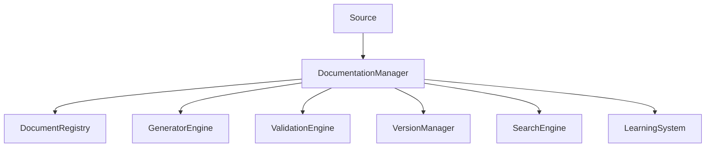

# RFC-0049

**Title:** Documentation Management System

**Document ID:** RFC-0049

**Version:** 1.0

**Status:** Accepted

**Category:** Platform

**Layer:** Knowledge / Governance / Maintainability

**Target:**

```text
knowledge/documentation_manager/
```

---

# Abstract

This RFC defines the SH-3 Documentation Management System.

The Documentation Management System provides the unified knowledge preservation framework responsible for creating, maintaining, validating, and evolving documentation across SH-3 components, architectures, APIs, operational procedures, decisions, and autonomous evolution history.

The system manages:

- architecture documentation
- API documentation
- module documentation
- operational documentation
- change documentation
- decision documentation
- learning documentation
- evolution documentation

The system enables:

- documentation lifecycle management
- automatic documentation generation
- documentation validation
- knowledge synchronization
- historical preservation
- documentation improvement

The Documentation Management System integrates with:

- Knowledge System
- Memory System
- Change Management System
- Release Management System
- Quality Management System
- Testing Management System
- Audit Management System
- Learning System
- Self Evolution System

This document is normative.

---

# Motivation

An autonomous intelligence system continuously changes.

Traditional documentation assumes human-maintained stability.

SH-3 requires documentation that evolves with:

- architecture changes
- capability expansion
- model updates
- reasoning improvements
- autonomous modifications

Without Documentation Management:

- system knowledge becomes outdated
- changes become difficult to understand
- debugging becomes inefficient
- evolution loses transparency

The Documentation Management System provides persistent system understanding.

---

# Goals

The Documentation Management System SHALL provide:

- centralized documentation control
- automatic synchronization
- version tracking
- validation capability
- historical preservation
- knowledge accessibility

---

# Non-Goals

The Documentation Management System SHALL NOT:

- replace source code
- replace Knowledge System
- replace Memory System
- decide system architecture
- authorize changes

Documentation records knowledge.

---

# Architecture



The Documentation Management System transforms system information into structured knowledge.

---

# Design Principles

The Documentation Management System follows these principles.

---

## Accuracy First

Documentation SHALL represent actual system state.

---

## Synchronization

Documentation SHOULD update with system changes.

---

## Traceability

Every document version SHALL be recoverable.

---

## Accessibility

Knowledge SHOULD be easily discoverable.

---

## Automation

Documentation generation SHOULD be automated.

---

## Evolution Compatibility

Documentation SHALL evolve with SH-3.

---

# Documentation Management Components

The system consists of:

| Component | Responsibility |
|-----------|----------------|
| DocumentationManager | Coordination |
| DocumentRegistry | Storage |
| GeneratorEngine | Creation |
| ValidationEngine | Verification |
| VersionManager | History |
| SearchEngine | Retrieval |
| Synchronizer | Update |
| LearningAdapter | Improvement |

---

# DocumentationManager

DocumentationManager coordinates documentation operations.

Responsibilities:

- document lifecycle
- generation control
- validation scheduling
- synchronization

DocumentationManager does not modify system implementation.

---

# Document Context

Every documentation operation receives an immutable DocumentContext.

A DocumentContext contains:

| Field | Description |
|--------|-------------|
| document_id | Document identifier |
| source | Origin |
| version | Document version |
| timestamp | Creation time |
| category | Document type |

---

# Document Model

A Document contains:

| Field | Description |
|------|-------------|
| document_id | Identifier |
| title | Document name |
| category | Type |
| content | Information |
| version | Revision |
| status | State |

---

# Documentation Categories

Supported categories:

| Type | Purpose |
|------|---------|
| Architecture | System design |
| API | Interface definition |
| Module | Component details |
| Operation | Procedures |
| Change | Modification history |
| Release | Delivery information |
| Learning | Improvement records |
| Evolution | Self-change history |

---

# Documentation Lifecycle

Every document follows:

```text
Created

↓

Reviewed

↓

Validated

↓

Published

↓

Updated

↓

Archived
```

---

# Document States

Supported states:

| State | Meaning |
|------|---------|
| Draft | Initial |
| Review | Validation |
| Approved | Accepted |
| Published | Active |
| Deprecated | Old |
| Archived | Stored |

---

# Document Registry

DocumentRegistry stores:

- documents
- versions
- relationships
- metadata
- validation results

---

# Version Management

VersionManager tracks:

- document revisions
- change history
- relationship changes
- release association

---

# Documentation Sources

Documentation may be generated from:

- source code
- configuration
- API definitions
- architecture models
- test results
- audit records
- learning records

---

# Automatic Documentation Generation

GeneratorEngine creates documentation from system information.

Generation targets:

- APIs
- modules
- interfaces
- configurations
- workflows
- decisions

---

# Generation Flow

```text
System Information

↓

Extraction

↓

Structure Analysis

↓

Document Generation

↓

Validation

↓

Publication
```

---

# API Documentation

API documentation includes:

- interfaces
- parameters
- data structures
- contracts
- examples

---

# Architecture Documentation

Architecture documentation includes:

- components
- dependencies
- data flow
- responsibilities
- design decisions

---

# Change Documentation

Change documentation includes:

- reason
- affected components
- implementation
- validation result
- deployment result

---

# Knowledge Integration

Knowledge System provides:

- semantic relationships
- retrieval
- concept linking

---

# Memory Integration

Memory System provides:

- historical context
- previous decisions
- operational experience

---

# Change Integration

Change Management provides:

- modification records
- impact information
- approval history

---

# Release Integration

Release Management provides:

- release versions
- artifact information
- deployment history

---

# Quality Integration

Quality Management provides:

- documentation quality evaluation
- consistency checks
- completeness metrics

---

# Documentation Management Execution Model

The Documentation Management System transforms system knowledge, operational history, and evolutionary changes into continuously updated and validated documentation.

The documentation lifecycle follows:


Each stage maintains a clear architectural responsibility.

---

# Documentation Control Loop

The Documentation Management System operates through continuous knowledge synchronization.

```text
System Change

↓

Information Extraction

↓

Documentation Update

↓

Validation

↓

Publication

↓

Knowledge Synchronization

↓

Future Improvement
```

---

# Documentation Validation

ValidationEngine ensures documentation accuracy.

Validation targets:

- technical correctness
- consistency
- completeness
- freshness
- relationship integrity

---

# Validation Model

```text
Document Content

+

Actual System State

↓

Comparison

↓

Validation Result
```

---

# Validation Types

| Type | Purpose |
|------|---------|
| Structural | Format validation |
| Technical | Implementation consistency |
| Semantic | Meaning consistency |
| Version | Revision correctness |
| Dependency | Relationship validation |

---

# Documentation Synchronization

Synchronizer maintains consistency between:

- source code
- configuration
- APIs
- architecture
- operational records

---

# Synchronization Flow

```text
System Event

↓

Detect Change

↓

Locate Related Documents

↓

Update Information

↓

Validate

↓

Publish Revision
```

---

# Event Sources

Synchronization receives events from:

- Change Management System
- Release Management System
- Testing Management System
- Quality Management System
- Self Evolution System

---

# Knowledge Graph Integration

Documentation is connected through a knowledge graph.

Relationship model:

```text
Component

↓

Interface

↓

Dependency

↓

Change

↓

Release

↓

Result
```

---

# Documentation Relationship Model

Supported relationships:

| Relationship | Meaning |
|-------------|---------|
| depends_on | Dependency |
| implements | Implementation |
| changed_by | Modification |
| validated_by | Verification |
| released_by | Delivery |

---

# Search Integration

SearchEngine provides:

- semantic search
- keyword search
- relationship search
- historical search

---

# Documentation Retrieval Model

```text
Query

↓

Document Search

↓

Relationship Expansion

↓

Context Generation

↓

Result
```

---

# Auto Update Pipeline

Documentation updates follow:

```text
Change Event

↓

Impact Analysis

↓

Document Discovery

↓

Content Generation

↓

Validation

↓

Version Creation
```

---

# Documentation Learning

Learning System improves documentation quality.

Learning targets:

- generation accuracy
- information completeness
- retrieval efficiency
- update timing

---

# Learning Pipeline

```text
Documentation History

↓

Usage Analysis

↓

Quality Evaluation

↓

Generation Improvement

↓

Better Documentation
```

---

# Memory Integration

Memory stores:

- documentation history
- design decisions
- operational experiences
- previous explanations

---

# Knowledge Integration

Knowledge System uses documentation for:

- semantic understanding
- system reasoning
- architecture awareness

---

# Quality Integration

Quality Management evaluates:

- accuracy
- completeness
- usefulness
- freshness

---

# Testing Integration

Testing Management validates:

- API examples
- configuration examples
- operational procedures

---

# Audit Integration

Audit records:

- document creation
- changes
- approval
- publication

---

# Autonomous Documentation Generation

SH-3 MAY generate documentation autonomously.

Generation targets:

- new modules
- new APIs
- architecture changes
- learning results
- evolution history

---

# Autonomous Documentation Requirements

Required conditions:

- reliable information source
- validated generation process
- quality verification
- version tracking

---

# Self-Documenting Architecture

SH-3 supports self-documentation.

Flow:

```text
System Observation

↓

Knowledge Extraction

↓

Documentation Generation

↓

Validation

↓

Documentation Update
```

---

# Documentation Governance

Governance ensures:

- authoritative information
- controlled revisions
- historical preservation
- transparent evolution

---

# Documentation Lifecycle Governance

```text
Create

↓

Review

↓

Validate

↓

Publish

↓

Monitor

↓

Retire
```

---

# Release Integration

Release Management uses documentation for:

- release notes
- migration information
- compatibility information

---

# Change Integration

Change Management uses documentation for:

- impact analysis
- modification explanation
- decision history

---

# Incident Integration

Incident Management uses documentation for:

- troubleshooting
- recovery procedures
- failure knowledge

---

# Message Bus Integration

Documentation events include:

- DocumentCreated
- DocumentUpdated
- DocumentValidated
- DocumentPublished
- DocumentArchived
- DocumentationImproved

---

# Persistence Integration

Persistence stores:

- document versions
- relationships
- generated content
- validation history

---

# Observability Integration

Documentation telemetry includes:

- update frequency
- validation results
- retrieval usage
- freshness score

---

# Tracing

Documentation traces preserve:

- trace_id
- document_id
- source_event
- generation_id
- validation_id

---

# Thread Model

The Documentation Management System supports concurrent:

- generation
- validation
- synchronization
- retrieval

Document state transitions SHALL be synchronized.

The reference implementation shall be thread-safe.

---

# Metrics

The Documentation Management System exposes:

- document count
- update frequency
- validation success rate
- documentation freshness
- retrieval accuracy
- autonomous generation rate

---

# Performance Objectives

The Documentation Management System should optimize for:

- accurate knowledge preservation
- rapid synchronization
- efficient retrieval
- low maintenance cost
- autonomous documentation growth

---

# Future Work

Potential future enhancements include:

- AI-generated architecture documentation
- automatic design explanation
- predictive documentation updates
- self-maintaining knowledge repositories
- fully autonomous self-documenting intelligence

These enhancements extend SH-3 knowledge continuity while preserving transparency and governance.

---

# References

- SH-3 Architecture Specification v2.1
- RFC-0013 Capability System
- RFC-0014 Registry System
- RFC-0015 Scheduler System
- RFC-0016 Pipeline System
- RFC-0017 Configuration System
- RFC-0018 Security System
- RFC-0019 Observability System
- RFC-0020 Distributed Cluster System
- RFC-0021 Agent System
- RFC-0022 Knowledge System
- RFC-0023 World Model System
- RFC-0024 Cognitive Architecture System
- RFC-0025 Meta Controller System
- RFC-0026 Self Evolution System
- RFC-0027 Autonomous Learning System
- RFC-0028 Optimizer System
- RFC-0029 Self-Healing System
- RFC-0030 Persistence System
- RFC-0031 Deployment System
- RFC-0032 Plugin System
- RFC-0033 API Gateway System
- RFC-0034 Message Bus System
- RFC-0035 Workflow Engine System
- RFC-0036 Task Management System
- RFC-0037 Resource Management System
- RFC-0038 Policy Management System
- RFC-0039 Identity Management System
- RFC-0040 Session Management System
- RFC-0041 Audit Management System
- RFC-0042 Compliance Management System
- RFC-0043 Risk Management System
- RFC-0044 Incident Management System
- RFC-0045 Change Management System
- RFC-0046 Release Management System
- RFC-0047 Quality Management System
- RFC-0048 Testing Management System

---

# End of RFC-0049
